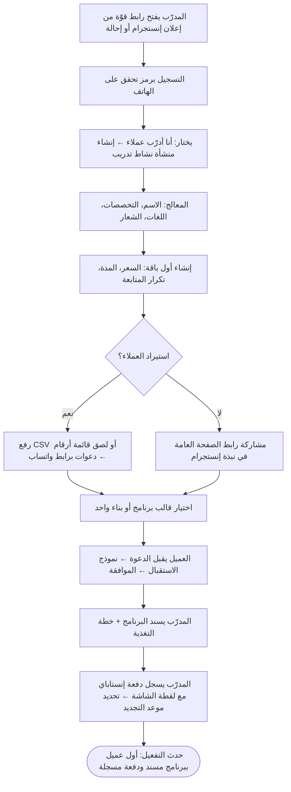
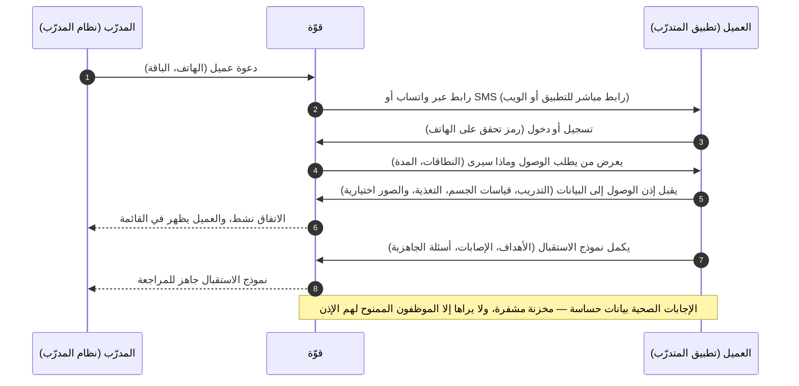
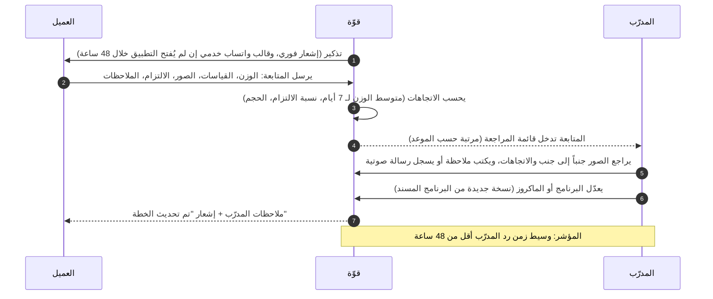
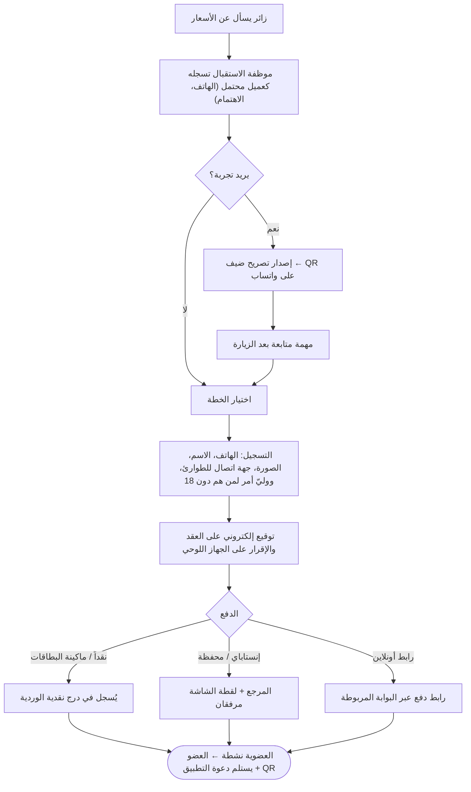
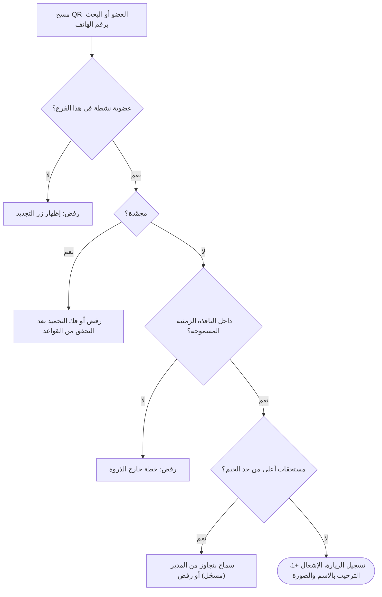
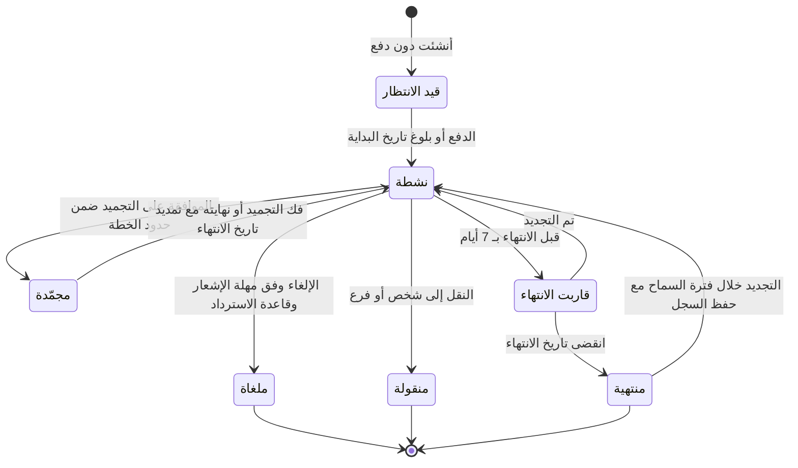
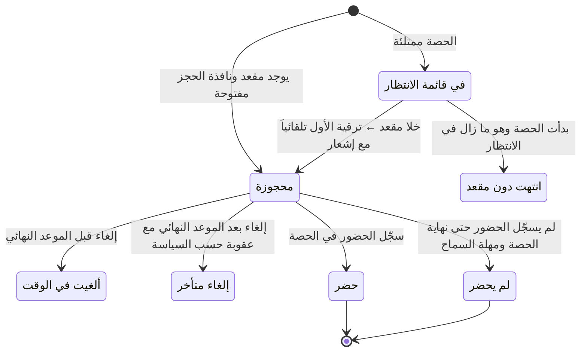
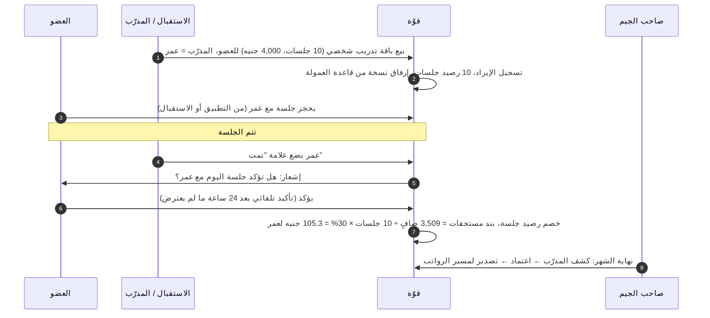
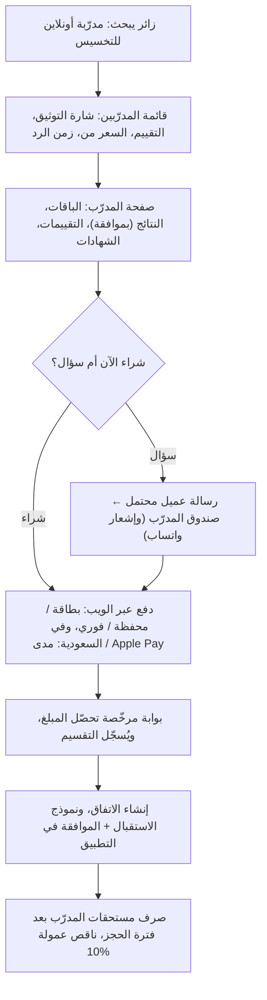
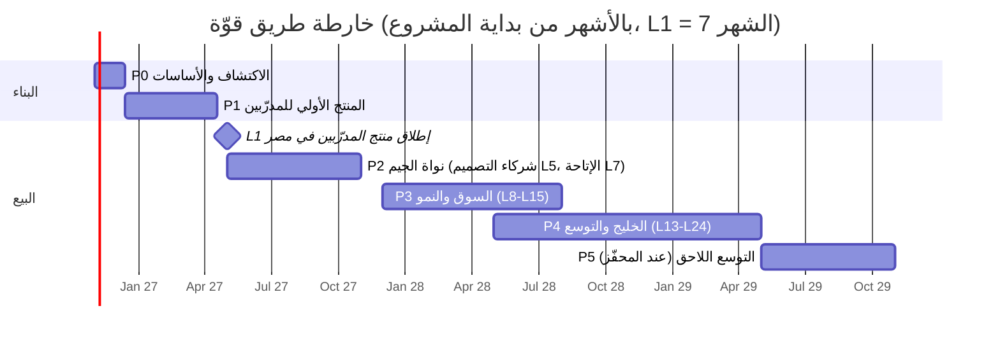

# قوّة — المخطط الشامل للمنتج والأعمال

**منظومة موحّدة للياقة البدنية والتدريب تخدم الجيمات والمدرّبين والمتدرّبين — البداية من مصر، ثم السعودية ودول الخليج**

| | |
|---|---|
| المستند | `PRODUCT_BUSINESS_BLUEPRINT.ar.md` (النسخة الإنجليزية: `PRODUCT_BUSINESS_BLUEPRINT.md`؛ المستند المرافق: `TECHNICAL_SYSTEM_ARCHITECTURE.ar.md`) |
| الإصدار / التاريخ | الإصدار 1.0 — 22 أكتوبر 2026 |
| الحالة | خط أساس للبحث والتخطيط. لا يتضمن أي كود. القرارات المعلَّمة بـ **[قرار]** مقترحة وتحتاج إلى اعتماد المؤسس (القسم 18). |
| العلامة | **قوّة (Qowa)**. النطاق `qowa.app`؛ الدعم `support@qowa.app` و`+20 155 544 0882`. **لم يتم التحقق بعد** من تسجيل العلامة التجارية (جهاز تنمية التجارة الداخلية في مصر، والهيئة السعودية للملكية الفكرية). |
| العملة | الجنيه المصري (EGP) ما لم يُذكر غير ذلك. التحويل إلى الدولار بسعر **52.5 جنيه/دولار** (أسعار البنوك كانت ≈52.7–52.8 في 13 أكتوبر 2026 [S21])؛ الريال السعودي مربوط عند 3.75 للدولار ← **14.0 جنيه/ريال**. |

### كيف تقرأ هذا المستند

كل عبارة مهمة تحمل أحد الوسوم التالية:

| الوسم | المعنى |
|---|---|
| **[حقيقة]** | تم التحقق منها من مصدر مذكور (أرقام المصادر `[Sxx]` مدرجة في الملحق (أ) مع تواريخها). معظم المصادر تم الوصول إليها عبر البحث على الويب في 22 أكتوبر 2026؛ صفحات الموردين تعبّر عن ادعاءاتهم الذاتية. |
| **[ادعاء المورّد]** | ما تقوله الشركة عن نفسها؛ غير متحقَّق منه بشكل مستقل. |
| **[افتراض]** | مُدخل عمل اخترناه. تغييره يغيّر الأرقام المبنية عليه. |
| **[تقدير]** | رقم محسوب من الافتراضات (مع عرض طريقة الحساب). |
| **[توصية]** / **[قرار]** | الاختيار الذي نقترحه مع سببه. |
| **[يحتاج تحقق]** | يجب تأكيده (قانونياً أو في الأسعار أو في قدرات المورّد) قبل أن يتحول إلى التزام. |

حدود البحث: لم يكن من الممكن فتح الموقع المرجعي `supercoach.me` ومعظم صفحات أسعار الموردين مباشرةً من بيئة البحث (حجب DNS/الاتصال الخارجي)؛ المعلومات عنها مأخوذة من النسخ المفهرسة في محركات البحث ومن مدونات الموردين وصفحات متاجر التطبيقات. اعتبر كل أسعار المنافسين إرشادية وأعد التحقق منها قبل استخدامها في مواد البيع.

---

## جدول المحتويات

0. المصطلحات المشتركة
1. الملخص التنفيذي ورؤية المنتج
2. أبحاث السوق وتحليل المنافسين
3. شخصيات العملاء والمهام المطلوب إنجازها
4. القائمة الكاملة للوظائف
5. مصفوفة القدرات حسب الوحدة والدور
6. رحلات المستخدمين ومسارات العمل التشغيلية
7. باقات SaaS والحزم والاستحقاقات
8. استراتيجية الاشتراكات والإيرادات
9. نموذج السوق والعمولات
10. مسارات العمل في الجيمات ومع المدرّبين
11. توصيات التسعير
12. التوقعات المالية واقتصاديات الوحدة
13. تعريف المنتج الأولي (MVP) وخارطة الطريق
14. التميّز والتموضع
15. استراتيجية الدخول إلى السوق
16. مخاطر الأعمال وطرق الحد منها
17. مؤشرات الأداء ومعايير النجاح
18. القرارات والافتراضات والأسئلة المفتوحة
- الملحق (أ) — المصادر
- الملحق (ب) — مدخلات النموذج المالي

---

## 0. المصطلحات المشتركة

يستخدم المستندان هذه المصطلحات بالمعنى نفسه. يربط المستند التقني كل مصطلح بالجداول والخدمات (المستند التقني، القسمان 5 و8).

| المصطلح | المعنى |
|---|---|
| **الشخص (Person)** | إنسان واحد بحساب دخول واحد. يمكن للشخص نفسه أن يكون متدرّباً ومدرّباً وصاحب جيم وموظف استقبال في الوقت نفسه. |
| **المساحة الشخصية (Personal Space)** | مساحة العمل الخاصة التي يحصل عليها كل شخص مجاناً. يملك فيها تمارينه وقياسات جسمه ومذكرات تغذيته وصور تقدّمه وإجاباته الصحية — بغض النظر عمّن ساعد في إنشائها. |
| **المنشأة (Organization / Org)** | مستأجر تجاري (Tenant). نوعها `gym` (جيم) أو `coaching_business` (نشاط تدريب). المدرّب الأونلاين المستقل هو نشاط تدريب فيه موظف واحد. |
| **الفرع (Branch)** | موقع فعلي لمنشأة من نوع جيم. نشاط التدريب له فرع افتراضي واحد. |
| **تعيين الموظف (Staff Assignment)** | دور الشخص داخل منشأة (مالك، مدير، مدير فرع، موظف استقبال، مدرّب، أخصائي تغذية، مبيعات)، ويمكن قصره على فروع معيّنة. |
| **علاقة العميل (Client Relationship)** | الشخص بصفته عميلاً لمنشأة. نوعان: **عضوية الجيم (Gym Membership)** وهي عقد لاستخدام الجيم، و**اتفاق التدريب (Coaching Engagement)** وهو عمل العميل مع مدرّب ضمن باقة. |
| **إذن الوصول إلى البيانات (Data Access Grant)** | إذن بموافقة الشخص، محدد النطاق والمدة وقابل للإلغاء، يسمح لمنشأة (وللموظفين المكلّفين بهذا العميل) بقراءة أجزاء من المساحة الشخصية أو الكتابة فيها. |
| **اشتراك المنصة (Platform Subscription)** | ما يدفعه الشخص أو المنشأة لمنصة *قوّة*: Trainee Plus، وCoach Starter/Pro/Team، وGym Essentials/Growth/Pro. |
| **الاستحقاق (Entitlement)** | ميزة أو حد مسموح به لشخص أو منشأة، يُحسب من اشتراكات المنصة إضافةً إلى الاستحقاقات المقدَّمة برعاية المنشآت. |
| **استحقاق برعاية المنشأة (Sponsored Entitlement)** | ميزة تمنحها المنشأة لعملائها (مثلاً: عملاء المدرّب يحصلون على تسجيل كامل للتمارين، وأعضاء الجيم يحصلون على تطبيق الأعضاء). |
| **العرض (Offering)** | ما تبيعه المنشأة لعملائها: خطط العضوية، باقات الحصص، باقات التدريب الشخصي، باقات التدريب، المنتجات، البرامج الرقمية. |
| **تحصيل المنشأة (Merchant Collection)** | الأموال التي تحصّلها المنشأة من عملائها. ثلاثة أنماط: **مُسجَّل (Recorded)** أي نقداً/إنستاباي/ماكينة الدفع خارج المنصة مع تسجيله فيها، و**بوابة مربوطة (Connected Gateway)** أي حساب بوابة الدفع الخاص بالمنشأة، و**دفع المنصة (Platform Checkout)** أي صفحة دفع تديرها قوّة مع تقسيم المبلغ والتحويل للبائع، وهي للسوق فقط (المرحلة 3). |
| **السوق (Marketplace)** | الاكتشاف العام: الصفحات العامة، والعروض المنشورة، والتقييمات، ودفع المنصة. |
| **قالب البرنامج / البرنامج المُسنَد (Program Template / Assigned Program)** | الخطة التي يعيد المدرّب استخدامها (ملكية فكرية للمنشأة)، مقابل النسخة التي تُسلَّم للعميل (تعيش في مساحته الشخصية مع بيان مصدرها). |
| **المتابعة الدورية (Progress Check-in)** | طقس التدريب المعتاد (نموذج أسبوعي، وزن، صور، ملاحظات المدرّب). لا تخلط بينها وبين **زيارة الجيم (Gym Visit)** أي تسجيل الدخول على الباب والحضور. |
| **الجلسة (Session)** | موعد محجوز: **جلسة تدريب شخصي (PT Session)** فردية، أو **حصة جماعية (Class Session)** وهي تكرار واحد من حصة جماعية، أو **استشارة (Consult)** عبر الإنترنت. |
| **قاعدة العمولة / مستحقات المدرّب / الصرف (Commission Rule / Trainer Earnings / Payout)** | طريقة احتساب أجر المدرّب لكل جلسة أو عملية بيع، وبنود الكشف الناتجة، والتحويل المالي الفعلي. |
| **شهر الإطلاق L1** | أول شهر يُباع فيه منتج المدرّبين الأولي. خارطة الطريق والتوقعات تعدّ الشهور من هنا (L1…L24). مرحلة البناء التي تسبقه هي P0 وP1 (≈ 6 أشهر). |

---

## 1. الملخص التنفيذي ورؤية المنتج

### 1.1 الرؤية

*كل متدرّب يتحدث العربية يحصل على سجل تدريب يمتلكه مدى الحياة؛ وكل مدرّب وجيم يحصل على الأدوات التي يدير بها عمله وينمّيه حول هذا السجل.*

معظم المنتجات في هذا المجال تختار عميلاً واحداً: برامج إدارة الجيمات (الاستقبال، العقود، نقاط البيع)، أو برامج المدرّبين (البرامج، المتابعات، المحادثة)، أو تطبيقات المستهلكين (تسجيل التمارين، السعرات). في مصر والخليج تتداخل هذه الثلاثة في الحياة اليومية: عضو يتمرّن في جيم، ويشتري جلسات تدريب شخصي من مدرّب مستقل يستأجر وقتاً على أرضية الجيم، ويتبع خطة تغذية من مدرّب على إنستجرام، ويسجّل تمارينه في تطبيق منفصل. البيانات مبعثرة بين محادثات واتساب وملفات PDF وجداول البيانات، ويفقدها المتدرّب في كل مرة يغيّر فيها المدرّب أو الجيم.

تجمع *قوّة* هذه العناصر الثلاثة حول فكرة واحدة: **المتدرّب يملك مساحته الشخصية؛ والمنشآت تحصل على وصول محدد النطاق وبموافقته طالما تخدمه.** هذه القاعدة الواحدة تحسم معظم الأسئلة الصعبة — ملكية البيانات، وتغيير المدرّب، وترك الجيم، وقانون حماية البيانات، والثقة في السوق — وهي أهم ما يميّز المنتج (القسم 14).

### 1.2 ما نوصي ببنائه، وبأي ترتيب

| # | التوصية | السبب |
|---|---|---|
| 1 | **[قرار] السوق الأولى = المدرّبون المستقلون الأونلاين في مصر** (نظام المدرّب + تطبيق المتدرّب)، مع الإطلاق بعد ≈ 6 أشهر من البناء. | بيع ذاتي، ودورة بيع قصيرة، وكل مدرّب يدفع يُدخل 10–50 متدرّباً إلى التطبيق (عرض وطلب للمراحل اللاحقة). دورة البيع للجيمات أطول وتحتاج عمقاً في الاستقبال ونقاط البيع والعقود لا يلزم لإثبات الفكرة الأساسية. |
| 2 | **نظام الجيم من الشهر L7** (شركاء تصميم من L5): العضويات، تسجيل الدخول بكود QR في الاستقبال، الحصص، باقات التدريب الشخصي وعمولات المدرّبين، نقطة بيع مبسّطة، تذكيرات واتساب. | إيراد أعلى لكل عميل (≈ 2,400 جنيه شهرياً مقابل ≈ 650 للمدرّب) وتسرّب أقل؛ ويعيد استخدام تطبيق المتدرّب كتطبيق للأعضاء. مدخلنا هو **نشاط التدريب الشخصي داخل الجيم** (مدرّبون داخليون ومستقلون)، وهو ما تتعامل معه أدوات الجيمات المحلية بشكل ضعيف. |
| 3 | **السوق من الشهر L10**، بعد وجود ≥ 300 مدرّب لهم صفحات عامة في القاهرة الكبرى والإسكندرية. | السوق بلا عرض يفشل. العرض يأتي نتيجةً طبيعية للخطوتين 1 و2. |
| 4 | **السعودية من الشهر L16** عبر شريك قنوات، بأسعار بالريال، ومدى/Apple Pay عبر بوابة سعودية، وفواتير متوافقة مع هيئة الزكاة والضريبة والجمارك (ZATCA). | الإيراد لكل عميل في السعودية ≈ 2–3 أضعاف مصر؛ والمنتج والمحتوى العربي ينتقلان كما هما. التوقيت يراعي منطقة AWS المخطط لها في السعودية (المستهدفة ديسمبر 2026 [S36]) والعمل القانوني. |
| 5 | **اشتراك Trainee Plus للمستهلكين قناةٌ لجذب المستخدمين وليس مصدر إيراد رئيسياً.** | الاستعداد للدفع مقابل التتبّع الذاتي في مصر منخفض. في السيناريو الأساسي يمثل Plus ≈ 1% من إيراد الشهر L24؛ مهمته إبقاء العملاء السابقين والمستخدمين العضويين داخل المنظومة. |
| 6 | **الذكاء الاصطناعي والأجهزة القابلة للارتداء والفيديو والعلامة البيضاء لاحقاً (المراحل 3–5)**، ولكل منها محفّز واضح (القسم 13.4). | تضيف تكلفة ومخاطرة دون أن تثبت جوهر المنتج. الذكاء الاصطناعي لدى المنافسين هو في الغالب "مسودة تمرين" [S54]. |

### 1.3 نموذج العمل في جدول واحد

| مصدر الإيراد | من يدفع | البداية | الحصة من إيراد L24 (السيناريو الأساسي) |
|---|---|---|---|
| اشتراكات المدرّبين (مصر) | أنشطة التدريب | L1 | 42% |
| اشتراكات الجيمات (مصر) | الجيمات | L7 | 27% |
| المدرّبون والجيمات في السعودية | المنشآت السعودية | L16 | 23% |
| عمولة السوق (10% من المبيعات القادمة من السوق) | المدرّبون/الجيمات، تُخصم عند الصرف | L10 | 7% |
| Trainee Plus | المتدرّبون | L10 | 1% |

### 1.4 الأرقام الرئيسية (السيناريو الأساسي، كلها **[تقدير]**، التفاصيل في القسم 12)

| المؤشر | L12 | L24 |
|---|---|---|
| المدرّبون الدافعون (مصر + السعودية) | ≈ 296 | ≈ 992 |
| الجيمات الدافعة (مصر + السعودية) | ≈ 29 | ≈ 183 |
| المستخدمون النشطون شهرياً (كل التطبيقات) | ≈ 12 ألف | ≈ 55 ألف |
| صافي الإيراد الشهري (بعد ضريبة القيمة المضافة) | ≈ 245 ألف جنيه (≈ 4.7 ألف دولار) | ≈ 1.23 مليون جنيه (≈ 23.4 ألف دولار) |
| معدل الإيراد السنوي المتكرر (ARR) | ≈ 56 ألف دولار | ≈ 281 ألف دولار |
| هامش الربح الإجمالي | ≈ 72% | ≈ 80% |
| الأرباح قبل الفوائد والضرائب والإهلاك (EBITDA) شهرياً | −386 ألف جنيه | +74 ألف جنيه (شهر التعادل ≈ L24) |
| أقصى احتياج نقدي شاملاً 6 أشهر بناء | — | ≈ 9.0 مليون جنيه (≈ 172 ألف دولار) |

**البديل المرشّد** (المؤسس يكتب الـ backend بنفسه، وفريق أصغر حتى L10) يصل إلى التعادل عند ≈ **L20** باحتياج نقدي أقصى ≈ **4.7 مليون جنيه (≈ 90 ألف دولار)**. السيناريو المتحفظ **لا** يصل إلى التعادل خلال 24 شهراً؛ ويحدد القسم 12.7 نقاط التوقف أو تغيير الاتجاه.

### 1.5 التقنية والبنية التحتية في فقرة واحدة

**تطبيق متكامل مقسّم إلى وحدات (Modular Monolith)** مبني على **Laravel 13 / PHP 8.4** مع **PostgreSQL** (على RDS)، و**Valkey** (على ElastiCache)، واتصالات WebSocket عبر **Laravel Reverb**؛ تطبيق ويب بـ **Nuxt 4** (تطبيق صفحة واحدة SPA للوحات التحكم، وصفحات عامة تُولَّد على الخادم لتحسين الظهور في محركات البحث)؛ تطبيق جوال واحد بـ **Flutter** بوضعين (متدرّب ومدرّب)؛ تشغيل على **ECS Fargate (معالجات ARM)** في **منطقة AWS eu-central-1 (فرانكفورت)**، مع CloudFront ونقطة التوزيع في القاهرة، ونسخ احتياطية إلى eu-south-1 (ميلانو). تبدأ تكلفة AWS للإنتاج عند **≈ 245 دولاراً شهرياً** وتصل إلى **≈ 1,000–1,200 دولار شهرياً** عند ≈ 30 ألف مستخدم نشط شهرياً (المستند التقني، القسم 15). **لا** نوصي بمناطق AWS الخليجية كاستضافة رئيسية في 2026: بعد الضربات في مارس–أبريل 2026 أعلنت AWS في سبتمبر أن الموارد المستضافة في منطقة البحرين وحدها لا يمكن استعادتها، كما فقدت منطقة الإمارات إحدى مناطق التوفر (Availability Zone) [S37]. استضافة بيانات المصريين خارج مصر تحتاج ترخيص نقل عبر الحدود من جهة حماية البيانات المصرية — وهو **اعتماد قانوني حاسم** (القسم 16، والمستند التقني القسم 16).

---

## 2. أبحاث السوق وتحليل المنافسين

### 2.1 مصر — السياق الذي يشكّل المنتج

| الموضوع | ما نعرفه | الأثر على المنتج |
|---|---|---|
| الجيمات | أدلة الأنشطة التجارية تحصي **≈ 8,000 "جيم"** (يوليو 2026) أو **≈ 10,000 جيم واستوديو** (مارس 2025) في مصر [S19] **[حقيقة، دقة منخفضة]**. لم نعثر على إحصاء رسمي للتراخيص. | السوق القابلة للخدمة لبرامج الجيمات بالآلاف. السيناريو الأساسي يصل إلى ≈ 158 جيماً مصرياً بحلول L24 (≈ 2% من عدد الأدلة). |
| أسعار الجيمات | الاشتراك الشهري في القاهرة من ≈ 750 إلى 5,000 جنيه؛ الاشتراك السنوي في Gold's Gym ‏6,500 جنيه؛ F45 من 4,000 إلى 5,000 جنيه شهرياً [S17] **[حقيقة، مصدر ثانوي]**. متوسط جيم في منطقة الأعمال ≈ 1,261 جنيهاً شهرياً (سبتمبر 2025) [S18]. | جيم متوسط بـ 400 عضو يحقق تقريباً 400–600 ألف جنيه شهرياً؛ فاتورة برمجيات بـ 1,000–2,000 جنيه شهرياً أقل من 0.5% من الإيراد. |
| التدريب الأونلاين | لم نجد قائمة أسعار منشورة وموثوقة بالجنيه **[فجوة]**. مدرّبو إنستجرام يبيعون عادةً باقات شهرية. **نفترض** 1,000–3,000 جنيه شهرياً للتدريب الأونلاين، ونستخدم 1,800 جنيه كمتوسط لطلب السوق (القسم 12). | يجب التحقق في مقابلات الاكتشاف (P0) قبل اعتماد الأسعار. |
| المدفوعات | السعر القياسي لـ Paymob للدفع الإلكتروني **2.75% + 3 جنيهات** دون رسوم شهرية [S23]؛ Apple Pay متاح منذ ديسمبر 2024 [S22]؛ إنستاباي منتشر في التحويلات من الأفراد إلى الأنشطة التجارية؛ المحافظ (فودافون كاش وغيرها) شائعة. الخصم المتكرر من البطاقات ممكن (اشتراكات Paymob) [S23] لكن كثيرين يدفعون بالتحويل. | يجب أن تدعم الفوترة **فترات مدفوعة مقدماً مع تذكيرات** كخيار افتراضي، والتجديد التلقائي كخيار، و**رفع إثبات تحويل إنستاباي يدوياً** مع موافقة الإدارة. |
| المراسلة | واتساب هو قناة الأعمال الافتراضية. تفرض Meta في مصر ≈ 0.0036–0.0054 دولار لكل رسالة خدمية (utility) و≈ 0.064–0.077 دولار لكل رسالة تسويقية؛ وردود خدمة العملاء تصبح مدفوعة بدءاً من 1 أكتوبر 2026 [S34] **[حقيقة، المصادر تختلف]**. | استخدم روابط `wa.me` المجانية للرسائل التي يبدأها الموظفون؛ واستخدم القوالب المدفوعة فقط للرسائل الخدمية الآلية (تذكير التجديد، تأكيد الحجز). وتُمرَّر الرسائل التسويقية بالتكلفة. |
| حماية البيانات | القانون 151 لسنة 2020 ولائحته التنفيذية (القرار 816 لسنة 2025، المنشور ≈ نوفمبر 2025، مع مهلة سنة حتى ≈ نوفمبر 2026) [S27]. **البيانات الصحية والبيومترية والمالية وبيانات الأطفال "حساسة"** [S28]. معالجة البيانات الحساسة ونقل البيانات إلى الخارج (بما في ذلك *تخزينها* في الخارج) يتطلبان تراخيص من مركز حماية البيانات الشخصية [S27][S29]. | مسارات الموافقة والتراخيص وتقليل البيانات متطلبات للإطلاق وليست تحسينات (القسم 16، والمستند التقني القسم 16). |
| الضرائب | ضريبة القيمة المضافة 14%. الإيصال الإلكتروني للمستهلكين يُطبّق على مراحل وفق قوائم ممولين محددة بالاسم (مثل القرار 361 بدءاً من 15 نوفمبر 2025) [S32]. | فواتير اشتراكاتنا يجب أن تتوافق مع منظومة مصلحة الضرائب (ETA) عندما نصبح ضمن النطاق؛ وقد تحتاج الجيمات إيصالات إلكترونية لمبيعاتها (تكامل في المرحلة 4 أو عبر شريك). |

### 2.2 السعودية — السياق

| الموضوع | ما نعرفه | الأثر |
|---|---|---|
| قائد السوق | شركة لجام (Fitness Time): **239 مركزاً (227 في السعودية) و468 ألف عضو** بنهاية 2025 [S20] **[حقيقة]**. | السلاسل الكبيرة تبني أنظمتها بنفسها؛ هدفنا في السعودية الجيمات المستقلة والاستوديوهات واستوديوهات التدريب الشخصي والمدرّبون الأونلاين. |
| دعم السياسات | رؤية 2030 تستهدف أن يكون 40% من السكان نشطين بدنياً بحلول 2030 (مصادر أقدم) [S20]. الجيمات النسائية مرخّصة منذ 2017. | الجيمات النسائية والمدرّبات شريحة مستقلة (فلاتر حسب الجنس، وإعدادات خصوصية افتراضية للصور). |
| المنافسون المحليون | أدوات الجيمات تبرز **رموز QR لفواتير ZATCA، ومدى، وApple Pay، وتابي/تمارا** [S14] **[ادعاء المورّد]**. | الفوترة الإلكترونية لـ ZATCA ومدى شرطان أساسيان لدخول السعودية. |
| المدفوعات | Stripe لا يدرج السعودية لإنشاء الحسابات (دليل ديسمبر 2025) [S25]؛ الخيارات الواقعية هي Moyasar (مرخّصة من البنك المركزي السعودي؛ مدى، Apple Pay، STC Pay، دفع متكرر يشمل مدى) وTap (مرخّصة في دول الخليج) [S26]. | طبقة تجريد لبوابات الدفع من اليوم الأول (المستند التقني، القسم 11). |
| البيانات | نظام حماية البيانات الشخصية السعودي نافذ؛ النقل للخارج مسموح بضمانات (بنود تعاقدية قياسية، تقييم مخاطر)؛ المصلحة المشروعة لا تغطي البيانات الحساسة (الصحية) [S30]. | موافقة صريحة على البيانات الصحية؛ توثيق ضمانات النقل؛ خلية استضافة سعودية اختيارية لاحقاً. |
| السحابة | منطقة AWS السعودية مستهدفة في **ديسمبر 2026** [S36]. | تتيح خلية استضافة سعودية في المرحلة 4 إذا طلبها عميل أو جهة تنظيمية. |

### 2.3 المنتج المرجعي: SuperCoach ‏(supercoach.me)

| الجانب | ما تم التحقق منه | المصدر |
|---|---|---|
| الشركة | من تطوير **ElCoach, Inc.**، شركة أُسست في القاهرة وكانت تدير تطبيقاً عربياً للمستهلكين (ElCoach، حصل على تمويل أولي في 2020 ويستهدف مصر والسعودية). | [S3][S4] **[حقيقة]** |
| المنتج | منصة SaaS للمدرّبين الشخصيين و"المنشآت الرياضية": لوحة تحكم للمدرّب + تطبيق جوال للمتدرّب؛ برامج تمارين مخصصة، خطط وجبات، متابعات وجدولة آلية، رسائل داخل التطبيق، إدارة عدة مدرّبين/فروع. | [S1][S2] **[ادعاء المورّد]** |
| السوق | تركيز على الشرق الأوسط، مصر والسعودية؛ واجهة عربية؛ iOS وAndroid والويب؛ "لا يلزم بطاقة ائتمان"، "عملاء غير محدودين". | [S1][S2] **[ادعاء المورّد]** |
| ادعاءات الحجم | "أكثر من 35,000 عميل في أكثر من 12 دولة". | [ادعاء المورّد]، غير متحقَّق |
| التسعير | من مقالات المورّد نفسه: **Essential بـ 19 دولاراً شهرياً (حتى 10 عملاء)، وGrowth من 45 دولاراً شهرياً (أكثر من 10 عملاء، ويرتفع مع عدد العملاء)، وElite+ بسعر خاص (أكثر من 1,000 عميل)**. المقالات غير متسقة. | [S1] **[ادعاء المورّد]** |
| ما لم نجده | ميزات استقبال الجيم (العقود، التجميد، التحكم في الأبواب، نقاط البيع)، سوق عام للمدرّبين مع دفع، قابلية نقل بيانات المتدرّب، اشتراك للمستهلكين. | **[افتراض — غياب الدليل ليس دليلاً على الغياب]**؛ يتم التحقق بحساب تجريبي في P0. |

**ما نتعلّمه منه:** فريق مصري أثبت بالفعل أن برمجيات التدريب العربية تُباع في مصر والسعودية وأن المدرّبين يدفعون أسعاراً معادلة للدولار. **أين نقطة ضعفه:** التسعير بالدولار (19–45 دولاراً ≈ 1,000–2,360 جنيهاً) ثقيل على الشريحة الواسعة من المدرّبين المصريين؛ وهو متمركز حول المدرّب (بيانات المتدرّب تتبع حساب المدرّب)؛ ولا يبدو أنه يملك نظام تشغيل الجيم أو سوقاً. تموضعنا (القسم 14) يستهدف هذه النقاط الثلاث تحديداً.

### 2.4 خريطة المنافسين

الأسعار بالدولار شهرياً ما لم يُذكر غير ذلك؛ وكلها من أطراف ثالثة أو من المورّدين، **[يحتاج تحقق]** قبل الاستخدام.

| المنتج | الشريحة | مؤشر السعر | نقاط القوة | الفجوات المهمة لنا | المصدر |
|---|---|---|---|---|---|
| **SuperCoach** | مدرّبون أونلاين في المنطقة، وبعض المنشآت | 19 دولاراً (10 عملاء)، 45+ | عربي، حضور في مصر والسعودية، تطبيقا مدرّب ومتدرّب | تشغيل الجيم، السوق، التسعير بالجنيه، ملكية المتدرّب لبياناته (غير متحقَّق) | [S1][S2] |
| **ElCoach** (للمستهلكين) | تدريب عربي للمستهلكين | 56 ريالاً شهرياً، 206 ريالات سنوياً (مواقع الكوبونات) | علامة معروفة في مصر والسعودية | للمستهلكين فقط؛ نموذج مختلف | [S3][S4] |
| **ABC Trainerize** | مدرّبون واستوديوهات عالمياً | مجاني (عميل واحد)، Pro من ≈ 22–23 دولاراً (5 عملاء)، Studio Plus ≈ 248 دولاراً للموقع؛ تطبيق بعلامة خاصة 169 دولاراً للإعداد؛ إضافات للتغذية والمدفوعات والفيديو | ناضج، تطبيقات بعلامة خاصة، تكاملات | إنجليزي أولاً، تراكم الإضافات، الدولار | [S5] |
| **TrueCoach** | مدرّبون عالمياً | ≈ 26–30 (5)، ≈ 58 (20)، ≈ 137 (50)؛ بلا باقة مجانية | بسيط ومحبوب لدى المدرّبين | تغذية محدودة، لا جيمات | [S6] |
| **Everfit** | مدرّبون/استوديوهات عالمياً | مجاني (5 عملاء)، Pro ≈ 19 (5) ← ≈ 290 (300)؛ إضافات للمدفوعات والأتمتة وخطط الوجبات | منشئ تمارين بالذكاء الاصطناعي، أتمتة | تكلفة الإضافات، إنجليزي أولاً | [S7][S54] |
| **Hevy Coach** | مدرّبون عملاؤهم يستخدمون Hevy | منخفض | تجربة تسجيل ممتازة | أدوات أعمال خفيفة | [S54] |
| **Mindbody** | استوديوهات/جيمات (أمريكا/عالمياً) | 99–139 ← 699 دولاراً + إضافات، عقود طويلة | سوق (تطبيق للمستهلكين)، مدفوعات | مكلف، غير معرَّب | [S9] |
| **ABC Glofox** | استوديوهات/جيمات متخصصة | 220–515 يورو شهرياً (صفحة 2026) | تطبيقات بعلامة خاصة، حجز الحصص | السعر، لا عربية | [S8] |
| **PushPress** | جيمات (نمط CrossFit) | باقة مجانية (رسوم معالجة أعلى)، 159، 229 دولاراً | دخول مجاني مقابل هامش المدفوعات | مدفوعات أمريكية | [S10] |
| **Gymdesk** | جيمات صغيرة/فنون قتالية | 75–200 دولاراً حسب الأعضاء | تسعير شفاف | لا عربية، لا مدفوعات للمنطقة | [S11] |
| **GymFlow** (مصر) | جيمات مصرية | "من ≈ 500 جنيه شهرياً" | عربي، حضور بـ QR، مسارات واتساب | لا تدريب أو سوق (حسب صفحة المورّد) | [S12] |
| **ArabGym** | جيمات المنطقة | تجربة 30 يوماً | عربي، السعودية/الإمارات/مصر | لا تدريب (حسب صفحة المورّد) | [S13] |
| **IDS Fitness / Gymsly / Easy Gym** | جيمات سعودية | بعرض سعر | QR فواتير ZATCA، مدى، الشراء الآن والدفع لاحقاً | لا تدريب أو سوق | [S14] |
| **Enhance Fitness وHeyTrainer وFitLov** | أسواق حجز مدرّبين شخصيين في الخليج | عمولة/باقات | توليد الطلب | ليست نظام تشغيل للأعمال؛ متمركزة في الإمارات | [S15][S16] |

### 2.5 الفجوات والفرص

1. **لا يوجد لاعب محلي يجمع تشغيل الجيم والتدريب وسجل المتدرّب الخاص** في منتج عربي أولاً (متحقَّق منه فقط بقدر ما تصف صفحات الموردين نطاقها).
2. **أرضية التدريب الشخصي في الجيم غير مُدارة.** الجيمات المصرية تستضيف عادةً مدرّبين مستقلين (رسوم أرضية، تقاسم إيراد) ومدرّبين داخليين بعمولة. احتساب أجور المدرّبين، ومنع الجلسات "خارج الدفاتر"، وإعطاء الجيم رؤية واضحة، آلام متكررة **[افتراض — يتم التحقق في P0 مع ≥ 15 جيماً]**.
3. **المدفوعات كما يدفع المصريون فعلاً**: تحويلات إنستاباي مع لقطات الشاشة، المحافظ، النقد في الاستقبال، روابط الدفع بالبطاقة. الأدوات العالمية تفترض بطاقة محفوظة وخصماً متكرراً.
4. **تغيير المدرّب وقابلية نقل البيانات**: المتدرّبون يفقدون تاريخهم عند ترك المدرّب؛ والمدرّبون يخشون فقدان العملاء لصالح الجيمات والعكس. قواعد بيانات واضحة ومتفق عليها (القسم 9.6) تقلل المخاوف من الطرفين.
5. **بيانات الأطعمة المحلية**: الأطباق المصرية والخليجية (الكشري، الفول، الملوخية، الكبسة) ضعيفة التغطية في قواعد بيانات الأطعمة العالمية **[افتراض]**. قائمة أطعمة محلية منسّقة ومراجَعة من أخصائي تغذية ميزة تتراكم قيمتها.
6. **السعر**: الأدوات المسعّرة بالدولار مكلفة للشريحة الواسعة في مصر؛ والتسعير بالجنيه مع باقة مجانية يكسب قاعدة القمع.

### 2.6 ما لم يستطع البحث إثباته (مفتوح)

- التوزيع الفعلي لأعداد عملاء المدرّبين المصريين وأسعارهم — **مقابلات P0 (30 مدرّباً)**.
- كم جيماً مصرياً يدفع حالياً مقابل برمجيات وكم يدفع — **مقابلات P0 (15 جيماً) + عروض GymFlow وArabGym**.
- العمق الفعلي لميزات SuperCoach للمنشآت وقابلية نقل البيانات — **حساب تجريبي في P0**.

---

## 3. شخصيات العملاء والمهام المطلوب إنجازها

| الرمز | الشخصية | السياق | المهام المطلوب إنجازها ("عندما …، أريد أن …، حتى …") | يدفع؟ |
|---|---|---|---|---|
| P-01 | **كريم، صاحب جيم مستقل** (مدينة نصر، فرع واحد، 450 عضواً، 6 موظفين، 4 مدرّبين مستقلين) | يعمل ببرنامج سطح مكتب + إكسل + واتساب؛ تسرّب نقدي في الاستقبال؛ لا يعرف أي المدرّبين يجلبون الإيراد | عندما تنتهي اشتراكات الأعضاء، أريد تذكيرهم وتجديدها دون أن تلاحقهم موظفة الاستقبال، حتى لا تعتمد السيولة على ذاكرتها. عندما يبيع المدرّبون جلسات تدريب شخصي، أريد تسجيل كل جلسة واحتساب حصة الجيم، حتى لا أُخدع. | Gym Growth |
| P-02 | **منى، مديرة عمليات سلسلة من 5 فروع** (القاهرة/الجيزة) | مديرو الفروع يرفعون تقاريرهم بطرق مختلفة؛ الأعضاء يريدون استخدام فروع أخرى | عندما أراجع الأسبوع، أريد أرقاماً قابلة للمقارنة لكل فرع ولكل مدرّب، حتى أتصرف مع ضعيفي الأداء. | Gym Pro |
| P-03 | **حسن، مدير فرع** | مسؤول عن الأهداف وجدول الموظفين وجدول الحصص | عندما تمتلئ حصة، أريد ترقية المنتظرين تلقائياً، حتى تكتمل الحصة وأتجنب الشكاوى. | (موظف) |
| P-04 | **سلمى، موظفة استقبال** | ضغط عالٍ في ساعات الذروة، تعمل على جهاز لوحي | عندما يصل العضو، أريد مسح كود QR الخاص به لأرى فوراً هل يُسمح له بالدخول (منتهٍ، مجمّد، عليه مستحقات)، حتى يستمر الطابور في الحركة. | (موظف) |
| P-05 | **عمر، مدرّب داخلي** (راتب + 30% عمولة تدريب شخصي) | يبيع باقات تدريب شخصي للأعضاء | عندما أنهي جلسة، أريد أن يؤكدها العميل بلمسة واحدة، حتى تُحتسب عمولتي وتختفي الخلافات. | (موظف) |
| P-06 | **يوسف، مدرّب مستقل يستأجر وقتاً في جيمين** + عملاء أونلاين | يدفع لكل جيم رسوماً شهرية أو رسوماً لكل جلسة | عندما أدير عملاء في جيمين وأونلاين، أريد جدولاً واحداً وقائمة عملاء واحدة، حتى لا أحجز مرتين وأحتفظ بعملائي إذا غيّرت الجيم. | Coach Pro (نشاطه الخاص) |
| P-07 | **نور، مدرّبة أونلاين** (40 ألف متابع على إنستجرام، 35 عميلة، عميلات سيدات) | واتساب + جداول جوجل + خطط وجبات PDF؛ تقضي أيام الأحد في المتابعات | عندما تصلني المتابعات الأسبوعية، أريدها في قائمة مراجعة واحدة مع الصور جنباً إلى جنب والاتجاهات، حتى أنتهي في ساعتين بدل ثماني. عندما يدفع العملاء بإنستاباي، أريد متابعة التجديدات، حتى أتوقف عن خسارة المال. | Coach Pro |
| P-08 | **أحمد، صاحب فريق تدريب** (4 مدرّبين، 150 عميلاً، عملاء في مصر والسعودية) | يحتاج لتوزيع العملاء ومشاركة القوالب وضبط الجودة | عندما يصل عميل محتمل، أريد توجيهه إلى المدرّب الذي لديه سعة، وأريد رؤية سرعة استجابة كل مدرّب ونسبة احتفاظه بالعملاء. | Coach Team |
| P-09 | **دينا، عضوة جيم** (28 عاماً، تتمرّن 4 مرات أسبوعياً) | عضوة في جيم واحد، وتتبع مدرّباً أونلاين للتغذية | عندما أتمرّن، أريد حجوزات حصص الجيم وبرنامج مدرّبي وسجلاتي في تطبيق واحد، حتى لا أتنقّل بين ثلاثة تطبيقات. | مجاني (برعاية) / Plus |
| P-10 | **مصطفى، يتمرّن ذاتياً** (22 عاماً، طالب، في المنزل وجيم عام) | حساس للسعر، يستخدم تطبيقات مجانية | عندما أتمرّن وحدي، أريد مسجّلاً مجانياً بالعربية مع الأطعمة المصرية، حتى أتابع تقدمي دون أن أدفع لمدرّب. | مجاني؛ ربما Plus |
| P-11 | **ريم، عميلة تدريب في الرياض** | تعمل مع مدرّب مصري أونلاين | عندما أدفع للتدريب، أريد الدفع بمدى/Apple Pay بالريال واستلام خطتي في التطبيق. | عميلة لدى مدرّب |
| P-12 | **زائر يبحث عن مدرّب** | يبحث عن "كوتش أونلاين للتخسيس" | عندما أختار مدرّباً، أريد شهادات موثّقة وتقييمات حقيقية وأسعار باقات واضحة، حتى لا أتعرض للاحتيال. | مشترٍ من السوق |
| P-13 | **موظف دعم المنصة** | يتعامل مع التهيئة وإثباتات الدفع والنزاعات | عندما يرفع مدرّب إثبات تحويل إنستاباي، أريد مطابقته مع الفاتورة في شاشة واحدة. | (داخلي) |
| P-14 | **وليّ أمر عضو عمره 15 عاماً** | عضوية قاصر | عندما ينضم ابني، أريد الموافقة على البيانات التي تُحفظ ورؤية حجوزاته. | يدفع للجيم |

---

## 4. القائمة الكاملة للوظائف

المراحل: **P1** المنتج الأولي للمدرّبين (حتى L1)، **P2** نواة الجيم (L2–L7)، **P3** السوق والنمو (L8–L15)، **P4** الخليج والتوسع (L13–L24)، **P5** التوسع اللاحق (بعد L24 أو عند تحقق المحفّز). محتوى المراحل ومعايير القبول: القسم 13 والمستند التقني القسم 21. عمود "القيمة" = السبب التجاري لوجود الميزة.

### 4.1 على مستوى المنصة (PLT)

| الرمز | الميزة | الأدوار | القيمة | المرحلة |
|---|---|---|---|---|
| PLT-01 | حساب واحد: رمز تحقق على الهاتف (واتساب/SMS)، بريد إلكتروني وكلمة مرور، الدخول بحساب Google وApple؛ التحقق بخطوتين (TOTP) إلزامي للملاك والمديرين | الجميع | هوية واحدة عبر الأدوار؛ أمان لبيانات المال والصحة | P1 |
| PLT-02 | مبدّل مساحات العمل (المساحة الشخصية ↔ كل منشأة للشخص فيها تعيين) | الجميع | الأشخاص متعددو الأدوار (مدرّب يتمرّن في جيم) | P1 |
| PLT-03 | العربية/الإنجليزية، من اليمين لليسار ومن اليسار لليمين، والأرقام اللاتينية افتراضياً للأرقام والتواريخ | الجميع | سهولة الاستخدام في مصر والسعودية | P1 |
| PLT-04 | مركز الإشعارات، الإشعارات الفورية، البريد؛ قوالب واتساب الخدمية؛ تفضيلات لكل مستخدم وساعات الهدوء | الجميع | التفاعل والاحتفاظ بالعملاء | P1 |
| PLT-05 | مركز الموافقات: عرض/قبول/إلغاء أذونات الوصول إلى البيانات لكل منشأة ونطاق | المتدرّب | الأساس القانوني + الثقة | P1 |
| PLT-06 | تصدير البيانات (JSON + ملخص PDF) وحذف الحساب وفق قواعد الاحتفاظ | المتدرّب | قابلية النقل، القانون | P1 (عند الطلب)، P2 (خدمة ذاتية) |
| PLT-07 | فوترة المنصة: الباقات، الفترات التجريبية، الفواتير (مع ضريبة القيمة المضافة)، البطاقة/المحفظة عبر Paymob، رفع إثبات إنستاباي + الموافقة، الكوبونات، رصيد الحساب | الملاك | الإيراد | P1 |
| PLT-08 | سجل عمليات المنشأة (من غيّر الأسعار، من ردّ مبلغاً، من حذف، من اطّلع على بيانات العملاء) | الملاك، المديرون | ضبط الاحتيال، المساءلة | P1 |
| PLT-09 | الملاحظات داخل التطبيق، مركز المساعدة (بالعربية)، تقارير الأخطاء من الواجهة | الجميع | الجودة | P1 |
| PLT-10 | لوحة إدارة المنصة: المنشآت، موافقات الفوترة، الإشراف على المحتوى، قائمة التحقق من الهوية، وصول الدعم بموافقة المنشأة مع التدقيق | فريق المنصة | العمليات | P1 |
| PLT-11 | برنامج الإحالة (مدرّب يدعو مدرّباً مقابل رصيد؛ متدرّب يدعو صديقاً) | المدرّبون، المتدرّبون | اكتساب منخفض التكلفة | P2 |
| PLT-12 | برنامج الشركاء/التسويق بالعمولة (عمولة على المنشآت الدافعة المحالة) | الشركاء | قناة السعودية، المؤثرون | P4 |
| PLT-13 | واجهة برمجية عامة (API) + Webhooks للمنشآت | السلاسل، المطوّرون | صفقات المؤسسات | P5 |
| PLT-14 | مفاتيح تشغيل الميزات لكل منشأة (المالك يشكّل المنتج) ومفاتيح إيقاف على مستوى المنصة | الملاك، المنصة | البساطة، الإطلاق الآمن | P1 |

### 4.2 الوحدة (ب) — نشاط المدرّب (COA)

| الرمز | الميزة | الأدوار | القيمة | المرحلة |
|---|---|---|---|---|
| COA-01 | معالج التهيئة: اسم النشاط، التخصصات، اللغات، العملة، أول باقة، لون/شعار العلامة | المدرّب | الوصول لأول عميل في أقل من 30 دقيقة | P1 |
| COA-02 | صفحة عامة للمدرّب (محسّنة لمحركات البحث، رابط/QR للمشاركة، الباقات، معرض النتائج بموافقة العملاء، "اطلب تدريباً" ← عميل محتمل + واتساب) | المدرّب، الزائر | اكتساب مجاني؛ يزرع بذور السوق | P1 |
| COA-03 | رفع الشهادات؛ تحقق يدوي ← شارة "موثّق" | المدرّب، المنصة | الثقة في السوق | P1 رفع، P3 الشارة |
| COA-04 | دعوة العملاء (رابط، QR، واتساب)، استيراد جماعي من CSV/Sheets | المدرّب | انتقال سريع | P1 |
| COA-05 | نماذج الاستقبال والتقييم (قوالب: الأهداف، تاريخ التدريب، الإصابات، استبيان الجاهزية، التفضيلات، الأطعمة غير المرغوبة)؛ أسئلة شرطية | المدرّب، العميل | التخصيص؛ فحص السلامة | P1 |
| COA-06 | مكتبة التمارين: ≈ 300 تمرين من المنصة (أسماء عربية/إنجليزية، إرشادات، العضلات، المعدات، فيديو توضيحي)؛ تمارين مخصصة بفيديو المدرّب | المدرّب | ميزة محتوى تنافسية | P1 |
| COA-07 | منشئ البرامج: مراحل/أسابيع/أيام، كتل، سوبر سِت/دوائر، مجموعات × تكرارات/زمن/مسافة، الحمل/% من 1RM/RPE/RIR، الإيقاع، الراحة، الملاحظات؛ مكتبة قوالب؛ نسخ وتعديل جماعي | المدرّب | القيمة الأساسية | P1 |
| COA-08 | إسناد البرامج بتاريخ بداية؛ قواعد تدرّج تلقائي بسيطة (+حمل/+تكرارات أسبوعياً) | المدرّب | توفير الوقت | P1 الإسناد، P2 التدرّج |
| COA-09 | التغذية: أهداف الماكروز والسعرات، خطط وجبات مع بدائل، قاعدة بيانات أطعمة محلية، وصفات، PDF قابل للطباعة | المدرّب، أخصائي التغذية | معظم المدرّبين يبيعون تدريباً + تغذية | P1 أساسي، P2 الوصفات/البدائل |
| COA-10 | المتابعات الدورية: نماذج مجدولة (الوزن، القياسات، الصور، الالتزام، النوم، التوتر)، قائمة مراجعة، مقارنة الصور جنباً إلى جنب، ملاحظات نصية/صوتية | المدرّب، العميل | أكبر مستهلك للوقت اليوم | P1 |
| COA-11 | ملف العميل الشامل 360°: الالتزام، حجم التدريب، الأرقام القياسية، اتجاه الوزن، الصور، الملاحظات، المدفوعات، موعد التجديد | المدرّب | الاحتفاظ بالعملاء | P1 |
| COA-12 | محادثة فردية: نص، صور، رسائل صوتية، فيديوهات قصيرة، إشعارات القراءة، ردود سريعة، مرفقات مرتبطة بالتمارين | المدرّب، العميل | بديل واتساب للتدريب | P1 |
| COA-13 | الباقات: السعر، المدة، المشمولات (برامج، تغذية، تكرار المتابعة، مكالمات)، التجديد، الإيقاف المؤقت | المدرّب | تحقيق الدخل | P1 |
| COA-14 | متابعة المدفوعات (النمط المسجَّل): تسجيل مدفوعات النقد/إنستاباي/المحافظ مع الإثبات، الإيصالات، الأرصدة، تذكيرات التجديد | المدرّب | "توقف عن خسارة المال" | P1 |
| COA-15 | البوابة المربوطة: ربط المدرّب لحساب بوابة الدفع الخاص به ← روابط دفع | المدرّب | مدفوعات بالبطاقة دون ترخيص للمنصة | P2 |
| COA-16 | دفع المنصة لباقات المدرّبين (بطاقات، محافظ، فوري، ومدى لاحقاً) مع الصرف | المدرّب، العميل | تجارة السوق | P3 |
| COA-17 | الجدولة: الأوقات المتاحة، جلسات فردية حضورية/أونلاين، فواصل زمنية، سياسة الإلغاء، تذكيرات، مزامنة التقويم (ICS) | المدرّب، العميل | المدرّبون الهجينون | P2 |
| COA-18 | مسار العملاء المحتملين (جديد ← تم التواصل ← استشارة ← تم الكسب/الخسارة)، المصادر، مهام المتابعة | المدرّب | النمو | P2 |
| COA-19 | لوحة الأعمال: العملاء النشطون، الإيراد، التجديدات المستحقة، التسرّب، زمن الرد على المتابعات | المدرّب | القرارات | P1 أساسي، P2 كامل |
| COA-20 | الفرق: عدة مدرّبين، توزيع ونقل العملاء، قوالب مشتركة، صلاحيات لكل مدرّب، مؤشرات جودة | صاحب الفريق | وكالات التدريب | P2 |
| COA-21 | برامج جماعية وقنوات مجتمعية (دفعات، تحديات) | المدرّب | التوسع من واحد إلى كثيرين | P3 |
| COA-22 | الأتمتة: سلسلة ترحيب، تذكير المتابعة، تنبيهات عدم النشاط، متابعة التجديدات | المدرّب | توفير الوقت | P2 |
| COA-23 | استشارات فيديو مدمجة | المدرّب، العميل | باقات مميزة | P4 |
| COA-24 | منتجات رقمية (برامج ذاتية، كتب إلكترونية) | المدرّب | دخل غير مباشر (قيود المتاجر، القسم 8.5) | P4 |
| COA-25 | مساعد صياغة بالذكاء الاصطناعي (مسودة برنامج/خطة وجبات من نموذج الاستقبال؛ تلخيص المتابعات)؛ يراجعها المدرّب قبل الإرسال | المدرّب | الإنتاجية | P4 تجريبي، P5 متاح للجميع |
| COA-26 | تطبيق بعلامة المدرّب الخاصة (علامة بيضاء) | كبار المدرّبين | إضافة مميزة | P5 |

### 4.3 الوحدة (ج) — المتدرّب / الرياضي (TRN)

| الرمز | الميزة | الأدوار | القيمة | المرحلة |
|---|---|---|---|---|
| TRN-01 | التهيئة: الهدف، الخبرة، المعدات، أيام التمرين أسبوعياً، تقييم اختياري؛ يعمل دون أي مدرّب أو جيم | المتدرّب | قمع المستهلكين | P1 |
| TRN-02 | شاشة "اليوم": التمرين، الوجبات، العادات، المتابعة المستحقة، حجوزات الحصص | المتدرّب | عادة يومية | P1 |
| TRN-03 | مسجّل التمارين: المجموعات/التكرارات/الحمل/RPE، مؤقت الراحة، الأداء السابق، حاسبة الأوزان، الملاحظات، استبدال التمرين، **يعمل بالكامل دون إنترنت** مع المزامنة | المتدرّب | الحلقة الأساسية؛ الإشارة ضعيفة غالباً في الجيمات | P1 |
| TRN-04 | روتينات وتمارين حرة خاصة به | المتدرّب | قيمة الباقة المجانية | P1 |
| TRN-05 | عروض التمارين (فيديو، إرشادات بالعربية) | المتدرّب | السلامة، الجودة | P1 |
| TRN-06 | السجل، الأرقام القياسية، الحجم لكل مجموعة عضلية، الرسوم البيانية | المتدرّب | التحفيز | P1 أساسي، P3 متقدم (Plus) |
| TRN-07 | قياسات الجسم، اتجاه الوزن، صور التقدم الخاصة (مشفّرة، لا تُشارك دون إذن) | المتدرّب | التقدم | P1 |
| TRN-08 | يوميات الطعام: بحث بالعربية، أطعمة محلية، أطعمة/وجبات مخصصة، الماكروز، الماء | المتدرّب | حلقة التغذية | P1 عرض خطة المدرّب؛ P2 اليوميات |
| TRN-09 | العادات والتذكيرات (الخطوات، الماء، النوم، المكملات) | المتدرّب | الالتزام | P2 |
| TRN-10 | المحادثة مع المدرّب؛ إرسال المتابعة الدورية | العميل | حلقة التدريب | P1 |
| TRN-11 | بطاقة عضوية الجيم (QR)، سجل الزيارات، طلبات التجميد/النقل، الفواتير | العضو | تطبيق أعضاء الجيم | P2 |
| TRN-12 | جدول الحصص، الحجز، قائمة الانتظار، الإلغاء | العضو | ولاء للجيم | P2 |
| TRN-13 | حجز جلسات التدريب الشخصي وتأكيدها | العضو | إيراد التدريب الشخصي | P2 |
| TRN-14 | "عضوياتي": كل علاقة مع جيم/مدرّب وما يستطيع كل منهم رؤيته | المتدرّب | الثقة | P2 |
| TRN-15 | اكتشاف المدرّبين/الجيمات/الحصص؛ مقارنة الباقات | الزائر | الطلب على السوق | P3 |
| TRN-16 | شراء الباقات/العضويات (دفع عبر الويب؛ داخل التطبيق فقط حيث تسمح قواعد المتاجر، القسم 8.5) | المتدرّب | قيمة المبيعات (GMV) | P3 |
| TRN-17 | الأجهزة القابلة للارتداء: Apple Health وAndroid Health Connect (الخطوات، التمارين، الوزن، نبض الراحة، النوم) | المتدرّب | ثراء البيانات | P3 |
| TRN-18 | Trainee Plus: تحليلات متقدمة، روتينات وتصدير سجل غير محدود، تدرّج ذكي، ميزات يوميات الطعام الكاملة | المتدرّب | إيراد المستهلكين | P3 |
| TRN-19 | الاستشفاء/الجاهزية (النوم، الإرهاق العضلي، تقلب نبض القلب إن توفر) | المتدرّب | تدريب أفضل | P3 |
| TRN-20 | التحديات، السلاسل المتتالية، الشارات، لوحات الصدارة (اختيارية، لكل منشأة أو عامة) | المتدرّب | التفاعل | P4 |
| TRN-21 | ملخص أسبوعي واقتراحات بالذكاء الاصطناعي (بإطار العافية) | المتدرّب | قيمة Plus | P5 |

### 4.4 الوحدة (أ) — الجيم والمركز الرياضي (GYM)

| الرمز | الميزة | الأدوار | القيمة | المرحلة |
|---|---|---|---|---|
| GYM-01 | تهيئة الجيم: الملف، العلامة، الفروع، ساعات العمل، السعة، المرافق، إعدادات الضريبة، استيراد الأعضاء (إكسل) | المالك | التفعيل | P2 |
| GYM-02 | الموظفون والأدوار والصلاحيات ونطاق الفروع، موافقة المدير برمز PIN على الإجراءات الحساسة | المالك | الضبط | P2 |
| GYM-03 | خطط العضوية: المدة، السعر، رسوم الاشتراك، الوصول للفروع (فرع/عدة فروع)، نوافذ زمنية (خارج الذروة)، حصص/جلسات تدريب/تصاريح ضيوف مشمولة، خطط عائلية/للأزواج | المالك | تصميم الإيراد | P2 |
| GYM-04 | تسجيل العضو في الاستقبال (≤ 60 ثانية): الهاتف، الاسم، الصورة، جهة اتصال للطوارئ، توقيع إلكتروني على العقد/الإقرار، وليّ أمر للقاصرين | الاستقبال | سرعة الإنجاز | P2 |
| GYM-05 | دورة حياة العقد: التجديد، التجميد (حد أدنى/أقصى للأيام، رسوم، عدد المرات)، الإلغاء (مهلة إشعار، قاعدة الاسترداد)، النقل (لشخص/فرع)، الترقية/التخفيض مع الحساب النسبي | المدير | الدقة، خلافات أقل | P2 |
| GYM-06 | الاستقبال: تسجيل دخول/خروج بـ QR، بحث يدوي، قواعد الدخول (منتهٍ/مجمّد/مستحقات/نافذة زمنية)، الإشغال اللحظي | الاستقبال | السرعة، ضبط التسرّب | P2 |
| GYM-07 | أجهزة التحكم في الدخول: البوابات الدوّارة/مرحّلات الأبواب، قارئات QR، (لاحقاً) أجهزة الوجه/البصمة | المالك | ضبط التسرّب | P4 |
| GYM-08 | الحصص: جدول متكرر، القاعات، المدرّبون، السعة، نوافذ الحجز، الترقية التلقائية من قائمة الانتظار، عقوبات الإلغاء المتأخر/عدم الحضور | المدير، العضو | الاستغلال الأمثل | P2 |
| GYM-09 | إدارة التدريب الشخصي: الباقات، أوقات المدرّب، الحجز، تأكيد العضو للجلسة، قواعد الانتهاء | المدرّب، العضو | إيراد التدريب الشخصي | P2 |
| GYM-10 | اتفاقيات المدرّبين المستقلين: رسوم أرضية شهرية، أو رسوم لكل جلسة، أو تقاسم إيراد؛ من يملك علاقة العميل | المالك، المدرّب المستقل | مدخلنا التنافسي (القسم 10) | P2 |
| GYM-11 | ورديات الموظفين والحضور والإجازات | المدير | التشغيل | P3 |
| GYM-12 | محرك أجور المدرّبين: راتب + قواعد عمولة، كشوف، تصدير لمسير الرواتب (إكسل) | المالك، المدرّب | الثقة، الوقت | P2 العمولات، P3 تصدير الرواتب |
| GYM-13 | نقطة البيع: منتجات، خدمات، عضويات، درج نقدية لكل وردية، إيصالات (80 مم)، مرتجعات بموافقة | الاستقبال | إيراد التجزئة | P2 |
| GYM-14 | المخزون لكل فرع: الأرصدة، الاستلام، الجرد؛ التحويل بين الفروع | المدير | المكملات/الملابس | P2 أساسي، P3 التحويلات |
| GYM-15 | التجديد/الشراء أونلاين عبر البوابة المربوطة للجيم؛ متجر أونلاين | العضو | الراحة | P3 (التجديد)، P4 (المتجر) |
| GYM-16 | الخصومات والعروض والكوبونات وأسعار الشركات | المدير | المبيعات | P2 أساسي، P3 |
| GYM-17 | إدارة العملاء المحتملين: الاستفسارات، تصاريح الضيوف/التجربة، مهام المتابعة، التحويل | المبيعات | النمو | P2 |
| GYM-18 | الاحتفاظ: تذكيرات التجديد (واتساب)، الأعضاء المعرّضون للتسرّب (انخفاض الزيارات)، حملات الاستعادة | المدير | تقليل التسرّب | P2 التذكيرات، P3 قائمة المخاطر |
| GYM-19 | الإحالة والولاء (نقاط للزيارات/الإحالات، مكافآت) | العضو | النمو | P4 |
| GYM-20 | المعدات والمرافق: الأصول، تذاكر الصيانة، قوائم التنظيف | المدير | التشغيل | P3 |
| GYM-21 | التقارير: الإيراد، التجديدات، التسرّب، خريطة الحضور الحرارية، استغلال الحصص، إنتاجية المدرّبين، تسوية المدفوعات، تصدير إكسل | المالك | القرارات | P2 أساسي، P3 متقدم |
| GYM-22 | صفحة عامة للجيم، أداة جدول الحصص، نطاق خاص | المالك | الاكتساب | P3 |
| GYM-23 | لوحة السلاسل: الوصول بين الفروع، تقارير مجمّعة، مقارنة الفروع | عمليات السلسلة | السلاسل | P3 |
| GYM-24 | تطبيق الأعضاء (تطبيق قوّة نفسه، تُفتح ميزات الجيم بالعضوية) | العضو | الاحتفاظ | P2 |
| GYM-25 | طلبات الأعضاء وشكاواهم (تجميد، نقل، إلغاء) بزمن خدمة محدد | العضو، المدير | الخدمة | P3 |
| GYM-26 | الإيصالات الإلكترونية لمصلحة الضرائب (مصر) / فواتير ZATCA (السعودية) لمبيعات الجيم | المالك | الامتثال | P4 (أو عبر شريك) |
| GYM-27 | إدارة الامتياز التجاري (الإتاوات، معايير العلامة) | مانح الامتياز | المؤسسات | P5 |

### 4.5 السوق (MKT)

| الرمز | الميزة | الأدوار | القيمة | المرحلة |
|---|---|---|---|---|
| MKT-01 | دليل المدرّبين والبحث (التخصص، اللغة، الجنس، السعر، أونلاين/حضوري، المنطقة، التقييم) | الزائر | الطلب | P3 (الصفحات العامة مفهرسة من P1) |
| MKT-02 | اكتشاف الجيمات والاستوديوهات والحصص مع خريطة وفلاتر | الزائر | الطلب | P3 |
| MKT-03 | العروض المنشورة: باقات تدريب، باقات تدريب شخصي، باقات حصص، حصص منفردة، عضويات | المدرّب، الجيم | قيمة المبيعات | P3 |
| MKT-04 | تقييمات موثّقة (فقط بعد تعامل مدفوع ومُنفّذ)؛ إشراف | العميل | الثقة | P3 |
| MKT-05 | التحقق: الهوية + الشهادات؛ شارة | المدرّب | الثقة | P3 |
| MKT-06 | دفع المنصة، العمولة، الصرف، الكشوف | الجميع | الإيراد | P3 |
| MKT-07 | الاستردادات والنزاعات وسياسات الإلغاء | العميل، المنصة | الثقة | P3 |
| MKT-08 | ظهور مميّز (مدفوع) | المدرّب، الجيم | الإيراد | P5 |
| MKT-09 | مطابقة المدرّبين المستقلين مع الجيمات (يبحث المدرّبون عن جيمات يعملون منها) | المدرّب، الجيم | سيولة العرض | P4 |
| MKT-10 | العافية المؤسسية (أصحاب العمل يشترون اشتراكات لموظفيهم) | صاحب العمل | B2B2C | P5 |

### 4.6 قاعدة التتبّع

كل ميزة أعلاه مرتبطة بـ: دور (عمود "الأدوار")، وقيمة (عمود "القيمة")، ومرحلة. يربط المستند التقني كل رمز ميزة بوحدة برمجية (المستند التقني، القسمان 2.1 و7.1) والمراحل بالمحطات الزمنية (المستند التقني، القسم 21). أي ميزة بلا شخصية دافعة وبلا أثر على الاحتفاظ لا تدخل قائمة الأعمال.

---

## 5. مصفوفة القدرات حسب الوحدة والدور

### 5.1 الأدوار

| الرمز | الدور | أين يعمل | ملاحظات |
|---|---|---|---|
| PA | مدير/دعم المنصة | لوحة الإدارة | لا يرى البيانات الصحية للعملاء أبداً ما لم تمنح المنشأة وصولاً للدعم (مع التدقيق) |
| GO | صاحب الجيم | الويب (سطح المكتب)، الويب على الجوال | مالك منشأة الجيم؛ لديه كل صلاحيات الوحدات التي تدفع المنشأة مقابلها |
| BM | مدير الفرع | الويب | مقيّد بالفروع المكلّف بها |
| RC | موظف الاستقبال | الويب على جهاز لوحي (تطبيق ويب قابل للتثبيت PWA) | مقيّد بفرع واحد؛ لا تصدير ولا تعديل أسعار افتراضياً |
| IT | المدرّب الداخلي | تطبيق الجوال (وضع المدرّب) + الويب | يرى العملاء المسندين إليه فقط |
| FT | المدرّب المستقل في جيم | تطبيق الجوال؛ نشاط تدريبه الخاص + وصول محدود في الجيم | وصوله في الجيم مقصور على عملاء الجيم الذين يخدمهم بموجب الاتفاقية |
| IC | المدرّب المستقل (مالك نشاط تدريب) | تطبيق الجوال + الويب | مالك منشأة التدريب |
| TC | مدرّب ضمن فريق (موظف في نشاط تدريب) | تطبيق الجوال + الويب | يرى العملاء المسندين إليه فقط |
| TR | المتدرّب / العضو / العميل | تطبيق الجوال (وضع المتدرّب)، الويب | مالك مساحته الشخصية |
| MV | زائر السوق | الويب العام | مجهول الهوية |

### 5.2 مصفوفة القدرات

المفتاح: ● كامل · ◐ محدود (الفرع / العملاء المسندون / سجلاته فقط) · ○ عرض فقط · — لا شيء.

| القدرة | PA | GO | BM | RC | IT | FT | IC | TC | TR | MV |
|---|---|---|---|---|---|---|---|---|---|---|
| إدارة ملف المنشأة والعلامة والفروع | ○ | ● | ◐ | — | — | — | ● | — | — | — |
| إدارة الموظفين والأدوار | ○ | ● | ◐ | — | — | — | ● | — | — | — |
| إدارة خطط العضوية / الباقات والأسعار | ○ | ● | ◐¹ | — | — | ◐² | ● | ◐¹ | — | — |
| تسجيل الأعضاء وبيع العضويات | — | ● | ● | ● | — | — | — | — | — | — |
| تجميد / إلغاء / نقل العقود | — | ● | ● | ◐³ | — | — | — | — | طلب | — |
| تسجيل الدخول في الاستقبال | — | ● | ● | ● | ○ | — | — | — | QR خاص | — |
| إدارة جدول الحصص | — | ● | ● | ○ | ◐ | — | — | — | — | ○ (عام) |
| حجز الحصص / جلسات التدريب الشخصي | — | ● | ● | ● | ◐ | ◐ | ● | ◐ | ● لنفسه | — |
| بناء البرامج والقوالب | — | ○ | ○ | — | ◐ | ● (منشأته) | ● | ◐ | روتيناته | — |
| عرض بيانات تدريب/صحة العميل | — | ◐⁴ | ◐⁴ | — | ◐⁵ | ◐⁵ | ◐⁵ | ◐⁵ | ● لنفسه | — |
| مراجعة المتابعات الدورية | — | — | — | — | ◐ | ◐ | ● | ◐ | إرسال | — |
| المحادثة مع العملاء | — | ◐ | ◐ | ◐⁶ | ◐ | ◐ | ● | ◐ | ● | — |
| مبيعات نقطة البيع ودرج النقدية | — | ● | ● | ● | — | — | — | — | — | — |
| المخزون | — | ● | ● | ○ | — | — | — | — | — | — |
| عمولات وكشوف المدرّبين | — | ● | ◐ | — | ◐ لنفسه | ◐ لنفسه | ● | ◐ لنفسه | — | — |
| التقارير والتصدير | ○ | ● | ◐ | — | ◐ لنفسه | ◐ لنفسه | ● | ◐ لنفسه | تصدير بياناته | — |
| سجل عمليات المنشأة | ○ | ● | ◐ | — | — | — | ● | — | — | — |
| اشتراك المنصة والفوترة | ● | ● | — | — | — | — | ● | — | Plus | — |
| منح / إلغاء الوصول للبيانات | — | — | — | — | — | — | — | — | ● | — |
| نشر الصفحة العامة / العروض | إشراف | ● | — | — | ◐ نبذته | ● | ● | ◐ نبذته | — | عرض |
| كتابة التقييمات | إشراف | ردّ | ردّ | — | — | ردّ | ردّ | ردّ | ● (موثّق) | قراءة |

ملاحظات: ¹ فقط إذا سمح المالك بتعديل الأسعار لهذا الدور. ² لنشاط تدريبه الخاص فقط. ³ التجميد ضمن قواعد الخطة؛ الإلغاء يحتاج رمز PIN من المدير. ⁴ **الجيمات لا ترى بيانات التدريب/الصحة افتراضياً**: ترى الحضور والحجوزات وبيانات العقد فقط؛ البيانات الصحية تحتاج إذن وصول (مثلاً: العضو الذي يشتري تدريباً شخصياً يمنح المدرّب الوصول). ⁵ العملاء المسندون إليه فقط، وفي حدود النطاقات الممنوحة. ⁶ محادثة الاستقبال مقصورة على صندوق "الاستقبال" للجيم، وليست محادثات التدريب الفردية.

### 5.3 الوحدات حسب الشخصيات

| الوحدة | المشترون الأساسيون | المستخدمون الأساسيون | الدور في الإيراد |
|---|---|---|---|
| (أ) — نظام الجيم | P-01، P-02 | P-03، P-04، P-05، P-09 | أعلى إيراد لكل عميل، أقل تسرّب |
| (ب) — نظام المدرّب | P-06، P-07، P-08 | هم وعملاؤهم | الحجم، والعرض للسوق |
| (ج) — تطبيق المتدرّب | P-10 (Plus)، وبرعاية (أ)/(ب) | P-09، P-10، P-11 | القمع، الاحتفاظ، الطلب |
| السوق | المدرّبون والجيمات (عمولة) | P-12 | العمولة، حلقة النمو |

---

## 6. رحلات المستخدمين ومسارات العمل التشغيلية

### 6.1 المدرّب: من التسجيل إلى أول عميل دافع (الهدف ≤ 30 دقيقة)

### 6.2 دعوة العميل والاستقبال والموافقة

### 6.3 حلقة المتابعة الدورية الأسبوعية

### 6.4 الجيم: من زائر إلى عضو نشط (الهدف ≤ 3 دقائق في الاستقبال)

### 6.5 قرار الدخول في الاستقبال

### 6.6 حالات عقد عضوية الجيم

### 6.7 حجز الحصص مع قائمة الانتظار

### 6.8 جلسة التدريب الشخصي وعمولة المدرّب

### 6.9 السوق: من الاكتشاف إلى الشراء (المرحلة 3)

### 6.10 عندما يترك المتدرّب مدرّبه

| البيانات | ماذا يحدث | السبب |
|---|---|---|
| سجلات التمارين، قياسات الجسم، إجابات المتابعات، الصور، يوميات الطعام | **تبقى في المساحة الشخصية للمتدرّب.** يفقد المدرّب الوصول عند انتهاء الإذن (نهاية الاتفاق + 7 أيام إنهاء تدريجي، قابلة للضبط 0–30 يوماً). | المتدرّب يملك بياناته (حقوق القانون 151؛ الثقة) |
| البرامج المسندة وخطط الوجبات المستلمة خلال الفترة المدفوعة | يحتفظ المتدرّب **بنسخة للقراءة فقط** مع نسبتها لصاحبها ("من الكوتش نور"). ويستطيع الاستمرار في التسجيل عليها. | دفع مقابلها؛ والمدرّب يحتفظ بالقالب |
| قوالب البرامج، فيديوهات التمارين، ملاحظات المدرّب | **تبقى مع منشأة المدرّب.** الملاحظات الخاصة لا تُعرض للمتدرّب أبداً. | ملكية فكرية للمدرّب |
| سجل المحادثة | يحتفظ الطرفان بالسجل، ويصبح للقراءة فقط. ولأي طرف طلب حذف رسائله وفق قواعد الاحتفاظ (القسم 18). | سجل للنصائح المقدَّمة |
| المدفوعات والفواتير | تبقى مع منشأة المدرّب (سجلات تجارية، احتفاظ ضريبي). | احتفاظ قانوني |
| إحصاءات المدرّب المجمّعة | يحتفظ المدرّب بأرقام مجمّعة مجهولة الهوية (مثل "الاحتفاظ 6 أشهر")، وليس ببيانات تعريفية. | التحليلات |

يمكن للمدرّب اختيار سياسة أشد ("البرامج للعرض فقط أثناء الاتفاق")، ويجب عرضها على العميل **قبل** الشراء.

### 6.11 عندما يترك المدرّب الجيم

| الحالة | مالك علاقة العميل | الأثر |
|---|---|---|
| مدرّب داخلي يغادر | **الجيم** | ينتهي وصوله لعملاء الجيم فوراً؛ يُعاد إسناد العملاء؛ رصيد جلسات التدريب الشخصي المتبقي يبقى مع الجيم. |
| مدرّب مستقل، عملاء جاؤوا **عن طريق الجيم** (نوع الاتفاقية "من مصادر الجيم") | الجيم | كما سبق؛ قد تتضمن الاتفاقية بند عدم استقطاب — قوّة تفرض حدود الوصول إلى البيانات، لا القانون. |
| مدرّب مستقل، **عملاؤه الخاصون** يتمرّنون في الجيم (نوع الاتفاقية "من مصادر المدرّب") | **نشاط تدريب المدرّب** | يبقى العملاء مع المدرّب؛ ويحتفظ الجيم بسجلات الحضور ورسوم الأرضية فقط. |
| عميل من أي نوع يقرر متابعة المدرّب بشكل مستقل | العميل يقرر | يمكن للعميل بدء اتفاق جديد مع نشاط المدرّب الخاص؛ ويلزم إذن جديد. لا يُبلَّغ الجيم بالمحتوى، فقط بأن الاتفاق مع الجيم انتهى. |

يُحدَّد هذا التصنيف **عند إضافة العميل** (الافتراضي حسب اتفاقية الجيم مع المدرّب) ويكون مرئياً للأطراف الثلاثة. وهو يمنع أكثر نزاع شيوعاً بين الجيمات والمدرّبين المستقلين (القسم 9.6).

### 6.12 دورة حياة اشتراك المنصة (من منظور الأعمال)

| المرحلة | القاعدة | التفاصيل |
|---|---|---|
| التجربة | 14 يوماً بالباقة الكاملة دون بطاقة للمدرّبين؛ 14 يوماً للجيمات مع مكالمة تهيئة | المستند التقني، القسم 11 |
| نشط | فترة مدفوعة (شهرية أو سنوية)؛ تجديد تلقائي بالبطاقة المحفوظة إن اختارها، وإلا فاتورة + تذكير | تذكيرات قبل 7 و3 و1 يوم ويوم الاستحقاق |
| متأخر السداد | 7 أيام بوصول كامل مع شريط تنبيه | إعادة محاولة الخصم في الأيام 1 و3 و6 |
| مقيّد | الأيام 8–21: بيانات الأعمال للقراءة فقط؛ **العملاء يواصلون التسجيل** في مساحاتهم الشخصية؛ لا عملاء جدد | لا نعاقب المتدرّبين على فاتورة مدرّبهم غير المدفوعة |
| معلّق | من اليوم 22: بيانات المنشأة مخفية عن الموظفين (محفوظة 90 يوماً)، وأذونات العملاء متوقفة مؤقتاً | التصدير متاح للمالك |
| مغلق | بعد 90 يوماً من التعليق: حذف بيانات المنشأة وفق قواعد الاحتفاظ؛ المساحات الشخصية للمتدرّبين لا تُمس | إشعارات بالبريد قبل 60 و30 و7 أيام |

---

## 7. باقات SaaS والحزم والاستحقاقات

### 7.1 كتالوج الباقات (مصر؛ الأسعار شاملة ضريبة القيمة المضافة)

| الجهة | الباقة | شهرياً (جنيه) | سنوياً (جنيه، شهران مجاناً) | الحدود | أهم الاستحقاقات |
|---|---|---|---|---|---|
| الشخص | **Free (مجاني)** | 0 | — | تسجيل غير محدود؛ 3 روتينات خاصة؛ رسوم بيانية لـ 12 شهراً؛ 2 جيجابايت للصور | المسجّل، عرض خطط المدرّبين، المحادثة مع المدرّبين، المتابعات، ميزات عضو الجيم عند الرعاية |
| الشخص | **Trainee Plus** | 79 | 599 (≈ 37% خصم) | روتينات غير محدودة، تحليلات للسجل الكامل | تحليلات متقدمة، تدرّج ذكي، ميزات يوميات الطعام الكاملة (الباركود، الوصفات)، مزامنة الأجهزة القابلة للارتداء، تصدير CSV |
| نشاط تدريب | **Coach Free** | 0 | — | 3 عملاء نشطين، مدرّب واحد | البرامج، المتابعات، المحادثة، الصفحة العامة (بعلامة "قوّة") |
| نشاط تدريب | **Coach Starter** | 349 | 3,490 | 15 عميلاً نشطاً، مدرّب واحد | + خطط التغذية، متابعة المدفوعات، الباقات، نماذج الاستقبال |
| نشاط تدريب | **Coach Pro** | 799 | 7,990 | 50 عميلاً نشطاً، مدرّب واحد؛ +10 جنيهات لكل عميل نشط إضافي | + الأتمتة، مسار العملاء المحتملين، الجدولة، لوحة الأعمال، البوابة المربوطة، ألوان وشعار مخصص للصفحة |
| نشاط تدريب | **Coach Team** | 1,999 | 19,990 | 3 مدرّبين، 150 عميلاً نشطاً؛ +399 لكل مدرّب إضافي | + توزيع العملاء، القوالب المشتركة، مؤشرات جودة المدرّبين، الأدوار |
| جيم | **Gym Essentials** | 900 / للفرع | 9,000 | ≤ 250 عضواً نشطاً لكل فرع | الأعضاء، العقود، التجميد، QR في الاستقبال، حصص أساسية، تذكيرات التجديد، تقارير أساسية، تطبيق الأعضاء |
| جيم | **Gym Growth** | 1,900 / للفرع | 19,000 | ≤ 800 عضو نشط لكل فرع | + باقات التدريب الشخصي، عمولات المدرّبين، اتفاقيات المستقلين، نقطة البيع + المخزون، إدارة العملاء المحتملين/التجارب، قوائم الانتظار، تقارير متقدمة |
| جيم | **Gym Pro** | 3,500 / للفرع | 35,000 | أعضاء غير محدودين | + الوصول بين الفروع ولوحة السلاسل، ورديات الموظفين، المعدات، الواجهة البرمجية (P5)، دعم ذو أولوية |

**الإضافات** (لأي باقة أعمال): حزمة أتمتة واتساب (بالتكلفة + 20%)، مساحة تخزين إضافية (للفيديو)، مساعدة في إعداد البوابة المربوطة (مرة واحدة)، نقل البيانات (مرة واحدة 1,500–5,000 جنيه)، تطبيق بعلامة بيضاء (P5، بعرض سعر)، تكامل أجهزة التحكم في الدخول (P4، لكل جهاز).

**العميل النشط / العضو النشط** = عميل لديه اتفاق نشط أو عضو لديه عقد نشط/مجمّد في أي وقت خلال شهر الفوترة. العملاء المؤرشفون مجانيون (يحافظ على أمانة المدرّبين دون معاقبتهم على السجل التاريخي).

### 7.2 باقات السعودية (غير شاملة ضريبة القيمة المضافة، للأعمال)

| الباقة | شهرياً (ريال) | ملاحظات |
|---|---|---|
| Coach Starter / Pro / Team | 49 / 119 / 299 | الحدود نفسها كما في مصر |
| Gym Essentials / Growth / Pro (للفرع) | 299 / 549 / 899 | فواتير ZATCA، مدى، Apple Pay |
| Trainee Plus | 19.99 شهرياً، 149 سنوياً | شرائح أسعار المتاجر |

### 7.3 مفاتيح الاستحقاقات (مشتركة مع المستند التقني، القسم 11)

| المفتاح | Free | Plus | Coach Free | Starter | Pro | Team | Essentials | Growth | Gym Pro |
|---|---|---|---|---|---|---|---|---|---|
| `coach.active_clients` | — | — | 3 | 15 | 50 (+بالاستهلاك) | 150 | — | — | — |
| `coach.seats` | — | — | 1 | 1 | 1 | 3 (+بالاستهلاك) | — | — | — |
| `coach.nutrition_plans` | — | — | ✓ | ✓ | ✓ | ✓ | — | — | — |
| `coach.automations` | — | — | — | — | ✓ | ✓ | — | — | — |
| `org.connected_gateway` | — | — | — | — | ✓ | ✓ | — | ✓ | ✓ |
| `gym.active_members_per_branch` | — | — | — | — | — | — | 250 | 800 | ∞ |
| `gym.pt_and_commissions` | — | — | — | — | — | — | — | ✓ | ✓ |
| `gym.pos_inventory` | — | — | — | — | — | — | — | ✓ | ✓ |
| `gym.multi_branch_access` | — | — | — | — | — | — | — | — | ✓ |
| `trainee.advanced_analytics` | — | ✓ | برعاية* | برعاية* | برعاية* | برعاية* | — | — | — |
| `trainee.wearables` | — | ✓ | — | — | برعاية* | برعاية* | — | — | برعاية* |
| `trainee.member_app` | — | — | — | — | — | — | برعاية | برعاية | برعاية |

*برعاية = عملاء المنشأة يحصلون على هذا الاستحقاق طالما اتفاقهم نشط (القسم 7.4).

### 7.4 ما يحصل عليه المتدرّب، وما يحدث عند انتهائه

| المصدر | الميزات | عند الانتهاء |
|---|---|---|
| **Free (خاص به)** | المسجّل، الروتينات (3)، قياسات الجسم، الصور، المحادثة، المتابعات، الرسوم الأساسية، عرض أي خطة مستلمة | لا ينتهي |
| **Plus (خاص به)** | التحليلات، روتينات غير محدودة، الأجهزة القابلة للارتداء، يوميات الطعام الكاملة، التصدير | في نهاية الفترة ← يعود إلى Free؛ كل البيانات محفوظة؛ الروتينات الزائدة عن 3 تصبح للقراءة فقط (لا تُحذف) |
| **برعاية المدرّب** | كل ما تمنحه باقة المدرّب لعملائه (مثل التحليلات المتقدمة في Pro) | مهلة 7 أيام ثم يعود لاستحقاقاته الخاصة؛ الخطط المستلمة تبقى للقراءة فقط (القسم 6.10) |
| **برعاية الجيم** | بطاقة العضوية، الحجوزات، حصص الجيم، تحديات الجيم | تُخفى ميزات الجيم عند انتهاء العضوية؛ ويبقى سجل الزيارات في المساحة الشخصية |
| **مصادر متعددة** | **اتحاد** كل الاستحقاقات النشطة | كل مصدر ينتهي بشكل مستقل |

القاعدة: **فقدان أي استحقاق لا يحذف أبداً بيانات المتدرّب**. هو فقط يقيّد إنشاء عناصر مميزة جديدة.

---

## 8. استراتيجية الاشتراكات والإيرادات

### 8.1 أي نماذج الإيراد نستخدم، ومتى

| النموذج | نستخدمه؟ | متى | السبب |
|---|---|---|---|
| اشتراك الجيم لكل فرع، بشرائح حسب الأعضاء النشطين | **نعم** | P2 | يطابق طريقة تفكير الجيمات (لكل موقع، حسب الحجم)؛ يمكن توقعه |
| اشتراك المدرّب بشرائح حسب العملاء النشطين | **نعم** | P1 | ينمو مع نجاح المدرّب؛ والباقة المجانية تغذي القمع |
| لكل مقعد (فرق التدريب) | **نعم** | P2 | الوكالات تتوسع بعدد المدرّبين |
| تسعير الجيم لكل عضو نشط فقط | لا (إلا كحدود للشرائح) | — | الجيمات في مصر لا تحب الفواتير المتغيرة؛ الشرائح + الحدود المرنة أسهل في البيع |
| اشتراك المتدرّب (Plus) | **نعم، صغير** | P3 | القمع والاحتفاظ؛ استعداد منخفض للدفع في مصر |
| الباقات السنوية (شهران مجاناً) | **نعم** | P1 | سيولة مقدمة، تسرّب أقل |
| رسوم إعداد / نقل بيانات لمرة واحدة | **نعم** | P2 | تغطي جهد تهيئة الجيمات |
| تمرير التكلفة حسب الاستخدام (واتساب، SMS، دقائق الفيديو، التخزين الإضافي) | **نعم** | P1–P4 | يحمي الهامش من التكاليف المتغيرة |
| عمولة السوق | **نعم** | P3 | إيراد من الطلب الذي نخلقه |
| هامش معالجة المدفوعات (نموذج PushPress: "برنامج مجاني، معالجة مدفوعة") | **مؤجل** | ≥ P4 | يحتاج ترخيص مدفوعات/اقتصاديات شريك؛ هوامش البطاقات في مصر ضيقة |
| العلامة البيضاء / تطبيق بعلامة خاصة | **مؤجل** | P5 | تكلفة دعم عالية؛ نطلب ≥ 10 طلبات جادة أولاً |
| الظهور المميز / الإعلانات | **مؤجل** | P5 | فقط بعد وجود زيارات للسوق؛ ويهدد الثقة |
| بيع البيانات أو مشاركتها | **أبداً** | — | بيانات صحية ومالية حساسة؛ الثقة والقانون |

### 8.2 سياسات الفوترة (قواعد الأعمال)

| السياسة | القاعدة |
|---|---|
| التجارب | المدرّبون: 14 يوماً من Pro دون بطاقة. الجيمات: 14 يوماً من Growth مع مكالمة تهيئة موجّهة. تجربة واحدة لكل نشاط (الهاتف + الرقم الضريبي + إشارات الجهاز). |
| الترقية | فورية؛ تُحاسب نسبياً باليوم لباقي الفترة. |
| التخفيض | في نهاية الفترة. إذا تجاوز الاستخدام الحد الأدنى، ينتظر التخفيض حتى يؤرشف المدرّب عملاء (دون حذف أي بيانات). |
| تجاوز الحد | حد مرن: تنبيه عند 80%، والسماح بـ +10% لمدة 14 يوماً، ثم تلزم الترقية **لإضافة** عملاء/أعضاء. العملاء الحاليون لا يُحجبون أبداً. |
| الإلغاء | في نهاية الفترة؛ لا استرداد للشهري. السنوي: استرداد نسبي خلال 30 يوماً من الشراء، وإلا فلا (يحتاج مراجعة قانون حماية المستهلك **[يحتاج تحقق]**). |
| فشل الدفع | التحصيل وفق القسم 6.12 (متأخر ← مقيّد ← معلّق)؛ إعادة محاولة البطاقات المحفوظة في الأيام 1 و3 و6؛ تذكيرات واتساب + بريد + داخل التطبيق مع رابط دفع بلمسة واحدة. |
| الدفع المقدم افتراضياً | معظم العملاء المصريين يدفعون بإنستاباي/المحافظ ← فواتير بتاريخ "مدفوع حتى"، لا بطاقة محفوظة. ويُعرض التجديد التلقائي عند حفظ بطاقة. |
| الخصومات | كوبونات (نسبة لعدد شهور، مبلغ ثابت، رصيد)، خصم سنوي، رصيد إحالة (شهر مجاني للمدرّبين الاثنين عندما يدفع المدرّب المُحال). كوبون نسبة واحد كحد أقصى في المرة. |
| عرض المؤسسين | أول 200 مدرّب وأول 30 جيماً: خصم 40% لمدة 12 شهراً مقابل مكالمات ملاحظات ودراسة حالة. |
| العملة | الجنيه في مصر (شامل الضريبة)، الريال في السعودية (غير شامل للأعمال). لا تسعير بالدولار للعملاء المحليين. |
| مراجعة الأسعار | كل 6 أشهر مقابل التضخم/سعر الصرف؛ العملاء الحاليون يحتفظون بأسعارهم 12 شهراً بعد أي زيادة (الحفاظ على الأسعار القديمة يبني الثقة بعد تخفيضات العملة). |

### 8.3 وسائل الدفع لفوترة المنصة

| السوق | الوسائل | المزوّد (التوصية) | ملاحظات |
|---|---|---|---|
| مصر | البطاقات (ومنها ميزة)، Apple Pay، المحافظ، مرجع فوري، **تحويل إنستاباي + إثبات** | **Paymob** أساسياً (2.75% + 3 جنيهات قياسياً [S23])؛ Kashier كعرض ثانٍ (2.85% + 3 جنيهات حسب مصدر أقدم [S24]) | إثباتات إنستاباي يعتمدها فريق المنصة (مطابقة تلقائية للمبلغ والمرجع لاحقاً) |
| السعودية | مدى، فيزا/ماستركارد، Apple Pay، STC Pay، تحويل بنكي | **Moyasar** أو **Tap** (كلاهما مرخّص؛ اطلب عروض أسعار) [S26] | يلزم فواتير متوافقة مع ZATCA |
| متاجر التطبيقات (Trainee Plus داخل التطبيق) | فوترة Apple / Google | عبر RevenueCat (مجاني تحت 2.5 ألف دولار إيراد شهري متتبَّع، ثم ≈ 1%) [S35] | رسوم المتاجر 15–30% **[يحتاج تحقق من شروط البرامج الحالية]** |

### 8.4 من يتولى ماذا في الفوترة

| الجانب | مزوّد الدفع | نطاق فوترة قوّة |
|---|---|---|
| بيانات البطاقات، 3-D Secure، الترميز (Tokenization)، نطاق PCI | ✓ | لا يخزّن أرقام البطاقات أبداً؛ صفحة دفع مستضافة/إطار مضمّن فقط |
| خصم بطاقة محفوظة، الاسترداد على مستوى الشبكة | ✓ (عبر API) | يقرر *متى* و*كم*؛ طلبات غير مكررة الأثر (Idempotent) |
| الباقات، الأسعار، الكوبونات، التجارب، الحساب النسبي | — | ✓ |
| الاستحقاقات (ما يحق للجهة استخدامه) | — | ✓ (تُفعَّل فقط بعد حدث دفع مؤكد) |
| الفواتير بالضريبة، الترقيم، إرسال الفاتورة/الإيصال الإلكتروني | — | ✓ (تكامل ETA/ZATCA في P4 أو عبر مزوّد معتمد) |
| التحصيل، التذكيرات، فترات السماح | إعادة محاولة البطاقة فقط | ✓ (القواعد، الرسائل، الحالة) |
| تقسيم السوق، الصرف للمدرّبين | ✓ (منتج سوق/صرف مرخّص) | دفتر لمن يستحق ماذا، فترات الحجز، الكشوف |
| التسوية | تقارير التسوية | ✓ مطابقة يومية للمدفوعات ↔ التسويات ↔ الدفتر |
| النزاعات البنكية (Chargebacks) | يُبلغ بها | يسجلها، ويخصمها من رصيد المدرّب، ويعدّ ملف الأدلة |

### 8.5 قواعد متاجر التطبيقات التي تشكّل المنتج

| ما يُباع | أين يمكن دفعه | القاعدة (إرشادات مراجعة تطبيقات Apple؛ ولدى Google Play قواعد مشابهة) |
|---|---|---|
| Trainee Plus (اشتراك ميزات رقمية) | داخل التطبيق عبر **الشراء داخل التطبيق (IAP)**، وعلى الويب | المحتوى/الميزات الرقمية المستهلكة داخل التطبيق تتطلب IAP عند بيعها داخل التطبيق (3.1.1) **[حقيقة، تحقق من النص الحالي]** |
| عضويات الجيم، جلسات التدريب الشخصي الحضورية، باقات الحصص | داخل التطبيق ببوابتنا، أو في أي مكان | السلع/الخدمات المستهلكة خارج التطبيق يمكن دفعها بوسائل أخرى (3.1.5(a)) **[يحتاج تحقق]** |
| الاستشارات الفردية اللحظية أونلاين (فيديو) | داخل التطبيق ببوابتنا | خدمات شخص لشخص اللحظية يمكن دفعها بوسائل أخرى (3.1.3(d))؛ **أما خدمات واحد لعدد قليل أو لكثيرين فيجب أن تستخدم IAP** [S33] |
| **باقات التدريب الأونلاين غير اللحظية** (برامج + محادثة + متابعات) | **على الويب فقط** (صفحة المدرّب، رابط الدفع، دفع المنصة على الويب) | تعاملت Apple مع خدمات الخبراء غير اللحظية كمحتوى رقمي يتطلب IAP [S33]. تطبيق iOS رفيق لخدمات مشتراة في مكان آخر، ويجب ألا يحتوي روابط شراء خارجية (خارج المناطق التي تسمح بذلك). |
| اشتراكات المدرّبين والجيمات (للأعمال) | على الويب فقط | أدوات أعمال تُستخدم في التطبيق وتُشترى على الويب |

**[قرار]** تطبيق الجوال لا يبيع باقات التدريب ولا باقات الأعمال في مصر والسعودية. دفع السوق يتم على الويب. هذا يُبعد رسوم المتاجر (15–30%) عن الإيراد الأساسي ويتجنب رفض المراجعة. ثمنه بعض التحويل، ونعوّضه بتحسين صفحة الدفع على متصفحات الجوال.

### 8.6 الاعتراف بالإيراد (للمحاسب)

اشتراكات المنصة: يُعترف بها على مدى فترة الخدمة (الباقات السنوية تؤجَّل شهرياً). السوق: إيراد قوّة هو **العمولة فقط** (نموذج الوكيل)، وليس قيمة الطلب الإجمالية — وفق الهيكل القانوني في القسم 9.3 **[تحقق مع المراجع]**. رسوم الإعداد: يُعترف بها عند تقديم الخدمة.

---

## 9. نموذج السوق والعمولات

### 9.1 الفكرة والبداية الباردة

السوق **منتج للمرحلة 3 مبني على عرض نملكه بالفعل**، وليس رهاناً عند الإطلاق:

1. من P1، يحصل كل مدرّب على صفحة عامة مفهرسة في محركات البحث (COA-02). يشاركها المدرّبون على إنستجرام، فتتكوّن روابط خلفية وعلامة دون تكلفة.
2. من P2، يحصل كل جيم على صفحة عامة بجدول حصصه (GYM-22 في P3؛ صفحة أساسية في P2).
3. الدليل القابل للبحث والدفع (P3) يُفتحان لكل مدينة فقط عند تحقق **حدود السيولة**:

| الحد (لكل مدينة) | القيمة |
|---|---|
| مدرّبون بصفحات عامة مكتملة وموثّقة | ≥ 300 (القاهرة الكبرى)، ≥ 80 (الإسكندرية) |
| مدرّبون ردّوا على ≥ 80% من العملاء المحتملين خلال 24 ساعة في آخر 30 يوماً | ≥ 120 |
| تخصصات يغطيها ≥ 10 مدرّبين لكل منها | التخسيس، بناء العضلات، تدريب السيدات، التمارين المنزلية، التغذية |
| جيمات بجداول حصص حية | ≥ 40 |

### 9.2 نسب العمولة

| المعاملة | العمولة | من يدفع | المنطق |
|---|---|---|---|
| باقة تدريب يشتريها عميل **وجد المدرّب عبر السوق** | **10%** من السعر الصافي، لأول 12 شهراً من علاقة هذا العميل | تُخصم من مستحقات المدرّب | ادفع فقط مقابل الطلب الذي نخلقه؛ أرخص من إعلانات إنستجرام لكل عميل |
| باقة تدريب يشتريها عميل **جاء به المدرّب** (دعوة/رابطه الخاص) عبر دفع المنصة | **0% عمولة**؛ المعالجة بالتكلفة (≈ 2.75% + 3 جنيهات) | المدرّب | يشجع نقل المدفوعات إلى المنصة ← بيانات وتجديدات أفضل |
| عضوية جيم تُشترى عبر السوق | 5% من المدة الأولى | الجيم | هوامش الجيمات أضيق؛ المدة الأولى فقط |
| حصة منفردة / باقة حصص عبر السوق | 10% | الجيم/الاستوديو | طلب على نمط ClassPass |
| المنتجات (متجر أونلاين في P4) | 5% | البائع | سلع منخفضة الهامش |

في كل طلب عبر دفع المنصة، تُمرَّر رسوم معالجة الدفع (≈ 2.75% + 3 جنيهات في مصر) إلى البائع كبند منفصل في الكشف؛ وتُحتسب العمولة على السعر الصافي وتخضع لضريبة القيمة المضافة (14% في مصر). مثال القيود المحاسبية: المستند التقني، القسم 11.8.

**التحايل لتجاوز المنصة** (اتفاق العميل والمدرّب خارج المنصة لتجنب الرسوم) يقل عبر: رسوم منخفضة؛ عمولة فقط على العملاء القادمين من السوق؛ التقييمات فقط للمشتريات عبر المنصة؛ التجديدات والإيصالات وحماية الاسترداد فقط داخل المنصة؛ ومكافأة ترتيب المدرّب على التجديدات داخل المنصة.

### 9.3 من هو التاجر المسجّل (Merchant of Record)؟

| الخيار | الآلية | المزايا | العيوب | الحكم |
|---|---|---|---|---|
| **(أ) منتج سوق/تقسيم لدى بوابة مرخّصة** | يدفع العميل عبر منتج السوق لدى بوابة مرخّصة؛ وتُقسَّم الأموال بين المدرّب (تاجر فرعي أو مستفيد صرف) وعمولة قوّة. توثّق Paymob "MarketPlace by Paymob" وميزات التقسيم [S23]؛ وتقدم Kashier الصرف [S24]. | الطرف المرخّص يحتفظ بالأموال؛ تعرّض أقل للترخيص | يعتمد على ملاءمة منتج البوابة (مدرّبون أفراد بلا سجل تجاري كمستفيدين) | **[توصية] أساسي**، رهناً بالرأي القانوني |
| (ب) قوّة تحصّل وتصرف | حساب تاجر قوّة يحصّل، وقوّة تدفع للمدرّبين | تجربة بسيطة، تحكم كامل | غالباً نشاط دفع منظَّم وفق قواعد ترخيص البنك المركزي المصري (يونيو 2025) [S31] **[يحتاج تحقق]**؛ متطلبات رأسمال/ضمانات | تجنّبه ما لم نحصل على ترخيص |
| (ج) توليد عملاء محتملين فقط | يدفع العميل للمدرّب مباشرة (بوابة مربوطة / إنستاباي)؛ وتفرض قوّة رسوماً ثابتة لكل عميل محتمل أو رسوم إدراج | لا تعامل مع الأموال | نسب ضعيفة للمصدر، تحايل لتجاوز المنصة | بديل احتياطي إن تعذّر (أ) |

**ضرائب/قانون [يحتاج تحقق]**: ضريبة القيمة المضافة على العمولة (14% في مصر)؛ هل يترتب على الصرف للأفراد التزامات خصم من المنبع؛ التزامات حماية المستهلك في البيع عن بُعد؛ شروط استخدام تجعل قوّة وسيطاً لا مقدّماً لخدمة التدريب.

### 9.4 الصرف

| القاعدة | القيمة |
|---|---|
| فترة الحجز | 7 أيام بعد الشراء (14 يوماً لأول 3 مبيعات للمدرّب) — تغطي الاستردادات والنزاعات المبكرة |
| الجدول | أسبوعياً (الأحد)، بحد أدنى 500 جنيه (وإلا يُرحَّل) |
| الوسائل | حساب بنكي (IBAN)، عنوان إنستاباي، محفظة جوال — عبر منتج الصرف لدى البوابة |
| الكشف | لكل عملية صرف: الطلبات، الاستردادات، العمولة، المعالجة، التسويات؛ قابل للتنزيل PDF/إكسل |
| الرصيد السالب | الناتج عن استرداد/نزاع بنكي بعد الصرف ← يُخصم من الصرف التالي؛ الرصيد السالب المستمر يوقف البيع |

### 9.5 الاستردادات والنزاعات

- كل عرض منشور يوضح سياسة الإلغاء الخاصة بالبائع (اختيار من 3 سياسات قياسية: مرنة، معتدلة، صارمة) قبل الشراء.
- الافتراضي في المنصة للباقات التي لم تبدأ: استرداد كامل خلال 48 ساعة من الشراء إذا لم يُسلَّم أي برنامج.
- النزاعات: يفتح العميل حالة ← أمام البائع 72 ساعة للرد ← تتوسط قوّة بالأدلة داخل المنصة (البرامج المسلَّمة، المحادثة، المتابعات). القرار خلال 7 أيام.
- يجب أن تعكس الشروط قواعد حماية المستهلك المصرية للخدمات عن بُعد **[تحقق مع المستشار القانوني]**.

### 9.6 التعارضات بين الجيمات والمدرّبين والمتدرّبين والسوق

| التعارض | الخطر | الحل في المنتج |
|---|---|---|
| مدرّب مستقل في جيم يعرض نفسه في السوق ويأخذ الأعضاء خارج دفاتر الجيم | الجيم يخسر إيراد التدريب الشخصي؛ وتهتز ثقته في قوّة | تصنيف ملكية العميل (القسم 6.11) عند التسجيل؛ يرى الجيم جلسات التدريب الشخصي التي تتم **داخل مقره** (حجوزات مرتبطة بالموقع)؛ وعروض السوق للجلسات داخل الجيم تُظهر الجيم وقواعد أرضيته |
| جيم يريد معرفة ما يفعله أعضاؤه مع مدرّبين خارجيين | انتهاك الخصوصية | الجيمات لا ترى بيانات أي منشأة أخرى أبداً. يمكن للأعضاء مشاركة بيانات محددة مع مدرّبي الجيم عبر إذن |
| مدرّب يريد رؤية التاريخ الكامل للعميل قبل الاتفاق | جمع مفرط للبيانات | للأذونات "نافذة تاريخية" (الافتراضي: آخر 90 يوماً + كل البيانات المستقبلية أثناء الاتفاق)؛ ويمكن للعميل تمديدها |
| ترتيب السوق يحابي مدرّبي الجيمات أو المعلنين | الثقة | قواعد الترتيب منشورة؛ الظهور "المميز" معلَّم؛ لا ظهور مدفوع قبل P5 |
| استخدام التقييمات كسلاح (منافسون، موظفون سابقون) | ضرر غير عادل | التقييم للمشترين الموثّقين فقط؛ حق الرد للبائع؛ إشراف وبلاغات |
| المتدرّب قاصر | قانوني (بيانات الأطفال حساسة) | دون 18 يلزم موافقة وليّ الأمر؛ لا مشتريات من السوق؛ لا تقييمات عامة؛ الصور مغلقة افتراضياً |
| مدرّب ينصح في حالات طبية أو بأنظمة غذائية متطرفة | ضرر، مسؤولية | إخلاء مسؤولية للعافية، استبيان جاهزية بتنبيهات "راجع طبيباً"، سياسة ادعاءات محظورة، بلاغات |

### 9.7 الثقة والأمان

- التحقق من هوية البائعين (الرقم القومي / الإقامة بمراجعة يدوية في P3؛ شريك تحقق إلكتروني لاحقاً).
- التحقق من الشهادات لدى الجهة المانحة حيثما أمكن؛ "موثّق" تعني الهوية + شهادة معترف بها واحدة على الأقل، مع شرح ذلك على الشارة.
- صور قبل/بعد فقط بموافقة صريحة من العميل مسجلة لكل صورة؛ مع إمكانية طمس الوجه.
- سياسة المحتوى: لا ادعاءات طبية، لا ترويج للمنشطات، لا تنمّر على الأجسام؛ تدرّج في العقوبات (تحذير ← إزالة العرض ← حظر).

### 9.8 مؤشرات السوق

تحويل العميل المحتمل إلى شراء، وسيط زمن أول رد، قيمة المبيعات لكل بائع نشط، معدل الشراء المتكرر، معدل الاسترداد (< 3%)، معدل النزاعات (< 0.5%)، نسبة التجديدات التي تبقى داخل المنصة (> 70%).

---

## 10. مسارات العمل في الجيمات ومع المدرّبين

### 10.1 ترتيبات المدرّبين التي يجب أن يدعمها النظام

| الترتيب | من يبيع للعميل | من يحصّل المال | من يملك علاقة العميل | كيف تحسب قوّة الأجر |
|---|---|---|---|---|
| راتب ثابت | الجيم | الجيم | الجيم | راتب ثابت (يُصدَّر لمسير الرواتب)، دون حساب لكل جلسة |
| راتب + عمولة تدريب شخصي | الجيم (المدرّب يبيع) | الجيم | الجيم | نسبة من صافي إيراد باقة التدريب، تُستحق لكل جلسة مؤكدة |
| عمولة فقط | الجيم | الجيم | الجيم | نسبة أو مبلغ ثابت لكل جلسة؛ مع حد أدنى شهري اختياري |
| مستقل — إيجار أرضية شهري | نشاط المدرّب الخاص | المدرّب | المدرّب | الجيم يحاسب المدرّب برسوم شهرية ثابتة (فاتورة للمدرّب) |
| مستقل — رسوم أرضية لكل جلسة | نشاط المدرّب الخاص | المدرّب | المدرّب | الجيم يحاسب المدرّب عن كل جلسة مؤكدة داخل مقره |
| مستقل — تقاسم إيراد | الجيم أو المدرّب | الجيم (غالباً) | يُتفق عليه لكل عميل (من مصادر الجيم أو المدرّب) | نسبة تقسيم لكل باقة؛ كشف تسوية في الاتجاهين |
| مدرّب حصص لكل حصة | الجيم | الجيم | الجيم | مبلغ ثابت لكل حصة، ومكافأة لكل حاضر فوق حد معين |

### 10.2 أمثلة محسوبة (الأرقام توضيحية **[افتراض]**)

**المثال 1 — تدريب شخصي داخلي بعمولة.** باقة تدريب شخصي: 10 جلسات بـ 4,000 جنيه شاملة الضريبة ← صافٍ 3,509 جنيهات. قاعدة العمولة: 30% من الصافي، تُستحق لكل جلسة مؤكدة ← 3,509 × 30% ÷ 10 = **105.3 جنيه لكل جلسة**. أتم المدرّب 8 جلسات هذا الشهر ← 842 جنيهاً عمولة. إذا استرد العضو قيمة الجلستين المتبقيتين، فلا يُسترجع شيء من المدرّب (لم يستحقها بعد). إذا اعتُرض على جلسة خلال 24 ساعة، يُعلَّق استحقاقها.

**المثال 2 — مستقل بتقاسم إيراد، عميل من مصادر الجيم.** الجيم يبيع باقة 12 جلسة بـ 6,000 جنيه (صافٍ 5,263). الاتفاقية: 60% للمدرّب / 40% للجيم لعملاء الجيم. يستحق المدرّب 5,263 × 60% ÷ 12 = 263.2 جنيه لكل جلسة مؤكدة؛ ويحتفظ الجيم بـ 2,105 جنيهات. كشف نهاية الشهر: الجيم مدين للمدرّب بالجلسات المؤكدة.

**المثال 3 — مستقل برسوم أرضية لكل جلسة.** عميل المدرّب الخاص يدفع للمدرّب 500 جنيه للجلسة (خارج دفاتر الجيم). الجيم يتقاضى 100 جنيه لكل جلسة داخل مقره. 20 جلسة ← الجيم يصدر فاتورة للمدرّب بـ 2,000 جنيه. تحسب قوّة الجلسات من الحجوزات المرتبطة بالموقع والمؤكدة من العميل — وهي الطريقة الأساسية التي يمنع بها الجيم الجلسات خارج الدفاتر.

**المثال 4 — مدرّب حصص.** 150 جنيهاً لكل حصة + 10 جنيهات لكل حاضر فوق 12. حصة بها 18 حاضراً ← 150 + 6 × 10 = 210 جنيهات.

### 10.3 قواعد العمولة (الإعدادات)

- أنواع القواعد: نسبة من صافي الإيراد (بعد الخصم وقبل الضريبة)، مبلغ ثابت لكل جلسة، مبلغ ثابت لكل حصة + مكافأة لكل حاضر، شرائح حسب الحجم الشهري (مثلاً 25% حتى 40 جلسة و30% فوقها)، مكافأة تجديد (مبلغ ثابت عند تجديد العميل مع المدرّب نفسه).
- **لحظة الاستحقاق**: عند تأكيد الجلسة (الافتراضي) أو عند البيع (لموظفي المبيعات).
- **نسخة من القاعدة**: القاعدة السارية وقت البيع تُحفظ مع عملية البيع، فلا تغيّر التعديلات اللاحقة التاريخ.
- الاسترجاع: فقط عند استرداد جلسات صُرفت بالفعل، وإذا اختار الجيم "الاسترجاع عند الاسترداد".
- الاعتماد: كشف نهاية الشهر ← مراجعة المدير ← اعتماد المالك ← تصدير (إكسل/CSV) أو تسجيل الصرف. مع تسجيل كل ذلك في سجل العمليات.

### 10.4 قواعد تشغيل العضويات (افتراضيات يمكن للجيم تغييرها)

| القاعدة | الافتراضي |
|---|---|
| التجميد | حد أقصى تجميدان لكل عقد، 7–30 يوماً لكل منهما، وإجمالي ≤ 30 يوماً في السنة؛ رسوم تجميد اختيارية؛ يُمدَّد تاريخ الانتهاء بأيام التجميد |
| النقل لشخص آخر | مسموح مرة واحدة، برسوم 10% من القيمة المتبقية؛ بموافقة المدير |
| النقل بين الفروع | مسموح لسلاسل Pro؛ يُحاسب على فرق السعر أو يُضاف رصيداً نسبياً |
| الترقية | دفع الفرق النسبي؛ التخفيض فقط عند التجديد |
| الإلغاء | مهلة إشعار 30 يوماً للعقود ≥ 6 أشهر؛ استرداد الشهور غير المستخدمة ناقص رسوم 15% (أو بلا استرداد — حسب اختيار الجيم، ويظهر في العقد) |
| السماح بعد الانتهاء | 3 أيام دخول مع تنبيه (قابلة للضبط 0–7) |
| القاصرون | جهة اتصال وموافقة وليّ الأمر إلزاميتان؛ لا رسائل تسويقية |

### 10.5 النقدية والتسوية (في الجيم)

يعمل كل موظف استقبال ضمن **وردية** لها درج نقدية: رصيد افتتاحي، مبيعات حسب الوسيلة (نقداً، ماكينة البطاقات، إنستاباي، محفظة، أونلاين)، مصروفات/سحوبات مع السبب، جرد الإغلاق مقابل المتوقع، والفرق يُرسل للمالك (الفروق الكبيرة تُبلَّغ للمالك فوراً). تُطابق المدفوعات الأونلاين ومدفوعات ماكينات البطاقات يومياً مع ملفات التسوية من البوابة/البنك. هذه الأنماط مجرَّبة في أنظمة نقاط البيع للتجزئة وتنتقل مباشرة.

### 10.6 خطة الاحتفاظ بالأعضاء المدمجة في المنتج

| الإشارة | الإجراء التلقائي |
|---|---|
| ينتهي العقد خلال 7 أيام | تذكير واتساب برابط التجديد؛ شريط تنبيه في الاستقبال عند الزيارة التالية |
| لا زيارة منذ 10 أيام (لعضو كان يحضر ≥ مرتين أسبوعياً) | مهمة لموظف للاتصال؛ رسالة اختيارية "افتقدناك" |
| عدم الحضور لحصة مرتين في الشهر | رسالة + تقييد الحجز حسب السياسة |
| رصيد جلسات التدريب الشخصي على وشك الانتهاء | تذكير للعضو والمدرّب |
| عميل المدرّب فاتته متابعتان | تنبيه للمدرّب؛ تذكير للعميل |

### 10.7 الإيقاع الأسبوعي للمدرّب (ما يحسّنه المنتج)

الاثنين: مراجعة المتابعات (قائمة مرتبة حسب الموعد) ← تعديل الخطط ← إرسال ملاحظات صوتية. يومياً: الرد على المحادثات على دفعات (ردود سريعة)، واعتماد العملاء المحتملين الجدد. نهاية الشهر: قائمة التجديدات ← تذكيرات الدفع ← ملخص الإيراد. الهدف: **وقت إداري أقل بنسبة 50%** مقارنة بواتساب والجداول (مؤشر في القسم 17).

---

## 11. توصيات التسعير

### 11.1 المنطق

| المبدأ | التطبيق |
|---|---|
| تسعير أقل من المنافسين المسعّرين بالدولار للشريحة الواسعة في مصر، والتنافس بالقيمة في القمة | Coach Starter بـ 349 جنيهاً (≈ 6.6 دولار) مقابل SuperCoach Essential بـ 19 دولاراً (≈ 1,000 جنيه) وTrainerize Pro-5 بـ ≈ 23 دولاراً [S1][S5] |
| تكلفة البرمجيات ≤ 2–3% من إيراد العميل | مدرّب بـ 35 عميلاً يتقاضى ≈ 1,500 جنيه يكسب ≈ 52 ألف جنيه شهرياً ← Pro (799) = 1.5%. جيم بـ 450 عضواً بـ ≈ 1,000 جنيه شهرياً = ≈ 450 ألفاً ← Growth (1,900) ≈ 0.4% |
| أدوات الجيمات المحلية تثبّت توقعات الجيمات عند أسعار منخفضة | GymFlow "من ≈ 500 جنيه" [S12]؛ باقة Essentials لدينا بـ 900 تشمل تطبيق الأعضاء؛ وGrowth بـ 1,900 تبيع مدخل التدريب الشخصي/العمولات |
| باقة مجانية للمدرّبين، لا للجيمات | المدرّبون يشترون بأنفسهم وينشرون المنتج؛ الجيمات تحتاج تهيئة ودعماً |
| يبقى سعر المستهلكين منخفضاً | 79 جنيهاً شهرياً ≈ فرق سعر قطعة بروتين بار واحدة؛ 599 سنوياً |

### 11.2 مقارنة الأسعار (جنيه شهرياً بسعر 52.5 جنيه للدولار)

| العميل | قوّة | SuperCoach | Trainerize | Everfit | أدوات الجيم المحلية |
|---|---|---|---|---|---|
| مدرّب بـ 10 عملاء | 349 | ≈ 998 (19 دولاراً) | ≈ 1,200+ (شريحة Pro لـ 15) | ≈ 1,000+ | — |
| مدرّب بـ 40 عميلاً | 799 | ≈ 2,360+ (45+ دولاراً، ويرتفع) | ≈ 4,000–6,300 | ≈ 3,000+ (+ إضافات) | — |
| جيم بفرع واحد و450 عضواً | 1,900 (Growth) | ؟ | ≈ 13,000 (Studio Plus بـ 248 دولاراً) | — | ≈ 500+ (GymFlow) |

### 11.3 تكتيكات

- **عرض المؤسسين** (القسم 8.2) لكسب عملاء مرجعيين مبكرين.
- إظهار **السعر السنوي مقسوماً شهرياً** في صفحة الأسعار؛ مع جعل الخيار السنوي افتراضياً للجيمات.
- **تسعير محلي لكل سوق**، وليس تحويلاً لحظياً بسعر الصرف.
- **الحفاظ على الأسعار القديمة** بعد الزيادات (12 شهراً).
- **لا** خصومات أعلى من 30% خارج عرض المؤسسين؛ امنح رصيداً (شهوراً إضافية) بدلاً من خصومات النسبة.
- إعادة اختبار نقاط السعر في L6 وL12 باستبيانات Van Westendorp للمدرّبين النشطين وأصحاب الجيمات.

---

## 12. التوقعات المالية واقتصاديات الوحدة

كل الأرقام **[تقدير]** من نموذج شهري قائم على الافتراضات (المدخلات في الملحق ب). إنها سيناريوهات تخطيط وليست تنبؤات. المبالغ بالجنيه **وصافية من ضريبة القيمة المضافة** (أسعار القائمة المصرية تشمل 14%؛ أسعار الأعمال السعودية لا تشملها). الشهر L1 هو أول شهر يُباع فيه منتج المدرّبين الأولي؛ والبناء في الأشهر الستة السابقة يكلّف ≈ 1.52 مليون جنيه (≈ 28.9 ألف دولار) وهو مُدرج في النقدية التراكمية.

### 12.1 الافتراضات الرئيسية (ملخص)

| المحرّك | متحفظ | أساسي | متفائل |
|---|---|---|---|
| مدرّبون دافعون جدد في L1، والنمو الشهري (L1–12 / L13–24) | 8، +8% / +4% | 15، +12% / +6% | 25، +15% / +8% |
| التسرّب الشهري للمدرّبين | 7% | 5% | 3.5% |
| متوسط الإيراد لكل مدرّب (سعر القائمة شاملاً الضريبة) | 600 | 650 | 700 |
| جيمات جديدة من L7، والنمو الشهري | 2، +6% | 4، +10% | 6، +12% |
| التسرّب الشهري للجيمات | 3.5% | 2.5% | 1.8% |
| متوسط الإيراد لكل جيم (سعر القائمة شاملاً الضريبة) | 2,100 | 2,400 | 2,700 |
| المستخدمون العضويون النشطون شهرياً في L10، والنمو الشهري | 600، +10% | 1,000، +15% | 2,000، +18% |
| تحويل المستخدمين العضويين إلى Plus | 2% | 3% | 4% |
| اتفاقات سوق جديدة في L10، النمو، الاحتفاظ الشهري | 15، +10%، 65% | 30، +15%، 70% | 50، +18%، 75% |
| مدرّبون / جيمات جدد في السعودية من L16، النمو | 4 / 1، +6% | 8 / 2، +10% | 12 / 3، +12% |
| تكلفة اكتساب المدرّب / الجيم (تسويق فقط) | 1,800 / 12,000 | 1,200 / 9,000 | 900 / 7,000 |

مشتركة: 18 عميلاً نشطاً لكل مدرّب دافع؛ 400 عضو لكل جيم، 35% منهم يستخدمون التطبيق شهرياً؛ متوسط طلب السوق 1,800 جنيه بعمولة 10%؛ متوسط إيراد المدرّب السعودي 99 ريالاً والجيم 450 ريالاً، عبر شريك قنوات يأخذ 20%؛ 60% من فوترة المنصة بالبطاقة بـ 2.75% + 3 جنيهات (والباقي إنستاباي)؛ رسائل واتساب الخدمية بـ 0.30 جنيه؛ تكلفة AWS حسب شريحة المستخدمين ($250 ← $1,000 ← $2,300 ← $5,000؛ المستند التقني، القسم 15).

### 12.2 السيناريو الأساسي — لقطة ربع سنوية

| الشهر | مدرّبون دافعون (مصر) | جيمات (مصر) | مدرّبون / جيمات السعودية | مشتركو Plus | اتفاقات سوق نشطة | المستخدمون النشطون شهرياً | صافي الإيراد / شهر | الهامش الإجمالي | المصروفات التشغيلية / شهر | EBITDA / شهر | النقدية التراكمية |
|---|---|---|---|---|---|---|---|---|---|---|---|
| L3 | 48 | 0 | — | — | — | 1,135 | 27,547 | 48% | 310,579 | −297,284 | −2.43 مليون |
| L6 | 109 | 0 | — | — | — | 2,569 | 62,320 | 75% | 344,722 | −298,077 | −3.30 مليون |
| L9 | 189 | 13 | — | — | — | 6,254 | 135,031 | 56% | 531,127 | −455,870 | −4.52 مليون |
| L12 | 296 | 29 | — | 40 | 79 | 12,368 | 245,441 | 72% | 563,592 | −385,875 | −5.75 مليون |
| L15 | 422 | 50 | — | 60 | 146 | 18,916 | 372,894 | 79% | 689,743 | −393,604 | −7.32 مليون |
| L18 | 561 | 77 | 25 / 6 | 92 | 232 | 28,363 | 600,455 | 83% | 762,927 | −266,946 | −8.27 مليون |
| L21 | 719 | 112 | 55 / 15 | 140 | 356 | 40,242 | 879,841 | 76% | 824,945 | −152,429 | −8.92 مليون |
| L24 | 900 | 158 | 92 / 25 | 212 | 542 | 55,452 | 1,230,480 | 80% | 905,115 | +73,850 | −8.94 مليون |

ينخفض الهامش الإجمالي عندما يعبر عدد المستخدمين شريحة جديدة في AWS (L9، L21) ثم يتعافى مع نمو الإيراد.

### 12.3 توقعات 12 و24 شهراً (كل السيناريوهات)

| | متحفظ | أساسي | متفائل |
|---|---|---|---|
| **إيراد السنة الأولى (L1–L12)** | 0.45 مليون | 1.16 مليون | 2.39 مليون |
| تكلفة الإيراد في السنة الأولى | 0.22 مليون | 0.38 مليون | 0.51 مليون |
| المصروفات التشغيلية في السنة الأولى | 4.74 مليون | 5.01 مليون | 5.29 مليون |
| EBITDA السنة الأولى | −4.51 مليون | −4.23 مليون | −3.41 مليون |
| صافي الإيراد الشهري المتكرر في L12 | 89 ألفاً (≈ 1.7 ألف دولار) | 245 ألفاً (≈ 4.7 ألف دولار) | 531 ألفاً (≈ 10.1 ألف دولار) |
| مدرّبون / جيمات دافعون في L12 | 112 / 13 | 296 / 29 | 635 / 47 |
| **إيراد السنة الثانية (L13–L24)** | 2.61 مليون | 8.22 مليون | 19.20 مليون |
| تكلفة الإيراد في السنة الثانية | 0.91 مليون | 1.80 مليون | 3.32 مليون |
| المصروفات التشغيلية في السنة الثانية | 8.08 مليون | 9.61 مليون | 11.37 مليون |
| EBITDA السنة الثانية | −6.37 مليون | −3.19 مليون | +4.51 مليون |
| صافي الإيراد الشهري المتكرر في L24 | 364 ألفاً (≈ 6.9 ألف دولار) | 1.23 مليون (≈ 23.4 ألف دولار) | 2.98 مليون (≈ 56.8 ألف دولار) |
| الإيراد السنوي المتكرر في L24 | ≈ 83 ألف دولار | ≈ 281 ألف دولار | ≈ 682 ألف دولار |
| مدرّبون / جيمات دافعون في L24 (مصر + السعودية) | 291 / 59 | 992 / 183 | 2,611 / 345 |
| المستخدمون النشطون شهرياً في L24 | 17 ألفاً | 55 ألفاً | 129 ألفاً |
| أول شهر بـ EBITDA موجب | ليس خلال 24 شهراً | L24 | L17 |
| أقصى احتياج نقدي (شاملاً البناء) | > 12.4 مليون (وما زال يحرق) | 9.0 مليون (≈ 172 ألف دولار) | 5.7 مليون (≈ 109 آلاف دولار) |

مزيج إيراد L24 (أساسي): المدرّبون 42%، الجيمات 27%، السعودية 23%، السوق 7%، Plus ‏1%.

### 12.4 اقتصاديات الوحدة (أساسي)

| | مدرّب (مصر) | جيم (مصر) |
|---|---|---|
| متوسط الإيراد لكل حساب، صافٍ من الضريبة | 570 جنيهاً | 2,105 جنيهات |
| التكلفة المتغيرة شهرياً (المعالجة، واتساب، حصة البنية التحتية) | ≈ 50 جنيهاً | ≈ 431 جنيهاً |
| هامش المساهمة | ≈ 91% | ≈ 80% |
| التسرّب الشهري ← العمر المتوقع | 5% ← 20 شهراً | 2.5% ← 40 شهراً |
| القيمة الدائمة للعميل (من المساهمة) | ≈ 10,400 جنيه | ≈ 67,000 جنيه |
| تكلفة الاكتساب (تسويق) | 1,200 جنيه | 9,000 جنيه |
| تكلفة الاكتساب شاملة راتب المبيعات | 1,200 جنيه (بيع ذاتي) | ≈ 14,000 جنيه (مندوب واحد يغلق ≈ 5 جيمات شهرياً) |
| القيمة الدائمة / تكلفة الاكتساب | ≈ 8.7 | ≈ 4.8 (بالتكلفة الكاملة) |
| فترة استرداد تكلفة الاكتساب | ≈ 2.3 شهر | ≈ 8.4 شهر (بالتكلفة الكاملة) |

تكلفة البنية التحتية لكل مستخدم نشط شهرياً في L24 (أساسي): 2,300 دولار / 55 ألفاً ≈ **0.04 دولار لكل مستخدم شهرياً**. معالجة المدفوعات على فوترتنا ≈ 1.8% من إيراد الاشتراكات (60% بالبطاقة).

### 12.5 تحليل نقطة التعادل

- **التعادل التشغيلي (أساسي) ≈ L24**، عندما يغطي صافي الإيراد الشهري (1.23 مليون) تكلفة الإيراد (0.25 مليون) والمصروفات التشغيلية (0.91 مليون، منها ≈ 0.37 مليون إنفاق نمو على الاكتساب).
- **التعادل في حالة الاستقرار** (دون إنفاق نمو): التكاليف الثابتة في L24 ≈ 538 ألف جنيه شهرياً (الفريق، القانوني، الأدوات، العلامة). تغطيها مثلاً **600 مدرّب (≈ 312 ألف مساهمة) + 135 جيماً (≈ 226 ألف مساهمة)**.
- **بديل الفريق المرشّد** (المؤسس يكتب الـ backend؛ مهندس Flutter ومصمم مستقل وموظف دعم واحد حتى L10؛ تعيين مهندس backend في L10): **التعادل في L20، وأقصى احتياج نقدي ≈ 4.7 مليون جنيه (≈ 90 ألف دولار)**، وEBITDA السنة الثانية ≈ −0.07 مليون. ينفّذ خارطة الطريق أبطأ (نواة الجيم تتأخر ≈ شهرين) — وهي المفاضلة بين مدة التمويل والسرعة.

### 12.6 الحساسية (أساسي، تغيير واحد في كل مرة)

| التغيير | صافي الإيراد الشهري في L24 | التعادل | أقصى احتياج نقدي |
|---|---|---|---|
| الأساسي | 1.23 مليون | L24 | 9.01 مليون |
| تسرّب المدرّبين 7% | 1.16 مليون | L24 | 9.42 مليون |
| تسرّب المدرّبين 3.5% | 1.29 مليون | L23 | 8.74 مليون |
| إيراد المدرّب −20% (520) | 1.13 مليون | > L24 | 9.92 مليون |
| إيراد المدرّب +20% (780) | 1.33 مليون | L22 | 8.22 مليون |
| تكلفة اكتساب المدرّب ×2 (2,400) | 1.23 مليون | > L24 | 10.62 مليون |
| تسرّب الجيمات 4% | 1.20 مليون | L24 | 9.14 مليون |
| إيراد الجيم 1,900 | 1.16 مليون | L24 | 9.44 مليون |
| بدون سوق | 1.14 مليون | > L24 | 9.42 مليون |
| بدون التوسع في السعودية | 0.95 مليون | > L24 | 9.27 مليون |
| بدون جيمات (مدرّبون فقط) | 0.90 مليون | > L24 | 9.15 مليون |

**القراءة:** النشاط أكثر حساسية لـ **تكلفة اكتساب المدرّب** و**سعر المدرّب**، ثم لتوسعي **السعودية** و**الجيمات**. شركة للمدرّبين فقط لا تصل إلى التعادل خلال 24 شهراً بالافتراضات الأساسية — ولهذا نظام الجيم ضمن الخطة، ولهذا يجب التحقق من مدخل الجيم مبكراً (بوابات القسم 13).

### 12.7 أثر ذلك على التمويل ونقاط التوقف/تغيير الاتجاه

| المسار | النقدية المطلوب التخطيط لها | يناسب |
|---|---|---|
| تمويل ذاتي، فريق مرشّد | ≈ 4.7 مليون جنيه (≈ 90 ألف دولار) + 20% احتياطي | مؤسس يستطيع كتابة كود الـ backend ويقبل تأخر نواة الجيم |
| جولة تمويل أولية صغيرة، فريق أساسي | ≈ 9.0 مليون جنيه (≈ 172 ألف دولار) + 20% احتياطي ≈ 205 آلاف دولار | خارطة طريق أسرع، السعودية من L16 |

محفّزات تُراجع في L6 وL12 (المسار "المتحفظ" هو حالة التحذير):

| نقطة المراجعة | وضع صحي | الإجراء |
|---|---|---|
| L6 | ≥ 90 مدرّباً دافعاً، تسرّب المدرّبين ≤ 6%، ≥ 40% من عملاء المدرّبين الدافعين يسجلون أسبوعياً | < 50 مدرّباً دافعاً **أو** تسرّب > 8% ← أوقف بناء الجيم، وأصلح احتفاظ المدرّبين/التموضع أولاً |
| L12 | ≥ 250 مدرّباً، ≥ 20 جيماً، تسرّب الجيمات ≤ 3% | < 15 جيماً ← أعد النظر في مدخل الجيم (التركيز على المدرّبين والاستوديوهات)؛ < 150 مدرّباً ← قلّص الفريق إلى البديل المرشّد |
| L18 | السوق ≥ 150 اتفاقاً نشطاً، وتوقيع شريك السعودية | السوق < 60 ← يبقى دليلاً/توليد عملاء محتملين (الخيار ج في القسم 9.3) |

### 12.8 افتراضات المصروفات التشغيلية

الدعم: موظف نجاح عملاء لكل ≈ 300 مدرّب دافع أو ≈ 60 جيماً (بالعربية، عبر واتساب أولاً)؛ مكالمة تهيئة لكل جيم (60–90 دقيقة) وخدمة استيراد البيانات؛ محاسبة + استشارة قانونية بـ 15 ألف جنيه شهرياً؛ مصروف قانوني لمرة واحدة ≈ 250 ألف جنيه قبل الإطلاق (تراخيص حماية البيانات، الشروط، هيكل المدفوعات) و≈ 300 ألف جنيه قبل السعودية. ضريبة الدخل على الشركات (22.5% في مصر) غير مدرجة في النموذج (الخسائر مُرحَّلة).

---

## 13. تعريف المنتج الأولي (MVP) وخارطة الطريق

### 13.1 المراحل بنظرة سريعة

التواريخ تفترض البدء في نوفمبر 2026؛ وتُزاح حسب الحاجة. المحطات التقنية التفصيلية ومعايير القبول وخطط الاختبار: المستند التقني، القسمان 21 و22.

| المرحلة | الهدف التجاري | داخل النطاق (رموز الميزات) | خارج النطاق صراحةً | بوابة الانتقال |
|---|---|---|---|---|
| **P0 الاكتشاف والأساسات** (6 أسابيع) | التحقق من التسعير والمدخل والمسار القانوني | مقابلات مع 30 مدرّباً و15 جيماً؛ عروض تجريبية لـ SuperCoach وGymFlow؛ آراء قانونية (تراخيص حماية البيانات، تدفق أموال السوق)؛ نظام التصميم؛ الأساسات (الهوية، تعدد المستأجرين، CI/CD) | بناء الميزات | ≥ 15 مدرّباً يلتزمون مسبقاً بعرض المؤسسين؛ تأكيد المسار القانوني للاستضافة بالخارج أو اختيار بديل |
| **P1 المنتج الأولي للمدرّبين** (18 أسبوعاً ← L1) | أول إيراد من المدرّبين؛ متدرّبون في التطبيق | PLT-01–05، 07–10، 14؛ COA-01–07، 08 (الإسناد)، 09 (أساسي)، 10–14، 19 (أساسي)؛ TRN-01–07، 10 | الجيمات، دفع السوق، الجدولة، الأتمتة، الأجهزة القابلة للارتداء، الذكاء الاصطناعي، الفيديو، يوميات الطعام، Plus | 50 مدرّباً دافعاً بحلول L3؛ حلقة المتابعة يستخدمها أسبوعياً ≥ 60% من العملاء النشطين |
| **P2 نواة الجيم** (L2–L7) | خط إيراد ثانٍ بإيراد أعلى لكل عميل | GYM-01–06، 08، 09، 10، 12 (العمولات)، 13، 14 (أساسي)، 16 (أساسي)، 17، 18 (التذكيرات)، 21 (أساسي)، 24؛ COA-15، 17، 18، 20، 22؛ TRN-08، 09، 11–14؛ PLT-06، 11 | أجهزة الدخول، تصدير الرواتب، لوحة السلاسل، المتجر الأونلاين | 5 جيمات شركاء تصميم تعمل في L5؛ 20 جيماً دافعاً بحلول L10؛ زمن تسجيل الدخول في الاستقبال < 3 ثوانٍ (p95) |
| **P3 السوق والنمو** (L8–L15) | محرك طلب + المستهلكون | MKT-01–07؛ COA-03 (الشارة)، 16، 21؛ TRN-06 (متقدم)، 15–19؛ GYM-11، 14 (التحويلات)، 15 (التجديد)، 20، 21 (متقدم)، 22، 23، 25 | الإعلانات/الظهور المميز، العلامة البيضاء، الذكاء الاصطناعي | حدود السيولة (القسم 9.1)؛ معدل الاسترداد في السوق < 3% |
| **P4 الخليج والتوسع** (L13–L24) | إيراد السعودية؛ جاهزية المؤسسات | فوترة السعودية (Moyasar/Tap، الريال، ZATCA)، PLT-12؛ GYM-07، 19، 26؛ COA-23، 24، 25 (تجريبي)؛ TRN-20؛ MKT-09؛ خلية استضافة سعودية اختيارية | الامتياز التجاري، الواجهة البرمجية العامة | 25 جيماً سعودياً + 90 مدرّباً سعودياً بحلول L24 (أساسي) |
| **P5 التوسع اللاحق** (عند المحفّز) | خطوط إيراد جديدة | COA-25 (متاح للجميع)، 26؛ TRN-21؛ GYM-27؛ MKT-08، 10؛ PLT-13 | — | دراسة جدوى لكل مبادرة |

### 13.2 المنتج الأولي: أصغر منتج قابل للبيع

**لمن:** المدرّبون المستقلون الأونلاين والهجينون في مصر الذين لديهم 5–60 عميلاً، وعملاؤهم.
**الوعد:** *"أدِر نشاط التدريب كله من تطبيق عربي واحد: البرامج، التغذية، المتابعات الأسبوعية، المحادثة، والمدفوعات — وعملاؤك يحصلون على تطبيق حقيقي بدلاً من ملفات PDF."*

| ضروري (P1) | لماذا لا يحتمل التأجيل |
|---|---|
| التسجيل برمز تحقق على الهاتف، إنشاء نشاط المدرّب، دعوة العملاء عبر واتساب | التفعيل |
| مكتبة التمارين (≈ 300، بالعربية) + منشئ البرامج + القوالب | القيمة الأساسية؛ تكلفة التحوّل لمنافس |
| خطة تغذية أساسية (أهداف الماكروز + خطة وجبات بأطعمة مصرية + PDF) | معظم المدرّبين المصريين يبيعون تدريباً + تغذية |
| تطبيق المتدرّب: شاشة اليوم، مسجّل تمارين يعمل دون إنترنت، قياسات الجسم، الصور | تجربة العميل هي ما يبيعه المدرّب |
| المتابعات الدورية مع قائمة المراجعة | أكبر موفّر للوقت |
| محادثة فردية مع الرسائل الصوتية والصور | بديل واتساب للتدريب |
| الباقات + متابعة المدفوعات (إثباتات إنستاباي/المحافظ/النقد) + تذكيرات التجديد | "توقف عن خسارة المال" |
| الصفحة العامة للمدرّب | اكتساب مجاني؛ يزرع بذور السوق |
| مركز الموافقات + تصدير البيانات عند الطلب | متطلب قانوني للبيانات الحساسة |
| فوترة المنصة (Paymob + إثباتات إنستاباي)، التجارب، كوبون المؤسسين | الإيراد |

**مؤجَّل حتى ملاءمة المنتج للسوق** (الإشارات: اجتياز بوابة L6، وصافي نقاط الترويج NPS ≥ 40 بين المدرّبين): الأتمتة، مسار العملاء المحتملين، الجدولة، ميزات الفرق (إلى P2)؛ يوميات الطعام للمتدرّبين الذاتيين، العادات (P2)؛ دفع السوق، Plus، الأجهزة القابلة للارتداء، التحليلات المتقدمة (P3)؛ الذكاء الاصطناعي، الفيديو، المنتجات الرقمية، العلامة البيضاء (P4–P5).

### 13.3 إيقاع الإصدارات

نسخة تجريبية مغلقة مع 20 مدرّباً (6 أسابيع قبل L1) ← إطلاق عام مع عرض المؤسسين ← قطار إصدارات كل أسبوعين للويب والـ API، وإصدارات جوال أسبوعية عبر TestFlight / الاختبار الداخلي، وإصدارات المتاجر كل 2–4 أسابيع بنشر تدريجي (المستند التقني، القسم 23).

### 13.4 متى نضيف القدرات "الكبيرة"

| القدرة | أبكر موعد | المحفّز للبدء | لماذا ليس قبل ذلك |
|---|---|---|---|
| الأجهزة القابلة للارتداء (Apple Health، Health Connect) | P3 | ≥ 30% من مستخدمي تجربة Plus يطلبونها، أو تشترطها سلسلة جيمات | تكاملات على الجهاز فقط (بلا تكلفة مزامنة على الخادم)؛ واجهات Google Fit تنتهي في 2026 وواجهة Fitbit Web تتغير في سبتمبر 2026 [S52] — البناء على المنصات الجديدة فقط |
| التحليلات المتقدمة | P3 | ≥ 5 آلاف مستخدم يسجّلون أسبوعياً | تحتاج حجم بيانات لتكون ذات معنى |
| استشارات الفيديو (مدمجة) | P4 | ≥ 20% من المدرّبين يبيعون مكالمات (عبر روابط Meet/Zoom حالياً) | تكلفة بالدقيقة؛ والروابط الخارجية تفي بالغرض حالياً |
| الحصص المباشرة/الجماعية المبثوثة | P5 | طلب من العافية المؤسسية أو السلاسل | بنية تحتية مختلفة (المستند التقني، القسم 10.7) |
| صياغة بالذكاء الاصطناعي (البرامج، خطط الوجبات، تلخيص المتابعات) | P4 تجريبي | ≥ 500 مدرّب، ≥ 50 ألف تمرين مسجَّل، اعتماد سياسة السلامة | يحتاج بياناتنا ليكون جيداً وآمناً؛ ويجب ألا يحل محل موافقة المدرّب أبداً |
| تطبيق بعلامة بيضاء | P5 | ≥ 10 مدرّبين/جيمات مستعدين لدفع ≥ 2,500 جنيه شهرياً + إعداد | حسابات المتاجر، وعبء المراجعة لكل علامة |
| الواجهة البرمجية العامة | P5 | أول صفقة سلسلة/مؤسسة تشترطها | تكلفة الإصدارات والدعم |

---

## 14. التميّز والتموضع

**بيان التموضع.** للمدرّبين والجيمات الناطقين بالعربية الذين يديرون أعمالهم عبر واتساب والجداول، قوّة هي نظام التشغيل الذي يدير البرامج والمتابعات والعضويات والتدريب الشخصي والمدفوعات بالطريقة التي يدفع بها المصريون والسعوديون فعلاً — ويمنح كل متدرّب سجل تدريب يمتلكه. وعلى عكس أدوات المدرّبين المسعّرة بالدولار أو أدوات الجيمات التي تتوقف عند مكتب الاستقبال، تربط قوّة الجيمات والمدرّبين والمتدرّبين في منظومة واحدة.

| الركيزة | الدليل في المنتج | لماذا يصعب تقليدها |
|---|---|---|
| **سجل يملكه المتدرّب** | المساحة الشخصية، مركز الموافقات، قابلية النقل عند تغيير المدرّب/الجيم | نموذج البيانات والتصميم القانوني من اليوم الأول؛ لدى المنافسين البيانات تتبع حساب المدرّب |
| **الجيم + المدرّب + المدرّب المستقل في مكان واحد** | اتفاقيات المستقلين، تصنيف ملكية العميل، جلسات مرتبطة بالموقع، محرك العمولات | يحتاج عمقاً في تشغيل الجيم وفي التدريب معاً |
| **مصمّم لأموال مصر والسعودية** | إثباتات إنستاباي، المحافظ، فوري، Apple Pay، مدى؛ فترات مدفوعة مقدماً؛ فواتير عربية؛ ZATCA | خبرة محلية في المدفوعات والضرائب |
| **محتوى عربي أولاً** | مكتبة تمارين بإرشادات عربية، بيانات أطعمة مصرية/خليجية منسّقة | المحتوى يتراكم مع الوقت |
| **أسعار عادلة بالعملة المحلية** | تسعير بالجنيه/الريال، باقة مجانية للمدرّبين | هياكل تكلفة المنافسين المسعّرين بالدولار تجعل ذلك صعباً عليهم |
| **أصيل في واتساب** | الدعوات، التذكيرات، روابط التجديد، روابط المحادثة المباشرة | تصميم لمسارات العمل، لا إضافة لاحقة |

**ما لا ننافس عليه عمداً (حالياً):** عمق أجهزة التحكم في الدخول، هامش المدفوعات على الطريقة الأمريكية، "التدريب الآلي" بالذكاء الاصطناعي، الأسواق الإنجليزية العالمية.

---

## 15. استراتيجية الدخول إلى السوق

### 15.1 المدرّبون (من P1، بيع ذاتي + مجتمع)

| القناة | التكتيك | المؤشر المستهدف |
|---|---|---|
| إعلانات إنستجرام/تيك توك (بالعربية) | عروض قصيرة: "متابعاتك في ساعتين بدل ثماني"؛ تقود إلى تسجيل مجاني | تكلفة الاكتساب (مدرّب دافع) ≤ 1,200 جنيه |
| سفراء من المدرّبين | 20 مدرّباً معروفاً يحصلون على Pro مجاناً لمدة عام + مكافأة إحالة؛ وصفحاتهم العامة تظهر "بدعم من قوّة" | ≥ 25% من المدرّبين الجدد عبر الإحالة بحلول L12 |
| أكاديميات ودورات الشهادات | Starter مجاناً للخريجين 3 أشهر؛ محاضرات ضيف عن "إدارة نشاط تدريب أونلاين" | 3 شراكات مع أكاديميات بحلول L6 |
| المحتوى وتحسين الظهور في البحث | أدلة عربية ("كيف تسعّر التدريب الأونلاين"، "قوالب المتابعة") + صفحات المدرّبين | 30% من التسجيلات عضوية بحلول L12 |
| خدمة النقل | نستورد برامجهم من الجداول/PDF لمشتري Pro/Team السنوي | التفعيل ≥ 70% |

### 15.2 الجيمات (من P2، بيع بمساعدة فريق)

- **شركاء التصميم (L3–L5):** 5 جيمات في مدينة نصر/مصر الجديدة/القاهرة الجديدة/الشيخ زايد، مجاناً لمدة 6 أشهر مقابل ملاحظات أسبوعية.
- **مبيعات ميدانية:** مندوب واحد (L6)، ومندوبان (L13)؛ حياً بعد حي؛ عروض على جهاز لوحي في الاستقبال؛ استيراد البيانات مشمول في الباقات السنوية.
- **الشركاء:** موردو المعدات واستشاريو الجيمات (عمولة متكررة 10% لمدة 12 شهراً، برنامج الشركاء في P4).
- **الدليل:** دراسات حالة بالأرقام ("التجديدات ارتفعت X%، إيراد التدريب الشخصي متتبَّع 100%").

### 15.3 المتدرّبون

يُكتسبون غالباً **عبر المدرّبين والجيمات** (B2B2C). عضوياً: صفحات عربية محسّنة للبحث (مكتبة التمارين، صفحات الأطعمة، صفحات المدرّبين)، تحسين الظهور في متاجر التطبيقات بالعربية، مكافآت الإحالة. لا اكتساب مدفوع للمستهلكين قبل أن يصل تحويل Plus إلى ≥ 3%.

### 15.4 السعودية (P4)

شريك قنوات (استشارات جيمات أو موزع منتجات لياقة) بتقاسم إيراد 20%؛ المحتوى العربي جاهز؛ مراجع سعودية من مدرّبين مصريين لديهم عملاء سعوديون (جسر طبيعي: كثير من المدرّبين المصريين يخدمون عملاء خليجيين بالفعل — يتم التحقق في P0). بوابة سعودية، أسعار بالريال، فواتير ZATCA قبل أول عملية بيع.

### 15.5 نجاح العملاء

قائمة تهيئة داخل التطبيق (أول برنامج، أول عميل، أول متابعة تمت مراجعتها، أول دفعة مسجلة)؛ خط دعم عبر واتساب بزمن رد < ساعتين في ساعات العمل؛ ندوات "ساعات مكتبية" شهرية؛ مؤشر صحة لكل حساب (مرات الدخول، العملاء النشطون، زمن الرد على المتابعات) لرصد خطر التسرّب.

---

## 16. مخاطر الأعمال وطرق الحد منها

| # | الخطر | الاحتمال | الأثر | الحد من الخطر | المسؤول |
|---|---|---|---|---|---|
| R1 | **تراخيص حماية البيانات**: تخزين بيانات صحية/مالية بالخارج دون ترخيص نقل عبر الحدود من مركز حماية البيانات؛ تأخر ترخيص معالجة البيانات الحساسة | مرتفع | حرج | رأي قانوني في P0؛ التقديم مبكراً؛ تقليل البيانات الحساسة (الصور والأسئلة الصحية اختيارية)؛ تصميم بديل لمخزن داخل مصر (المستند التقني، القسمان 13.1 و25) | المؤسس + المستشار القانوني |
| R2 | SuperCoach (أو لاعب محلي آخر) يخفض أسعاره أو يضيف ميزات الجيم | متوسط | مرتفع | التحرك بسرعة على مدخل الجيم وملكية المتدرّب؛ تسعير محلي؛ مجتمع | المؤسس |
| R3 | تسرّب المدرّبين بعد زوال الانبهار (ضعف تفاعل عملائهم) | متوسط | مرتفع | مؤشرات التفعيل، جودة حلقة المتابعة، فريق النجاح؛ بوابة L6 | المنتج |
| R4 | دورة بيع الجيمات أطول من المفترض | مرتفع | متوسط | شركاء التصميم، خدمة استيراد البيانات، تسعير المؤسسين؛ البديل المرشّد | المبيعات |
| R5 | السوق لا يصل إلى السيولة | متوسط | متوسط | الفتح لكل مدينة عند بلوغ الحدود فقط؛ الرجوع إلى الدليل/توليد العملاء المحتملين | المنتج |
| R6 | اعتبار هيكل مدفوعات السوق نشاطاً منظماً | متوسط | مرتفع | استخدام منتج السوق لدى بوابة مرخّصة (الخيار أ)؛ الخيار ج كبديل | المؤسس + المستشار القانوني |
| R7 | انخفاض الجنيه يزيد التكاليف المقوّمة بالدولار (AWS، الأدوات) | متوسط | متوسط | مراجعة الأسعار كل 6 أشهر؛ إيراد السعودية بعملة مربوطة؛ خطط الادخار (Savings Plans) | المالية |
| R8 | رفض من متاجر التطبيقات (قواعد IAP) | متوسط | متوسط | قواعد القسم 8.5؛ لا شراء داخل التطبيق للتدريب أو باقات الأعمال | قائد الجوال |
| R9 | ضرر من نصائح التدريب/التغذية (إصابة، اضطرابات أكل) | منخفض–متوسط | مرتفع | استبيان جاهزية بتنبيهات إحالة، إخلاء مسؤولية، سياسة محتوى، تأمين مسؤولية مهنية للشركة **[يحتاج تحقق من التوفر]** | المنتج + القانوني |
| R10 | اختراق أمني للصور/البيانات الصحية | منخفض | حرج | التشفير، أقل صلاحية ممكنة، تخزين خاص، تدقيق، خطة حوادث (المستند التقني، القسمان 16 و20) | المدير التقني |
| R11 | عدم الاستقرار الإقليمي يؤثر على مناطق السحابة | منخفض (الأساسية في أوروبا) | مرتفع | منطقة أساسية في أوروبا + نسخ احتياطية بين المناطق؛ لا منطقة خليجية أساسية في 2026 (القسم 1.5) | المدير التقني |
| R12 | الاعتماد على شخص واحد (مؤسس منفرد) | مرتفع | مرتفع | التوثيق، البنية التحتية ككود (IaC)، أدلة التشغيل، مهندسان يعرفان كل مجال | المؤسس |
| R13 | انتقال نزاعات الجيم/المدرّب إلى المنصة | متوسط | متوسط | تصنيف واضح لملكية العميل وسجلات الاتفاقيات (القسمان 6.11 و9.6) | المنتج |
| R14 | تغيّر أسعار أو سياسات واتساب (مثل احتساب رسائل الخدمة من أكتوبر 2026) | مرتفع | منخفض–متوسط | إضافات بتمرير التكلفة؛ الإشعارات الفورية أولاً؛ روابط المحادثة المباشرة | المنتج |

---

## 17. مؤشرات الأداء ومعايير النجاح

### 17.1 مؤشر النجم القطبي

**المتدرّبون النشطون أسبوعياً ضمن علاقة تدريب (WACT):** المتدرّبون الذين سجلوا تمريناً أو وجبة أو متابعة خلال الأسبوع **ولديهم** علاقة نشطة مع منشأة دافعة. لا يتحرك هذا المؤشر إلا عندما تحتفظ المنشآت بعملائها وتخدمهم عبر المنصة — وهو ما يدفع احتفاظ الأعمال وعرض السوق معاً.

### 17.2 المؤشرات حسب المجال والأهداف

| المجال | المؤشر | هدف L6 | هدف L12 | هدف L24 (أساسي) |
|---|---|---|---|---|
| النجم القطبي | WACT | 1,200 | 5,000 | 20,000 |
| اكتساب المدرّبين | مدرّبون دافعون جدد شهرياً (مصر) | 26 | 52 | 105 |
| تفعيل المدرّبين | % من المدرّبين الجدد لديهم ≥ 3 عملاء وبرنامج مسند خلال 14 يوماً | 50% | 60% | 65% |
| احتفاظ المدرّبين | التسرّب الشهري (الدافعون) | ≤ 6% | ≤ 5% | ≤ 4% |
| جودة التدريب | وسيط زمن الرد على المتابعات | < 48 ساعة | < 36 ساعة | < 24 ساعة |
| وقت المدرّب الموفَّر | ساعات إدارية موفَّرة أسبوعياً (تقرير ذاتي) | ≥ 3 ساعات | ≥ 4 ساعات | ≥ 5 ساعات |
| الجيمات | الجيمات الدافعة (مصر) | — | 29 | 158 |
| احتفاظ الجيمات | التسرّب الشهري | — | ≤ 3% | ≤ 2.5% |
| الاستقبال | زمن تسجيل الدخول p95 (المسح ← القرار) | — | < 3 ثوانٍ | < 2 ثانية |
| قيمة الجيم | الأعضاء الذين ثبّتوا التطبيق | — | 30% | 40% |
| تفاعل المتدرّبين | الاحتفاظ بعد 30 يوماً للمتدرّبين الجدد (العملاء) | 45% | 50% | 55% |
| المستهلكون | تحويل المستخدمين العضويين إلى Plus | — | 2% | 3% |
| السوق | تحويل العميل المحتمل إلى شراء | — | — | 12% |
| السوق | معدل الاسترداد / النزاعات | — | — | < 3% / < 0.5% |
| المالية | صافي الإيراد الشهري المتكرر | 62 ألفاً | 245 ألفاً | 1.23 مليون |
| المالية | الهامش الإجمالي | ≥ 70% | ≥ 72% | ≥ 78% |
| المالية | صافي الاحتفاظ بالإيراد (الأعمال، شرائح شهرية، سنوياً) | — | ≥ 90% | ≥ 100% |
| الاعتمادية | إتاحة الواجهة البرمجية (شهرياً) | 99.5% | 99.9% | 99.9% |
| الثقة | طلبات الوصول للبيانات (التصدير/الحذف) المعالَجة خلال ≤ 7 أيام | 100% | 100% | 100% |

---

## 18. القرارات والافتراضات والأسئلة المفتوحة

### 18.1 القرارات (مقترحة؛ تحتاج اعتماد المؤسس)

| الرمز | القرار | السبب | قابلية التراجع | المرجع التقني (TECHNICAL_SYSTEM_ARCHITECTURE.ar.md) |
|---|---|---|---|---|
| D-01 | السوق الأولى: المدرّبون المستقلون في مصر؛ الجيمات من L7؛ السوق من L10؛ السعودية من L16 | إيراد سريع بالبيع الذاتي + عرض للمراحل اللاحقة | متوسطة | القسم 21 |
| D-02 | هوية واحدة للشخص + مساحة شخصية؛ المنشآت تحصل على وصول بموافقة ومحدد النطاق | الملكية، قانون الخصوصية، قابلية النقل، التميّز | صعبة (تأسيسية) | القسمان 4 و5 |
| D-03 | قواعد ملكية البيانات في القسمين 6.10 و6.11 | تزيل أكبر تعارضات الثقة | متوسطة | القسم 8.4 |
| D-04 | تسعير محلي بالجنيه/الريال وفق القسم 7؛ باقة مجانية للمدرّبين؛ لا باقة مجانية للجيمات | ملاءمة السوق | سهلة | القسم 11 |
| D-05 | السوق: عمولة فقط على العملاء القادمين منه (10%)، وتقسيم عبر بوابة مرخّصة (الخيار أ) | تحايل أقل، تعرّض أقل للترخيص | متوسطة | القسم 12 |
| D-06 | لا بيع لباقات التدريب أو باقات الأعمال داخل تطبيقات الجوال (مصر/السعودية) | قواعد المتاجر ورسومها | سهلة | القسم 11.10 |
| D-07 | فترات فوترة مدفوعة مقدماً مع تذكيرات افتراضياً؛ التجديد التلقائي اختياري | طريقة دفع العملاء | سهلة | القسم 11 |
| D-08 | التقنيات: تطبيق Laravel متكامل مقسّم لوحدات، PostgreSQL، Valkey، Reverb، Nuxt، Flutter | الإنتاجية، المواهب، خبرة المؤسس | صعبة | القسم 3، سجلات القرار ADR-001…004 |
| D-09 | AWS eu-central-1 أساسية، وeu-south-1 للنسخ الاحتياطية؛ لا منطقة خليجية أساسية في 2026 | زمن الاستجابة مقابل المخاطر؛ انقطاعات الخليج في 2026 | متوسطة | القسم 13، ADR-006 |
| D-10 | الذكاء الاصطناعي كصياغة يعتمدها المدرّب فقط، من P4 | السلامة، الحاجة للبيانات | سهلة | القسم 24، ADR-012 |

### 18.2 الافتراضات الرئيسية المطلوب التحقق منها (مع الطريقة)

| الرمز | الافتراض | طريقة التحقق | متى |
|---|---|---|---|
| A-01 | المدرّب المصري الأونلاين لديه في المتوسط ≈ 18 عميلاً نشطاً ويتقاضى ≈ 1,000–3,000 جنيه شهرياً | 30 مقابلة + استبيان 100 مدرّب | P0 |
| A-02 | المدرّبون سيدفعون 349–799 جنيهاً شهرياً | التزامات مسبقة بعرض المؤسسين (≥ 15) | P0 |
| A-03 | الجيمات تعاني في إدارة إيراد التدريب الشخصي/المدرّبين المستقلين | 15 مقابلة مع جيمات؛ شركاء التصميم | P0، P2 |
| A-04 | متوسط إيراد ≈ 2,400 جنيه لكل جيم قابل للتحقيق | تحويل شركاء التصميم بسعر القائمة | L7–L10 |
| A-05 | 35% من أعضاء الجيم سيستخدمون تطبيق الأعضاء شهرياً | شركاء التصميم | L7–L12 |
| A-06 | عملاء السوق يقبلون الدفع عبر الويب | اختبار التحويل | L10 |
| A-07 | شريك قنوات سعودي بتقاسم إيراد 20% متاح | التواصل مع الشركاء | L10–L14 |
| A-08 | إنفاق AWS ≤ 15% من صافي الإيراد من L15 و≤ 10% من L24 (المستند التقني، NFR-16) | مراجعة شهرية للتكلفة | مستمر |

### 18.3 أسئلة مفتوحة (تحتاج مسؤولاً وموعداً)

| الرمز | السؤال | المسؤول | مطلوب قبل |
|---|---|---|---|
| Q-01 | ما التراخيص المحددة المطلوبة من مركز حماية البيانات (المتحكم، البيانات الحساسة، النقل عبر الحدود) ومددها؟ وهل الاستضافة في أوروبا قابلة للترخيص للبيانات الصحية؟ | المستشار القانوني | نهاية P0 |
| Q-02 | هل تستطيع منتجات السوق لدى Paymob/Kashier الصرف لمدرّبين أفراد دون سجل تجاري؟ وما الرسوم؟ | المؤسس | نهاية P0 |
| Q-03 | المعالجة الضريبية (القيمة المضافة والخصم من المنبع) لعمولات السوق والصرف للأفراد | المستشار الضريبي | قبل P3 |
| Q-04 | هل نحن ضمن نطاق الفاتورة/الإيصال الإلكتروني لمصلحة الضرائب من اليوم الأول لفواتير اشتراكاتنا؟ | المستشار الضريبي | قبل L1 |
| Q-05 | الحد الأدنى لمدد الاحتفاظ بالسجلات المالية مقابل طلبات الحذف (المحادثات، الفواتير) | المستشار القانوني | قبل L1 |
| Q-06 | الاسم التجاري النهائي (العلامة في مصر والسعودية، النطاقات، أسماء المتاجر) | المؤسس | P0 |
| Q-07 | مكتبة فيديوهات التمارين: إنتاج (التكلفة/الوقت) أم ترخيص؟ | المنتج | P0 |
| Q-08 | مصدر قاعدة بيانات الأطعمة المحلية: بناء مع أخصائي تغذية أم ترخيص؟ | المنتج | P0 |
| Q-09 | خلية استضافة سعودية: هل يشترطها العملاء المستهدفون أو الجهة التنظيمية؟ | المؤسس + المستشار القانوني | L12 |
| Q-10 | تأمين المسؤولية المهنية عن نصائح العافية المقدمة عبر المنصة | المؤسس | قبل L1 |

---

## الملحق (أ) — المصادر

تم الوصول إليها في 22 أكتوبر 2026 عبر البحث على الويب ما لم يُذكر غير ذلك. "مورّد" = ادعاء ذاتي. الأسعار والملخصات القانونية مصادر ثانوية ما لم يكن المصدر هو المورّد أو الجهة التنظيمية؛ أعد التحقق قبل الاعتماد عليها. (عناوين المصادر بلغتها الأصلية.)

| الرمز | المصدر | النوع / التاريخ |
|---|---|---|
| S1 | مقارنات مدونة SuperCoach — https://blog.supercoach.me/articles/en/online-personal-trainer-platforms/ ؛ https://blog.supercoach.me/articles/en/truecoach-vs-supercoach/ ؛ https://blog.supercoach.me/articles/en/hevy-coach-vs-supercoach/ | مورّد، 2025 |
| S2 | SuperCoach – Train & Connect (Google Play، ElCoach, Inc.) — https://play.google.com/store/apps/details?id=com.supercoach.me | صفحة متجر |
| S3 | ElCoach Tech — https://elcoach.tech/ | مورّد |
| S4 | MENAbytes: إطلاق ElCoach وتمويله الأولي — https://www.menabytes.com/elcoach-seed/ ؛ https://www.menabytes.com/just-launched-elcoach/ | أخبار، 2020 |
| S5 | ملخصات أسعار Trainerize — https://www.quickcoach.fit/trainerize-pricing-2026.html ؛ https://coachway.io/articles/trainerize-pricing/ | مدونات منافسين، 2026 |
| S6 | أسعار TrueCoach — https://www.quickcoach.fit/truecoach-pricing-2026.html ؛ https://www.capterra.com/p/155784/truecoach/pricing/ | طرف ثالث، 2026 |
| S7 | أسعار Everfit — https://www.quickcoach.fit/everfit-pricing-2026.html | طرف ثالث، 2026 |
| S8 | صفحة أسعار Glofox — https://www.glofox.com/price-2026/ | مورّد، 2026 |
| S9 | أسعار Mindbody — https://www.capterra.com/p/40229/MINDBODY/pricing/ ؛ https://vibefam.com/mindbody-pricing/ | طرف ثالث، 2026 |
| S10 | أسعار PushPress — https://www.capterra.com/p/172781/PushPress/pricing/ | طرف ثالث، 2026 |
| S11 | أسعار Gymdesk — https://www.wodify.com/blog/gymdesk-pricing ؛ https://costbench.com/software/gym-management/gymdesk/ | طرف ثالث |
| S12 | GymFlow (مصر) — https://gymflowsystem.com/blog/best-gym-software-egypt-2026 | مورّد، 2026 |
| S13 | ArabGym — https://arabgym.pro/en | مورّد |
| S14 | IDS Fitness (السعودية) — https://idsfitness.com/ ؛ Gymsly — https://gymsly.fit/gym-management-software/saudi-arabia | مورّد |
| S15 | جولة Series A لـ Enhance Fitness — https://thestartupscene.me/INVESTMENTS/MENA-Personal-Training-App-Enhance-Fitness-Raises-3M-Series-A | أخبار (≈ 2023) |
| S16 | ترتيب تطبيقات المدرّبين في الإمارات من HeyTrainer — https://www.heytrainer.ae/blog/best-personal-trainer-apps-in-uae-2026 | مورّد، 2026 |
| S17 | أفضل جيمات القاهرة 2026 (الأسعار) — https://themiddleeastinsider.com/2026/03/13/best-gyms-cairo/ | إعلام، مارس 2026 |
| S18 | سعر جيم في القاهرة من Expatistan — https://www.expatistan.com/price/gym/cairo | بيانات جماعية، سبتمبر 2025 |
| S19 | أعداد الجيمات في مصر — https://www.xmap.ai/location-intelligence-reports/sports--fitness-locations-in-egypt ؛ https://www.poidata.io/report/gym/egypt | بيانات أدلة، 2025–2026 |
| S20 | نتائج لجام للربع الرابع 2025 — https://www.saudiexchange.sa/Resources/fsPdf/7994_1281_2026-02-18_01-54-00_en.pdf ؛ هدف النشاط البدني في رؤية 2030 (تغطية أقدم) — https://www.attractionsmanagement.com/attractions-news/Saudi-fitness-company-Leejam-Sports-plans-IPO/338321 | إفصاح المُصدِر، فبراير 2026؛ أخبار 2018 |
| S21 | أسعار البنوك للدولار/الجنيه في 13 أكتوبر 2026 — https://arabfinance.com/en/news/newdetails/usd-egp-exchange-rates-up-on-october-13 | أخبار، أكتوبر 2026 |
| S22 | Apple Pay في مصر — https://newsroom.mastercard.com/news/eemea/en/newsroom/press-releases/en/2024/december/in-collaboration-with-the-central-bank-of-egypt-and-egyptian-banks-company-mastercard-brings-apple-pay-to-customers-in-egypt ؛ بنك الإمارات دبي الوطني مصر (فبراير 2026) — https://meatechwatch.com/?p=47517 | بيانات صحفية، 2024–2026 |
| S23 | أسعار Paymob والاشتراكات والتقسيم/السوق — https://www.paymob.com/en/pricing ؛ https://paymob.com/en/subscriptions ؛ https://developers.paymob.com/paymob-docs/payments-and-features | مورّد |
| S24 | رسوم Kashier (أقدم) — https://kr-asia.com/egyptian-payments-platform-kashier-raises-six-figure-seed ؛ الصرف — https://developers.kashier.io/docs | أخبار ≈ 2020؛ وثائق المورّد |
| S25 | إطلاق Stripe في الإمارات — https://stripe.com/nl/newsroom/news/stripe-launches-uae ؛ Stripe والمؤسسون السعوديون — https://www.zenind.com/help/post/how-saudi-founders-can-use-stripe-for-global-sales | مورّد 2021؛ دليل ديسمبر 2025 |
| S26 | Moyasar — https://moyasar.com/en/products/accept-payments/ ؛ Tap Payments (قائمة فوربس الشرق الأوسط لشركات التقنية المالية 2025) — https://www.forbesmiddleeast.com/ar/lists/the-middle-easts-fintech-50-2025/tap-payments/ | مورّد؛ إعلام |
| S27 | اللائحة التنفيذية لقانون حماية البيانات المصري — https://www.tamimi.com/law_update_articles/from-policy-to-practice-egypt-issues-executive-regulations-of-the-personal-data-protection-law/ ؛ https://chambers.com/articles/a-first-look-at-egypt-s-personal-data-protection-executive-regulations ؛ https://ppc.land/egypt-finally-implements-data-protection-law-after-five-year-delay/ | مكاتب محاماة/إعلام، 2025–2026 |
| S28 | تعريف البيانات الحساسة في القانون 151/2020 — https://eg.andersen.com/wp-content/uploads/2025/06/Law-No.-151-OF-2020.pdf ؛ https://www.dlapiperdataprotection.com/guide.pdf?c=EG | ترجمة؛ دليل مكتب محاماة |
| S29 | ترخيص النقل عبر الحدود (مصر) — https://consortiolawfirm.com/cross-border-data-transfer-egypt-pdpl/ | مكتب محاماة |
| S30 | النقل في نظام حماية البيانات السعودي — https://www.clydeco.com/en/insights/2025/03/update-on-saudi-arabia-risk-assessment-guidelines ؛ https://www.kslaw.com/insights/articles/international-personal-data-transfers-under-saudi-arabias-data-protection-law | مكاتب محاماة، 2024–2025 |
| S31 | قواعد ترخيص البنك المركزي المصري لمقدمي خدمات الدفع (يونيو 2025) — https://insightplus.bakermckenzie.com/bm/banking-finance_1/egypt-new-regulation-on-payment-solutions ؛ https://www.businesstodayegypt.com/amp/1/6465/Central-Bank-of-Egypt-issues-new-licensing-rules-for-payment | مكتب محاماة؛ أخبار |
| S32 | تطبيق الإيصال الإلكتروني في مصر — https://invoicedataextraction.com/blog/egypt-electronic-receipt-compliance-guide | دليل مورّد، أغسطس 2026 |
| S33 | إرشادات Apple ‏3.1.3(d) والخدمات غير اللحظية — https://developer.apple.com/forums/thread/730033 ؛ https://developer.apple.com/forums/thread/723322 ؛ إرشادات مراجعة التطبيقات (developer.apple.com) | منتديات/إرشادات Apple |
| S34 | أسعار واتساب للأعمال في مصر — https://chatmaxima.com/whatsapp-api-pricing/egypt/ ؛ https://techpoint.africa/insight/techpoint-digest-1414/ ؛ https://developers.facebook.com/docs/whatsapp/pricing | طرف ثالث، يوليو–أكتوبر 2026؛ وثائق Meta |
| S35 | أسعار RevenueCat — https://pricingsaas.com/companies/revenuecat ؛ https://costbench.com/software/subscription-billing/revenuecat/ | طرف ثالث، 2026 |
| S36 | منطقة AWS في السعودية (بحلول ديسمبر 2026) — https://www.aboutamazon.com/news/aws/aws-cloud-region-saudi-arabia | مورّد، 2026 |
| S37 | ضربات مراكز AWS في الشرق الأوسط وفقدان البيانات — https://www.datacenterknowledge.com/outages/aws-middle-east-outage-after-data-center-hit-by-unidentified-objects ؛ https://www.tomshardware.com/networking/drones-attack-several-aws-middle-east-region-data-centers-amid-iran-war-leading-to-outages-service-health-been-disrupted-after-power-cut-due-to-fire-risk ؛ https://www.helpnetsecurity.com/2026/09/17/aws-middle-east-outage-permanent-data-loss-bahrain-uae/ | أخبار، مارس–سبتمبر 2026 |
| S52 | انتهاء واجهات Google Fit / واجهة Fitbit Web — https://developer.android.com/health-and-fitness/guides/health-connect/migrate/migration-faq ؛ https://www.thryve.health/blog/fitbit-shutdown-september-2026-migration-options | وثائق Google؛ طرف ثالث 2026 |
| S54 | الذكاء الاصطناعي في تطبيقات التدريب — https://coachway.io/articles/best-ai-coaching-apps/ ؛ https://www.trainerfu.com/blog/everfit_alternatives/ | مدونات منافسين، 2026 |

المصادر S38–S55 (أسعار AWS، موردو الاتصال اللحظي والفيديو، Laravel، تراخيص البيانات) مدرجة في الملحق (أ) من المستند التقني بالأرقام نفسها.

---

## الملحق (ب) — مدخلات النموذج المالي

يعمل النموذج (سكربت Python قصير محفوظ مع ملاحظات التخطيط، ويمكن إعادة إنتاجه من هذا الجدول) شهرياً من L1 إلى L24.

| المُدخل | القيمة | ملاحظة |
|---|---|---|
| مرحلة البناء | 6 أشهر × (مطوّر full-stack أول 85 ألفاً + مطوّر Flutter أول 80 ألفاً + مصمم بنصف دوام 30 ألفاً + أدوات 8 آلاف + AWS للتطوير ≈ 8 آلاف) + قانوني 250 ألفاً = **1.52 مليون جنيه** | المؤسس بلا راتب أثناء البناء |
| الفريق من L1 (شهرياً، بالتكلفة الكاملة) | full-stack ‏85 ألفاً، Flutter ‏80 ألفاً، مصمم 30 ألفاً، مكافأة المؤسس 30 ألفاً، نجاح العملاء 20 ألفاً؛ + مبيعات الجيمات 25 ألفاً (L6)، مهندس جودة/دعم 35 ألفاً (L7)، مهندس backend ‏75 ألفاً (L8)، نجاح عملاء ثانٍ 20 ألفاً (L9)، مهندس 70 ألفاً + مبيعات ثانٍ 25 ألفاً (L13) | **[افتراض]** رواتب السوق المصري بالتكلفة الكاملة |
| مصروفات ثابتة | محاسبة/قانوني 15 ألفاً، أدوات 8 آلاف، علامة/محتوى 20 ألفاً شهرياً؛ قانوني/تأسيس كيان في السعودية 300 ألف لمرة واحدة في L14 | |
| ضريبة القيمة المضافة | مصر 14% (الأسعار شاملة)؛ السعودية للأعمال غير شاملة (يُفترض الاحتساب العكسي **[يحتاج تحقق]**) | |
| سعر الصرف | 52.5 جنيه/دولار، 14.0 جنيه/ريال | |
| AWS حسب المستخدمين النشطين شهرياً | < 5 آلاف: 250 دولاراً؛ < 30 ألفاً: 1,000 دولار؛ < 100 ألف: 2,300 دولار؛ ≥ 100 ألف: 5,000 دولار | المستند التقني، القسم 15 |
| معالجة المدفوعات | 60% من فوترة الاشتراكات بالبطاقة/المحفظة بـ 2.75% + 3 جنيهات؛ 40% إنستاباي (بلا رسوم) | [S23] |
| رسائل واتساب الخدمية | 0.30 جنيه للرسالة؛ 1.5 لكل عضو شهرياً (الجيمات)، 2 لكل عميل شهرياً (المدرّبون) | [S34] |
| رسوم المتاجر على Plus | 60% يُشترى داخل التطبيق بنسبة 15% | **[يحتاج تحقق]** أهلية البرنامج |
| السوق | متوسط الطلب 1,800 جنيه، عمولة 10%، تكلفة صرف/تسوية 20 جنيهاً لكل اتفاق نشط | |
| البديل المرشّد | Flutter ‏80 ألفاً، مصمم مستقل 15 ألفاً، نجاح عملاء 20 ألفاً من L1؛ مبيعات 25 ألفاً (L7)؛ backend ‏75 ألفاً (L10)؛ نجاح عملاء ثانٍ 20 ألفاً (L13)؛ المؤسس يكتب الـ backend، بلا مكافأة | |
