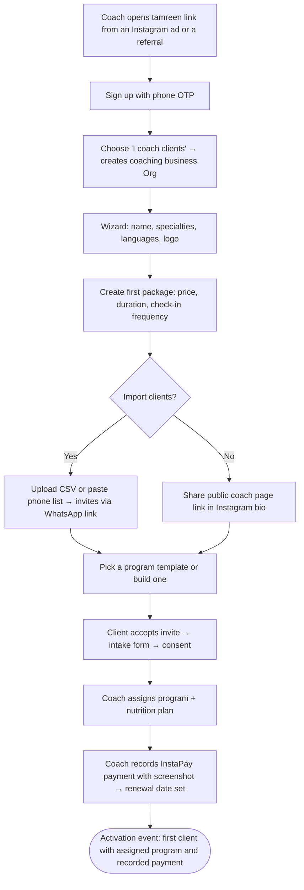
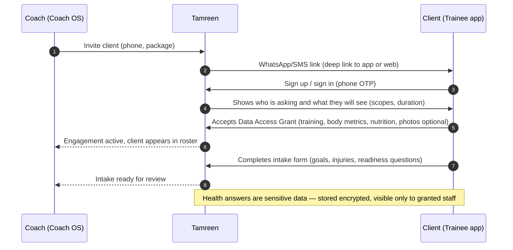
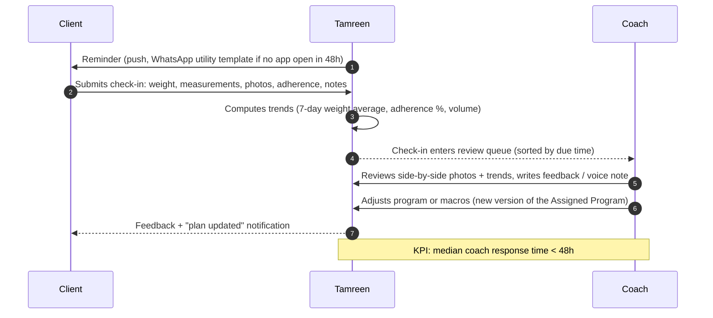
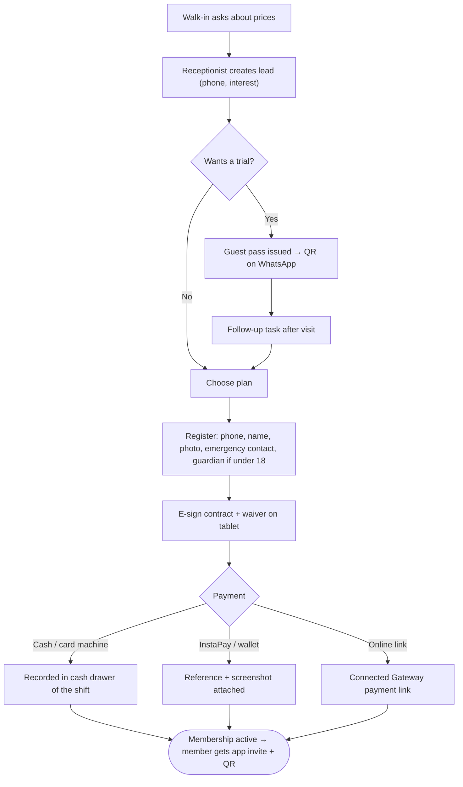
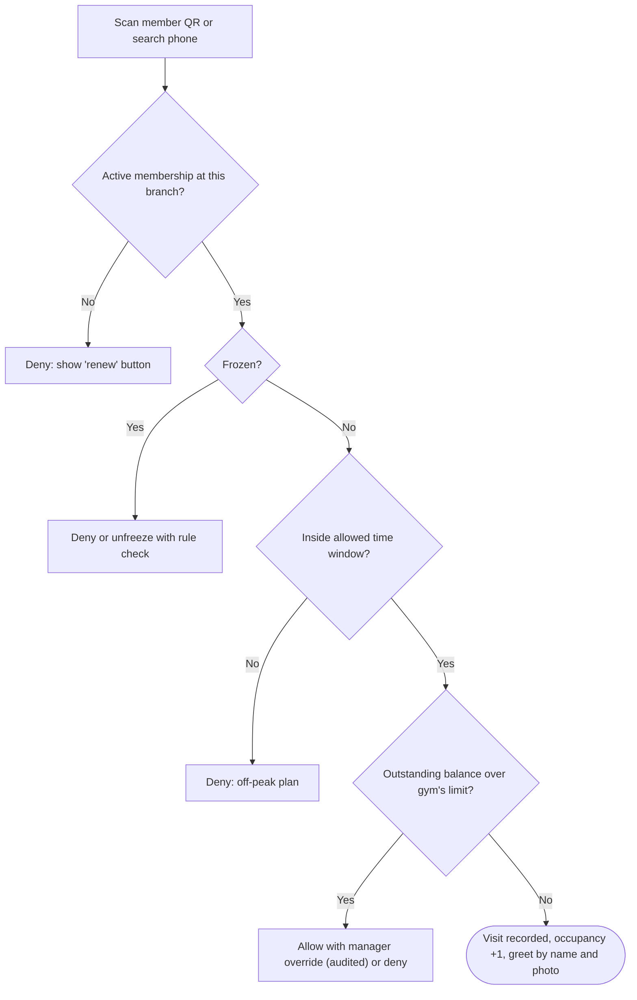
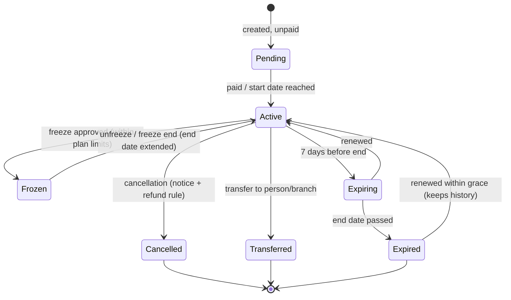
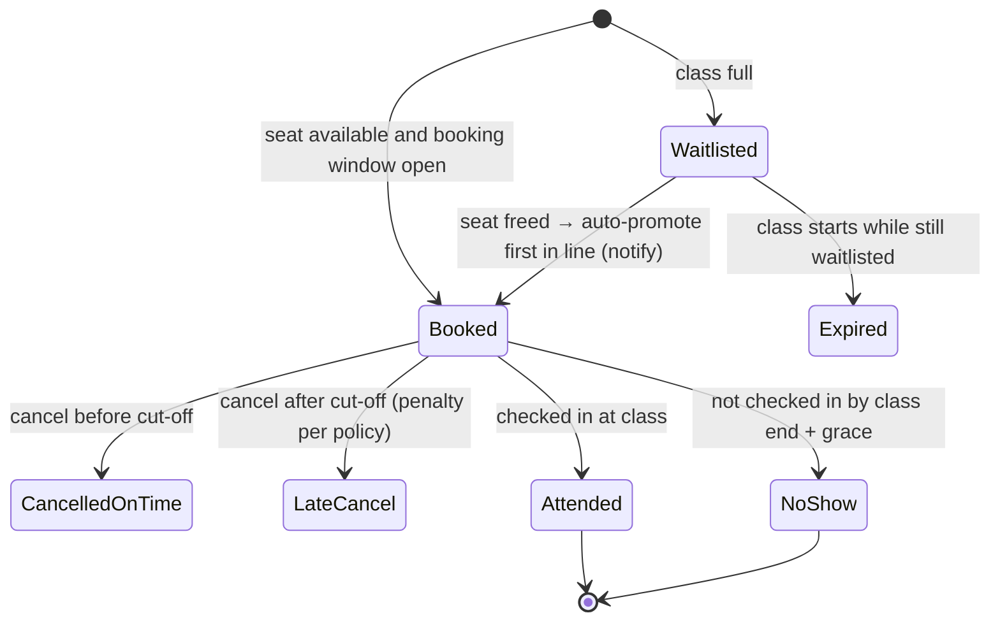
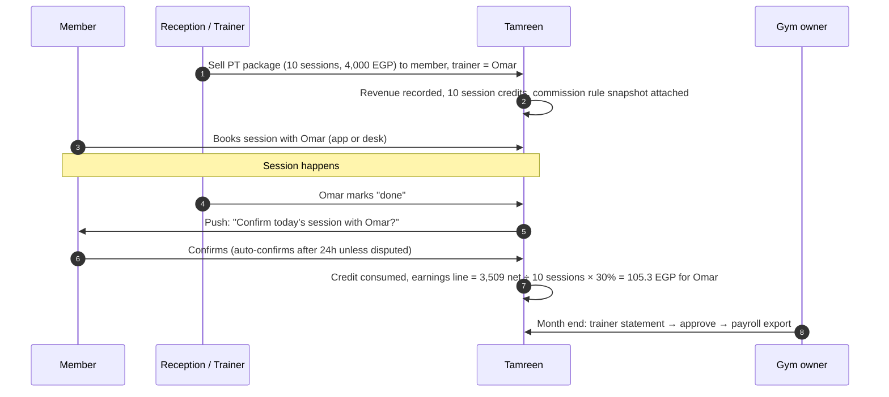
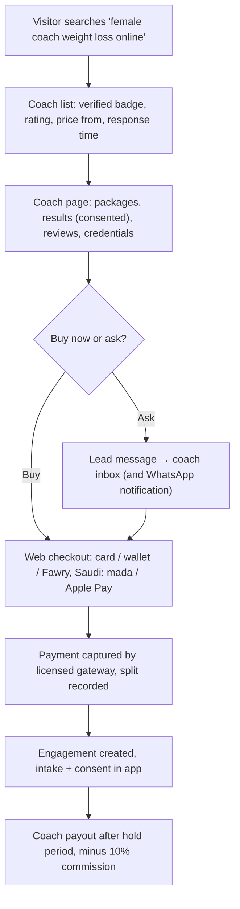
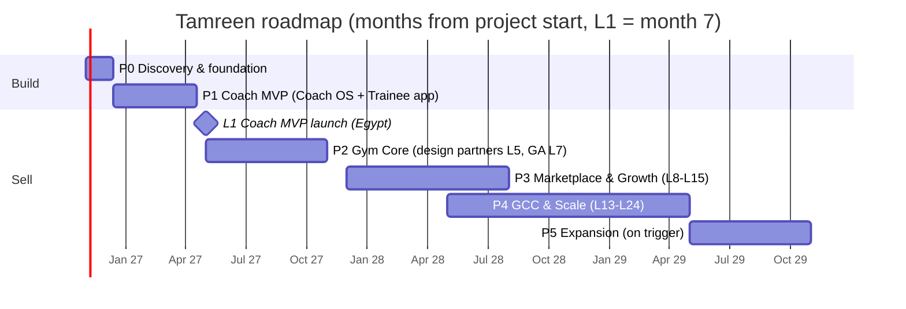

# Tamreen — Product & Business Blueprint

**A unified fitness & coaching ecosystem for gyms, coaches and trainees — Egypt first, Saudi Arabia / GCC next**

| | |
|---|---|
| Document | `PRODUCT_BUSINESS_BLUEPRINT.md` (companion: [`TECHNICAL_SYSTEM_ARCHITECTURE.md`](./TECHNICAL_SYSTEM_ARCHITECTURE.md)) |
| Version / date | v1.0 — 22 October 2026 |
| Status | Research & planning baseline. No code. Decisions marked **[DECISION]** are proposed and need founder sign-off (§18). |
| Working name | **Tamreen** (تمرين, "training/exercise") — a placeholder. Trademark and domain availability have **not** been checked. |
| Currency | Egyptian pounds (EGP) unless stated. USD conversions use **52.5 EGP/USD** (bank quotes were \~52.7–52.8 on 13 Oct 2026 [S21]); SAR is pegged at 3.75/USD → **14.0 EGP/SAR**. |

### How to read this document

Every important statement carries one of these labels:

| Label | Meaning |
|---|---|
| **[FACT]** | Verified from a cited source (source IDs `[Sxx]` are listed in Appendix A with dates). Most sources were reached through web search on 22 Oct 2026; vendor pages are self-reported. |
| **[VENDOR CLAIM]** | Stated by a company about itself; not independently verified. |
| **[ASSUMPTION]** | A working input chosen by us. Change it and dependent numbers change. |
| **[ESTIMATE]** | A calculated number derived from assumptions (calculation shown). |
| **[RECOMMENDATION]** / **[DECISION]** | Our proposed choice, with the reason. |
| **[VERIFY]** | Must be confirmed (legal, pricing, vendor capability) before it becomes a commitment. |

Research limits: the reference site `supercoach.me` and most vendor pricing pages could not be opened directly from the research environment (DNS/egress blocked); facts about them come from search-indexed copies, vendor blog posts and app-store listings. Treat all competitor pricing as indicative and re-check before using it in sales material.

---

## Table of contents

0. [Shared vocabulary](#0-shared-vocabulary)
1. [Executive summary and product vision](#1-executive-summary-and-product-vision)
2. [Market research and competitor analysis](#2-market-research-and-competitor-analysis)
3. [Customer personas and jobs-to-be-done](#3-customer-personas-and-jobs-to-be-done)
4. [Complete functional feature inventory](#4-complete-functional-feature-inventory)
5. [Module and role-level capability matrix](#5-module-and-role-level-capability-matrix)
6. [User journeys and operational workflows](#6-user-journeys-and-operational-workflows)
7. [SaaS plans, packages and feature entitlements](#7-saas-plans-packages-and-feature-entitlements)
8. [Subscription and revenue strategy](#8-subscription-and-revenue-strategy)
9. [Marketplace and commission model](#9-marketplace-and-commission-model)
10. [Gym and trainer business workflows](#10-gym-and-trainer-business-workflows)
11. [Pricing recommendations](#11-pricing-recommendations)
12. [Financial forecasts and unit economics](#12-financial-forecasts-and-unit-economics)
13. [MVP definition and product roadmap](#13-mvp-definition-and-product-roadmap)
14. [Differentiation and positioning](#14-differentiation-and-positioning)
15. [Go-to-market](#15-go-to-market)
16. [Business risks and mitigations](#16-business-risks-and-mitigations)
17. [KPIs and success criteria](#17-kpis-and-success-criteria)
18. [Decisions, assumptions and open questions](#18-decisions-assumptions-and-open-questions)
- [Appendix A — Sources](#appendix-a--sources)
- [Appendix B — Financial model inputs](#appendix-b--financial-model-inputs)

---

## 0. Shared vocabulary

Both documents use these terms the same way. The technical document maps each one to tables and services (Technical §5, §8).

| Term | Meaning |
|---|---|
| **Person** | One human, one login. A Person can be a trainee, a coach, a gym owner and a receptionist at the same time. |
| **Personal Space** | The private workspace every Person gets for free. It owns their workouts, body metrics, nutrition diary, progress photos and health answers — whoever helped create them. |
| **Organization (Org)** | A business tenant. `type = gym` or `coaching_business`. A solo online coach is a coaching business with one staff member. |
| **Branch** | A physical location of a gym Org. A coaching business has one virtual branch. |
| **Staff Assignment** | A Person's role inside an Org (owner, manager, branch manager, receptionist, trainer, nutritionist, sales), optionally limited to some branches. |
| **Client Relationship** | A Person as a customer of an Org. Two kinds: **Gym Membership** (contract to use a gym) and **Coaching Engagement** (a client working with a coach under a package). |
| **Data Access Grant** | A consented, scoped, time-boxed, revocable permission for an Org (and the staff assigned to that client) to read or write parts of a Personal Space. |
| **Platform Subscription** | What a Person or an Org pays *Tamreen*: Trainee Plus, Coach Starter/Pro/Team, Gym Essentials/Growth/Pro. |
| **Entitlement** | A feature or limit a Person or Org may use, computed from Platform Subscriptions plus Sponsored Entitlements. |
| **Sponsored Entitlement** | A feature an Org gives its clients (e.g. a coach's clients get full logging; a gym's members get the member app). |
| **Offering** | What an Org sells to its own clients: membership plans, class packs, PT packages, coaching packages, products, digital programs. |
| **Merchant Collection** | Money an Org collects from its clients. Three modes: **Recorded** (cash/InstaPay/POS outside the platform, recorded in it), **Connected Gateway** (the Org's own gateway account), **Platform Checkout** (Tamreen-operated checkout with split/payout, marketplace only, Phase 3). |
| **Marketplace** | Public discovery: Public Profiles, Listings, reviews, Platform Checkout. |
| **Program Template / Assigned Program** | A coach's reusable plan (the Org's intellectual property) vs. the copy delivered to a client (lives in the client's Personal Space, with provenance). |
| **Progress Check-in** | The coaching ritual (weekly form, weight, photos, feedback). Not to be confused with a **Gym Visit** (door check-in/attendance). |
| **Session** | A booked time slot: **PT Session** (1:1), **Class Session** (one occurrence of a group class), **Consult** (online call). |
| **Commission Rule / Trainer Earnings / Payout** | How a trainer is paid per session/sale, the resulting statement lines, and the money transfer. |
| **Launch month L1** | First month the Coach MVP is sold. Roadmap and forecasts count months from here (L1…L24). The build before it is P0 + P1 (≈ 6 months). |

---

## 1. Executive summary and product vision

### 1.1 Vision

*Every Arabic-speaking trainee gets a lifelong training record they own; every coach and gym gets the tools to run and grow their business around that record.*

Most products in this space pick one customer: gym software (front desk, contracts, POS), coaching software (programs, check-ins, chat) or consumer apps (logging, calories). In Egypt and the Gulf the three overlap in daily life: a member trains at a gym, buys PT sessions from a freelance trainer who rents floor time there, follows an Instagram coach's nutrition plan, and logs workouts in a separate app. Data is scattered across WhatsApp chats, PDFs and spreadsheets, and the trainee loses it every time they change coach or gym.

Tamreen joins these three around one idea: **the trainee owns their Personal Space; businesses get scoped, consented access to it while they serve that trainee.** That one rule settles most of the hard questions — data ownership, coach switching, gym exits, privacy law, marketplace trust — and it is the main thing that sets the product apart (§14).

### 1.2 What we recommend building, in order

| # | Recommendation | Why |
|---|---|---|
| 1 | **[DECISION] Beachhead = independent online coaches in Egypt** (Coach OS + Trainee app), launched after \~6 months of build. | Self-serve sales, short sales cycle, each paying coach brings 10–50 trainees into the app (supply + demand for later phases). Gym sales cycles are longer and need front-desk, POS and contract depth that is not needed to prove the core. |
| 2 | **Gym OS from L7** (design partners from L5): memberships, front desk QR check-in, classes, PT packages and trainer commissions, POS-lite, WhatsApp reminders. | Higher revenue per customer (\~2,400 EGP/month vs \~650 for a coach) and lower churn; reuses the trainee app as the member app. The wedge is **the gym's PT business** (in-house + freelance trainers), which local gym tools handle poorly. |
| 3 | **Marketplace from L10**, once there are ≥ 300 coaches with public profiles in Greater Cairo/Alexandria. | A marketplace without supply fails. Supply arrives as a by-product of steps 1–2. |
| 4 | **Saudi Arabia from L16** through a channel partner, with SAR pricing, mada/Apple Pay via a Saudi gateway and ZATCA-compliant invoicing. | Saudi revenue per customer is \~2–3× Egypt's; Arabic product and content carry over. The timing allows for the planned AWS Saudi region (targeted Dec 2026 [S36]) and legal work. |
| 5 | **Trainee Plus (B2C) as a funnel, not a revenue pillar.** | Willingness to pay for self-tracking in Egypt is low. In the base case Plus is \~1% of L24 revenue; its job is to keep ex-clients and organic users in the ecosystem. |
| 6 | **AI, wearables, video, white-label later (Phase 3–5)**, each behind a clear trigger (§13.4). | They add cost and risk without proving the core. Competitors' AI is mostly "draft a workout" [S54]. |

### 1.3 Business model in one table

| Revenue stream | Who pays | Start | Share of L24 revenue (base) |
|---|---|---|---|
| Coach subscriptions (Egypt) | Coaching businesses | L1 | 42% |
| Gym subscriptions (Egypt) | Gyms | L7 | 27% |
| Saudi coaches + gyms | Saudi businesses | L16 | 23% |
| Marketplace commission (10% of marketplace-originated sales) | Coaches/gyms, deducted at payout | L10 | 7% |
| Trainee Plus | Trainees | L10 | 1% |

### 1.4 Headline numbers (base scenario, all **[ESTIMATE]**, details in §12)

| Metric | L12 | L24 |
|---|---|---|
| Paying coaches (Egypt + KSA) | \~296 | \~992 |
| Paying gyms (Egypt + KSA) | \~29 | \~183 |
| Monthly active users (all apps) | \~12k | \~55k |
| Net monthly revenue (after VAT) | \~245k EGP (\~$4.7k) | \~1.23M EGP (\~$23.4k) |
| ARR run-rate | \~$56k | \~$281k |
| Gross margin | \~72% | \~80% |
| Monthly EBITDA | −386k EGP | +74k EGP (break-even month ≈ L24) |
| Peak cash need incl. 6-month build | — | \~9.0M EGP (\~$172k) |

A **lean variant** (founder writes the backend, smaller team until L10) breaks even at about **L20** with a peak cash need of about **4.7M EGP (\~$90k)**. The conservative scenario does **not** break even within 24 months; §12.7 sets stop/pivot triggers.

### 1.5 Technology and infrastructure in one paragraph

A **modular monolith** in **Laravel 13 / PHP 8.4** with **PostgreSQL** (RDS), **Valkey** (ElastiCache) and **Laravel Reverb** WebSockets; a **Nuxt 4** web app (SPA for the dashboards, server-rendered public pages for SEO); one **Flutter** mobile app with role modes (trainee and coach); **ECS Fargate (ARM)** in **AWS eu-central-1 (Frankfurt)**, CloudFront with its Cairo edge, backups copied to eu-south-1 (Milan). Production starts at **\~$245/month** of AWS spend and reaches **\~$1,000–1,200/month** at \~30k monthly active users (Technical §15). The Gulf AWS regions are *not* recommended as primary hosting in 2026: after strikes in March–April 2026, AWS said in September that resources hosted only in its Bahrain region cannot be restored, and its UAE region lost an availability zone [S37]. Hosting Egyptians' data abroad needs a cross-border transfer licence from Egypt's data protection regulator — a **blocking legal dependency** (§16, Technical §16).

---

## 2. Market research and competitor analysis

### 2.1 Egypt — context that shapes the product

| Topic | What we know | Product implication |
|---|---|---|
| Gyms | Business directories count **\~8,000 "gyms"** (Jul 2026) or **\~10,000 gyms and studios** (Mar 2025) in Egypt [S19] **[FACT, low precision]**. No official licensing count was found. | Serviceable market for gym software is in the thousands. Our base case reaches \~158 Egyptian gyms by L24 (\~2% of directory count). |
| Gym prices | Cairo monthly memberships range from \~EGP 750 to EGP 5,000; annual Gold's Gym EGP 6,500; F45 EGP 4,000–5,000/month [S17] **[FACT, secondary]**. Average business-district gym \~EGP 1,261/month (Sep 2025) [S18]. | A 400-member mid-tier gym turns over roughly 400–600k EGP/month; a 1,000–2,000 EGP/month software bill is < 0.5% of revenue. |
| Online coaching | No reliable published EGP price list was found **[GAP]**. Instagram coaches commonly sell monthly packages. We **assume** 1,000–3,000 EGP/month for online coaching and use 1,800 EGP as the average marketplace order (§12). | Validate in discovery interviews (P0) before final pricing. |
| Payments | Paymob standard online rate **2.75% + EGP 3**, no monthly fee [S23]; Apple Pay live since Dec 2024 [S22]; InstaPay widely used for person-to-business transfers; wallets (Vodafone Cash etc.) common. Recurring card charges are possible (Paymob Subscriptions) [S23] but many users pay by transfer. | Billing must support **prepaid periods with reminders** as the default, auto-renew as an option, and **manual InstaPay proof upload** with admin approval. |
| Messaging | WhatsApp is the default business channel. Meta charges ≈ $0.0036–0.0054 per utility and ≈ $0.064–0.077 per marketing message in Egypt; service replies start being charged on 1 Oct 2026 [S34] **[FACT, sources disagree]**. | Use free `wa.me` click-to-chat links for staff-initiated messages; use paid templates only for automated utility messages (renewal reminders, booking confirmations). Pass marketing messages through at cost. |
| Data protection | Law 151/2020 and its Executive Regulations (Decree 816 of 2025, published \~Nov 2025, one-year grace to \~Nov 2026) [S27]. **Health, biometric, financial and children's data are "sensitive"** [S28]. Processing sensitive data and transferring data abroad (including *storing* it abroad) require licences from the Personal Data Protection Centre [S27][S29]. | Consent flows, licences and data minimisation are launch requirements, not polish (§16, Technical §16). |
| Tax | VAT 14%. B2C e-receipts are being phased in by named taxpayer lists (e.g. Decision 361 from 15 Nov 2025) [S32]. | Platform invoices for our own SaaS must be ETA-compliant once we are in scope; gyms may need e-receipts for their own sales (integration in Phase 4 or via partner). |

### 2.2 Saudi Arabia — context

| Topic | What we know | Implication |
|---|---|---|
| Market leader | Leejam (Fitness Time): **239 centres (227 KSA), 468k members** at end-2025 [S20] **[FACT]**. | Chains build their own stack; our Saudi target is independent gyms, studios, PT studios and online coaches. |
| Policy tailwind | Vision 2030 targets 40% of the population being physically active by 2030 (older sources) [S20]. Women's gyms licensed since 2017. | Women-only gyms and female coaches are a distinct segment (gender filters, privacy defaults for photos). |
| Local competitors | Gym tools stress **ZATCA QR tax invoices, mada, Apple Pay, Tabby/Tamara** [S14] **[VENDOR CLAIM]**. | ZATCA e-invoicing and mada are table stakes for Saudi launch. |
| Payments | Stripe does not list Saudi Arabia for account creation (Dec 2025 guide) [S25]; Moyasar (SAMA-licensed; mada, Apple Pay, STC Pay, recurring incl. mada) and Tap (licensed across GCC) are the realistic options [S26]. | Gateway abstraction from day one (Technical §11). |
| Data | Saudi PDPL in force; transfers abroad allowed with safeguards (SCCs, risk assessment); legitimate interest does not cover sensitive (health) data [S30]. | Explicit consent for health data; transfer safeguards documented; optional Saudi hosting cell later. |
| Cloud | AWS Saudi region targeted for **December 2026** [S36]. | Allows a Saudi hosting cell in Phase 4 if a customer or regulator requires it. |

### 2.3 The reference product: SuperCoach (supercoach.me)

| Aspect | Verified | Source |
|---|---|---|
| Company | Built by **ElCoach, Inc.**, a Cairo-founded company that first ran an Arabic consumer coaching app (ElCoach, seed-funded 2020, targeting Egypt and KSA). | [S3][S4] **[FACT]** |
| Product | SaaS for personal trainers and "sports facilities": trainer dashboard + trainee mobile app; custom workout programs, meal plans, automated check-ins and scheduling, in-app messaging, multi-coach/branch management. | [S1][S2] **[VENDOR CLAIM]** |
| Market | Middle East focus, Egypt and Saudi Arabia; Arabic UI; iOS, Android and web; "no credit card required", "unlimited clients". | [S1][S2] **[VENDOR CLAIM]** |
| Scale claims | "35,000+ clients, 12+ countries". | [VENDOR CLAIM], unverified |
| Pricing | Vendor's own posts: **Essential $19/month (up to 10 clients), Growth from $45/month (>10 clients, rises with clients), Elite+ custom (>1,000 clients)**. Posts are inconsistent. | [S1] **[VENDOR CLAIM]** |
| Not found | Gym front-desk features (contracts, freezes, door access, POS), a public trainer marketplace with checkout, trainee-owned data portability, B2C subscription. | **[ASSUMPTION — absence of evidence, not evidence of absence]**; verify with a demo account in P0. |

**What to learn from it:** an Egyptian team has already proven that Arabic-first coaching software sells in Egypt and KSA and that coaches will pay in USD-equivalent prices. **Where it is exposed:** USD pricing ($19–45 ≈ 1,000–2,360 EGP) is heavy for the long tail of Egyptian coaches; it is coach-centric (the trainee's data belongs to the coach's account); and it does not appear to own the gym operating system or a marketplace. Our positioning (§14) attacks exactly those three points.

### 2.4 Competitor landscape

Prices in USD per month unless noted; all third-party or vendor-reported, **[VERIFY]** before use.

| Product | Segment | Price signal | Strengths | Gaps relevant to us | Src |
|---|---|---|---|---|---|
| **SuperCoach** | MENA online coaches, some facilities | $19 (10 clients), $45+ | Arabic, Egypt/KSA presence, coach + trainee apps | Gym ops, marketplace, EGP pricing, trainee data ownership (unverified) | [S1][S2] |
| **ElCoach** (consumer) | Arabic B2C coaching | SAR 56/month, SAR 206/year (coupon sites) | Brand in Egypt/KSA B2C | B2C only; different model | [S3][S4] |
| **ABC Trainerize** | Global coaches, studios | Free (1 client), Pro from \~$22–23 (5 clients), Studio Plus \~$248/location; branded app $169 setup; nutrition/payments/video add-ons | Mature, branded apps, integrations | English-first, add-on creep, USD | [S5] |
| **TrueCoach** | Global coaches | \~$26–30 (5), \~$58 (20), \~$137 (50); no free tier | Simple, coach-loved | No nutrition depth, no gyms | [S6] |
| **Everfit** | Global coaches/studios | Free (5 clients), Pro \~$19 (5) → \~$290 (300); add-ons for payments, automation, meal plans | AI workout builder, automation | Add-on costs, English-first | [S7][S54] |
| **Hevy Coach** | Coaches with Hevy-logging clients | Low | Excellent logging UX | Light business tooling | [S54] |
| **Mindbody** | Studios/gyms (US/global) | $99–139 → $699 + add-ons, long contracts | Marketplace (consumer app), payments | Expensive, not localised | [S9] |
| **ABC Glofox** | Boutique studios/gyms | €220–515/month (2026 page) | Branded apps, class booking | Price, no Arabic | [S8] |
| **PushPress** | Gyms (CrossFit-style) | Free tier (higher processing), $159, $229 | Free entry via payments margin | US-centric payments | [S10] |
| **Gymdesk** | Small gyms/martial arts | $75–200 by members | Transparent pricing | No Arabic, no MENA payments | [S11] |
| **GymFlow** (Egypt) | Egyptian gyms | "From \~500 EGP/month" | Arabic, QR attendance, WhatsApp workflows | Coaching/marketplace absent (vendor page) | [S12] |
| **ArabGym** | MENA gyms | 30-day trial | Arabic, KSA/UAE/Egypt | Coaching absent (vendor page) | [S13] |
| **IDS Fitness / Gymsly / Easy Gym** | Saudi gyms | Quote | ZATCA QR, mada, BNPL | Coaching/marketplace absent | [S14] |
| **Enhance Fitness, HeyTrainer, FitLov** | GCC PT booking marketplaces | Commission/packages | Demand generation | Not a business OS; UAE-centric | [S15][S16] |

### 2.5 Gaps and opportunities

1. **Nobody local joins gym operations, coaching and the trainee's own record** in one Arabic-first product (verified only to the extent vendor pages describe their scope).
2. **The gym's PT floor is unmanaged.** Egyptian gyms commonly host freelance trainers (floor fees, revenue splits) and in-house trainers on commission. Calculating trainer pay, preventing "off-book" sessions and giving the gym visibility are recurring pains **[ASSUMPTION — validate in P0 with ≥ 15 gyms]**.
3. **Payments as Egyptians actually pay**: InstaPay transfers with screenshots, wallets, cash at the desk, card links. Global tools assume card-on-file recurring billing.
4. **Coach switching and data portability**: trainees lose history when they leave a coach; coaches fear losing clients to gyms and vice versa. Clear, contractual data rules (§9.5) reduce both fears.
5. **Local food data**: Egyptian and Gulf dishes (koshari, ful, molokhia, kabsa) are poorly covered by global food databases **[ASSUMPTION]**. A curated, dietitian-reviewed local food list is a moat that compounds.
6. **Price**: USD-priced tools are expensive for the Egyptian long tail; EGP pricing with a free tier wins the bottom of the funnel.

### 2.6 What the research could not establish (open)

- Actual distribution of Egyptian coaches' client counts and prices — **P0 interviews (30 coaches)**.
- How many Egyptian gyms already pay for software and how much — **P0 interviews (15 gyms) + GymFlow/ArabGym demos**.
- SuperCoach's real feature depth on facilities and data portability — **demo account in P0**.

---

## 3. Customer personas and jobs-to-be-done

| ID | Persona | Context | Jobs-to-be-done ("When …, I want to …, so I can …") | Pays? |
|---|---|---|---|---|
| P-01 | **Karim, independent gym owner** (Nasr City, 1 branch, 450 members, 6 staff, 4 freelance PTs) | Runs on a desktop app + Excel + WhatsApp; cash leaks at the desk; doesn't know which trainers bring revenue | When members' subscriptions expire, I want them reminded and renewed without my receptionist chasing them, so cash flow doesn't depend on her memory. When trainers sell PT, I want every session recorded and the gym's share calculated, so I'm not cheated. | Gym Growth |
| P-02 | **Mona, operations director of a 5-branch chain** (Cairo/Giza) | Branch managers report differently; members want to use other branches | When I review the week, I want comparable numbers per branch and per trainer, so I can act on underperformers. | Gym Pro |
| P-03 | **Hassan, branch manager** | Owns targets, staff rota, class schedule | When a class fills, I want waitlisted members promoted automatically, so the class is full and I avoid complaints. | (staff) |
| P-04 | **Salma, receptionist** | High volume at peak hours, works on a tablet | When a member arrives, I want to scan their QR and immediately see whether they may enter (expired, frozen, owes money), so the line keeps moving. | (staff) |
| P-05 | **Omar, in-house trainer** (salary + 30% PT commission) | Sells PT packages to members | When I finish a session, I want it confirmed by the client in one tap, so my commission is counted and disputes disappear. | (staff) |
| P-06 | **Youssef, freelance trainer renting floor time** in two gyms + online clients | Pays each gym a monthly fee or per-session fee | When I manage clients across two gyms and online, I want one schedule and one client list, so I don't double-book and I keep my clients if I change gyms. | Coach Pro (own business) |
| P-07 | **Nour, online coach** (Instagram 40k followers, 35 clients, female clients) | WhatsApp + Google Sheets + PDF meal plans; spends Sundays on check-ins | When my weekly check-ins arrive, I want them in one review queue with photos side by side and trends, so I finish in 2 hours not 8. When clients pay via InstaPay, I want renewals tracked, so I stop losing money. | Coach Pro |
| P-08 | **Ahmed, owner of a coaching team** (4 coaches, 150 clients, Egypt + KSA clients) | Needs to assign clients, share templates, control quality | When a lead arrives, I want it routed to the coach with capacity, and I want to see each coach's response times and retention. | Coach Team |
| P-09 | **Dina, gym member** (28, trains 4×/week) | Member of one gym, follows an online coach for nutrition | When I train, I want my gym's class bookings, my coach's program and my own logs in one app, so I don't juggle three apps. | Free (sponsored) / Plus |
| P-10 | **Mostafa, self-trainee** (22, student, home + public gym) | Price-sensitive, uses free apps | When I train alone, I want a free logger in Arabic with Egyptian foods, so I can track progress without paying a coach. | Free; maybe Plus |
| P-11 | **Reem, coached client in Riyadh** | Works with an Egyptian coach online | When I pay for coaching, I want to pay with mada/Apple Pay in SAR and get my plan in the app. | Client of coach |
| P-12 | **Visitor looking for a coach** | Searches "كوتش أونلاين للتخسيس" | When I'm choosing a coach, I want verified certificates, real reviews and clear package prices, so I'm not scammed. | Marketplace buyer |
| P-13 | **Platform support agent** | Handles onboarding, billing proofs, disputes | When a coach uploads an InstaPay proof, I want it matched to the invoice in one screen. | (internal) |
| P-14 | **Parent of a 15-year-old gym member** | Minor's membership | When my child joins, I want to consent to what data is kept and see their bookings. | Pays the gym |

---

## 4. Complete functional feature inventory

Phases: **P1** Coach MVP (to L1), **P2** Gym Core (L2–L7), **P3** Marketplace & Growth (L8–L15), **P4** GCC & Scale (L13–L24), **P5** Expansion (after L24 or on trigger). Phase content and acceptance criteria: §13 and Technical §21. "Value" = the business reason the feature exists.

### 4.1 Platform-wide (PLT)

| ID | Feature | Roles | Value | Phase |
|---|---|---|---|---|
| PLT-01 | One account: phone OTP (WhatsApp/SMS), email + password, Google and Sign in with Apple; 2FA (TOTP) required for owners/managers | All | One identity across roles; security for money/health data | P1 |
| PLT-02 | Workspace switcher (Personal Space ↔ each Org where the Person has a Staff Assignment) | All | Multi-role people (coach who trains at a gym) | P1 |
| PLT-03 | Arabic/English, RTL/LTR, Latin digits by default for numbers and dates | All | Egypt/KSA usability | P1 |
| PLT-04 | Notification centre, push, email; WhatsApp utility templates; per-user preferences and quiet hours | All | Engagement and retention | P1 |
| PLT-05 | Consent centre: view/approve/revoke Data Access Grants per Org and scope | Trainee | Legal basis + trust | P1 |
| PLT-06 | Data export (JSON + PDF summary) and account deletion with retention rules | Trainee | Portability, law | P1 (export on request), P2 (self-serve) |
| PLT-07 | Platform billing: plans, trials, invoices (VAT), card/wallet via Paymob, InstaPay proof upload + approval, coupons, credit balance | Owners | Revenue | P1 |
| PLT-08 | Org audit log (who changed prices, refunded, deleted, accessed client data) | Owners, managers | Fraud control, accountability | P1 |
| PLT-09 | In-app feedback, help centre (Arabic), client error reporting | All | Quality | P1 |
| PLT-10 | Platform admin console: Orgs, billing approvals, moderation, verification queue, support access with Org consent and audit | Platform staff | Operations | P1 |
| PLT-11 | Referral program (coach→coach credit; trainee→friend) | Coaches, trainees | Low-cost acquisition | P2 |
| PLT-12 | Partner/affiliate program (commission on referred paying Orgs) | Partners | KSA channel, influencers | P4 |
| PLT-13 | Public API + webhooks for Orgs | Chains, integrators | Enterprise deals | P5 |
| PLT-14 | Feature switches per Org (owner shapes the product) and platform kill switches | Owners, platform | Simplicity, safe rollout | P1 |

### 4.2 Module B — Coach business (COA)

| ID | Feature | Roles | Value | Phase |
|---|---|---|---|---|
| COA-01 | Onboarding wizard: business name, specialties, languages, currency, first package, branding colour/logo | Coach | Time-to-first-client < 30 min | P1 |
| COA-02 | Public coach page (SEO, share link/QR, packages, results gallery with client consent, "Request coaching" → lead + WhatsApp) | Coach, visitor | Free acquisition; seeds marketplace | P1 |
| COA-03 | Credentials upload; manual verification → "Verified" badge | Coach, platform | Marketplace trust | P1 upload, P3 badge |
| COA-04 | Client invites (link, QR, WhatsApp), bulk import from CSV/Sheets | Coach | Fast migration | P1 |
| COA-05 | Intake & assessment forms (templates: goals, training history, injuries, readiness questionnaire, preferences, food dislikes); conditional questions | Coach, client | Personalisation; safety screening | P1 |
| COA-06 | Exercise library: \~300 platform exercises (AR/EN names, cues, muscles, equipment, demo video); custom exercises with own video | Coach | Content moat | P1 |
| COA-07 | Program builder: phases/weeks/days, blocks, supersets/circuits, sets × reps/time/distance, load/% 1RM/RPE/RIR, tempo, rest, notes; template library; duplicate and bulk edit | Coach | Core value | P1 |
| COA-08 | Assign programs with start date; automatic simple progression rules (+load/+reps per week) | Coach | Saves time | P1 assign, P2 progression |
| COA-09 | Nutrition: macro/calorie targets, meal plans with alternatives, local food database, recipes, printable PDF | Coach, nutritionist | Most coaches sell training + nutrition | P1 basic, P2 recipes/swaps |
| COA-10 | Progress Check-ins: scheduled forms (weight, measurements, photos, adherence, sleep, stress), review queue, side-by-side photo compare, text/voice feedback | Coach, client | Biggest time sink today | P1 |
| COA-11 | Client 360°: adherence, training volume, PRs, weight trend, photos, notes, payments, renewal date | Coach | Retention | P1 |
| COA-12 | 1:1 chat: text, images, voice notes, short videos, read receipts, quick replies, attachments to workouts | Coach, client | Replaces WhatsApp for coaching | P1 |
| COA-13 | Packages: price, duration, inclusions (programs, nutrition, check-in frequency, calls), renewals, pausing | Coach | Monetisation | P1 |
| COA-14 | Payment tracking (Recorded mode): record cash/InstaPay/wallet payments with proof, receipts, balances, renewal reminders | Coach | "Stop losing money" | P1 |
| COA-15 | Connected Gateway: coach links own gateway account → payment links | Coach | Card payments without platform licence | P2 |
| COA-16 | Platform Checkout for coach packages (cards, wallets, Fawry, mada later) with payouts | Coach, client | Marketplace commerce | P3 |
| COA-17 | Scheduling: availability, 1:1 sessions in person/online, buffer, cancellation policy, reminders, calendar sync (ICS) | Coach, client | Hybrid coaches | P2 |
| COA-18 | Lead pipeline (new → contacted → consult → won/lost), sources, follow-up tasks | Coach | Growth | P2 |
| COA-19 | Business dashboard: active clients, revenue, renewals due, churn, check-in response time | Coach | Decisions | P1 basic, P2 full |
| COA-20 | Teams: multiple coaches, client assignment and transfer, shared templates, per-coach permissions, quality metrics | Team owner | Coaching agencies | P2 |
| COA-21 | Group programs and community channels (cohorts, challenges) | Coach | Scale 1-to-many | P3 |
| COA-22 | Automations: welcome sequence, check-in reminders, inactivity nudges, renewal follow-ups | Coach | Time saving | P2 |
| COA-23 | Embedded video consults | Coach, client | Premium packages | P4 |
| COA-24 | Digital products (self-guided programs, e-books) | Coach | Passive income (store-policy constraints, §8.5) | P4 |
| COA-25 | AI drafting assistant (draft program/meal plan from intake; summarise check-ins); coach reviews before sending | Coach | Productivity | P4 beta, P5 GA |
| COA-26 | Branded (white-label) app | Large coaches | Premium add-on | P5 |

### 4.3 Module C — Trainee / athlete (TRN)

| ID | Feature | Roles | Value | Phase |
|---|---|---|---|---|
| TRN-01 | Onboarding: goal, experience, equipment, days/week, optional assessment; works without any coach or gym | Trainee | B2C funnel | P1 |
| TRN-02 | "Today": workout, meals, habits, check-in due, class bookings | Trainee | Daily habit | P1 |
| TRN-03 | Workout logger: sets/reps/load/RPE, rest timer, previous performance, plate calculator, notes, swap exercise, **fully offline** with sync | Trainee | Core loop; gyms often have poor signal | P1 |
| TRN-04 | Own routines and free workouts | Trainee | Free tier value | P1 |
| TRN-05 | Exercise demos (video, cues in Arabic) | Trainee | Safety, quality | P1 |
| TRN-06 | History, PRs, volume per muscle group, charts | Trainee | Motivation | P1 basic, P3 advanced (Plus) |
| TRN-07 | Body metrics, measurements, weight trend, private progress photos (encrypted, never shared without a grant) | Trainee | Progress | P1 |
| TRN-08 | Food diary: Arabic search, local foods, custom foods/meals, macros, water | Trainee | Nutrition loop | P1 view coach plan; P2 diary |
| TRN-09 | Habits and reminders (steps, water, sleep, supplements) | Trainee | Adherence | P2 |
| TRN-10 | Chat with coach; Progress Check-in submission | Client | Coaching loop | P1 |
| TRN-11 | Gym membership card (QR), visit history, freeze/transfer requests, invoices | Member | Gym member app | P2 |
| TRN-12 | Class schedule, booking, waitlist, cancellation | Member | Gym loyalty | P2 |
| TRN-13 | PT session booking and confirmation | Member | PT revenue | P2 |
| TRN-14 | "My memberships": every gym/coach relationship and what each can see | Trainee | Trust | P2 |
| TRN-15 | Discover coaches/gyms/classes; compare packages | Visitor | Marketplace demand | P3 |
| TRN-16 | Purchase packages/memberships (web checkout; in-app only where store rules allow, §8.5) | Trainee | GMV | P3 |
| TRN-17 | Wearables: Apple Health, Android Health Connect (steps, workouts, weight, resting HR, sleep) | Trainee | Data richness | P3 |
| TRN-18 | Trainee Plus: advanced analytics, unlimited routines/history exports, smart progression, full food diary features | Trainee | B2C revenue | P3 |
| TRN-19 | Recovery/readiness (sleep, soreness, HRV if available) | Trainee | Better coaching | P3 |
| TRN-20 | Challenges, streaks, badges, leaderboards (opt-in, per Org or public) | Trainee | Engagement | P4 |
| TRN-21 | AI weekly summary and suggestions (wellness framing) | Trainee | Plus value | P5 |

### 4.4 Module A — Gym and fitness centre (GYM)

| ID | Feature | Roles | Value | Phase |
|---|---|---|---|---|
| GYM-01 | Gym onboarding: profile, branding, branches, hours, capacity, facilities, tax settings, import members (Excel) | Owner | Activation | P2 |
| GYM-02 | Staff, roles, permissions, branch scoping, manager PIN approvals for sensitive actions | Owner | Control | P2 |
| GYM-03 | Membership plans: duration, price, joining fee, branch access (single/multi), time windows (off-peak), included classes/PT/guest passes, family/couple plans | Owner | Revenue design | P2 |
| GYM-04 | Member registration at the desk (≤ 60 s): phone, name, photo, emergency contact, digital waiver/contract signature, guardian for minors | Receptionist | Throughput | P2 |
| GYM-05 | Contract lifecycle: renew, freeze (min/max days, fee, allowed count), cancel (notice period, refund rule), transfer (person/branch), upgrade/downgrade with proration | Manager | Correctness, less arguing | P2 |
| GYM-06 | Front desk: QR check-in/out, manual lookup, entry rules (expired/frozen/debt/time window), live occupancy | Receptionist | Speed, leakage control | P2 |
| GYM-07 | Access hardware: turnstile/door relay, QR readers, (later) face/fingerprint devices | Owner | Leakage control | P4 |
| GYM-08 | Classes: recurring schedule, rooms, instructors, capacity, booking windows, waitlist auto-promotion, late cancel/no-show penalties | Manager, member | Utilisation | P2 |
| GYM-09 | PT management: PT packages, trainer availability, booking, session confirmation by member, expiry rules | Trainer, member | PT revenue | P2 |
| GYM-10 | Freelance trainer agreements: monthly floor fee, per-session fee or revenue share; who owns the client relationship | Owner, freelance trainer | The wedge (§10) | P2 |
| GYM-11 | Staff shifts, attendance, leave | Manager | Ops | P3 |
| GYM-12 | Trainer compensation engine: salary + commission rules, statements, payroll export (Excel) | Owner, trainer | Trust, time | P2 commissions, P3 payroll export |
| GYM-13 | POS: products, services, memberships, cash drawer per shift, receipts (80 mm), refunds with approval | Receptionist | Retail revenue | P2 |
| GYM-14 | Inventory per branch: stock, receiving, counts; transfers between branches | Manager | Supplements/merch | P2 basic, P3 transfers |
| GYM-15 | Online renewals/purchases through the gym's Connected Gateway; online shop | Member | Convenience | P3 (renewals), P4 (shop) |
| GYM-16 | Discounts, promotions, coupons, corporate rates | Manager | Sales | P2 basic, P3 |
| GYM-17 | CRM: inquiries, guest/trial passes, follow-up tasks, conversion | Sales | Growth | P2 |
| GYM-18 | Retention: renewal reminders (WhatsApp), at-risk members (visit drop), win-back campaigns | Manager | Churn ↓ | P2 reminders, P3 risk list |
| GYM-19 | Referral and loyalty (points for visits/referrals, rewards) | Member | Growth | P4 |
| GYM-20 | Equipment and facility: assets, maintenance tickets, cleaning checklists | Manager | Ops | P3 |
| GYM-21 | Reports: revenue, renewals, churn, attendance heat-map, class utilisation, trainer productivity, payment reconciliation, Excel export | Owner | Decisions | P2 core, P3 advanced |
| GYM-22 | Public gym page, class timetable widget, custom domain | Owner | Acquisition | P3 |
| GYM-23 | Chain console: cross-branch access, consolidated reports, branch comparison | Chain ops | Chains | P3 |
| GYM-24 | Member app (the same Tamreen app, gym features unlocked by membership) | Member | Retention | P2 |
| GYM-25 | Member requests and complaints (freeze, transfer, cancellation) with SLA | Member, manager | Service | P3 |
| GYM-26 | ETA e-receipts (Egypt) / ZATCA invoices (KSA) for the gym's own sales | Owner | Compliance | P4 (or via partner) |
| GYM-27 | Franchise management (royalties, brand standards) | Franchisor | Enterprise | P5 |

### 4.5 Marketplace (MKT)

| ID | Feature | Roles | Value | Phase |
|---|---|---|---|---|
| MKT-01 | Coach directory and search (specialty, language, gender, price, online/in person, area, rating) | Visitor | Demand | P3 (public pages indexed from P1) |
| MKT-02 | Gym, studio and class discovery with map and filters | Visitor | Demand | P3 |
| MKT-03 | Listings: coaching packages, PT packs, class packs, drop-ins, memberships | Coach, gym | GMV | P3 |
| MKT-04 | Verified reviews (only after a paid, delivered engagement); moderation | Client | Trust | P3 |
| MKT-05 | Verification: identity + certificates; badge | Coach | Trust | P3 |
| MKT-06 | Platform Checkout, commission, payouts, statements | All | Revenue | P3 |
| MKT-07 | Refunds, disputes, cancellation policies | Client, platform | Trust | P3 |
| MKT-08 | Featured placement (paid) | Coach, gym | Revenue | P5 |
| MKT-09 | Freelance trainer ↔ gym matching (trainers find gyms to work from) | Trainer, gym | Supply liquidity | P4 |
| MKT-10 | Corporate wellness (employers buy access for staff) | Employer | B2B2C | P5 |

### 4.6 Traceability rule

Every feature above maps to: a role (column "Roles"), a value (column "Value") and a phase. The technical document maps each feature ID to a module (Technical §2.1, §7.1) and the phases to milestones (Technical §21). A feature with no paying persona and no retention effect does not enter the backlog.

---

## 5. Module and role-level capability matrix

### 5.1 Roles

| Code | Role | Where they work | Notes |
|---|---|---|---|
| PA | Platform admin / support | Admin console | Never sees client health data unless the Org grants support access (audited) |
| GO | Gym owner | Web (desktop), mobile web | Owner of a gym Org; all permissions of the modules the Org pays for |
| BM | Branch manager | Web | Scoped to assigned branches |
| RC | Receptionist | Web on tablet (installable PWA) | Scoped to one branch; no exports, no price edits by default |
| IT | In-house trainer | Mobile app (coach mode) + web | Sees only assigned clients |
| FT | Freelance trainer at a gym | Mobile app; their own coaching business + limited gym access | Gym-side access limited to the gym clients they serve under the agreement |
| IC | Independent coach (owner of a coaching business) | Mobile app + web | Owner of a coaching Org |
| TC | Team coach (staff of a coaching business) | Mobile app + web | Sees only assigned clients |
| TR | Trainee / member / client | Mobile app (trainee mode), web | Owner of their Personal Space |
| MV | Marketplace visitor | Public web | Anonymous |

### 5.2 Capability matrix

Legend: ● full · ◐ scoped (own branch / assigned clients / own records) · ○ view only · — none.

| Capability | PA | GO | BM | RC | IT | FT | IC | TC | TR | MV |
|---|---|---|---|---|---|---|---|---|---|---|
| Manage Org profile, branding, branches | ○ | ● | ◐ | — | — | — | ● | — | — | — |
| Manage staff and roles | ○ | ● | ◐ | — | — | — | ● | — | — | — |
| Manage membership plans / packages and prices | ○ | ● | ◐¹ | — | — | ◐² | ● | ◐¹ | — | — |
| Register members, sell memberships | — | ● | ● | ● | — | — | — | — | — | — |
| Freeze / cancel / transfer contracts | — | ● | ● | ◐³ | — | — | — | — | request | — |
| Front-desk check-in | — | ● | ● | ● | ○ | — | — | — | own QR | — |
| Class schedule management | — | ● | ● | ○ | ◐ | — | — | — | — | ○ (public) |
| Book classes / PT sessions | — | ● | ● | ● | ◐ | ◐ | ● | ◐ | ● own | — |
| Build programs, templates | — | ○ | ○ | — | ◐ | ● (own Org) | ● | ◐ | own routines | — |
| View client training/health data | — | ◐⁴ | ◐⁴ | — | ◐⁵ | ◐⁵ | ◐⁵ | ◐⁵ | ● own | — |
| Review Progress Check-ins | — | — | — | — | ◐ | ◐ | ● | ◐ | submit | — |
| Chat with clients | — | ◐ | ◐ | ◐⁶ | ◐ | ◐ | ● | ◐ | ● | — |
| POS sales, cash drawer | — | ● | ● | ● | — | — | — | — | — | — |
| Inventory | — | ● | ● | ○ | — | — | — | — | — | — |
| Trainer commissions and statements | — | ● | ◐ | — | ◐ own | ◐ own | ● | ◐ own | — | — |
| Reports and exports | ○ | ● | ◐ | — | ◐ own | ◐ own | ● | ◐ own | own data export | — |
| Org audit log | ○ | ● | ◐ | — | — | — | ● | — | — | — |
| Platform subscription and billing | ● | ● | — | — | — | — | ● | — | Plus | — |
| Grant / revoke data access | — | — | — | — | — | — | — | — | ● | — |
| Publish public profile / listings | moderate | ● | — | — | ◐ own bio | ● | ● | ◐ own bio | — | view |
| Leave reviews | moderate | reply | reply | — | — | reply | reply | reply | ● (verified) | read |

Notes: ¹ only if the owner allows price edits per role. ² their own coaching business only. ³ freeze within plan rules; cancellation needs a manager PIN. ⁴ **gyms do not see training/health data by default**: only attendance, bookings and contract data; health data needs a Data Access Grant (e.g. a member who buys PT grants the PT trainer access). ⁵ only clients assigned to them, only the scopes granted. ⁶ receptionist chat is limited to the gym's "front desk" inbox, not 1:1 coaching threads.

### 5.3 Module by persona

| Module | Primary buyers | Primary users | Revenue role |
|---|---|---|---|
| A — Gym OS | P-01, P-02 | P-03, P-04, P-05, P-09 | Highest ARPA, lowest churn |
| B — Coach OS | P-06, P-07, P-08 | Same + their clients | Volume, supply for marketplace |
| C — Trainee app | P-10 (Plus), sponsored by A/B | P-09, P-10, P-11 | Funnel, retention, demand |
| Marketplace | Coaches, gyms (commission) | P-12 | Commission, growth loop |

---

## 6. User journeys and operational workflows

### 6.1 Coach: sign-up to first paying client (target ≤ 30 minutes)

### 6.2 Client invite, intake and consent

### 6.3 Weekly Progress Check-in loop

### 6.4 Gym: walk-in to active member (target ≤ 3 minutes at the desk)

### 6.5 Front-desk entry decision

### 6.6 Gym Membership contract states

### 6.7 Class booking with waitlist

### 6.8 PT session and trainer commission

### 6.9 Marketplace: discovery to purchase (Phase 3)

### 6.10 When a trainee leaves a coach

| Data | What happens | Why |
|---|---|---|
| Workout logs, body metrics, check-in answers, photos, food diary | **Stay in the trainee's Personal Space.** The coach loses access when the grant ends (end of engagement + 7-day wind-down, configurable 0–30 days). | Trainee owns their data (Law 151 rights; trust) |
| Assigned Programs and meal plans received during the paid period | Trainee keeps a **read-only copy** with attribution ("by Coach Nour"). They can keep logging against it. | They paid for it; coach keeps the template |
| Program Templates, exercise videos, coach notes | **Stay with the coach's Org.** Private coach notes are never shown to the trainee. | Coach's IP |
| Chat history | Both sides keep the history; it becomes read-only. Either party may request deletion of their own messages subject to retention (§18). | Record of advice given |
| Payments, invoices | Stay with the coach's Org (business records, tax retention). | Legal retention |
| Coach-only aggregated stats | Coach keeps anonymised aggregates (e.g. "retention 6 months"), not identifiable data. | Analytics |

A coach can choose a stricter policy ("programs are view-only during the engagement"), which must be shown to the client **before** purchase.

### 6.11 When a trainer leaves a gym

| Situation | Client relationship owner | Effect |
|---|---|---|
| In-house trainer leaves | **Gym** | Trainer's access to gym clients ends immediately; clients are reassigned; remaining PT credits stay with the gym. |
| Freelance trainer, clients acquired **through the gym** (agreement type "gym-sourced") | Gym | Same as above; the agreement may include a non-solicitation clause — Tamreen enforces data access, not the law. |
| Freelance trainer, **own clients** training at the gym (agreement type "trainer-sourced") | **Trainer's coaching business** | Clients stay with the trainer; the gym keeps only attendance/floor-fee records. |
| Client of either kind independently follows the trainer | Client decides | A client can start a new engagement with the trainer's own business; a new grant is required. The gym is not notified of the content, only that the gym engagement ended. |

This classification is set **when the client is added** (default chosen by the gym's agreement with the trainer) and is visible to all three parties. It prevents the most common conflict between gyms and freelance trainers (§9.6).

### 6.12 Platform subscription lifecycle (business view)

| Stage | Rule | Detail |
|---|---|---|
| Trial | 14 days full plan, no card for coaches; 14 days for gyms with onboarding call | Technical §11 |
| Active | Paid period (monthly or yearly); auto-renew with saved card if chosen, otherwise invoice + reminder | Reminders at −7, −3, −1, 0 days |
| Past due | 7 days full access, banner | Card retries on days 1, 3, 6 |
| Restricted | Days 8–21: read-only for business data; **clients keep logging** in their Personal Space; no new clients | Never punish trainees for their coach's unpaid bill |
| Suspended | Day 22+: Org data hidden from staff (kept 90 days), clients' grants paused | Export available to owner |
| Closed | After 90 days suspended: Org data deleted per retention; trainees' Personal Spaces untouched | Notice e-mails at 60/30/7 days |

---

## 7. SaaS plans, packages and feature entitlements

### 7.1 Plan catalogue (Egypt; VAT-inclusive list prices)

| Subject | Plan | Monthly (EGP) | Yearly (EGP, 2 months free) | Limits | Key entitlements |
|---|---|---|---|---|---|
| Person | **Free** | 0 | — | Unlimited logging; 3 own routines; 12 months of charts; 2 GB photo storage | Logger, coach plans view, chat with coaches, check-ins, gym member features when sponsored |
| Person | **Trainee Plus** | 79 | 599 (≈ 37% off) | Unlimited routines, full history analytics | Advanced analytics, smart progression, full food diary features (barcode, recipes), wearable sync, CSV export |
| Coaching business | **Coach Free** | 0 | — | 3 active clients, 1 coach | Programs, check-ins, chat, public page (with "Tamreen" branding) |
| Coaching business | **Coach Starter** | 349 | 3,490 | 15 active clients, 1 coach | + nutrition plans, payment tracking, packages, intake forms |
| Coaching business | **Coach Pro** | 799 | 7,990 | 50 active clients, 1 coach; +10 EGP per extra active client | + automations, lead pipeline, scheduling, business dashboard, Connected Gateway, custom page colours/logo |
| Coaching business | **Coach Team** | 1,999 | 19,990 | 3 coaches, 150 active clients; +399/extra coach | + client assignment, shared templates, coach quality metrics, roles |
| Gym | **Gym Essentials** | 900 / branch | 9,000 | ≤ 250 active members per branch | Members, contracts, freezes, front-desk QR, basic classes, renewals reminders, basic reports, member app |
| Gym | **Gym Growth** | 1,900 / branch | 19,000 | ≤ 800 active members per branch | + PT packages, trainer commissions, freelance agreements, POS + stock, CRM/trials, waitlists, advanced reports |
| Gym | **Gym Pro** | 3,500 / branch | 35,000 | Unlimited members | + multi-branch access & chain console, staff shifts, equipment, API (P5), priority support |

**Add-ons** (any business plan): WhatsApp automation pack (pass-through + 20%), extra storage (video), Connected Gateway setup help (one-off), data migration (one-off 1,500–5,000 EGP), white-label app (P5, quoted), access-control integration (P4, per device).

**Active client / active member** = a client with an active engagement or a member with an active/frozen contract at any time in the billing month. Archived clients are free (keeps coaches honest without punishing them for history).

### 7.2 Saudi plans (VAT-exclusive, B2B)

| Plan | Monthly (SAR) | Notes |
|---|---|---|
| Coach Starter / Pro / Team | 49 / 119 / 299 | Same limits as Egypt |
| Gym Essentials / Growth / Pro (per branch) | 299 / 549 / 899 | ZATCA invoices, mada, Apple Pay |
| Trainee Plus | 19.99 / month, 149 / year | Store pricing tiers |

### 7.3 Entitlement keys (shared with Technical §11)

| Key | Free | Plus | Coach Free | Starter | Pro | Team | Essentials | Growth | Gym Pro |
|---|---|---|---|---|---|---|---|---|---|
| `coach.active_clients` | — | — | 3 | 15 | 50 (+metered) | 150 | — | — | — |
| `coach.seats` | — | — | 1 | 1 | 1 | 3 (+metered) | — | — | — |
| `coach.nutrition_plans` | — | — | ✓ | ✓ | ✓ | ✓ | — | — | — |
| `coach.automations` | — | — | — | — | ✓ | ✓ | — | — | — |
| `org.connected_gateway` | — | — | — | — | ✓ | ✓ | — | ✓ | ✓ |
| `gym.active_members_per_branch` | — | — | — | — | — | — | 250 | 800 | ∞ |
| `gym.pt_and_commissions` | — | — | — | — | — | — | — | ✓ | ✓ |
| `gym.pos_inventory` | — | — | — | — | — | — | — | ✓ | ✓ |
| `gym.multi_branch_access` | — | — | — | — | — | — | — | — | ✓ |
| `trainee.advanced_analytics` | — | ✓ | sponsored* | sponsored* | sponsored* | sponsored* | — | — | — |
| `trainee.wearables` | — | ✓ | — | — | sponsored* | sponsored* | — | — | sponsored* |
| `trainee.member_app` | — | — | — | — | — | — | sponsored | sponsored | sponsored |

*sponsored = the Org's clients receive this entitlement while their engagement is active (§7.4).

### 7.4 What a trainee gets, and what happens when it ends

| Source | Features | When it ends |
|---|---|---|
| **Free (own)** | Logger, routines (3), body metrics, photos, chat, check-ins, basic charts, viewing any plan received | Never |
| **Plus (own)** | Analytics, unlimited routines, wearables, full food diary, exports | At period end → back to Free; all data kept; extra routines become read-only beyond 3 (not deleted) |
| **Coach-sponsored** | Everything the coach's plan gives clients (e.g. advanced analytics on Pro) | Grace 7 days, then back to own entitlements; delivered plans stay read-only (§6.10) |
| **Gym-sponsored** | Member card, bookings, gym classes, gym challenges | Gym features hidden when the membership ends; visit history kept in the Personal Space |
| **Multiple sources** | **Union** of all active entitlements | Each source expires independently |

Rule: **losing an entitlement never deletes trainee data**. It only limits creation of new premium objects.

---

## 8. Subscription and revenue strategy

### 8.1 Which revenue models, and when

| Model | Use? | When | Reason |
|---|---|---|---|
| Gym subscription per branch, tiered by active members | **Yes** | P2 | Matches how gyms think (per location, by size); predictable |
| Coach subscription tiered by active clients | **Yes** | P1 | Grows with the coach's success; free tier feeds the funnel |
| Per-seat (coach teams) | **Yes** | P2 | Agencies scale by coaches |
| Pure per-active-member pricing for gyms | No (only as tier limits) | — | Gyms in Egypt dislike variable bills; tiers + soft limits are easier to sell |
| Trainee subscription (Plus) | **Yes, small** | P3 | Funnel and retention; low Egyptian WTP |
| Annual plans (2 months free) | **Yes** | P1 | Cash up-front, lower churn |
| One-off setup / migration fees | **Yes** | P2 | Pays for onboarding effort for gyms |
| Usage-based pass-through (WhatsApp, SMS, video minutes, extra storage) | **Yes** | P1–P4 | Protects margin on variable costs |
| Marketplace commission | **Yes** | P3 | Revenue from demand we create |
| Payment processing margin (PushPress-style "free software, paid processing") | **Defer** | ≥ P4 | Needs payment licensing/partner economics; Egyptian margins on cards are thin |
| White-label / custom-branded app | **Defer** | P5 | High support cost; ask ≥ 10 qualified requests first |
| Featured listings / advertising | **Defer** | P5 | Only after marketplace traffic exists; risks trust |
| Selling or sharing data | **Never** | — | Sensitive health/financial data; trust and law |

### 8.2 Billing policies (business rules)

| Policy | Rule |
|---|---|
| Trials | Coaches: 14 days of Pro, no card. Gyms: 14 days of Growth with a guided onboarding call. One trial per business (phone + tax ID + device signals). |
| Upgrades | Immediate; charged pro-rata by day for the rest of the period. |
| Downgrades | At period end. If usage exceeds the lower limit, the downgrade waits until the coach archives clients (no data deleted). |
| Over limit | Soft limit: warn at 80%, allow +10% for 14 days, then require an upgrade to **add** clients/members. Existing clients are never blocked. |
| Cancellation | At period end; no refunds for monthly. Yearly: pro-rata refund within 30 days of purchase, otherwise none (consumer-law check **[VERIFY]**). |
| Failed payment | Dunning per §6.12 (past due → restricted → suspended); retries for saved cards on days 1, 3, 6; WhatsApp + e-mail + in-app reminders with a one-tap pay link. |
| Prepaid default | Most Egyptian customers pay by InstaPay/wallet → invoices with "paid until" dates, not card-on-file. Auto-renew is offered when a card is saved. |
| Discounts | Coupons (percent for N months, fixed amount, credit), annual discount, referral credit (one free month for both coaches when the referred one pays). Max one percentage coupon at a time. |
| Founders offer | First 200 coaches and first 30 gyms: 40% off for 12 months in exchange for feedback calls and a case study. |
| Currency | EGP in Egypt (VAT-inclusive), SAR in KSA (VAT-exclusive B2B). No USD pricing for local customers. |
| Price reviews | Every 6 months against inflation/FX; existing customers keep their price for 12 months after any rise (grandfathering builds trust after devaluations). |

### 8.3 Payment methods for platform billing

| Market | Methods | Provider (recommendation) | Notes |
|---|---|---|---|
| Egypt | Cards (incl. Meeza), Apple Pay, mobile wallets, Fawry reference, **InstaPay transfer + proof** | **Paymob** primary (2.75% + EGP 3 standard [S23]); Kashier as second quote (2.85% + EGP 3 reported, older source [S24]) | InstaPay proofs approved by platform staff (auto-match on amount + reference later) |
| Saudi Arabia | mada, Visa/Mastercard, Apple Pay, STC Pay, bank transfer | **Moyasar** or **Tap** (both licensed; get quotes) [S26] | ZATCA-compliant invoices needed |
| App stores (Trainee Plus in-app) | Apple / Google billing | via RevenueCat (free < $2.5k monthly tracked revenue, then \~1%) [S35] | 15–30% store fee **[VERIFY current programme terms]** |

### 8.4 Who does what in billing

| Concern | Payment provider | Tamreen billing domain |
|---|---|---|
| Card data, 3-D Secure, tokenisation, PCI scope | ✓ | Never stores card numbers; hosted/iframe checkout only |
| Charging a saved card, refunds at network level | ✓ (API) | Decides *when* and *how much*; idempotent requests |
| Plans, prices, coupons, trials, proration | — | ✓ |
| Entitlements (what a subject may use) | — | ✓ (activated only after a confirmed payment event) |
| Invoices with VAT, numbering, e-invoice/e-receipt submission | — | ✓ (ETA/ZATCA integration in P4 or via an accredited provider) |
| Dunning, reminders, grace periods | Card retries only | ✓ (rules, messages, state) |
| Marketplace split, payouts to coaches | ✓ (licensed marketplace/payout product) | Ledger of who is owed what, hold periods, statements |
| Reconciliation | Settlement reports | ✓ daily matching of payments ↔ settlements ↔ ledger |
| Chargebacks | Notifies | Records, debits coach balance, evidence pack |

### 8.5 App store rules that shape the product

| What is sold | Where it can be paid | Rule (Apple App Review Guidelines; Google Play has similar rules) |
|---|---|---|
| Trainee Plus (digital feature subscription) | In-app via **IAP**, and on the web | Digital content/features consumed in the app require IAP when sold in the app (3.1.1) **[FACT, VERIFY current text]** |
| Gym memberships, in-person PT sessions, class packs | In-app with our gateway, or anywhere | Goods/services consumed outside the app may use other payment methods (3.1.5(a)) **[VERIFY]** |
| Real-time 1:1 online consults (video) | In-app with our gateway | Real-time person-to-person services may use other methods (3.1.3(d)); **one-to-few/one-to-many must use IAP** [S33] |
| **Asynchronous online coaching packages** (programs + chat + check-ins) | **Web only** (coach page, payment link, Platform Checkout on web) | Apple has treated non-real-time expert services as digital content requiring IAP [S33]. The iOS app is a companion for services bought elsewhere and must not link out to buy (outside regions where linking is allowed). |
| Coach and gym subscriptions (B2B) | Web only | Business tools used in the app, purchased on the web |

**[DECISION]** The mobile app never sells coaching packages or business plans in Egypt/KSA. Marketplace checkout lives on the web. This keeps 15–30% store fees off the core revenue and avoids review rejections. It costs some conversion; the web checkout is optimised for mobile browsers to compensate.

### 8.6 Revenue recognition (for the accountant)

Platform subscriptions: recognised over the service period (yearly plans deferred monthly). Marketplace: Tamreen's revenue is the **commission only** (agent model), not the gross order value — subject to the legal structure in §9.3 **[VERIFY with auditor]**. Setup fees: recognised when the service is delivered.

---

## 9. Marketplace and commission model

### 9.1 Thesis and cold start

The marketplace is a **phase-3 product built on supply we already have**, not a launch bet:

1. From P1, every coach gets an SEO-indexed public page (COA-02). Coaches share it on Instagram, which builds backlinks and brand at zero cost.
2. From P2, every gym gets a public page with its timetable (GYM-22 in P3; basic page in P2).
3. The searchable directory and checkout (P3) open per city only when **liquidity thresholds** are met:

| Threshold (per city) | Value |
|---|---|
| Coaches with complete, verified public profiles | ≥ 300 (Greater Cairo), ≥ 80 (Alexandria) |
| Coaches who answered ≥ 80% of leads within 24 h in the last 30 days | ≥ 120 |
| Specialties covered with ≥ 10 coaches each | weight loss, muscle gain, women's training, home workouts, nutrition |
| Gyms with live timetables | ≥ 40 |

### 9.2 Take rates

| Transaction | Commission | Who pays | Rationale |
|---|---|---|---|
| Coaching package bought by a client **who found the coach through the marketplace** | **10%** of net price, for the first 12 months of that client relationship | Deducted from coach payout | Pay only for demand we create; cheaper than Instagram ads per client |
| Coaching package bought by a client **the coach brought** (invite/own link) through Platform Checkout | **0% commission**; processing at cost (\~2.75% + EGP 3) | Coach | Encourages moving payments onto the platform → better data, renewals |
| Gym membership bought via marketplace | 5% of the first term | Gym | Gyms' margins are thinner; first term only |
| Class drop-in / class pack via marketplace | 10% | Gym/studio | ClassPass-like demand |
| Products (P4 online store) | 5% | Seller | Low-margin goods |

On every Platform Checkout order, payment processing (\~2.75% + EGP 3 in Egypt) is passed through to the seller as a separate statement line; commission is charged on the net price and carries VAT (14% in Egypt). Worked ledger example: Technical §11.8.

**Disintermediation** (client and coach going off-platform to skip the fee) is reduced by: low fee; commission only on originated clients; reviews only for purchases made on the platform; renewals, receipts and refunds protection only on-platform; and the coach's ranking rewarding on-platform renewals.

### 9.3 Who is the merchant of record?

| Option | How | Pros | Cons | Verdict |
|---|---|---|---|---|
| **A. Licensed gateway marketplace/split** | Client pays through a licensed gateway's marketplace product; funds split between coach (sub-merchant or payout beneficiary) and Tamreen commission. Paymob documents "MarketPlace by Paymob" and split features [S23]; Kashier offers payouts [S24]. | Regulated party holds the funds; less licensing exposure | Depends on gateway product fit (individual coaches without a commercial register as beneficiaries) | **[RECOMMENDATION] Primary**, subject to legal opinion |
| B. Tamreen collects and pays out | Tamreen's merchant account collects; Tamreen pays coaches | Simple UX, full control | Likely a regulated payment activity under CBE's June 2025 licensing rules [S31] **[VERIFY]**; capital/guarantee requirements | Avoid unless licensed |
| C. Lead generation only | Client pays coach directly (Connected Gateway / InstaPay); Tamreen charges a fixed lead fee or listing fee | No money handling | Weak attribution, disintermediation | Fallback if A is blocked |

**Tax/legal [VERIFY]**: VAT on commission (14% in Egypt); whether payouts to individuals trigger withholding obligations; consumer-protection obligations for distance sales; terms of service making Tamreen an intermediary, not the coaching provider.

### 9.4 Payouts

| Rule | Value |
|---|---|
| Hold period | 7 days after purchase (14 days for a coach's first 3 sales) — covers early refunds/disputes |
| Schedule | Weekly (Sunday), minimum EGP 500 (else rolls over) |
| Methods | Bank account (IBAN), InstaPay address, mobile wallet — through the gateway's payout product |
| Statement | Per payout: orders, refunds, commission, processing, adjustments; downloadable PDF/Excel |
| Negative balance | From refunds/chargebacks after payout → netted from the next payouts; persistent negatives suspend selling |

### 9.5 Refunds and disputes

- Each listing shows the seller's cancellation policy (choose from 3 standard policies: flexible, moderate, strict) before purchase.
- Platform default for unstarted packages: full refund within 48 h of purchase if no program was delivered.
- Disputes: client opens a case → seller has 72 h to respond → Tamreen mediates with the evidence in the platform (delivered programs, chat, check-ins). Decision within 7 days.
- Egyptian consumer-protection rules for distance services must be reflected in terms **[VERIFY with counsel]**.

### 9.6 Conflicts between gyms, trainers, trainees and the marketplace

| Conflict | Risk | Resolution in the product |
|---|---|---|
| A gym's freelance trainer lists themself on the marketplace and takes gym members off-book | Gym loses PT revenue; trust in Tamreen drops | Client-ownership classification (§6.11) at enrolment; the gym sees PT sessions held **on its premises** (location-tagged bookings); marketplace listings for in-gym sessions show the gym and its floor rules |
| A gym wants to see what its members do with outside coaches | Privacy breach | Gyms never see another Org's data. Members can share selected data with the gym's trainers via a grant |
| A coach wants to see clients' full history from before the engagement | Over-collection | Grants have a "history window" (default: last 90 days + all future data during the engagement); the client can extend |
| Marketplace ranking favours gyms' own trainers or paying advertisers | Trust | Ranking rules published; "featured" placements labelled; no paid placement until P5 |
| Reviews used as a weapon (competitors, ex-employees) | Unfair damage | Only verified purchasers review; seller reply; moderation and reporting |
| A trainee is a minor | Legal (children's data is sensitive) | Under 18 requires guardian consent; no marketplace purchases; no public reviews; photos off by default |
| Coach advises on medical conditions or extreme diets | Harm, liability | Wellness disclaimers, readiness questionnaire with "see a doctor" flags, prohibited-claims policy, reporting |

### 9.7 Trust and safety

- Identity verification for sellers (national ID / iqama via manual review in P3; automated eKYC partner later).
- Certificates checked against issuer where possible; "Verified" means identity + at least one recognised certificate, explained on the badge.
- Before/after photos only with the client's explicit consent recorded per photo; faces blurrable.
- Content policy: no medical claims, no drug/steroid promotion, no body-shaming; enforcement ladder (warning → listing removal → ban).

### 9.8 Marketplace metrics

Lead-to-purchase conversion, median first-response time, GMV per active seller, repeat purchase rate, refund rate (< 3%), dispute rate (< 0.5%), share of renewals kept on platform (> 70%).

---

## 10. Gym and trainer business workflows

### 10.1 Trainer arrangements the system must support

| Arrangement | Who sells to the client | Who collects money | Who owns the client relationship | How Tamreen computes pay |
|---|---|---|---|---|
| Salaried | Gym | Gym | Gym | Fixed salary (exported to payroll), no per-session calc |
| Salary + PT commission | Gym (trainer sells) | Gym | Gym | % of PT package net revenue, earned per confirmed session |
| Commission only | Gym | Gym | Gym | % or fixed per session; optional monthly guarantee |
| Freelance — monthly floor rent | Trainer's own business | Trainer | Trainer | Gym charges the trainer a fixed monthly fee (invoice to trainer) |
| Freelance — per-session floor fee | Trainer's own business | Trainer | Trainer | Gym invoices trainer per confirmed session on premises |
| Freelance — revenue share | Gym or trainer | Gym (usually) | Agreed per client (gym-sourced vs trainer-sourced) | Split % of each package; settlement statement both ways |
| Class instructor per class | Gym | Gym | Gym | Fixed per class taught, bonus per attendee above threshold |

### 10.2 Worked examples (numbers are illustrative **[ASSUMPTION]**)

**Example 1 — in-house PT with commission.** PT package: 10 sessions, 4,000 EGP incl. VAT → net 3,509 EGP. Commission rule: 30% of net, earned per confirmed session → 3,509 × 30% ÷ 10 = **105.3 EGP per session**. Trainer completes 8 sessions this month → 842 EGP commission. If the member gets a refund for the remaining 2 sessions, nothing is clawed back (unearned). If a session is disputed within 24 h, its earning waits.

**Example 2 — freelance revenue share, gym-sourced client.** Gym sells a 12-session package for 6,000 EGP (net 5,263). Agreement: 60% trainer / 40% gym on gym-sourced clients. Trainer earns 5,263 × 60% ÷ 12 = 263.2 EGP per confirmed session; the gym keeps 2,105 EGP. Statement at month end: gym owes the trainer for sessions confirmed.

**Example 3 — freelance per-session floor fee.** Trainer's own client pays the trainer 500 EGP/session (outside the gym's books). Gym charges 100 EGP per session held on premises. 20 sessions → gym invoices the trainer 2,000 EGP. Tamreen counts sessions from location-tagged bookings confirmed by the client — the main way the gym prevents off-book sessions.

**Example 4 — class instructor.** 150 EGP per class + 10 EGP per attendee above 12. A class with 18 attendees → 150 + 6 × 10 = 210 EGP.

### 10.3 Commission rules (configuration)

- Rule types: percentage of net revenue (after discount, before VAT), fixed per session, fixed per class + per-attendee bonus, tiered by monthly volume (e.g. 25% up to 40 sessions, 30% above), renewal bonus (fixed when a client renews with the same trainer).
- **Earning moment**: at session confirmation (default) or at sale (for sales-only staff).
- Rule **snapshot**: the rule active at sale time is stored on the sale, so later rule edits don't change history.
- Clawback: only for refunds of sessions already paid out when the gym chooses "clawback on refund".
- Approval: month-end statement → manager review → owner approval → export (Excel/CSV) or record payout. Audited.

### 10.4 Membership operations rules (defaults gyms can change)

| Rule | Default |
|---|---|
| Freeze | Max 2 freezes per contract, 7–30 days each, total ≤ 30 days per year; optional freeze fee; end date extended by freeze days |
| Transfer to another person | Allowed once, fee 10% of remaining value; manager approval |
| Branch transfer | Allowed for Pro chains; price difference charged/credited pro-rata |
| Upgrade | Pay the pro-rata difference; downgrade only at renewal |
| Cancellation | 30 days' notice for contracts ≥ 6 months; refund of unused months minus a 15% fee (or no refund — gym's choice, shown on the contract) |
| Grace after expiry | 3 days access with warning (configurable 0–7) |
| Minors | Guardian contact + consent mandatory; no marketing messages |

### 10.5 Cash and reconciliation (gym)

Each receptionist works in a **shift** with a cash drawer: opening float, sales by method (cash, card machine, InstaPay, wallet, online), expenses/withdrawals with reason, closing count vs expected, difference flagged to the owner (large differences notify the owner immediately). Online and card-machine payments are reconciled daily against gateway/bank settlement files. These patterns are proven in retail POS systems and carry over directly.

### 10.6 Retention playbook built into the product

| Signal | Automatic action |
|---|---|
| Contract ends in 7 days | WhatsApp reminder with renewal link; front-desk banner on next visit |
| No visit in 10 days (member who visited ≥ 2×/week) | Task for staff to call; optional "we miss you" message |
| Class no-show twice in a month | Message + booking restriction per policy |
| PT credits about to expire | Reminder to member and trainer |
| Coach client misses 2 check-ins | Coach alert; client nudge |

### 10.7 The coach's weekly rhythm (what the product optimises)

Monday: review check-ins (queue sorted by due time) → adjust plans → send voice feedback. Daily: answer chat in batches (quick replies), approve new leads. Month end: renewals list → payment reminders → revenue summary. Target: **50% less admin time** than WhatsApp + Sheets (KPI in §17).

---

## 11. Pricing recommendations

### 11.1 Rationale

| Principle | Application |
|---|---|
| Price under USD-priced rivals for the Egyptian long tail, compete on value for the top | Coach Starter 349 EGP (\~$6.6) vs SuperCoach Essential $19 (\~1,000 EGP) and Trainerize Pro-5 \~$23 [S1][S5] |
| Software cost ≤ 2–3% of the customer's revenue | A 35-client coach charging \~1,500 EGP earns \~52k EGP/month → Pro (799) = 1.5%. A 450-member gym at \~1,000 EGP/month = \~450k → Growth (1,900) ≈ 0.4% |
| Local gym tools anchor gyms low | GymFlow "from \~500 EGP" [S12]; our Essentials at 900 includes the member app; Growth at 1,900 sells the PT/commission wedge |
| Free tier for coaches, not for gyms | Coaches self-serve and spread the product; gyms need onboarding and support |
| B2C stays cheap | 79 EGP/month ≈ a single protein bar's price difference; yearly 599 |

### 11.2 Price comparison (EGP/month at 52.5 EGP/USD)

| Customer | Tamreen | SuperCoach | Trainerize | Everfit | Local gym tools |
|---|---|---|---|---|---|
| Coach with 10 clients | 349 | \~998 ($19) | \~1,200+ (Pro tier for 15) | \~1,000+ | — |
| Coach with 40 clients | 799 | \~2,360+ ($45+, rises) | \~4,000–6,300 | \~3,000+ (+ add-ons) | — |
| Gym, 1 branch, 450 members | 1,900 (Growth) | ? | \~13,000 (Studio Plus $248) | — | \~500+ (GymFlow) |

### 11.3 Tactics

- **Founders offer** (§8.2) to buy early references.
- Show **annual price per month** on the pricing page; default toggle to yearly for gyms.
- **Price localisation by market**, never by FX conversion on the fly.
- **Grandfathering** after increases (12 months).
- **Don't** discount below 30% outside the founders offer; give credits (extra months) instead of percentage cuts.
- Re-test price points at L6 and L12 with Van Westendorp surveys on active coaches and gym owners.

---

## 12. Financial forecasts and unit economics

All figures are **[ESTIMATE]** from an assumption-driven monthly model (inputs in Appendix B). They are planning scenarios, not predictions. Money is in EGP, **net of VAT** (Egyptian list prices include 14% VAT; Saudi B2B prices exclude VAT). Month L1 is the first month the Coach MVP is sold; the 6-month build before it costs \~1.52M EGP (\~$28.9k) and is included in cumulative cash.

### 12.1 Key assumptions (summary)

| Driver | Conservative | Base | Aggressive |
|---|---|---|---|
| New paying coaches in L1, monthly growth (L1–12 / L13–24) | 8, +8% / +4% | 15, +12% / +6% | 25, +15% / +8% |
| Coach monthly churn | 7% | 5% | 3.5% |
| Coach ARPA (list, incl. VAT) | 600 | 650 | 700 |
| New gyms from L7, monthly growth | 2, +6% | 4, +10% | 6, +12% |
| Gym monthly churn | 3.5% | 2.5% | 1.8% |
| Gym ARPA (list, incl. VAT) | 2,100 | 2,400 | 2,700 |
| Organic trainee MAU at L10, monthly growth | 600, +10% | 1,000, +15% | 2,000, +18% |
| Plus conversion of organic MAU | 2% | 3% | 4% |
| New marketplace engagements at L10, growth, monthly retention | 15, +10%, 65% | 30, +15%, 70% | 50, +18%, 75% |
| KSA new coaches / gyms at L16, growth | 4 / 1, +6% | 8 / 2, +10% | 12 / 3, +12% |
| CAC per coach / per gym (marketing only) | 1,800 / 12,000 | 1,200 / 9,000 | 900 / 7,000 |

Shared: 18 active clients per paying coach; 400 members per gym, 35% use the app monthly; marketplace average order 1,800 EGP at 10% commission; KSA coach ARPA SAR 99, gym SAR 450, through a channel partner taking 20%; card share of platform billing 60% at 2.75% + EGP 3 (the rest InstaPay); WhatsApp utility messages at 0.30 EGP; AWS cost by MAU tier ($250 → $1,000 → $2,300 → $5,000; Technical §15).

### 12.2 Base scenario — quarterly snapshot

| Month | Paying coaches (EG) | Gyms (EG) | KSA coaches / gyms | Plus subs | Active marketplace engagements | MAU | Net revenue / month | Gross margin | Opex / month | EBITDA / month | Cumulative cash |
|---|---|---|---|---|---|---|---|---|---|---|---|
| L3 | 48 | 0 | — | — | — | 1,135 | 27,547 | 48% | 310,579 | −297,284 | −2.43M |
| L6 | 109 | 0 | — | — | — | 2,569 | 62,320 | 75% | 344,722 | −298,077 | −3.30M |
| L9 | 189 | 13 | — | — | — | 6,254 | 135,031 | 56% | 531,127 | −455,870 | −4.52M |
| L12 | 296 | 29 | — | 40 | 79 | 12,368 | 245,441 | 72% | 563,592 | −385,875 | −5.75M |
| L15 | 422 | 50 | — | 60 | 146 | 18,916 | 372,894 | 79% | 689,743 | −393,604 | −7.32M |
| L18 | 561 | 77 | 25 / 6 | 92 | 232 | 28,363 | 600,455 | 83% | 762,927 | −266,946 | −8.27M |
| L21 | 719 | 112 | 55 / 15 | 140 | 356 | 40,242 | 879,841 | 76% | 824,945 | −152,429 | −8.92M |
| L24 | 900 | 158 | 92 / 25 | 212 | 542 | 55,452 | 1,230,480 | 80% | 905,115 | +73,850 | −8.94M |

Gross margin dips when MAU crosses an AWS tier (L9, L21) and recovers as revenue grows into it.

### 12.3 Twelve- and twenty-four-month projections (all scenarios)

| | Conservative | Base | Aggressive |
|---|---|---|---|
| **Year 1 (L1–L12)** revenue | 0.45M | 1.16M | 2.39M |
| Year 1 cost of revenue | 0.22M | 0.38M | 0.51M |
| Year 1 operating expenses | 4.74M | 5.01M | 5.29M |
| Year 1 EBITDA | −4.51M | −4.23M | −3.41M |
| Net MRR at L12 | 89k (\~$1.7k) | 245k (\~$4.7k) | 531k (\~$10.1k) |
| Paying coaches / gyms at L12 | 112 / 13 | 296 / 29 | 635 / 47 |
| **Year 2 (L13–L24)** revenue | 2.61M | 8.22M | 19.20M |
| Year 2 cost of revenue | 0.91M | 1.80M | 3.32M |
| Year 2 operating expenses | 8.08M | 9.61M | 11.37M |
| Year 2 EBITDA | −6.37M | −3.19M | +4.51M |
| Net MRR at L24 | 364k (\~$6.9k) | 1.23M (\~$23.4k) | 2.98M (\~$56.8k) |
| ARR run-rate at L24 | \~$83k | \~$281k | \~$682k |
| Paying coaches / gyms at L24 (EG + KSA) | 291 / 59 | 992 / 183 | 2,611 / 345 |
| MAU at L24 | 17k | 55k | 129k |
| First month with positive EBITDA | not within 24 months | L24 | L17 |
| Peak cash need (incl. build) | > 12.4M (still burning) | 9.0M (\~$172k) | 5.7M (\~$109k) |

L24 revenue mix (base): coaches 42%, gyms 27%, KSA 23%, marketplace 7%, Plus 1%.

### 12.4 Unit economics (base)

| | Coach (Egypt) | Gym (Egypt) |
|---|---|---|
| ARPA, net of VAT | 570 EGP | 2,105 EGP |
| Variable cost per month (processing, WhatsApp, infrastructure share) | \~50 EGP | \~431 EGP |
| Contribution margin | \~91% | \~80% |
| Monthly churn → expected lifetime | 5% → 20 months | 2.5% → 40 months |
| Contribution LTV | \~10,400 EGP | \~67,000 EGP |
| CAC (marketing) | 1,200 EGP | 9,000 EGP |
| CAC incl. sales salary | 1,200 EGP (self-serve) | \~14,000 EGP (one rep closing \~5 gyms/month) |
| LTV / CAC | \~8.7 | \~4.8 (fully loaded) |
| CAC payback | \~2.3 months | \~8.4 months (fully loaded) |

Infrastructure cost per MAU at L24 base: $2,300 / 55k ≈ **$0.04 per MAU per month**. Payment processing on our own billing ≈ 1.8% of SaaS revenue (60% card share).

### 12.5 Break-even analysis

- **Operating break-even (base) ≈ L24**, when monthly net revenue (1.23M) covers cost of revenue (0.25M) and operating expenses (0.91M, of which \~0.37M is growth spend on CAC).
- **Steady-state break-even** (no growth spend): fixed costs at L24 are \~538k EGP/month (team, legal, tools, brand). They are covered by, for example, **600 coaches (\~312k contribution) + 135 gyms (\~226k contribution)**.
- **Lean team variant** (founder writes the backend; Flutter engineer, freelance designer and one support person until L10; backend hire at L10): **break-even L20, peak cash need \~4.7M EGP (\~$90k)**, Year 2 EBITDA ≈ −0.07M. It ships the roadmap more slowly (Gym Core slips \~2 months) — the trade-off between runway and speed.

### 12.6 Sensitivity (base, one change at a time)

| Change | L24 net MRR | Break-even | Peak cash need |
|---|---|---|---|
| Base | 1.23M | L24 | 9.01M |
| Coach churn 7% | 1.16M | L24 | 9.42M |
| Coach churn 3.5% | 1.29M | L23 | 8.74M |
| Coach ARPA −20% (520) | 1.13M | > L24 | 9.92M |
| Coach ARPA +20% (780) | 1.33M | L22 | 8.22M |
| Coach CAC ×2 (2,400) | 1.23M | > L24 | 10.62M |
| Gym churn 4% | 1.20M | L24 | 9.14M |
| Gym ARPA 1,900 | 1.16M | L24 | 9.44M |
| No marketplace | 1.14M | > L24 | 9.42M |
| No Saudi expansion | 0.95M | > L24 | 9.27M |
| No gyms (coach-only) | 0.90M | > L24 | 9.15M |

**Reading:** the business is most sensitive to **coach CAC** and **coach ARPA**, then to the **Saudi** and **gym** expansions. A coach-only company does not break even in 24 months under base assumptions — which is why Gym OS is in the plan and why the gym wedge must be validated early (§13 gates).

### 12.7 Funding implications and stop/pivot triggers

| Path | Cash to plan for | Fits |
|---|---|---|
| Bootstrap, lean team | \~4.7M EGP (\~$90k) + 20% buffer | Founder can write backend code and accept slower Gym Core |
| Small pre-seed, base team | \~9.0M EGP (\~$172k) + 20% buffer ≈ $205k | Faster roadmap, KSA from L16 |

Triggers reviewed at L6 and L12 (the "conservative" path is the warning case):

| Checkpoint | Healthy | Act |
|---|---|---|
| L6 | ≥ 90 paying coaches, coach churn ≤ 6%, ≥ 40% of paying coaches' clients log weekly | < 50 paying coaches **or** churn > 8% → stop gym build, fix coach retention/positioning first |
| L12 | ≥ 250 coaches, ≥ 20 gyms, gym churn ≤ 3% | < 15 gyms → reconsider gym wedge (coach + studio focus); < 150 coaches → cut team to lean variant |
| L18 | Marketplace ≥ 150 active engagements, KSA partner signed | Marketplace < 60 → keep as directory/lead-gen (Option C §9.3) |

### 12.8 Operational overhead assumptions

Support: 1 customer-success person per \~300 paying coaches or \~60 gyms (Arabic, WhatsApp-first); onboarding call for every gym (60–90 min) and data import service; accounting + legal retainer 15k EGP/month; one-off legal \~250k EGP before launch (data protection licences, terms, payment structure) and \~300k EGP before KSA. Corporate income tax (22.5% in Egypt) is not modelled (losses carried forward).

---

## 13. MVP definition and product roadmap

### 13.1 Phases at a glance

Dates assume a November 2026 start; shift as needed. Detailed technical milestones, acceptance criteria and test plans: Technical §21 and Technical §22.

| Phase | Business objective | In scope (feature IDs) | Explicitly out | Exit gate |
|---|---|---|---|---|
| **P0 Discovery & foundation** (6 weeks) | Validate pricing, wedge, legal path | 30 coach + 15 gym interviews; SuperCoach/GymFlow demos; legal opinions (PDPL licences, marketplace money flow); design system; foundations (identity, tenancy, CI/CD) | Feature build | ≥ 15 coaches pre-commit to the founders offer; legal path for hosting abroad confirmed or mitigation chosen |
| **P1 Coach MVP** (18 weeks → L1) | First revenue from coaches; trainees in the app | PLT-01–05, 07–10, 14; COA-01–07, 08 (assign), 09 (basic), 10–14, 19 (basic); TRN-01–07, 10 | Gyms, marketplace checkout, scheduling, automations, wearables, AI, video, food diary, Plus | 50 paying coaches by L3; check-in loop used weekly by ≥ 60% of active clients |
| **P2 Gym Core** (L2–L7) | Second revenue line with higher ARPA | GYM-01–06, 08, 09, 10, 12 (commissions), 13, 14 (basic), 16 (basic), 17, 18 (reminders), 21 (core), 24; COA-15, 17, 18, 20, 22; TRN-08, 09, 11–14; PLT-06, 11 | Hardware access, payroll export, chain console, online shop | 5 design-partner gyms live at L5; 20 paying gyms by L10; front-desk check-in < 3 s p95 |
| **P3 Marketplace & Growth** (L8–L15) | Demand engine + B2C | MKT-01–07; COA-03 (badge), 16, 21; TRN-06 (advanced), 15–19; GYM-11, 14 (transfers), 15 (renewals), 20, 21 (advanced), 22, 23, 25 | Ads/featured listings, white-label, AI | Liquidity thresholds (§9.1); marketplace refund rate < 3% |
| **P4 GCC & Scale** (L13–L24) | KSA revenue; enterprise readiness | KSA billing (Moyasar/Tap, SAR, ZATCA), PLT-12; GYM-07, 19, 26; COA-23, 24, 25 (beta); TRN-20; MKT-09; optional Saudi hosting cell | Franchise, public API | 25 Saudi gyms + 90 Saudi coaches by L24 (base) |
| **P5 Expansion** (on trigger) | New revenue lines | COA-25 (GA), 26; TRN-21; GYM-27; MKT-08, 10; PLT-13 | — | Per-initiative business case |

### 13.2 The MVP: smallest commercially viable product

**Who:** independent online and hybrid coaches in Egypt with 5–60 clients, and their clients.
**Promise:** *"Run your coaching business from one Arabic app: programs, nutrition, weekly check-ins, chat and payments — your clients get a real app instead of PDFs."*

| Must have (P1) | Why it can't wait |
|---|---|
| Phone OTP sign-up, coach business creation, client invites via WhatsApp | Activation |
| Exercise library (\~300, Arabic) + program builder + templates | Core value; switching cost |
| Basic nutrition plan (macro targets + meal plan with Egyptian foods + PDF) | Most Egyptian coaches sell training + nutrition |
| Trainee app: today view, offline workout logger, body metrics, photos | The client experience is what coaches sell |
| Progress Check-ins with review queue | The biggest time saver |
| 1:1 chat with voice notes and images | Replaces WhatsApp for coaching |
| Packages + payment tracking (InstaPay/wallet/cash proofs) + renewal reminders | "Stop losing money" |
| Public coach page | Free acquisition; seeds the marketplace |
| Consent centre + data export on request | Legal requirement for sensitive data |
| Platform billing (Paymob + InstaPay proofs), trials, founders coupon | Revenue |

**Postponed until product–market fit** (signals: L6 gate passed, NPS ≥ 40 among coaches): automations, lead pipeline, scheduling, team features (to P2); food diary for self-trainees, habits (P2); marketplace checkout, Plus, wearables, advanced analytics (P3); AI, video, digital products, white-label (P4–P5).

### 13.3 Release rhythm

Closed beta with 20 coaches (6 weeks before L1) → public launch with founders offer → two-week release train for web/API, weekly mobile builds through TestFlight / internal testing, store releases every 2–4 weeks with staged rollout (Technical §23).

### 13.4 When to add the "big" capabilities

| Capability | Earliest | Trigger to start | Why not earlier |
|---|---|---|---|
| Wearables (Apple Health, Health Connect) | P3 | ≥ 30% of Plus-trial users ask for it, or a gym chain requires it | On-device integrations only (no server sync cost); Google Fit APIs end in 2026 and the Fitbit Web API changes in Sep 2026 [S52] — build on the new platforms only |
| Advanced analytics | P3 | ≥ 5k weekly active loggers | Needs data volume to be meaningful |
| Video consults (embedded) | P4 | ≥ 20% of coaches sell calls (via Meet/Zoom links today) | Per-minute costs; external links work meanwhile |
| Live/group streamed classes | P5 | Corporate wellness or chain demand | Different infrastructure (Technical §10.7) |
| AI drafting (programs, meal plans, check-in summaries) | P4 beta | ≥ 500 coaches, ≥ 50k logged workouts, safety policy approved | Needs our own data to be good and safe; must never replace coach approval |
| White-label app | P5 | ≥ 10 coaches/gyms willing to pay ≥ 2,500 EGP/month + setup | Store accounts, review overhead per brand |
| Public API | P5 | First chain/enterprise deal requiring it | Versioning and support cost |

---

## 14. Differentiation and positioning

**Positioning statement.** For Arabic-speaking coaches and gyms who run their business on WhatsApp and spreadsheets, Tamreen is the operating system that runs programs, check-ins, memberships, PT and payments the way Egyptians and Saudis actually pay — and gives every trainee a training record they own. Unlike coach-only tools priced in dollars or gym tools that stop at the front desk, Tamreen connects gyms, coaches and trainees in one ecosystem.

| Pillar | Proof point in the product | Hard to copy because |
|---|---|---|
| **Trainee-owned record** | Personal Space, consent centre, portability when changing coach/gym | Data model and legal design from day one; incumbents' data belongs to the coach's account |
| **Gym + coach + freelance trainer in one place** | Freelance agreements, client-ownership classification, location-tagged sessions, commission engine | Needs both gym ops and coaching depth |
| **Built for Egyptian/Saudi money** | InstaPay proofs, wallets, Fawry, Apple Pay, mada; prepaid periods; Arabic invoices; ZATCA | Local payment and tax know-how |
| **Arabic-first content** | Exercise library with Arabic cues, curated Egyptian/Gulf food data | Content compounds over time |
| **Fair prices in local currency** | EGP/SAR pricing, free coach tier | USD-priced rivals carry cost structures that make this hard |
| **WhatsApp-native** | Invites, reminders, renewal links, click-to-chat | Workflow design, not a bolt-on |

**What we deliberately do not compete on (yet):** hardware access control depth, US-style payments margin, AI "auto-coaching", global English markets.

---

## 15. Go-to-market

### 15.1 Coaches (P1 onwards, self-serve + community)

| Channel | Tactic | Target metric |
|---|---|---|
| Instagram/TikTok ads (Arabic) | Short demos: "your check-ins in 2 hours not 8"; lead to free sign-up | CPA (paying) ≤ 1,200 EGP |
| Coach ambassadors | 20 respected coaches get Pro free for a year + referral bonus; their public pages show "Powered by Tamreen" | ≥ 25% of new coaches via referral by L12 |
| Certification academies and courses | Free Starter for graduates for 3 months; guest lessons on "running an online coaching business" | 3 academy partnerships by L6 |
| Content/SEO | Arabic guides ("how to price online coaching", "check-in templates") + coach pages | 30% of sign-ups organic by L12 |
| Migration service | We import their Sheets/PDF programs for Pro/Team annual buyers | Activation ≥ 70% |

### 15.2 Gyms (P2 onwards, sales-assisted)

- **Design partners (L3–L5):** 5 gyms in Nasr City / Heliopolis / New Cairo / Sheikh Zayed, free for 6 months for weekly feedback.
- **Field sales:** 1 rep (L6), 2 reps (L13); district-by-district; demos on a tablet at the desk; data import included in yearly plans.
- **Partners:** equipment suppliers and gym consultants (10% recurring commission for 12 months, P4 partner program).
- **Proof:** case studies with numbers ("renewals up X%, PT revenue tracked 100%").

### 15.3 Trainees

Acquired mostly **through coaches and gyms** (B2B2C). Organic: Arabic SEO pages (exercise library, food pages, coach pages), app store optimisation in Arabic, referral rewards. No paid B2C acquisition before Plus conversion is ≥ 3%.

### 15.4 Saudi Arabia (P4)

Channel partner (gym consultancy or fitness distributor) on 20% revenue share; Arabic content already exists; Saudi references from Egyptian coaches with Saudi clients (a natural bridge: many Egyptian coaches already serve Gulf clients — validate in P0). Saudi gateway, SAR pricing, ZATCA invoices before the first sale.

### 15.5 Customer success

Onboarding checklist in-app (first program, first client, first check-in reviewed, first payment recorded); WhatsApp support line with < 2 h response in working hours; monthly "office hours" webinars; health score per account (logins, active clients, check-in response time) to spot churn risk.

---

## 16. Business risks and mitigations

| # | Risk | Likelihood | Impact | Mitigation | Owner |
|---|---|---|---|---|---|
| R1 | **Data protection licensing**: storing health/financial data abroad without a PDPC cross-border licence; sensitive-data processing licence delays | High | Critical | Legal opinion in P0; apply early; minimise sensitive data (photos optional, health questions optional); design for an Egypt-hosted fallback store (Technical §13.1, §25) | Founder + counsel |
| R2 | SuperCoach (or another local player) cuts price or adds gym features | Medium | High | Move fast on the gym wedge and trainee ownership; local pricing; community | Founder |
| R3 | Coaches churn after the novelty (low engagement of their clients) | Medium | High | Activation metrics, check-in loop quality, success team; L6 gate | Product |
| R4 | Gym sales cycle longer than modelled | High | Medium | Design partners, data-import service, founders pricing; lean variant | Sales |
| R5 | Marketplace fails to reach liquidity | Medium | Medium | Open per city only at thresholds; fall back to directory/lead-gen | Product |
| R6 | Payment structure for marketplace judged a regulated activity | Medium | High | Use licensed gateway marketplace product (Option A); Option C fallback | Founder + counsel |
| R7 | EGP devaluation erodes USD-denominated costs (AWS, tools) | Medium | Medium | Price reviews every 6 months; KSA revenue in a pegged currency; savings plans | Finance |
| R8 | App store rejection (IAP rules) | Medium | Medium | §8.5 rules; no in-app purchase of coaching or B2B plans | Mobile lead |
| R9 | Harm from training/nutrition advice (injury, eating disorders) | Low–Medium | High | Readiness questionnaire with referral flags, disclaimers, content policy, professional insurance for the company **[VERIFY availability]** | Product + legal |
| R10 | Security breach of photos/health data | Low | Critical | Encryption, least privilege, private storage, audits, incident plan (Technical §16, Technical §20) | CTO |
| R11 | Regional instability affecting cloud regions | Low (EU primary) | High | EU primary + cross-region backups; no Gulf primary in 2026 (§1.5) | CTO |
| R12 | Key-person risk (solo founder) | High | High | Documentation, IaC, runbooks, two engineers who know each area | Founder |
| R13 | Gym/trainer disputes spill onto the platform | Medium | Medium | Clear client-ownership classification and agreement records (§6.11, §9.6) | Product |
| R14 | WhatsApp pricing or policy changes (e.g. service messages charged from Oct 2026) | High | Low–Medium | Pass-through add-ons; push notifications first; click-to-chat links | Product |

---

## 17. KPIs and success criteria

### 17.1 North-star metric

**Weekly Active Coached Trainees (WACT):** trainees who logged a workout, meal or check-in in the week **and** have an active relationship with a paying Org. It moves only when businesses retain and serve their clients through the platform — the thing that drives both B2B retention and marketplace supply.

### 17.2 Metrics by area and targets

| Area | Metric | L6 target | L12 target | L24 target (base) |
|---|---|---|---|---|
| North star | WACT | 1,200 | 5,000 | 20,000 |
| Coach acquisition | New paying coaches / month (Egypt) | 26 | 52 | 105 |
| Coach activation | % of new coaches with ≥ 3 clients and a program assigned within 14 days | 50% | 60% | 65% |
| Coach retention | Monthly logo churn (paying) | ≤ 6% | ≤ 5% | ≤ 4% |
| Coaching quality | Median check-in response time | < 48 h | < 36 h | < 24 h |
| Coach time saved | Self-reported admin hours saved per week | ≥ 3 h | ≥ 4 h | ≥ 5 h |
| Gyms | Paying gyms (EG) | — | 29 | 158 |
| Gym retention | Monthly logo churn | — | ≤ 3% | ≤ 2.5% |
| Front desk | Check-in time p95 (scan → decision) | — | < 3 s | < 2 s |
| Gym value | Members with the app installed | — | 30% | 40% |
| Trainee engagement | D30 retention of new trainees (clients) | 45% | 50% | 55% |
| B2C | Plus conversion of organic MAU | — | 2% | 3% |
| Marketplace | Lead → purchase conversion | — | — | 12% |
| Marketplace | Refund rate / dispute rate | — | — | < 3% / < 0.5% |
| Finance | Net MRR | 62k | 245k | 1.23M |
| Finance | Gross margin | ≥ 70% | ≥ 72% | ≥ 78% |
| Finance | Net revenue retention (B2B, monthly cohorts, annualised) | — | ≥ 90% | ≥ 100% |
| Reliability | API availability (monthly) | 99.5% | 99.9% | 99.9% |
| Trust | Data-access requests (export/delete) handled in ≤ 7 days | 100% | 100% | 100% |

---

## 18. Decisions, assumptions and open questions

### 18.1 Decisions (proposed; founder sign-off needed)

| ID | Decision | Reason | Reversibility | Technical ref (TECHNICAL_SYSTEM_ARCHITECTURE.md) |
|---|---|---|---|---|
| D-01 | Beachhead: independent coaches in Egypt; gyms from L7; marketplace from L10; KSA from L16 | Fast self-serve revenue + supply for later phases | Medium | §21 |
| D-02 | One Person identity + Personal Space; businesses get consented, scoped access | Ownership, privacy law, portability, differentiation | Hard (foundational) | §4, §5 |
| D-03 | Data ownership rules in §6.10/§6.11 | Removes the biggest trust conflicts | Medium | §8.4 |
| D-04 | Local pricing in EGP/SAR per §7; free coach tier; no free gym tier | Market fit | Easy | §11 |
| D-05 | Marketplace: commission only on originated clients (10%), licensed-gateway split (Option A) | Low disintermediation, low licensing exposure | Medium | §12 |
| D-06 | No sale of coaching packages or B2B plans inside the mobile apps (Egypt/KSA) | Store rules and fees | Easy | §11.10 |
| D-07 | Prepaid billing periods with reminders by default; auto-renew optional | How customers pay | Easy | §11 |
| D-08 | Stack: Laravel modular monolith, PostgreSQL, Valkey, Reverb, Nuxt, Flutter | Productivity, talent, founder experience | Hard | §3, ADR-001…004 |
| D-09 | AWS eu-central-1 primary, eu-south-1 backups; no Gulf primary region in 2026 | Latency vs risk; 2026 Gulf outages | Medium | §13, ADR-006 |
| D-10 | AI only as coach-approved drafting, from P4 | Safety, data needs | Easy | §24 ADR-012 |

### 18.2 Key assumptions to validate (with method)

| ID | Assumption | Validate by | When |
|---|---|---|---|
| A-01 | Egyptian online coaches average \~18 active clients and charge \~1,000–3,000 EGP/month | 30 interviews + survey of 100 coaches | P0 |
| A-02 | Coaches will pay 349–799 EGP/month | Founders-offer pre-commitments (≥ 15) | P0 |
| A-03 | Gyms struggle to manage PT/freelance trainer revenue | 15 gym interviews; design partners | P0, P2 |
| A-04 | Gym ARPA \~2,400 EGP achievable | Design-partner conversion at list price | L7–L10 |
| A-05 | 35% of gym members will use the member app monthly | Design partners | L7–L12 |
| A-06 | Marketplace clients accept web checkout | Conversion test | L10 |
| A-07 | KSA channel partner at 20% share is available | Partner outreach | L10–L14 |
| A-08 | AWS spend ≤ 15% of net revenue from L15 and ≤ 10% from L24 (Technical NFR-16) | Monthly cost review | Ongoing |

### 18.3 Open questions (need an owner and a date)

| ID | Question | Owner | Needed by |
|---|---|---|---|
| Q-01 | Exact PDPC licences required (controller, sensitive data, cross-border) and timelines; is EU hosting licensable for health data? | Counsel | End of P0 |
| Q-02 | Can Paymob/Kashier marketplace products pay out to individual coaches without a commercial register? Fees? | Founder | End of P0 |
| Q-03 | VAT and withholding treatment of marketplace commissions and payouts to individuals | Tax advisor | Before P3 |
| Q-04 | Are we in scope of ETA e-invoicing/e-receipt from day one for our own SaaS invoices? | Tax advisor | Before L1 |
| Q-05 | Minimum retention periods for financial records vs deletion requests (chat, invoices) | Counsel | Before L1 |
| Q-06 | Final brand name (trademark in Egypt + KSA, domains, store names) | Founder | P0 |
| Q-07 | Exercise video library: produce (cost/time) or license? | Product | P0 |
| Q-08 | Local food database source: build with a dietitian vs licence | Product | P0 |
| Q-09 | Saudi hosting cell: required by target customers or regulator? | Founder + counsel | L12 |
| Q-10 | Professional liability insurance for wellness advice delivered via the platform | Founder | Before L1 |

---

## Appendix A — Sources

Accessed 22 October 2026 via web search unless noted. "Vendor" = self-reported. Prices and legal summaries are secondary sources unless the source is the vendor or the regulator; re-verify before relying on them.

| ID | Source | Type / date |
|---|---|---|
| S1 | SuperCoach blog comparisons — https://blog.supercoach.me/articles/en/online-personal-trainer-platforms/ ; https://blog.supercoach.me/articles/en/truecoach-vs-supercoach/ ; https://blog.supercoach.me/articles/en/hevy-coach-vs-supercoach/ | Vendor, 2025 |
| S2 | SuperCoach – Train & Connect (Google Play, ElCoach, Inc.) — https://play.google.com/store/apps/details?id=com.supercoach.me | Store listing |
| S3 | ElCoach Tech — https://elcoach.tech/ | Vendor |
| S4 | MENAbytes: ElCoach launch and seed — https://www.menabytes.com/elcoach-seed/ ; https://www.menabytes.com/just-launched-elcoach/ | News, 2020 |
| S5 | Trainerize pricing summaries — https://www.quickcoach.fit/trainerize-pricing-2026.html ; https://coachway.io/articles/trainerize-pricing/ | Competitor blogs, 2026 |
| S6 | TrueCoach pricing — https://www.quickcoach.fit/truecoach-pricing-2026.html ; https://www.capterra.com/p/155784/truecoach/pricing/ | Third party, 2026 |
| S7 | Everfit pricing — https://www.quickcoach.fit/everfit-pricing-2026.html | Third party, 2026 |
| S8 | Glofox pricing page — https://www.glofox.com/price-2026/ | Vendor, 2026 |
| S9 | Mindbody pricing — https://www.capterra.com/p/40229/MINDBODY/pricing/ ; https://vibefam.com/mindbody-pricing/ | Third party, 2026 |
| S10 | PushPress pricing — https://www.capterra.com/p/172781/PushPress/pricing/ | Third party, 2026 |
| S11 | Gymdesk pricing — https://www.wodify.com/blog/gymdesk-pricing ; https://costbench.com/software/gym-management/gymdesk/ | Third party |
| S12 | GymFlow (Egypt) — https://gymflowsystem.com/blog/best-gym-software-egypt-2026 | Vendor, 2026 |
| S13 | ArabGym — https://arabgym.pro/en | Vendor |
| S14 | IDS Fitness (KSA) — https://idsfitness.com/ ; Gymsly — https://gymsly.fit/gym-management-software/saudi-arabia | Vendor |
| S15 | Enhance Fitness Series A — https://thestartupscene.me/INVESTMENTS/MENA-Personal-Training-App-Enhance-Fitness-Raises-3M-Series-A | News (≈2023) |
| S16 | HeyTrainer UAE apps ranking — https://www.heytrainer.ae/blog/best-personal-trainer-apps-in-uae-2026 | Vendor, 2026 |
| S17 | Best gyms in Cairo 2026 (prices) — https://themiddleeastinsider.com/2026/03/13/best-gyms-cairo/ | Media, Mar 2026 |
| S18 | Expatistan Cairo gym price — https://www.expatistan.com/price/gym/cairo | Crowd data, Sep 2025 |
| S19 | Gym counts Egypt — https://www.xmap.ai/location-intelligence-reports/sports--fitness-locations-in-egypt ; https://www.poidata.io/report/gym/egypt | Directory data, 2025–2026 |
| S20 | Leejam Q4 2025 results — https://www.saudiexchange.sa/Resources/fsPdf/7994_1281_2026-02-18_01-54-00_en.pdf ; Vision 2030 activity target (older coverage) — https://www.attractionsmanagement.com/attractions-news/Saudi-fitness-company-Leejam-Sports-plans-IPO/338321 | Issuer filing, Feb 2026; news 2018 |
| S21 | USD/EGP bank quotes 13 Oct 2026 — https://arabfinance.com/en/news/newdetails/usd-egp-exchange-rates-up-on-october-13 | News, Oct 2026 |
| S22 | Apple Pay in Egypt — https://newsroom.mastercard.com/news/eemea/en/newsroom/press-releases/en/2024/december/in-collaboration-with-the-central-bank-of-egypt-and-egyptian-banks-company-mastercard-brings-apple-pay-to-customers-in-egypt ; Emirates NBD Egypt (Feb 2026) — https://meatechwatch.com/?p=47517 | Press, 2024–2026 |
| S23 | Paymob pricing, subscriptions, split/marketplace — https://www.paymob.com/en/pricing ; https://paymob.com/en/subscriptions ; https://developers.paymob.com/paymob-docs/payments-and-features | Vendor |
| S24 | Kashier fees (older) — https://kr-asia.com/egyptian-payments-platform-kashier-raises-six-figure-seed ; payouts — https://developers.kashier.io/docs | News ≈2020; vendor docs |
| S25 | Stripe UAE launch — https://stripe.com/nl/newsroom/news/stripe-launches-uae ; Stripe and Saudi founders — https://www.zenind.com/help/post/how-saudi-founders-can-use-stripe-for-global-sales | Vendor 2021; guide Dec 2025 |
| S26 | Moyasar — https://moyasar.com/en/products/accept-payments/ ; Tap Payments (Forbes ME Fintech 50, 2025) — https://www.forbesmiddleeast.com/ar/lists/the-middle-easts-fintech-50-2025/tap-payments/ | Vendor; media |
| S27 | Egypt PDPL Executive Regulations — https://www.tamimi.com/law_update_articles/from-policy-to-practice-egypt-issues-executive-regulations-of-the-personal-data-protection-law/ ; https://chambers.com/articles/a-first-look-at-egypt-s-personal-data-protection-executive-regulations ; https://ppc.land/egypt-finally-implements-data-protection-law-after-five-year-delay/ | Law firms/media, 2025–2026 |
| S28 | Law 151/2020 sensitive data definition — https://eg.andersen.com/wp-content/uploads/2025/06/Law-No.-151-OF-2020.pdf ; https://www.dlapiperdataprotection.com/guide.pdf?c=EG | Translation; law-firm guide |
| S29 | Cross-border transfer licence (Egypt) — https://consortiolawfirm.com/cross-border-data-transfer-egypt-pdpl/ | Law firm |
| S30 | Saudi PDPL transfers — https://www.clydeco.com/en/insights/2025/03/update-on-saudi-arabia-risk-assessment-guidelines ; https://www.kslaw.com/insights/articles/international-personal-data-transfers-under-saudi-arabias-data-protection-law | Law firms, 2024–2025 |
| S31 | CBE licensing rules for payment service providers (June 2025) — https://insightplus.bakermckenzie.com/bm/banking-finance_1/egypt-new-regulation-on-payment-solutions ; https://www.businesstodayegypt.com/amp/1/6465/Central-Bank-of-Egypt-issues-new-licensing-rules-for-payment | Law firm; news |
| S32 | Egypt e-receipt rollout — https://invoicedataextraction.com/blog/egypt-electronic-receipt-compliance-guide | Vendor guide, Aug 2026 |
| S33 | Apple guideline 3.1.3(d) and non-real-time services — https://developer.apple.com/forums/thread/730033 ; https://developer.apple.com/forums/thread/723322 ; App Review Guidelines (developer.apple.com) | Apple forums/guidelines |
| S34 | WhatsApp Business pricing Egypt — https://chatmaxima.com/whatsapp-api-pricing/egypt/ ; https://techpoint.africa/insight/techpoint-digest-1414/ ; https://developers.facebook.com/docs/whatsapp/pricing | Third party, Jul–Oct 2026; Meta docs |
| S35 | RevenueCat pricing — https://pricingsaas.com/companies/revenuecat ; https://costbench.com/software/subscription-billing/revenuecat/ | Third party, 2026 |
| S36 | AWS Saudi Arabia region (by Dec 2026) — https://www.aboutamazon.com/news/aws/aws-cloud-region-saudi-arabia | Vendor, 2026 |
| S37 | AWS Middle East strikes and data loss — https://www.datacenterknowledge.com/outages/aws-middle-east-outage-after-data-center-hit-by-unidentified-objects ; https://www.tomshardware.com/networking/drones-attack-several-aws-middle-east-region-data-centers-amid-iran-war-leading-to-outages-service-health-been-disrupted-after-power-cut-due-to-fire-risk ; https://www.helpnetsecurity.com/2026/09/17/aws-middle-east-outage-permanent-data-loss-bahrain-uae/ | News, Mar–Sep 2026 |
| S52 | Google Fit API sunset / Fitbit Web API — https://developer.android.com/health-and-fitness/guides/health-connect/migrate/migration-faq ; https://www.thryve.health/blog/fitbit-shutdown-september-2026-migration-options | Google docs; third party 2026 |
| S54 | AI in coaching apps — https://coachway.io/articles/best-ai-coaching-apps/ ; https://www.trainerfu.com/blog/everfit_alternatives/ | Competitor blogs, 2026 |

Sources S38–S55 (AWS pricing, real-time/video vendors, Laravel, data licences) are listed in the technical document's Appendix A with the same IDs.

---

## Appendix B — Financial model inputs

The model (a short Python script kept with the planning notes; reproducible from this table) runs monthly from L1 to L24.

| Input | Value | Note |
|---|---|---|
| Build phase | 6 months × (senior full-stack 85k + senior Flutter 80k + designer 50% 30k + tools 8k + AWS dev \~8k) + legal 250k = **1.52M EGP** | Founder unpaid during build |
| Team from L1 (monthly, loaded) | full-stack 85k, Flutter 80k, designer 30k, founder stipend 30k, CS 20k; + gym sales 25k (L6), QA/support engineer 35k (L7), backend 75k (L8), CS #2 20k (L9), engineer 70k + sales #2 25k (L13) | **[ASSUMPTION]** Egyptian market salaries, loaded |
| Fixed overhead | accounting/legal 15k, tools 8k, brand/content 20k per month; KSA legal/entity 300k one-off at L14 | |
| VAT | Egypt 14% (prices inclusive); KSA B2B exclusive (reverse charge assumed **[VERIFY]**) | |
| FX | 52.5 EGP/USD, 14.0 EGP/SAR | |
| AWS by MAU | < 5k: $250; < 30k: $1,000; < 100k: $2,300; ≥ 100k: $5,000 | Technical §15 |
| Payment processing | 60% of SaaS billing by card/wallet at 2.75% + 3 EGP; 40% InstaPay (no fee) | [S23] |
| WhatsApp utility | 0.30 EGP/message; 1.5/member/month (gyms), 2/client/month (coaches) | [S34] |
| Store fees on Plus | 60% bought in-app at 15% | **[VERIFY]** programme eligibility |
| Marketplace | AOV 1,800 EGP, 10% commission, 20 EGP payout/reconciliation cost per active engagement | |
| Lean variant | Flutter 80k, freelance designer 15k, CS 20k from L1; sales 25k (L7); backend 75k (L10); CS #2 20k (L13); founder writes backend, no stipend | |
