# قوّة — المعمارية التقنية للنظام

**المعمارية والبيانات والأمان والبنية التحتية وخطة التنفيذ لمنظومة اللياقة والتدريب الموحّدة**

| | |
|---|---|
| المستند | `TECHNICAL_SYSTEM_ARCHITECTURE.ar.md` (النسخة الإنجليزية: `TECHNICAL_SYSTEM_ARCHITECTURE.md`؛ المستند المرافق: `PRODUCT_BUSINESS_BLUEPRINT.ar.md`) |
| الإصدار / التاريخ | الإصدار 1.0 — 22 أكتوبر 2026 |
| الحالة | خط أساس للتصميم قبل التنفيذ. سجلات القرار المعماري (ADR) في القسم 24 *مقترحة* حتى تُعتمد. |
| المصطلحات | المصطلحات (الشخص، المساحة الشخصية، المنشأة، الفرع، تعيين الموظف، إذن الوصول إلى البيانات، الاستحقاق، تحصيل المنشأة، دفع المنصة، المتابعة الدورية، زيارة الجيم، شهر الإطلاق L1 …) معرَّفة في المخطط الشامل (القسم 0) وتُستخدم هنا بالمعنى نفسه. يربط الملحق (ب) كل مصطلح بالجداول. أسماء الجداول والأعمدة والكود والواجهات البرمجية تبقى بالإنجليزية لأنها معرّفات برمجية. |
| الوسوم | **[حقيقة]** (مع مصدر `[Sxx]` في الملحق أ)، **[افتراض]**، **[تقدير]**، **[توصية]**، **[قرار]**، **[يحتاج تحقق]** — بالمعنى نفسه المستخدم في المخطط الشامل. |

جُمعت أسعار AWS أدناه في 22 أكتوبر 2026 من متتبعي أسعار مستقلين ومن صفحات AWS التي أمكن الوصول إليها عبر البحث (صفحات أسعار AWS نفسها لم يمكن فتحها من بيئة البحث). كل سعر معلَّم بمصدره؛ **أعد التحقق في حاسبة أسعار AWS لمنطقة eu-central-1 قبل اعتماد أي ميزانية**.

---

## جدول المحتويات

1. مبادئ المعمارية ومتطلباتها
2. المتطلبات الوظيفية وغير الوظيفية
3. تقييم التقنيات والتوصيات النهائية
4. معمارية تعدد المستأجرين
5. نموذج الهوية والتفويض
6. المعمارية الكاملة للنظام
7. حدود النطاقات والوحدات
8. معمارية قاعدة البيانات ومخططات الكيانات والعلاقات
9. تصميم الواجهة البرمجية ونقاط النهاية النموذجية
10. معمارية الاتصال اللحظي
11. معمارية الاشتراكات والفوترة
12. السوق ومعالجة العمولات
13. البنية التحتية على AWS وقرارات المناطق
14. طوبولوجيا الاستضافة والنشر
15. تقديرات التكلفة وسيناريوهات التوسع
16. معمارية الأمان والخصوصية
17. التخزين المؤقت وتحسين الأداء
18. الطوابير والأحداث ومسارات العمل غير المتزامنة
19. المراقبة والسجلات وقابلية الملاحظة
20. النسخ الاحتياطي والتعافي من الكوارث
21. مراحل التطوير ومحطات التنفيذ
22. استراتيجية الاختبار وضمان الجودة
23. التكامل والنشر المستمر، والبنية التحتية ككود، وDevOps
24. سجلات القرار المعماري
25. المخاطر التقنية الرئيسية والافتراضات والقرارات غير المحسومة
- الملحق (أ) — المصادر
- الملحق (ب) — ربط المصطلحات بالمخطط البرمجي

---

## 1. مبادئ المعمارية ومتطلباتها

### 1.1 القيود التي تقود كل شيء

| القيد | النتيجة |
|---|---|
| مؤسس منفرد + 2–3 مهندسين حتى ≈ L8 (المخطط الشامل، القسم 12) | backend واحد قابل للنشر، وقاعدة كود ويب واحدة، وقاعدة كود جوال واحدة. لا خدمات مصغّرة (Microservices)، ولا Kubernetes، ولا بنية تحتية نبنيها بأنفسنا دون حاجة. |
| الميزانية: AWS ≈ 250 دولاراً شهرياً عند الإطلاق، و≤ 10% من الإيراد لاحقاً | معالجات Graviton ‏(ARM) في كل مكان، ولا بوابة NAT حتى تلزم، وخدمات مُدارة فقط حيث تحل محل عمل تشغيلي حقيقي. |
| بيانات حساسة (صحية، مالية، قاصرون) تخضع لقانون حماية البيانات المصري والنظام السعودي [S27][S28][S30] | نموذج ملكية المساحة الشخصية، سجلات الموافقة، التشفير، سجل الوصول، تقليل البيانات، والتراخيص قبل الإطلاق. |
| مصر أولاً، ثم السعودية، مع احتمال طلبات توطين البيانات | معرّفات مستقلة عن المنطقة، وحقل `home_region` للأشخاص والمنشآت لإمكانية إضافة "خلية" إقليمية لاحقاً (القسم 4.6). |
| اتصال غير موثوق داخل الجيمات، وهواتف أندرويد متوسطة | تسجيل تمارين يعمل دون إنترنت أولاً، وحمولات صغيرة، وضغط الصور على الجهاز. |
| العربية أولاً، من اليمين لليسار | كل نصوص الواجهة قابلة للترجمة، وتخطيطات RTL، وتطبيع النص العربي في البحث. |

### 1.2 المبادئ

1. **تطبيق متكامل مقسّم إلى وحدات أولاً.** حدود واضحة بين الوحدات تفرضها الاختبارات؛ ولا نفصل خدمة إلا عندما يكون لوحدة ملف توسع أو فشل مختلف *ولها* مالك (القسم 7.4).
2. **المتدرّب يملك مساحته الشخصية.** وصول المنشآت دائماً = إذن وصول إلى البيانات + تعيين موظف + صلاحية دور (القسم 5). لا اختصار من نوع "المدير يرى كل شيء".
3. **لكل صف مالك.** الصفوف المملوكة للمنشأة تحمل `organization_id`؛ والمملوكة للشخص تحمل `person_id`؛ والمشتركة تحمل الاثنين وتحدد أي طرف يملكها (القسم 8.4).
4. **المال يُضاف ولا يُعدَّل.** وحدات صغرى بأعداد صحيحة، ودفتر قيد مزدوج، ومعالجة مدفوعات غير مكررة الأثر، ولا تعديل لقيود مرحَّلة (القسم 11).
5. **عدم تكرار الأثر (Idempotency) في كل مكان تكون فيه الشبكة غير موثوقة.** معرّفات يولّدها العميل للتسجيلات والرسائل والمبيعات والمدفوعات.
6. **بنية تحتية مُدارة ومملّة.** RDS وElastiCache وS3 وCloudFront وSES وECS — لا عناقيد تحتاج رعاية.
7. **الأمان والخصوصية افتراضيان وليسا إعداداً.** أقل صلاحية ممكنة، وتشفير، وتدقيق، ووسائط خاصة افتراضياً.
8. **التصميم لإمكانية التراجع.** نفضّل اختيارات يمكن استبدالها خلف واجهة (محوّلات بوابات الدفع، WebSockets ببروتوكول Pusher، تخزين متوافق مع S3، عقود OpenAPI).
9. **القياس قبل التحسين.** ميزانيات زمن الاستجابة وأهداف مستوى الخدمة (القسم 19) هي التي تقرر متى نضيف ذاكرة مؤقتة أو نسخاً للقراءة أو عناقيد بحث — لا الشعبية.

### 1.3 أولويات سمات الجودة

| الترتيب | السمة | السبب |
|---|---|---|
| 1 | حماية البيانات وعزل المستأجرين | بيانات صحية ومالية؛ تسريب واحد ينهي الشركة |
| 2 | صحة الأموال والعقود | الجيمات والمدرّبون يحكمون على المنتج بدقة الأرقام |
| 3 | إتاحة الاستقبال والتسجيل | لا يمكن للجيم إيقاف الأعضاء على الباب بسببنا؛ والمتدرّبون يسجلون أثناء التمرين |
| 4 | إنتاجية المطورين | فريق صغير؛ سرعة الوصول للسوق |
| 5 | كفاءة التكلفة | مستويات الأسعار المصرية |
| 6 | قابلية التوسع | مطلوبة، لكن 100 ضعف السيناريو الأساسي ما زالت تناسب تطبيقاً متكاملاً مبنياً جيداً (القسم 15) |

---

## 2. المتطلبات الوظيفية وغير الوظيفية

### 2.1 المتطلبات الوظيفية (ملخص)

القائمة الكاملة للميزات برموزها في المخطط الشامل، القسم 4. مجمّعة حسب القدرة:

| مجموعة المتطلبات | المتطلب | رموز الميزات | الوحدات (القسم 7) |
|---|---|---|---|
| FR-ID | هوية واحدة لكل شخص، رمز تحقق/كلمة مرور/دخول اجتماعي، تحقق بخطوتين، تبديل مساحات العمل | PLT-01، 02 | Identity، Organizations |
| FR-CON | وصول بموافقة ومحدد النطاق وقابل للإلغاء إلى بيانات المساحة الشخصية؛ سجل شفافية الوصول؛ التصدير/الحذف | PLT-05، 06 | Access |
| FR-TRN | البرامج، القوالب، الإسناد، التسجيل دون إنترنت، الأرقام القياسية، قياسات الجسم، الصور | COA-06–08، TRN-01–07 | Exercises، Training، Body |
| FR-NUT | قاعدة بيانات الأطعمة، خطط الوجبات، اليوميات، الماكروز | COA-09، TRN-08 | Nutrition |
| FR-COA | الاتفاقات، الباقات، الاستقبال، المتابعات، العملاء المحتملون، فرق التدريب | COA-01–05، 10–22 | Coaching |
| FR-GYM | الخطط، العقود، التجميد، الزيارات، الحصص، الحجوزات، قوائم الانتظار، أرصدة التدريب الشخصي | GYM-01–10، 24 | Gym، Scheduling |
| FR-PAY-TRN | اتفاقيات المدرّبين، قواعد العمولة، المستحقات، الكشوف | GYM-10، 12 | Compensation |
| FR-COM | نقطة البيع، المخزون، ورديات النقدية، تحصيل المنشآت | GYM-13–16 | Commerce، Payments |
| FR-MSG | محادثة لحظية، إشعارات (فورية، بريد، واتساب، SMS) | COA-12، PLT-04 | Messaging، Notifications |
| FR-BIL | باقات المنصة، الاشتراكات، الفواتير، التحصيل، الاستحقاقات، الشراء داخل التطبيق | PLT-07، TRN-18 | Billing، Payments |
| FR-MKT | الصفحات العامة، البحث، العروض، التقييمات، الدفع، الصرف، النزاعات | MKT-01–07 | Marketplace، Payments |
| FR-RPT | تقارير تشغيلية ومالية، تصدير | GYM-21، COA-19 | Reporting |
| FR-ADM | لوحة المنصة، التحقق، الإشراف، وصول الدعم | PLT-10 | Admin |

### 2.2 المتطلبات غير الوظيفية

| الرمز | المتطلب | الهدف | طريقة القياس |
|---|---|---|---|
| NFR-01 | إتاحة الواجهة البرمجية (شهرياً) | 99.5% عند L1، و**99.9% من L7** (الجيمات) | فحوص اصطناعية + أخطاء 5xx في موازن الأحمال |
| NFR-02 | قرار تسجيل الدخول في الاستقبال (زمن الخادم) | p95 < 250 مللي ثانية؛ ومن المسح للقرار p95 < 2 ثانية على 4G | تتبع الأداء، مراقبة المستخدم الحقيقي |
| NFR-03 | زمن استجابة واجهات القراءة (زمن الخادم، فرانكفورت) | p95 < 300 مللي ثانية، p99 < 800 مللي ثانية | تتبع الأداء |
| NFR-04 | زمن واجهات الكتابة | p95 < 500 مللي ثانية (دون الرفع) | تتبع الأداء |
| NFR-05 | توصيل رسالة المحادثة لمستلم متصل | p95 < 1 ثانية | توقيت يرسله العميل |
| NFR-06 | الإشعار الفوري بعد الحدث | p95 < 30 ثانية | توقيت المهام |
| NFR-07 | التسجيل دون إنترنت | تسجيل تمرين كامل دون شبكة؛ مزامنة خلال 60 ثانية بعد عودة الاتصال؛ صفر تكرار | اختبارات المزامنة |
| NFR-08 | ديمومة البيانات | RPO ≤ 5 دقائق (فشل منطقة توفر/خادم)، الهدف ≤ ساعة والمضمون ≤ 24 ساعة (فقدان منطقة) | تدريبات الاستعادة |
| NFR-09 | زمن التعافي | RTO ≤ ساعة (مرحلة المنطقة الواحدة)، ≤ 15 دقيقة (مرحلة Multi-AZ)، ≤ 8 ساعات عند فقدان منطقة | تدريبات |
| NFR-10 | قابلية التوسع (نقطة التصميم) | 150 ألف مستخدم نشط شهرياً، 20 ألف يومياً، 5 آلاف اتصال WebSocket متزامن، 300 طلب/ثانية ذروة دون تغيير معماري | اختبارات الحمل (القسم 22.1) |
| NFR-11 | الأمان | OWASP ASVS المستوى 2 للويب/الواجهة؛ MASVS-L1 للجوال؛ اختبار اختراق سنوي من L12 | تدقيقات |
| NFR-12 | الخصوصية | طلبات أصحاب البيانات ≤ 7 أيام؛ سجل وصول لكل قراءة موظف لبيانات حساسة | مركز الموافقات |
| NFR-13 | التعريب | العربية/الإنجليزية كاملة، RTL/LTR، أرقام لاتينية افتراضياً | اختبارات الواجهة |
| NFR-14 | الإتاحة لذوي الإعاقة | WCAG 2.2 المستوى AA للويب؛ واجهات إتاحة المنصة على الجوال | تدقيقات |
| NFR-15 | أداء الجوال | بدء التشغيل البارد < 2.5 ثانية على أندرويد متوسط (مثلاً 4 جيجابايت رام)؛ حجم التنزيل < 40 ميجابايت | مختبر الأجهزة |
| NFR-16 | التكلفة | AWS ≤ 0.04 دولار لكل مستخدم نشط شهرياً عند ≥ 30 ألفاً؛ ≤ 15% من صافي الإيراد من L15 و≤ 10% من L24 | مراجعة شهرية |
| NFR-17 | قابلية الصيانة | اختبارات معمارية تفرض حدود الوحدات؛ تغطية أسطر ≥ 70% لوحدات النطاق | التكامل المستمر |

---

## 3. تقييم التقنيات والتوصيات النهائية

### 3.1 السياق المهم للاختيار

- يدير المؤسس بالفعل تطبيقاً متكاملاً مقسّماً لوحدات في الإنتاج مبنياً على **Laravel 13 / PHP 8.4 + PostgreSQL + Nuxt 4** (محاسبي، `abdo-shrief270/muhasebi-egypt`)، مع تعدد مستأجرين (`BelongsToTenant`)، وملفات تعريف للوحدات، وحل الصلاحيات، واتصال لحظي عبر Reverb، وصندوق صادر دون إنترنت في تطبيق ويب تقدمي، ومسارات اعتماد مدفوعات إنستاباي، وقوالب واتساب. هذه إنتاجية حقيقية قابلة للنقل — أنماط وليست كوداً مشتركاً: يجب أن تكون منصة اللياقة **مستودعاً ونشراً منفصلين** (عملاء مختلفون، وملف حماية بيانات مختلف).
- سوق المطورين في مصر غني بمواهب PHP/Laravel وJavaScript/Vue/React وFlutter **[افتراض — مبني على معرفة سوق التوظيف؛ يتم التحقق باختبارات توظيف في P0]**.
- صدر Laravel 13 في مارس 2026 (PHP ≥ 8.3)، مع إصلاحات أخطاء حتى الربع الثالث 2027 وإصلاحات أمنية حتى الربع الأول 2028؛ واكتسب Reverb محرك توسع عبر قاعدة البيانات [S51] **[حقيقة]**.

### 3.2 الـ backend — مصفوفة قرار موزونة

مجموع الأوزان 100؛ الدرجات من 1 إلى 5؛ الإجمالي = Σ(الوزن × الدرجة)/100.

| المعيار (الوزن) | Laravel 13 / PHP 8.4 ‏(Octane + FrankenPHP) | NestJS / Node ‏(TypeScript) | ASP.NET Core / C# | Django / Python | Rails 8 | Go | Elixir / Phoenix |
|---|---|---|---|---|---|---|---|
| الأداء (10) | 3 | 4 | 5 | 3 | 3 | 5 | 5 |
| إنتاجية المطورين (20) | 5 | 4 | 3 | 4 | 5 | 2 | 3 |
| قابلية الصيانة (10) | 4 | 4 | 5 | 4 | 4 | 4 | 4 |
| توفر المطورين في مصر/المنطقة (15) | 5 | 4 | 3 | 3 | 1 | 2 | 1 |
| قابلية التوسع طويلة المدى (10) | 4 | 4 | 5 | 4 | 4 | 5 | 5 |
| الاتصال اللحظي (8) | 4 (Reverb) | 5 | 4 | 3 | 4 | 4 | 5 |
| التوافق مع AWS ‏(5) | 4 | 5 | 4 | 4 | 4 | 5 | 3 |
| بساطة النشر (7) | 4 | 4 | 3 | 4 | 4 | 5 | 3 |
| منظومة الأمان (5) | 4 | 4 | 5 | 5 | 4 | 4 | 4 |
| التكلفة الإجمالية للملكية (10) | 5 | 4 | 3 | 4 | 4 | 3 | 3 |
| **الإجمالي الموزون** | **4.35** | **4.13** | 3.83 | 3.72 | 3.65 | 3.52 | 3.41 |

**[توصية] Laravel 13 على PHP 8.4، تعمل تحت Octane مع FrankenPHP** (عمّال دائمون؛ دون إقلاع PHP-FPM لكل طلب). يفوز في الإنتاجية (الطوابير، المجدول، السياسات، التحقق، الإشعارات، البث، Horizon، مفاتيح الميزات Pennant، Sanctum مدمجة)، وفي التوظيف، وفي الأنماط المجرَّبة لدى المؤسس.

**متى تفوز تقنيات أخرى:** إذا كان الفريق متمحوراً حول TypeScript ويريد لغة واحدة للويب والواجهة البرمجية والجوال (React Native)، فإن **NestJS + Next.js + React Native** هو البديل الجاد (الدرجة 4.13). وإذا احتاجت خدمة مستقبلية تزامناً عالياً جداً بذاكرة منخفضة (مثل بوابة لحظية مخصصة تتجاوز ≈ 50 ألف اتصال متزامن)، فـ **Go أو Elixir** لتلك الخدمة وحدها.

### 3.3 واجهة الويب

| المعيار (الوزن) | Nuxt 4 ‏(Vue 3) + Nuxt UI | Next.js ‏(React) | SvelteKit | Angular |
|---|---|---|---|---|
| الأداء (10) | 4 | 4 | 5 | 4 |
| الإنتاجية (20) | 5 | 4 | 4 | 3 |
| قابلية الصيانة (10) | 4 | 4 | 4 | 5 |
| توفر المواهب (15) | 4 | 5 | 2 | 4 |
| التوليد على الخادم/الظهور في البحث للصفحات العامة (15) | 5 | 5 | 5 | 3 |
| نضج التعريب + RTL ‏(10) | 5 | 4 | 3 | 4 |
| المنظومة/المكوّنات (10) | 4 | 5 | 3 | 4 |
| التكلفة الإجمالية (10) | 5 | 4 | 4 | 3 |
| **الإجمالي الموزون** | **4.55** | 4.40 | 3.75 | 3.65 |

**[توصية] Nuxt 4**، بثلاثة تطبيقات في مستودع واحد:
- `apps/web` — لوحات تحكم للمدرّبين والجيمات والمتدرّبين على سطح المكتب (SPA مع `ssr: false`، وتطبيق ويب قابل للتثبيت لجهاز الاستقبال اللوحي).
- `apps/public` — صفحات المدرّبين/الجيمات العامة، والسوق، والصفحة التعريفية، والمدونة (توليد على الخادم مع تخزين مؤقت في شبكة التوزيع؛ `routeRules` لتخزين بنمط ISR؛ JSON-LD).
- `apps/admin` — لوحة المنصة على نطاق منفصل مع قائمة عناوين IP مسموحة وسياسة CSP صارمة.

### 3.4 الجوال

| المعيار (الوزن) | Flutter | React Native ‏(Expo) | تطبيق ويب تقدمي فقط | Swift + Kotlin أصلي | Kotlin/Compose Multiplatform |
|---|---|---|---|---|---|
| جودة التجربة (15) | 5 | 4 | 3 | 5 | 4 |
| العمل دون إنترنت/قاعدة بيانات محلية (10) | 5 | 4 | 3 | 5 | 5 |
| تكاملات الصحة (HealthKit/Health Connect) ‏(15) | 4 | 4 | 1 | 5 | 4 |
| الإنتاجية (15) | 5 | 4 | 5 | 2 | 3 |
| المواهب في مصر (15) | 5 | 4 | 5 | 3 | 2 |
| مشاركة الكود مع الويب (10) | 3 | 4 | 5 | 1 | 3 |
| الأداء (10) | 5 | 4 | 3 | 5 | 5 |
| التكلفة الإجمالية (10) | 5 | 4 | 5 | 2 | 3 |
| **الإجمالي الموزون** | **4.65** | 4.00 | 3.70 | 3.55 | 3.55 |

**[توصية] تطبيق Flutter واحد ("قوّة") بوضعين:** وضع المتدرّب (للجميع) ووضع المدرّب (للأشخاص الذين لديهم تعيين في نشاط تدريب)، ويتم التبديل عبر مبدّل مساحات العمل. موظفو الجيم يستخدمون تطبيق الويب (سطح المكتب وتطبيق الويب على جهاز الاستقبال اللوحي)؛ وأعضاء الجيم يستخدمون وضع المتدرّب الذي تُفتح فيه ميزات الجيم عند وجود عضوية. تطبيق واحد = صفحة متجر واحدة، ومسار مراجعة واحد، وقاعدة كود واحدة.

مكوّنات الجوال: Riverpod (إدارة الحالة)، Drift/SQLite (مخزن دون إنترنت + صندوق صادر)، Dio (HTTP مع اعتراض المصادقة/عدم تكرار الأثر)، عميل ببروتوكول Pusher لـ Reverb، Firebase Cloud Messaging، إضافة `health` ‏(HealthKit + Health Connect، في P3)، RevenueCat SDK (الشراء داخل التطبيق لـ Plus، في P3)، Sentry، تعريب `intl` بملفات ARB مع RTL، ضغط الصور قبل الرفع، مزامنة في الخلفية عبر WorkManager/BGTaskScheduler.

### 3.5 مكوّنات أخرى

| الجانب | الخيارات التي دُرست | الاختيار | السبب / متى نعيد النظر |
|---|---|---|---|
| قاعدة البيانات الرئيسية | RDS PostgreSQL، Aurora PostgreSQL، Aurora Serverless v2، MySQL، DynamoDB، MongoDB | **RDS PostgreSQL 17** (+ PostGIS، pg_trgm، pgcrypto) | سلامة علائقية للأموال/العقود، JSONB لمستندات البرامج، أمان على مستوى الصف (RLS)، بحث نصي، بيانات جغرافية. Aurora عندما نحتاج أكثر من نسخة قراءة مع تحويل سريع أو تخزيناً > 2 تيرابايت. |
| الذاكرة المؤقتة، الطوابير، الأقفال، حدود المعدل، توزيع WebSocket | Valkey/Redis ‏(ElastiCache)، SQS، طابور قاعدة البيانات | **ElastiCache for Valkey** + Laravel Horizon | مكوّن واحد يخدم خمس احتياجات؛ Valkey Serverless يبدأ من ≈ 6 دولارات شهرياً [S43]. دُرس SQS للطوابير — ورُفض للحفاظ على أدوات Horizon؛ والأحداث الحرجة تمر عبر صندوق صادر في Postgres على أي حال (القسم 18). |
| المصادقة | داخل التطبيق (Sanctum + رمز تحقق + Apple/Google)، Cognito، Auth0، Clerk، Keycloak | **داخل التطبيق** | رمز التحقق عبر واتساب محوري؛ تسعير الهوية المستضافة لكل مستخدم نشط يتراكم مع قاعدة المستهلكين؛ والمؤسس نفّذ ذلك سابقاً. نعيد النظر إذا أصبح الدخول الموحد للمؤسسات (SAML) شرطاً لصفقة (P5) — نضيفه حينها. |
| التفويض | RBAC فقط، محرك ABAC ‏(Cedar/OPA)، ReBAC ‏(OpenFGA/SpiceDB)، هجين داخل التطبيق | **هجين داخل التطبيق** (RBAC + أذونات العلاقات + شروط السمات) | القسم 5؛ OpenFGA عند ظهور هرميات الامتياز/الشركات (P5). |
| الاتصال اللحظي | Reverb (مستضاف ذاتياً)، Pusher، Ably، AppSync Events، API Gateway WebSockets، Centrifugo | **Laravel Reverb** على ECS | القسم 10؛ بروتوكول Pusher يُبقي البديل المُدار على بُعد تغيير إعداد واحد. |
| البحث | Postgres FTS + pg_trgm + PostGIS، OpenSearch، Elasticsearch ذاتي الإدارة، Algolia | **Postgres** حتى بلوغ الحدود (القسم 17.5)، ثم **Amazon OpenSearch Service** | تجنب عنقود قبل وجود بيانات تستحق البحث. |
| تخزين الكائنات / شبكة التوزيع | S3 + CloudFront، Cloudflare R2، Bunny | **S3 + CloudFront** (نقطة القاهرة منذ مايو 2024 [S38]) | AWS أولاً؛ باقة مجانية 1 تيرابايت شهرياً للنقل الخارج؛ باقات بسعر ثابت متاحة [S39]. |
| الصور / الفيديو | libvips في العمّال؛ MediaConvert؛ Cloudflare Stream؛ Mux | **libvips** (الصور) + **AWS Elemental MediaConvert** (فيديوهات المدرّبين) | الدفع بالدقيقة، بلا خوادم. |
| البريد الإلكتروني | SES، Postmark، Mailgun | **Amazon SES** | رخيص وفي المنطقة نفسها. |
| الإشعارات الفورية | FCM، Amazon SNS، OneSignal | **FCM** (وAPNs عبر FCM) | مجاني، وواجهة واحدة. |
| واتساب | واجهة Meta السحابية مباشرة، أو مزوّد خدمة (Twilio/360dialog/Infobip) | **واجهة Meta السحابية مباشرة** | بلا هامش وسيط؛ ونحتاج إدارة القوالب على أي حال. |
| الرسائل النصية | AWS End User Messaging، مجمّعات مصرية محلية | **مجمّع محلي** كبديل لرمز التحقق **[يحتاج عروض أسعار]** | معدلات التوصيل في مصر وقواعد اسم المرسل. |
| قابلية الملاحظة | CloudWatch، Sentry، Grafana Cloud، Datadog، New Relic | **CloudWatch + Sentry** (+ OpenTelemetry لاحقاً) | تكلفة منخفضة؛ أدوات بمستوى Datadog مسعّرة لفرق أكبر. |
| التكامل/النشر المستمر | GitHub Actions، CodePipeline، GitLab | **GitHub Actions** (+ Codemagic أو Actions/Fastlane للجوال) | مستخدم بالفعل. |
| البنية التحتية ككود | Terraform/OpenTofu، AWS CDK، CloudFormation، Pulumi | **Terraform (متوافق مع OpenTofu)** | محايد للغة، منظومة وحدات كبيرة، مراجعة الخطة/التطبيق في طلبات الدمج. |
| الحوسبة | EC2، ECS Fargate، ECS على EC2، EKS، Lambda ‏(Bref)، Lightsail، App Runner، Beanstalk | **ECS على Fargate ‏(ARM64)** ← ECS على EC2 عند النمو | القسم 13.2. |

### 3.6 التقنيات النهائية

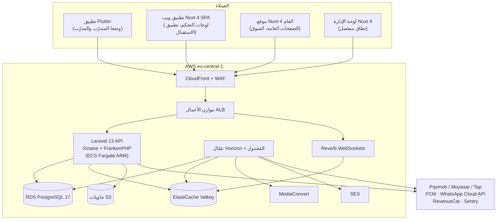

---

## 4. معمارية تعدد المستأجرين

### 4.1 ماذا يعني "المستأجر" هنا

يوجد **نوعان من مالكي البيانات**، لا نوع واحد:

| المالك | أمثلة | مفتاح العزل |
|---|---|---|
| **المنشأة** (جيم أو نشاط تدريب) | الموظفون، الخطط، العقود، المبيعات، ورديات النقدية، قوالب البرامج، العملاء المحتملون، ملاحظات المدرّب، الفواتير الصادرة من المنشأة | `organization_id` |
| **الشخص** (المساحة الشخصية) | سجلات التمارين، قياسات الجسم، الصور، الملف الصحي، يوميات الطعام، نسخ البرامج المسندة، سجلات الموافقة | `person_id` |

الكائنات المشتركة (اتفاق تدريب، محادثة، حجز حصة) ترتبط بالطرفين وتحدد طرفاً مالكاً (القسم 8.4). التعاون بين المستأجرين يتم فقط عبر **أذونات الوصول إلى البيانات** (من الشخص إلى المنشأة) و**علاقات العملاء**؛ ولا تتشارك المنشآت البيانات فيما بينها مباشرة أبداً.

### 4.2 مقارنة استراتيجيات العزل

| الاستراتيجية | العزل | التكلفة | تعقيد التشغيل | الميزات العابرة للمستأجرين (السوق، شخص في عدة منشآت) | الملاءمة |
|---|---|---|---|---|---|
| **قاعدة بيانات ومخطط مشتركان، أعمدة المستأجر + تقييد في التطبيق + RLS في Postgres** | منطقي (قوي مع RLS) | الأقل | منخفض | طبيعية | **المختار** |
| مخطط (Schema) لكل منشأة | منطقي أقوى | منخفضة–متوسطة | تهجيرات × N مخطط؛ التعامل مع الاتصالات/search_path | محرجة: بيانات الشخص تمتد عبر منشآت؛ والمساحة الشخصية ليس لها مخطط منشأة | لا |
| قاعدة بيانات لكل منشأة | قوي | مرتفعة (آلاف المنشآت) | مرتفع | محرجة جداً | فقط لخلية مستقبلية للمؤسسات/التوطين |
| **الخلية (Cell)** (حزمة كاملة لكل منطقة/شريحة، دون مشاركة) | قوي، إقليمي | متوسطة لكل خلية | متوسط | خدمة دليل توجّه المستخدمين | **لاحقاً** لتوطين بيانات السعودية أو للسلاسل الكبيرة جداً (القسم 4.6) |

**[قرار] ADR-005:** قاعدة بيانات ومخطط مشتركان؛ كل استعلام مقيّد في التطبيق؛ **أمان PostgreSQL على مستوى الصف كخط دفاع ثانٍ** على جداول المستأجرين والجداول الحساسة؛ والخلايا فقط عندما يتطلبها التوطين أو عقد مؤسسي.

### 4.3 سياق الطلب

كل طلب مصادَق عليه يحمل:

- رمز الحامل (Bearer token) ← **الشخص**؛
- `X-Workspace: personal` أو `X-Workspace: org:{organizationId}` ← **سياق التصرف**؛
- `X-Branch-Id` اختيارياً لنقاط النهاية المقيدة بفرع (الاستقبال، نقطة البيع، الحصص).

تقوم طبقة وسيطة (Middleware) بحل السياق والتحقق منه (يجب أن يكون للشخص تعيين نشط في تلك المنشأة، والفرع ضمن نطاقه)، ثم:

1. تربط `CurrentContext` (الشخص، المنشأة، الفرع، تعيين الموظف، الأدوار، الصلاحيات، مفتاح ذاكرة الأذونات النشطة)؛
2. تضبط إعدادات جلسة Postgres لـ RLS: ‏`app.person_id`، `app.org_id`، `app.staff_id`، `app.context` ‏(`personal` / `org` / `system`)؛
3. توسم السجلات والتتبعات وSentry والمهام في الطوابير بالسياق (معرّف الشخص مُجزّأ (hashed) في السجلات).

### 4.4 تصميم الأمان على مستوى الصف (RLS)

- يتصل التطبيق بالدور `app_rw` (دون `BYPASSRLS`). التهجيرات تعمل بالدور `app_owner`. ودور ضيق `app_system` بصلاحية `BYPASSRLS` تستخدمه فقط مهام نظام مسماة (دورات الفوترة، حذف البيانات وفق الاحتفاظ، إعادة الفهرسة)، وكل استخدام له يُدقَّق.
- **جداول المنشآت** (`organization_id` إلزامي): السياسة `organization_id = current_setting('app.org_id')::uuid`.
- **الجداول الشخصية** (`person_id` إلزامي): تسمح السياسة للمالك، أو لسياق منشأة لديها إذن نشط للنطاق المطلوب:

```sql
CREATE POLICY personal_rw ON body_metrics
USING (
  person_id = nullif(current_setting('app.person_id', true), '')::uuid
  OR app_has_grant(person_id, 'body.read')
)
WITH CHECK (
  person_id = nullif(current_setting('app.person_id', true), '')::uuid
  OR app_has_grant(person_id, 'body.write')
);

-- STABLE, SECURITY DEFINER, indexed lookup on (person_id, organization_id, status)
CREATE FUNCTION app_has_grant(p_person uuid, p_scope text) RETURNS boolean
LANGUAGE sql STABLE SECURITY DEFINER AS $$
  SELECT EXISTS (
    SELECT 1
    FROM data_access_grants g
    JOIN client_assignments ca ON ca.org_client_id = g.org_client_id
    WHERE g.person_id = p_person
      AND g.organization_id = nullif(current_setting('app.org_id', true), '')::uuid
      AND g.status = 'active'
      AND now() <@ g.valid_during
      AND p_scope = ANY (g.scopes)
      AND (current_setting('app.staff_role_all_clients', true) = 'on'
           OR ca.staff_assignment_id = nullif(current_setting('app.staff_id', true), '')::uuid)
  );
$$;
```

- RLS **دفاع إضافي**: التطبيق يقيّد الاستعلامات أيضاً (نطاقات عامة، سياسات) بحيث تكشف الاختبارات أي سياسة ناقصة، ويلتقط RLS أي تقييد ناقص في الكود.
- نظافة السياق مع Octane (عمّال دائمون واتصالات دائمة): يُضبط السياق **في بداية كل طلب ومهمة** باستخدام `set_config(..., false)` و**يُعاد ضبطه في خطاف الإنهاء**؛ واختبار يؤكد أن طلباً بلا سياق يرى صفر صفوف. لا PgBouncer بوضع تجميع المعاملات (سيكسر إعدادات الجلسة)؛ وإذا أُضيف RDS Proxy لاحقاً، يُستخدم `SET LOCAL` داخل معاملات صريحة لتقليل التثبيت (Pinning).

### 4.5 منع التسرب خارج قاعدة البيانات

| الطبقة | الخطر | الضابط |
|---|---|---|
| الواجهة البرمجية | الوصول المباشر غير الآمن للكائنات (IDOR: تخمين معرّفات منشأة أخرى) | سياسات على كل مسار (اختبار معماري يُفشل أي مسار بلا تفويض، كما في قاعدة كود المؤسس)؛ معرّفات UUIDv7 (ليست سرية، لكنها غير قابلة للعد)؛ 404 بدلاً من 403 للكائنات خارج المستأجر |
| المهام في الخلفية | مهمة تعمل بلا سياق أو بسياق خاطئ | المهام التي تنفّذ `TenantAware` تسلسل `{person, org, staff}` وتستعيد السياق في طبقة وسيطة؛ والمهام بدونه تعمل كـ `system` فقط إن كانت مدرجة |
| الذاكرة المؤقتة | تصادم مفاتيح بين المستأجرين | منشئ المفاتيح يتطلب نطاقاً: `org:{id}:…`، `person:{id}:…`، `public:…`؛ مصفوفات فقط (لا نماذج مسلسلة أبداً) |
| البحث | بيانات خاصة بالمنشأة في فهرس عام | الفهرس العام يحتوي فقط حقول الصفحات/العروض المنشورة؛ والبحث الخاص يبقى في Postgres تحت RLS |
| الاتصال اللحظي | الاشتراك في قناة مستأجر آخر | دوال تفويض القنوات (القسم 10.3)؛ أسماء القنوات تتضمن معرّفات لكن التفويض يُفحص على الخادم |
| الملفات | مفاتيح S3 قابلة للتخمين، حاويات عامة | حاويات خاصة مع حجب الوصول العام؛ المفاتيح تتضمن معرّفات وسائط عشوائية؛ الوصول فقط عبر روابط موقّعة قصيرة العمر بعد فحص السياسات؛ وحاوية منفصلة للبيانات الحساسة (القسم 16.4) |
| التقارير/التصدير | ضم بين المستأجرين في SQL | التقارير تعمل في سياق المنشأة على نسخة القراءة مع RLS؛ والتصدير تولّده مهام بسياقها ويُخزَّن بشكل خاص لمدة 24 ساعة |
| السجلات/التحليلات | بيانات شخصية في السجلات؛ تسرب في تحليلات المنتج | سجلات منظمة بمعرّفات مُجزّأة؛ قواعد تنقية في Sentry؛ أحداث التحليلات لا تتضمن قيماً صحية |
| الإدارة/الدعم | موظفو المنصة يتصفحون بيانات العملاء | وصول الدعم يتطلب جلسة دعم تمنحها المنشأة ومحددة المدة؛ وبيانات المساحة الشخصية لا تظهر للدعم أبداً دون موافقة الشخص؛ وكل ذلك مُدقَّق |

### 4.6 الخلايا الإقليمية (مستقبلاً)

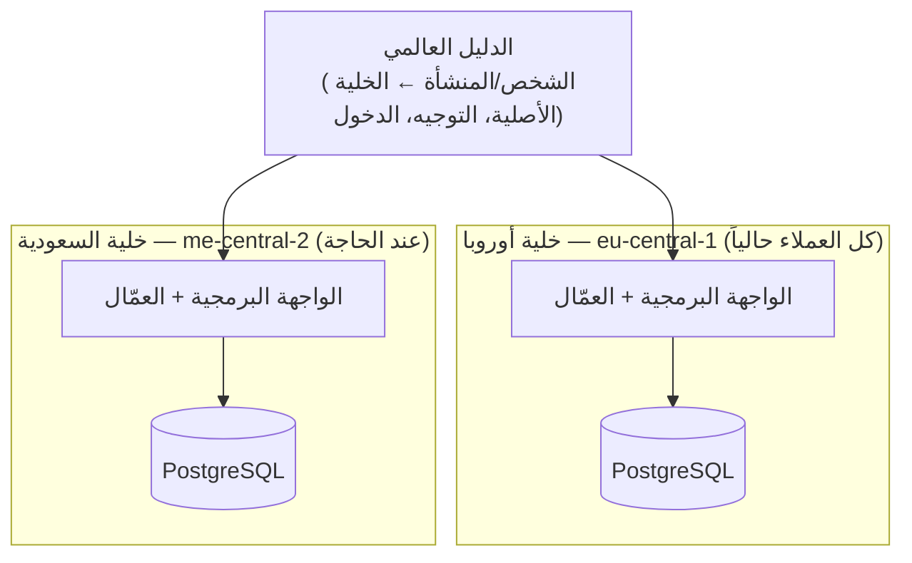

ما نجهّزه الآن (رخيص): معرّفات UUIDv7 (لا تصادم في التسلسلات)، و`home_region` في `persons` و`organizations`، ولا عمليات ضم بين الوحدات تفترض قاعدة بيانات واحدة للسوق (يقرأ من إسقاط/Projection)، ومفاتيح الوسائط مسبوقة بالمنطقة. ما نؤجله (مكلف): خدمة الدليل، والاتفاقات العابرة للخلايا (مدرّب سعودي بعميل مصري ← الاتفاق يعيش في خلية العميل؛ وتطبيق المدرّب يتحدث مع خليتين). المحفّز: عميل سعودي موقّع أو اشتراط تنظيمي للاستضافة داخل المملكة، مع إتاحة منطقة AWS السعودية عامةً بالخدمات التي نستخدمها [S36].

---

## 5. نموذج الهوية والتفويض

### 5.1 الهوية

| العنصر | التصميم |
|---|---|
| الشخص | صف واحد لكل إنسان في `persons`؛ الهاتف (بصيغة E.164) هو المعرّف الأساسي (فريد عند التحقق)؛ البريد اختياري وفريد عند التحقق؛ `birth_date` (قواعد العمر)، `locale`، `home_region`. |
| طرق الدخول | رمز تحقق على الهاتف (قالب مصادقة واتساب أولاً، ثم SMS كبديل)، بريد + كلمة مرور (Argon2id)، الدخول بحساب Apple (مطلوب على iOS عند تقديم دخول اجتماعي آخر **[تحقق من الإرشاد 4.8 الحالي]**)، Google. مفاتيح المرور (Passkeys) في P3. |
| الأشخاص غير المُطالَب بهم | يمكن للاستقبال والمدرّبين إنشاء عضو/عميل برقم الهاتف قبل تثبيته للتطبيق. يكون الصف `claimed_at = null` ويحتوي فقط ما أدخلته المنشأة. عندما يتحقق الشخص من الرقم نفسه برمز التحقق، فإنه **يطالب** به؛ وتبقى السجلات التجارية التي أنشأتها المنشأة مملوكة لها، وتبدأ المساحة الشخصية فارغة. المطالبة لا تدمج أبداً حسابين متحققين بصمت — التكرارات تذهب لدمج بمساعدة الدعم. |
| الجلسات — الجوال | رموز Sanctum غامضة لكل جهاز (مُجزّأة عند التخزين)، محفوظة في Keychain/Keystore، صلاحية متجددة 60 يوماً، مع قائمة "الأجهزة" وإمكانية الإلغاء. |
| الجلسات — الويب | **جلسات Sanctum بملفات تعريف الارتباط** (HttpOnly، Secure، SameSite=Lax، رمز CSRF) على نطاقات فرعية خاصة بنا — البيانات الصحية لا يجب أن تكون في رموز `localStorage` يمكن للسكربتات المحقونة قراءتها. |
| الجلسات — الإدارة | حارس منفصل، نطاق منفصل، رموز صلاحيتها 12 ساعة، TOTP إلزامي، قائمة عناوين IP مسموحة. |
| التحقق بخطوتين | TOTP للملاك/المديرين (مطلوب بالسياسة لمنشآت Growth/Pro ولكل من لديه `payments.*` أو `clients.view_all`)، ورموز استرداد مُجزّأة. |
| ضوابط إساءة الاستخدام | رمز التحقق: 5 إرسالات لكل هاتف كل 15 دقيقة، و20 لكل IP في الساعة، مع تباطؤ أسي؛ قفل الدخول بعد 5 محاولات فاشلة (15 دقيقة)؛ إشارات خطر (جهاز جديد + دولة جديدة) ← تحقق إضافي. |
| القاصرون | العمر < 18 ← يلزم وليّ أمر (`guardianships`)، والموافقة من وليّ الأمر، ولا مشتريات من السوق، ولا تقييمات عامة، والصور مغلقة افتراضياً (بيانات الأطفال حساسة وفق القانون 151 [S28]). |

### 5.2 لماذا نموذج تفويض هجين

| النموذج | يتعامل جيداً مع | يفشل في | الحكم |
|---|---|---|---|
| RBAC (أدوار ← صلاحيات) | "موظفو الاستقبال يمكنهم بيع العضويات" | "…فقط في الفرع س"، "فقط للعملاء المسندين لي"، "فقط إذا منح العميل الإذن" | ضروري لكنه غير كافٍ |
| ABAC (قواعد سمات، مثل Cedar/OPA) | النوافذ الزمنية، الفرع، حالة العقد، الحساسية | رسوم العلاقات تتحول إلى فوضى سمات؛ ومحرك إضافي للتشغيل | نستخدم السمات داخل السياسات، دون محرك منفصل حالياً |
| ReBAC (نمط Zanzibar: ‏OpenFGA، SpiceDB) | "مدرّب س لعميل ص في منشأة ع"، الهرميات | تكلفة تشغيلية؛ اتساق الكتابة المزدوجة مع Postgres؛ مبالغة لحجمنا | مؤجل (الامتياز/العافية المؤسسية في P5) |
| **هجين داخل التطبيق (المختار)** | RBAC للإجراءات + جداول العلاقات (التعيينات، الأذونات) + شروط السمات، كلها في سياسات Laravel مدعومة بـ Postgres + RLS | يحتاج انضباطاً واختبارات | **ADR-009** |

### 5.3 طبقات القرار

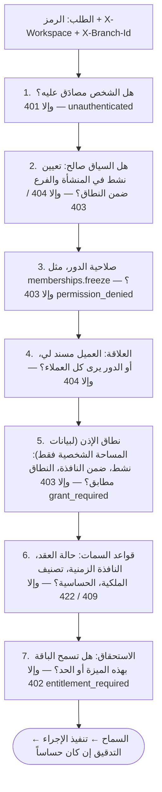

الطبقات 1–6 تجيب عن "هل يحق لهذا الشخص فعل ذلك؟"؛ والطبقة 7 تجيب عن "هل دفعت هذه المنشأة مقابله؟" — وتُفصل حتى لا يتحول اشتراك منتهٍ أبداً إلى قرار خصوصية.

### 5.4 الصلاحيات والأدوار ونطاقات الأذونات

**مفاتيح الصلاحيات** تعلنها كل وحدة في ملف تعريفها (`module.php`)، مثلاً:

| الوحدة | أمثلة صلاحيات |
|---|---|
| Organizations | `org.settings`، `staff.manage`، `branches.manage` |
| Coaching | `clients.view_assigned`، `clients.view_all`، `clients.assign`، `programs.manage_templates`، `checkins.review`، `packages.manage`، `leads.manage` |
| Gym | `members.register`، `memberships.sell`، `memberships.freeze`، `memberships.cancel`، `memberships.transfer`، `frontdesk.checkin`، `classes.manage`، `classes.book_for_member`، `pt.sell`، `pt.confirm` |
| Commerce | `pos.sell`، `pos.refund`، `inventory.manage`، `cash.close_shift`، `cash.view_expected` |
| Compensation | `commissions.manage_rules`، `earnings.view_own`، `earnings.view_all`، `statements.approve` |
| Payments | `payments.record`، `payments.refund`، `gateway.connect`، `payouts.view` |
| Reporting | `reports.view`، `reports.financial`، `reports.export` |
| Audit | `audit.view` |

**الأدوار الافتراضية** (يمكن للمنشآت نسخها وتعديلها؛ والمالك لديه دائماً كل صلاحيات الوحدات المستحقة للمنشأة):

| الدور | صلاحيات الجيم الافتراضية | صلاحيات نشاط التدريب الافتراضية |
|---|---|---|
| المالك | الكل | الكل |
| المدير / مدير الفرع | الكل عدا الفوترة و`staff.manage` (مدير الفرع: فروعه فقط) | الكل عدا الفوترة |
| موظف الاستقبال | `members.register`، `memberships.sell`، `memberships.freeze`، `frontdesk.checkin`، `classes.book_for_member`، `pos.sell`، `payments.record` | — |
| مدرّب (داخلي) | `clients.view_assigned`، `programs.manage_templates`، `checkins.review`، `pt.confirm`، `earnings.view_own` | — |
| مدرّب (فريق) | — | `clients.view_assigned`، `programs.manage_templates`، `checkins.review`، `earnings.view_own` |
| أخصائي تغذية | `clients.view_assigned` (نطاقات التغذية فقط) | مثله |

**نطاقات الأذونات** (ما يشاركه الشخص مع المنشأة):

| النطاق | يغطي | الافتراضي في اتفاق تدريب | الافتراضي في عضوية جيم |
|---|---|---|---|
| `training.read` / `training.write` | سجلات التمارين، الأرقام القياسية، البرامج المسندة | ✓ / ✓ | — (فقط مع شراء تدريب شخصي) |
| `body.read` / `body.write` | الوزن، القياسات | ✓ / ✓ | — |
| `photos.read` | صور التقدم | يُطلب منفصلاً (اختياري) | — |
| `nutrition.read` / `nutrition.write` | اليوميات، خطط الوجبات | ✓ / ✓ | — |
| `health.read` | إجابات الجاهزية، الإصابات، الحالات | ✓ (لازم لبرمجة آمنة) | — |
| `checkins.read` / `checkins.write` | إرسالات المتابعة/الملاحظات | ✓ / ✓ | — |
| `wearables.read` | بيانات الأجهزة المتزامنة | اختياري | — |
| النافذة التاريخية | إلى أي مدى في الماضي تقرأ المنشأة | آخر 90 يوماً + المستقبل | — |

ترى الجيمات **بيانات الأعمال** التي تملكها (العقود، الزيارات، الحجوزات، المدفوعات) دون أي إذن؛ أما بيانات التدريب/الصحة فتحتاج إذناً مثل أي طرف آخر.

### 5.5 التقييم والتخزين المؤقت

```php
// Pseudocode — Coaching module policy
public function viewBodyMetrics(Context $ctx, Person $client): bool
{
    return $ctx->inOrg()
        && $ctx->can('clients.view_assigned')                        // RBAC
        && ($ctx->can('clients.view_all') || $ctx->isAssignedTo($client)) // relationship
        && $ctx->grants()->allows($client->id, 'body.read');           // consent scope + window
}
```

- مجموعات الصلاحيات لكل `(person, org)` تُخزَّن كمصفوفات (`perm:{org}:{person}:v{n}`)، ويُرفع رقم الإصدار عند تغيير الأدوار/التعيينات.
- مجموعات الأشخاص الممنوح لهم إذن لكل `(org, staff, scope)` تُخزَّن (`grants:{org}:{staff}:{scope}:v{n}`)، ويُرفع رقم الإصدار عند إنشاء/إلغاء/انتهاء الإذن — وتُستخدم لتصفية القوائم ("عملائي الذين شاركوا الصور").
- كل قراءة موظف لبيانات `health.*` أو `photos.*` أو `body.*` تكتب صفاً في `data_access_log` (على دفعات)، يراه المتدرّب في مركز الموافقات ("الكوتش نور اطّلعت على صور متابعتك في 12 أكتوبر").

### 5.6 وصول الدعم ووصول الطوارئ

لا يملك دعم المنصة أي وصول دائم إلى بيانات المنشآت أو المساحات الشخصية. يمكن لمالك المنشأة فتح **جلسة دعم** (النطاق: بيانات أعمال المنشأة، 24 ساعة كحد أقصى) من الإعدادات؛ وبيانات المساحة الشخصية تحتاج إضافةً لذلك رابط موافقة من الشخص. ومسار الطوارئ للحوادث القانونية/الأمنية يتطلب مديرَين اثنين من المنصة، ويسجل سبباً، ويُبلغ مالك المنشأة المتأثرة بعد ذلك.

---

## 6. المعمارية الكاملة للنظام

### 6.1 سياق النظام

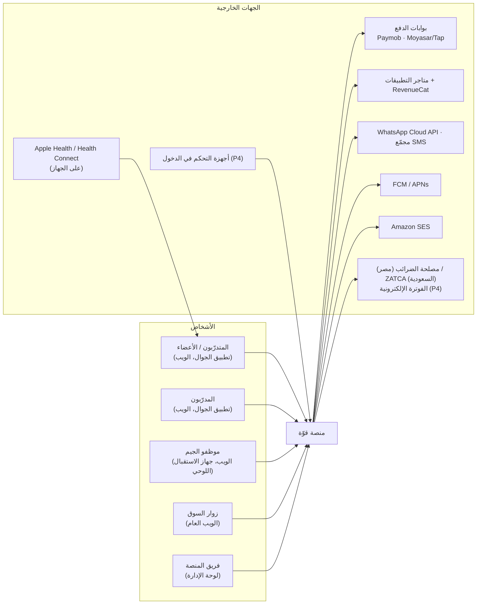

### 6.2 الحاويات (Containers)

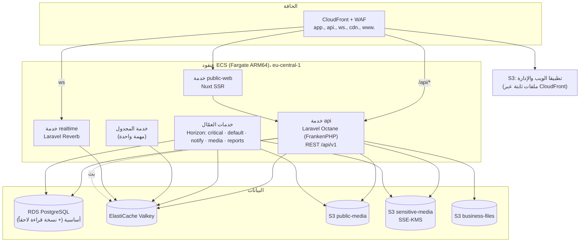

ملاحظات:
- **لا منتج بوابة API منفصل.** CloudFront ← ALB ← ECS يوفر TLS وWAF والتوجيه ودعم WebSocket. بوابة API Gateway ستضيف تكلفة لكل طلب ومهلة تكامل 29 ثانية دون فائدة هنا.
- **لا خدمة BFF منفصلة.** يقدّم التطبيق المتكامل بعض نقاط النهاية المصممة على شكل الشاشات للجوال (`/me/today`، `/coach/inbox`) — أي BFF *داخل* الواجهة البرمجية. نعيد النظر فقط إذا ظهر نوع ثالث من العملاء باحتياجات مختلفة جداً.
- تطبيقات SPA الثابتة تُقدَّم من S3 عبر CloudFront (رخيصة ومخزنة مؤقتاً)؛ والموقع العام بالتوليد على الخادم هو الوحيد الذي يعمل كحاوية.

### 6.3 مسارات التشغيل الرئيسية

**مزامنة التمارين دون إنترنت**

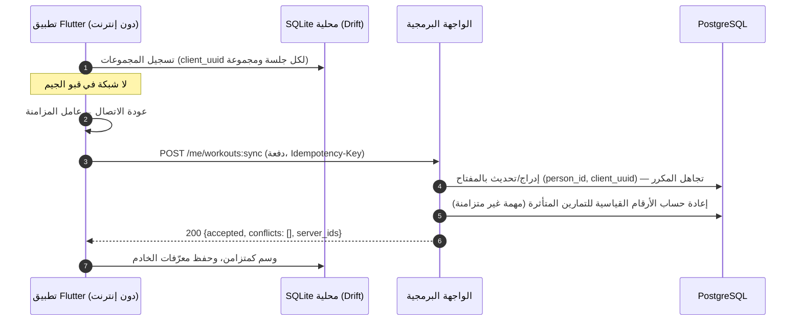

**تسجيل الدخول في الاستقبال (متصل، مع بديل دون إنترنت)**

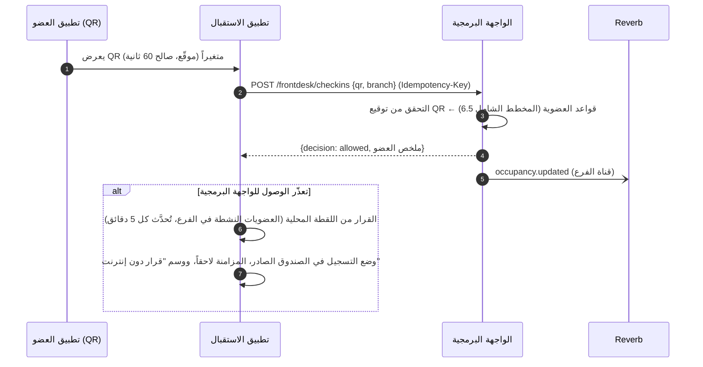

لا يمنع الاستقبال الأعضاء أبداً بسبب انقطاع. اللقطة المحلية تحتوي فقط ما يحتاجه القرار (معرّف العضو، الاسم، الحالة، تاريخ الانتهاء، صورة صغيرة)، وتعيش خلف قفل التطبيق برمز PIN، وتُمسح بعد 24 ساعة دون تحديث.

### 6.4 عزل الأعطال والمرونة

| الجانب | التصميم |
|---|---|
| الاستدعاءات الخارجية البطيئة (البوابات، واتساب، FCM) | لا تكون أبداً في مسار الطلب إلا عمليات إعادة التوجيه للدفع؛ مهام في طوابير بمهل (5–10 ثوانٍ)، وإعادة محاولة بتراجع متذبذب، وقاطع دائرة لكل مزوّد (يفتح بعد N إخفاقات، ونصف مفتوح للاختبار) |
| عزل الطوابير | طوابير Horizon وعمليات عمّال منفصلة: `critical` (Webhooks الدفع، الاستحقاقات)، `default`، `notify` (الإشعارات/واتساب/البريد)، `media` (الصور/الفيديو)، `reports` (التصدير). سيل من مهام الوسائط لا يؤخر المدفوعات. |
| تعطل الاتصال اللحظي | الرسائل تُحفظ أولاً؛ وإذا تعطل Reverb يعود العملاء إلى الاستطلاع `GET /conversations/{id}/messages?after_seq=` كل 15 ثانية |
| ضغط قاعدة البيانات | مهلة استعلام 5 ثوانٍ لدور الواجهة، و60 ثانية لدور التقارير؛ نسخة قراءة للتقارير (من شريحة النمو) |
| فشل النشر | قاطع دائرة النشر في ECS مع تراجع تلقائي؛ تهجيرات بنمط التوسيع/التقليص (القسم 23.4) |
| الجوال | تسجيل دون إنترنت أولاً؛ كل الكتابات عبر صندوق صادر بمعرّفات غير مكررة الأثر |
| الاستقبال | بديل اللقطة المحلية (القسم 6.3) |

---

## 7. حدود النطاقات والوحدات

### 7.1 الوحدات

يعيش الكود في `app/Modules/{Name}` مع ملفات تعريف `module.php` (الصلاحيات، المسارات، عناصر القائمة، الميزات، الأحداث) — الاصطلاح نفسه الذي يستخدمه المؤسس بالفعل. يمكن للوحدة الإشارة فقط إلى `Contracts\` (الواجهات) و`Events\` في الوحدات الأخرى؛ وتفرض ذلك اختبارات معمارية.

| الوحدة | المسؤولية | تملك (الجداول الرئيسية) | تعرض (العقود) | تنشر (الأحداث) |
|---|---|---|---|---|
| **Identity** | الأشخاص، بيانات الدخول، رموز التحقق، الأجهزة/الرموز، التحقق بخطوتين، الولاية | persons، person_devices، otp_challenges، guardianships | `PersonDirectory`، `AccountSecurity` | `PersonRegistered`، `PersonClaimed`، `PersonErased` |
| **Organizations** | المنشآت، الفروع، تعيينات الموظفين، الأدوار، الدعوات | organizations، branches، staff_assignments، roles، role_permissions، org_clients، client_assignments | `OrgDirectory`، `StaffDirectory`، `ClientRegistry` | `OrgCreated`، `StaffAssigned`، `ClientAdded` |
| **Access** | الأذونات، سجلات الموافقة، سجل الوصول، جلسات الدعم | data_access_grants، consent_records، data_access_log، support_sessions | `Grants`، `ConsentLedger` | `GrantGiven`، `GrantRevoked`، `GrantExpired` |
| **Exercises** | مكتبة التمارين (المنصة + المخصصة للمنشأة) | exercises، exercise_media | `ExerciseCatalog` | — |
| **Training** | قوالب البرامج، البرامج المسندة، سجلات التمارين، الأرقام القياسية | program_templates، assigned_programs، workout_sessions، workout_sets، personal_records | `ProgramDelivery`، `TrainingStats` | `ProgramAssigned`، `WorkoutLogged`، `PersonalRecordSet` |
| **Body** | قياسات الجسم، صور التقدم، الملف الصحي | body_metrics، progress_photos، health_profiles | `BodyStats` | `BodyMetricRecorded` |
| **Nutrition** | الأطعمة، خطط الوجبات، يوميات الطعام، العادات | foods، meal_plans، food_logs، habits، habit_logs | `NutritionPlans` | `MealPlanAssigned` |
| **Coaching** | الباقات، الاتفاقات، نماذج الاستقبال، المتابعات، الملاحظات، العملاء المحتملون | coaching_packages، coaching_engagements، forms، form_responses، progress_checkins، coach_notes، leads | `Engagements` | `EngagementStarted`، `EngagementEnded`، `CheckinSubmitted`، `CheckinReviewed` |
| **Gym** | خطط العضوية، العقود، التجميد، الزيارات، الحصص، الحجوزات، أرصدة التدريب الشخصي، المرافق | membership_plans، gym_memberships، membership_events، gym_visits، class_*، class_bookings، pt_credit_lots، equipment | `Memberships`، `ClassBooking` | `MembershipActivated`، `MembershipFrozen`، `MembershipExpired`، `VisitRecorded`، `BookingPromoted` |
| **Scheduling** | الأوقات المتاحة، الجلسات القابلة للحجز (تدريب شخصي، استشارات) | availability_rules، sessions | `Calendar` | `SessionBooked`، `SessionConfirmed`، `SessionCancelled` |
| **Compensation** | اتفاقيات المدرّبين، قواعد العمولة، المستحقات، الكشوف | trainer_agreements، commission_rules، earnings_lines، trainer_statements | `Earnings` | `StatementApproved` |
| **Commerce** | المنتجات، مبيعات نقطة البيع، المخزون، ورديات النقدية، تحصيل المنشآت | products، product_variants، sales، sale_lines، sale_payments، stock_levels، stock_movements، cash_shifts، cash_movements | `Sales`، `CashDrawer`، `StockLedger` | `SaleCompleted`، `SaleRefunded` |
| **Payments** | محوّلات البوابات، نوايا الدفع، صندوق Webhooks، الإثباتات اليدوية، الصرف، الدفتر | payment_intents، payments، payment_methods، webhook_events، manual_payment_proofs، payouts، ledger_* | `PaymentGateway`، `Ledger`، `Payouts` | `PaymentSucceeded`، `PaymentFailed`، `RefundSucceeded`، `ChargebackOpened` |
| **Billing** | باقات المنصة، الاشتراكات، الفواتير، الكوبونات، الأرصدة، الشراء داخل التطبيق، الاستحقاقات | plans، plan_prices، subscriptions، subscription_items، usage_records، invoices، invoice_lines، coupons، credits، entitlements | `Entitlements`، `Subscriptions` | `SubscriptionActivated`، `SubscriptionPastDue`، `EntitlementsChanged` |
| **Marketplace** | الصفحات العامة، العروض، التحقق، التقييمات، الطلبات، نسب المصدر، النزاعات، إسقاط البحث | public_profiles، listings، verifications، reviews، marketplace_orders، attributions، disputes | `PublicProfiles`، `Attribution` | `OrderPaid`، `ReviewPublished` |
| **Messaging** | المحادثات، الرسائل، المرفقات، حالة القراءة | conversations، conversation_participants، messages | `Conversations` | `MessageSent` |
| **Notifications** | داخل التطبيق، فورية، بريد، واتساب، SMS؛ القوالب، التفضيلات | notifications، push_tokens، notification_preferences، message_templates، outbound_messages | `Notifier` | — |
| **Media** | الرفع، المعالجة، الوصول الموقّع | media | `MediaStore` | `MediaReady` |
| **Reporting** | تعريفات تقارير للقراءة فقط على جداول الوحدات الأخرى (SQL، لا نماذج أبداً) | report_runs، exports | — | — |
| **Audit** | سجل عمليات المنشأة | audit_events | `Auditor` | — |
| **Admin** | لوحة المنصة، الإشراف، قائمة التحقق | admin_users، admin_actions | — | — |

النواة المشتركة (`app/Support`): سياق تعدد المستأجرين، المال (كائن القيمة `Money` بالوحدات الصغرى)، المعرّفات، تطبيع النص العربي (`SearchText`)، ترقيم المستندات، الصندوق الصادر، عدم تكرار الأثر، استجابات أخطاء HTTP، مفاتيح الميزات.

### 7.2 خريطة الاعتماديات (الاتجاهات المسموحة)

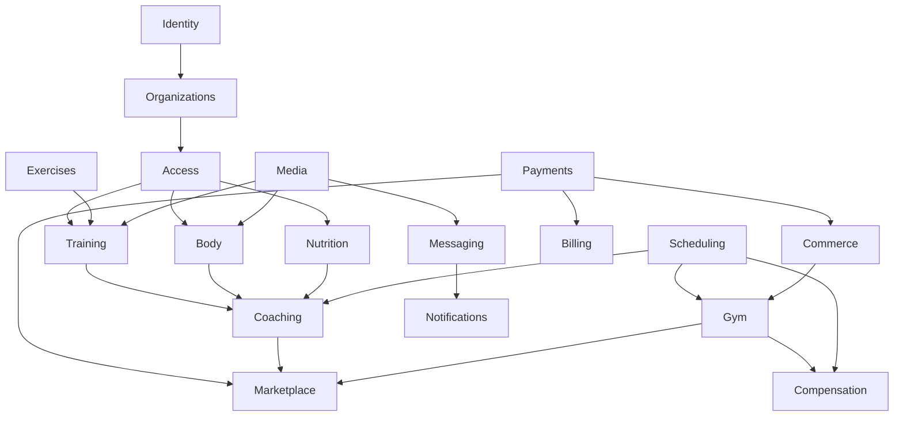

الأسهم تعني "تُستخدم من قِبل" (عبر العقود). عقد `Entitlements` في Billing تستخدمه كل الوحدات (غير مرسوم). وحدتا Reporting وAudit تقرآن/تكتبان عبر الوحدات بحكم التصميم ومستبعدتان من الرسم.

### 7.3 تطبيق متكامل مقسّم إلى وحدات أم خدمات مصغّرة

| العامل | تطبيق متكامل مقسّم إلى وحدات | خدمات مصغّرة |
|---|---|---|
| فريق من 2–6 مهندسين | مستودع واحد، نشر واحد، مصحح أخطاء واحد | تكلفة التنسيق تفوق الفريق |
| المعاملات عبر العقود/المدفوعات/المخزون | معاملة ACID واحدة (مثلاً: بيع ← صرف مخزون ← دفتر ← عضوية) | Sagas، صندوق صادر لكل خدمة، أخطاء الاتساق النهائي |
| تكلفة البنية التحتية | 3–5 خدمات ECS | أكثر من 15 خدمة، وأدوات شبكة خدمات/مراقبة |
| التوسع المستقل | العمّال والاتصال اللحظي خدمات ECS منفصلة بالفعل من الصورة نفسها | أدق |
| عزل الأعطال | فصل الطوابير والخدمات حسب الدور (القسم 6.4) | أقوى |
| **الحكم** | **المختار (ADR-001)** | فقط بالفصل عند تحقق المحفّز |

### 7.4 مرشحو الفصل ومحفزاته

| المرشح | المحفّز للفصل | الشكل |
|---|---|---|
| بوابة الاتصال اللحظي | > 50 ألف اتصال متزامن أو Reverb مقيد بالمعالج | خدمة منفصلة بالفعل؛ يمكن نقلها لبوابة Go/Elixir تتحدث بروتوكول Pusher |
| معالجة الوسائط | > 20% من معالج العمّال أو ميزات كثيفة الفيديو | مسار Lambda/MediaConvert يُطلق بأحداث S3 |
| إسقاط البحث | إدخال OpenSearch | مُفهرِس يستهلك أحداث الصندوق الصادر |
| المدفوعات/الدفتر | اشتراط ترخيص لأنظمة منفصلة، أو طلب تدقيق | خدمة منفصلة بقاعدة بيانات خاصة وواجهة صارمة |
| خدمات الذكاء الاصطناعي | P4/P5 | مجموعة عمّال منفصلة تستدعي واجهات نماذج اللغة، بمفاتيح وحصص معزولة |

---

## 8. معمارية قاعدة البيانات ومخططات الكيانات والعلاقات

### 8.1 الاصطلاحات

| الموضوع | القاعدة |
|---|---|
| المحرك | PostgreSQL 17 على RDS؛ الإضافات `pg_trgm`، `postgis`، `pgcrypto`، `btree_gist`، `unaccent` (غير مستخدمة للعربية؛ التطبيع العربي يتم في الكود) |
| المعرّفات | UUIDv7 ‏(`HasUuids`) لكل شيء عدا جداول الربط الخالصة؛ مرتبة زمنياً فتبقى إدراجات B-tree متجاورة |
| المال | `bigint` بالوحدات الصغرى (`*_minor`) + `currency char(3)`؛ لا أعداد عشرية أبداً. الجنيه والريال كلاهما 100 وحدة صغرى |
| الأوزان / القياسات | أعداد صحيحة بالوحدات الأساسية: جرامات (`weight_g`)، ملليمترات، ثوانٍ، أمتار؛ وRPE كـ `numeric(3,1)` |
| الوقت | `timestamptz` (UTC) للّحظات؛ و`date` لأيام العمل بتوقيت المنشأة (`Africa/Cairo`، `Asia/Riyadh`)؛ وقواعد التكرار كنصوص RFC 5545 |
| المستندات | هياكل البرامج وخطط الوجبات كـ `jsonb` بإصدارات يُتحقق منها بـ JSON Schema ‏(ADR-011)؛ وكل ما يُستعلم عنه أو يُجمَّع عمود عادي |
| الإضافة فقط | `membership_events`، `stock_movements`، `cash_movements`، `ledger_entries`، `consent_records`، `data_access_log`، `audit_events`، `messages` (التعديلات إصدارات جديدة) — لا صلاحيات UPDATE/DELETE للدور `app_rw` على هذه الجداول |
| الترتيب | الدفاتر وتيارات الأحداث تُرتب بعمود `seq bigint GENERATED ALWAYS AS IDENTITY`، لا بالطوابع الزمنية أبداً |
| الحذف المرن | فقط حيث يتوقع المستخدمون "التراجع" (البرامج، القوالب، المنتجات). حذف البيانات الشخصية حذف حقيقي أو إخفاء هوية (القسم 16.7) |
| أعمدة البحث | `search_name text` مطبَّع (أإآ←ا، ة←ه، ى←ي، مع إزالة التشكيل/التطويل) مع فهرس `gin_trgm_ops` |

### 8.2 مخططات الكيانات والعلاقات

تبقى المخططات بالإنجليزية لأن أسماء الجداول والأعمدة معرّفات برمجية. وتُعرض على صفحات A3 أفقية في نسخة PDF.

#### 8.2.1 الهوية والمنشآت والوصول

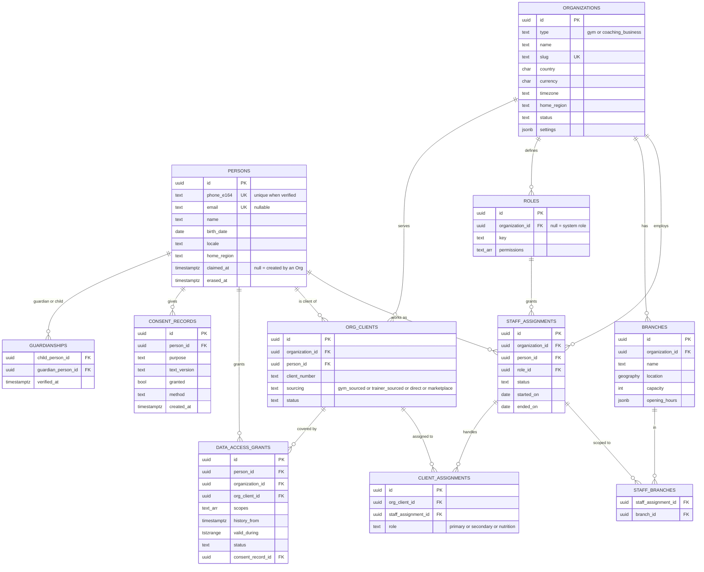

#### 8.2.2 المساحة الشخصية — التدريب، الجسم، التغذية

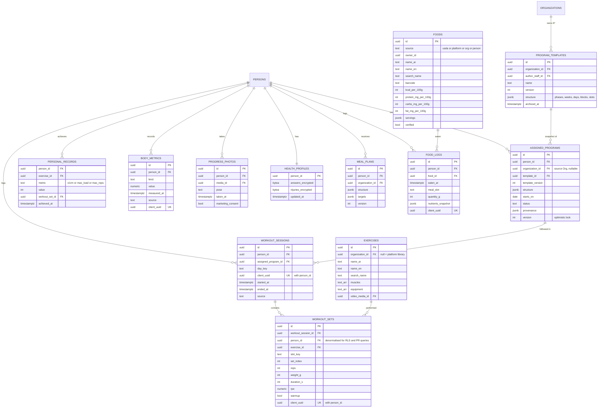

#### 8.2.3 التدريب (Coaching) والجدولة

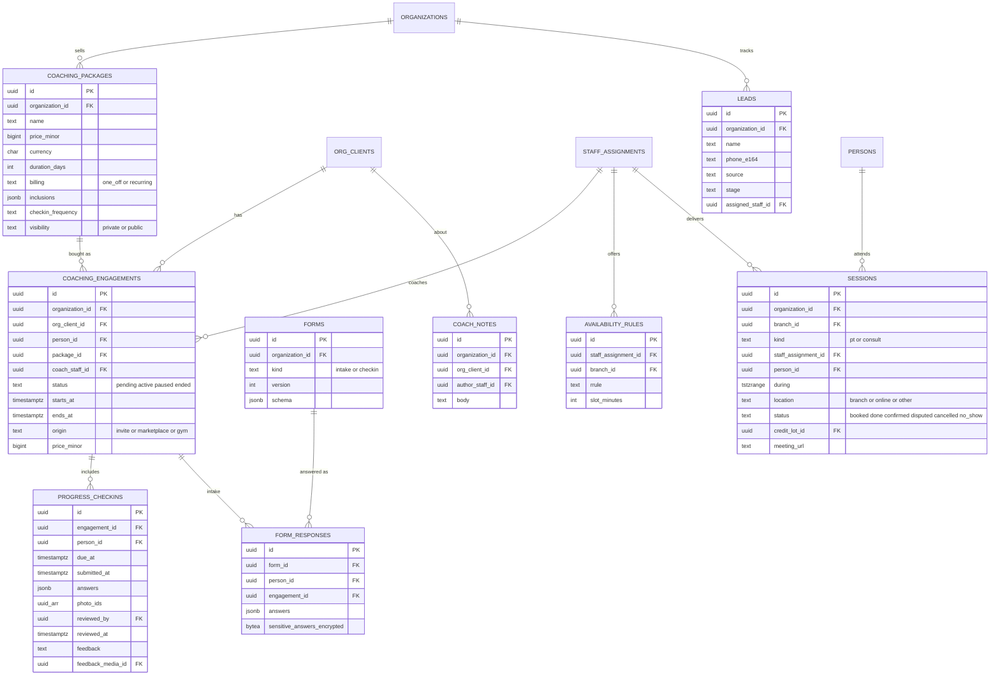

#### 8.2.4 تشغيل الجيم والأجور

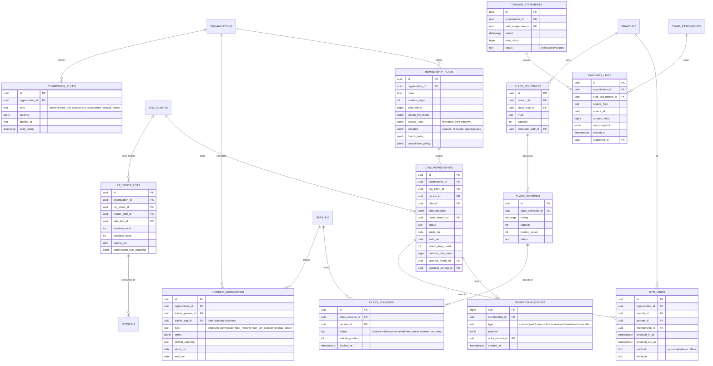

#### 8.2.5 التجارة والمدفوعات والدفتر والفوترة

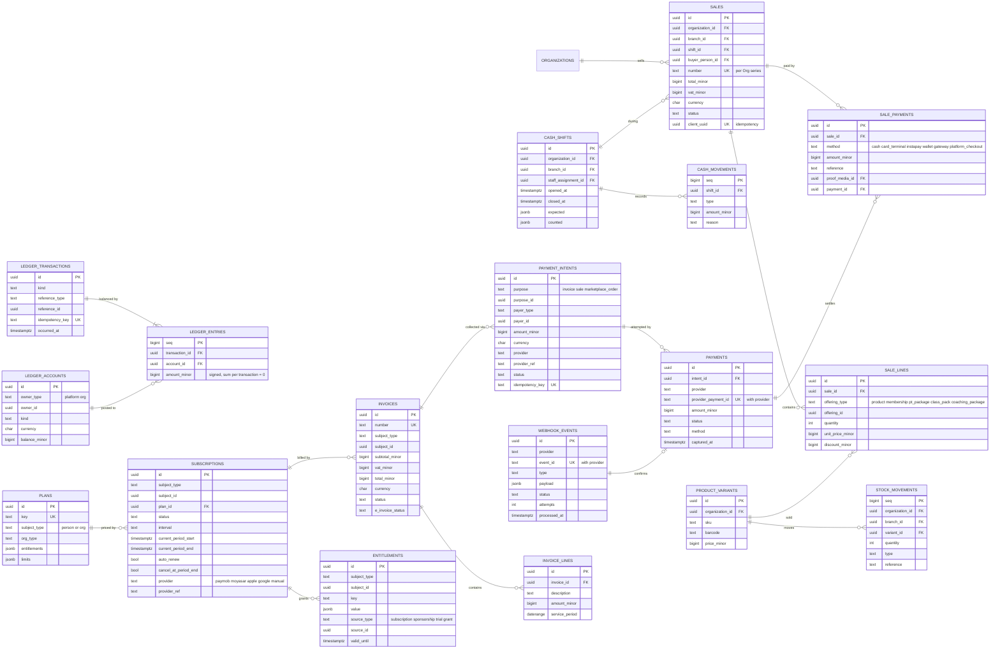

#### 8.2.6 السوق والمراسلة والإشعارات والوسائط والتدقيق

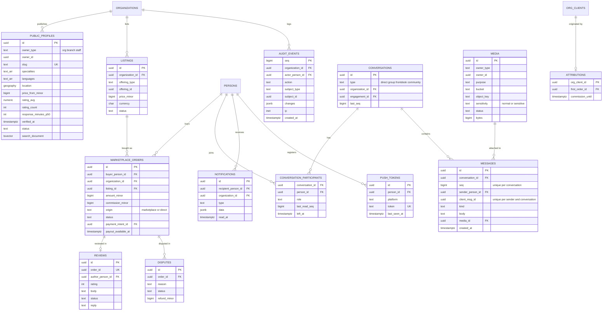

### 8.3 قيود التفرد والسلامة الحرجة

| الجدول | القيد | يمنع |
|---|---|---|
| `persons` | `UNIQUE (phone_e164) WHERE phone_verified_at IS NOT NULL` | حسابين متحققين على رقم واحد |
| `staff_assignments` | `UNIQUE (organization_id, person_id) WHERE status = 'active'` | أدوار مكررة |
| `org_clients` | `UNIQUE (organization_id, person_id)` | سجلات عميل مكررة لكل منشأة |
| `data_access_grants` | `EXCLUDE USING gist (org_client_id WITH =, valid_during WITH &&) WHERE (status = 'active')` | أذونات نشطة متداخلة لعلاقة واحدة |
| `coaching_engagements` | `EXCLUDE USING gist (org_client_id WITH =, coach_staff_id WITH =, tstzrange(starts_at, ends_at) WITH &&) WHERE (status IN ('active','paused'))` | اتفاقات مزدوجة مع المدرّب نفسه |
| `gym_memberships` | `EXCLUDE USING gist (org_client_id WITH =, daterange(starts_on, ends_on) WITH &&) WHERE (status IN ('active','frozen'))` (لكل عائلة خطط) | عقدين نشطين متداخلين |
| `class_bookings` | `UNIQUE (class_session_id, person_id) WHERE status IN ('booked','waitlisted')`؛ و`booked_count ≤ capacity` تُفرض تحت `SELECT … FOR UPDATE` على جلسة الحصة | الحجز الزائد، الحجز المزدوج |
| `sessions` | `EXCLUDE USING gist (staff_assignment_id WITH =, during WITH &&) WHERE (status IN ('booked','done','confirmed'))` | حجز المدرّب مرتين |
| `workout_sessions`، `workout_sets`، `body_metrics`، `food_logs` | `UNIQUE (person_id, client_uuid)` | تكرار مزامنات العمل دون إنترنت |
| `messages` | `UNIQUE (conversation_id, seq)`، `UNIQUE (conversation_id, sender_person_id, client_msg_id)` | فجوات الترتيب والإرسال المكرر |
| `payments` | `UNIQUE (provider, provider_payment_id)` | احتساب الدفعة مرتين |
| `webhook_events` | `UNIQUE (provider, event_id)` | إعادة معالجة Webhooks |
| `payment_intents`، `ledger_transactions` | `UNIQUE (idempotency_key)` | خصومات/قيود مكررة |
| `ledger_entries` | مُطلِق قيد مؤجل: Σ `amount_minor` لكل معاملة = 0 | دفاتر غير متوازنة |
| `invoices`، `sales` | `UNIQUE (number)` لكل سلسلة (من عدّاد مقفول لكل منشأة داخل المعاملة) | فجوات/تكرار في المستندات الضريبية |
| `reviews` | `UNIQUE (order_id)` | حشو التقييمات |
| `public_profiles` | `UNIQUE (slug)` | تعارض الروابط |

### 8.4 قواعد الملكية

| الكيان | المالك | من يستطيع القراءة/الكتابة أيضاً | عند انتهاء العلاقة | الاحتفاظ |
|---|---|---|---|---|
| جلسات/مجموعات التمارين، الأرقام القياسية | الشخص | المنشآت ذات إذن `training.*` | ينتهي وصول المنشأة؛ والبيانات تبقى | حتى يحذفها الشخص |
| قياسات الجسم، الصور، الملف الصحي | الشخص | حاملو الأذونات (`body.*`، `photos.read`، `health.read`) | كذلك | حتى الحذف؛ والصور تُحذف من المجموعة الحية للنسخ الاحتياطية بعد 30 يوماً من حذفها |
| البرامج المسندة، خطط الوجبات | الشخص (نسخة) مع بيان المصدر | المنشأة المصدر تعدّل طالما الإذن يتضمن `*.write` | تبقى نسخة للقراءة فقط (المخطط الشامل 6.10) | مع المساحة الشخصية |
| قوالب البرامج، فيديوهات التمارين، ملاحظات المدرّب | المنشأة | موظفو المنشأة حسب الصلاحية | تبقى مع المنشأة | عمر المنشأة + 90 يوماً بعد الإغلاق |
| اتفاقات التدريب، الباقات، المدفوعات، الفواتير | المنشأة | العميل يرى اتفاقه وإيصالاته | تُحفظ | الاحتفاظ المالي (**[يحتاج تحقق]**، عادةً 5–7 سنوات) |
| عضويات الجيم، الزيارات، الحجوزات | المنشأة | العضو يرى ما يخصه | تُحفظ؛ والعضو يرى السجل في "عضوياتي" | العقد + الاحتفاظ المالي؛ والزيارات 3 سنوات ثم تُجمَّع |
| المحادثات/الرسائل | مشتركة (المشاركون) | المشاركون | للقراءة فقط بعد نهاية الاتفاق | 3 سنوات بعد آخر رسالة ما لم يحذف المشارك رسائله **[يحتاج تحقق]** |
| طلبات السوق، التقييمات | مشتركة (المشتري + المنشأة) | العامة: التقييمات فقط | تُحفظ | الاحتفاظ المالي |
| سجلات الموافقة، سجل الوصول للبيانات | الشخص (صاحب البيانات) | الشخص؛ والمنصة للامتثال | تُحفظ | الحد القانوني الأدنى بعد العلاقة **[يحتاج تحقق]** |
| أحداث التدقيق | المنشأة (والمنصة لإجراءات المنصة) | الملاك/المديرون | تُحفظ | سنتان متاحة، ثم أرشيف |

### 8.5 استراتيجية الفهرسة (نماذج)

| الاستعلام | الفهرس |
|---|---|
| قائمة عملاء المدرّب مع آخر نشاط | `client_assignments (staff_assignment_id)`؛ `org_clients (organization_id, status)` |
| أحدث تمارين العميل | `workout_sessions (person_id, started_at DESC)` |
| الأرقام القياسية / السجل لكل تمرين | `workout_sets (person_id, exercise_id, created_at DESC)` |
| اتجاه الوزن | `body_metrics (person_id, kind, measured_at DESC)` |
| قائمة مراجعة المتابعات | `progress_checkins (organization_id, reviewed_at NULLS FIRST, due_at)` جزئي `WHERE submitted_at IS NOT NULL AND reviewed_at IS NULL` |
| بحث الاستقبال بالهاتف/الاسم | `persons (phone_e164)`؛ `org_clients` + فهرس trigram على الاسم المطبَّع |
| مهام انتهاء العضويات | `gym_memberships (organization_id, ends_on) WHERE status IN ('active','frozen')` |
| الإشغال الآن | `gym_visits (branch_id, checked_in_at DESC) WHERE checked_out_at IS NULL` |
| جدول الحصص | `class_sessions USING gist (during)` + `(class_schedule_id)` |
| رسائل محادثة | `messages (conversation_id, seq DESC)` |
| الإشعارات غير المقروءة | `notifications (recipient_person_id, read_at, created_at DESC)` |
| بحث السوق | GIN على `search_document`؛ GIN trigram على الأسماء؛ GIST على `location`؛ جزئي `WHERE status = 'published'` |
| البحث في الأذونات (دالة RLS) | `data_access_grants (person_id, organization_id) WHERE status = 'active'` |
| إعادة بناء أرصدة الدفتر | `ledger_entries (account_id, seq)` |
| البحث في التمارين/الأطعمة | GIN trigram على `search_name`؛ `foods (barcode)` |

### 8.6 الحجم والتقسيم والأرشفة

| الجدول | الحجم في السيناريو الأساسي عند L24 **[تقدير]** | الخطة |
|---|---|---|
| `workout_sets` | ≈ 20 ألف مسجّل نشط × 3 تمارين أسبوعياً × 20 مجموعة ≈ 5 ملايين صف شهرياً | أقسام شهرية حسب `created_at` من P3؛ فهرس BRIN على الوقت |
| `gym_visits` | 183 جيماً × 400 عضو × 12 زيارة شهرياً ≈ 0.9 مليون شهرياً | أقسام شهرية من P3 |
| `messages` | ≈ 3 ملايين شهرياً | أقسام شهرية من P3 |
| `audit_events`، `data_access_log` | ≈ 1–2 مليون شهرياً | أقسام شهرية؛ ما تجاوز 24 شهراً يُصدَّر إلى S3 (Parquet) |
| `ledger_entries` | ≈ 100 ألف شهرياً | لا حاجة للتقسيم قبل ≈ 50 مليون صف |

### 8.7 التهجيرات

تهجيرات Laravel لكل وحدة (`Database/migrations`)، للأمام فقط في الإنتاج، بنمط توسيع ← نقل البيانات (في طابور، على دفعات) ← تقليص عبر إصدارات منفصلة؛ `CREATE INDEX CONCURRENTLY` للجداول الكبيرة؛ إصدارات JSON Schema لأعمدة المستندات مع محوّلات ترقية في الكود؛ وفحص للتهجيرات في التكامل المستمر (لا حذف أعمدة ولا تغيير أنواع على الجداول النشطة في الإصدار نفسه الذي يتوقف عن استخدامها).

---

## 9. تصميم الواجهة البرمجية ونقاط النهاية النموذجية

### 9.1 REST أم GraphQL؟

| العامل | REST + OpenAPI | GraphQL |
|---|---|---|
| الملاءمة مع منظومة Laravel (السياسات، الموارد، حدود المعدل، التخزين المؤقت) | أصيلة | Lighthouse يعمل، لكن التفويض لكل حقل وضبط N+1 يحتاجان عناية |
| مزامنة الجوال دون إنترنت بدفعات غير مكررة الأثر | نقاط نهاية مخصصة بسيطة | التعديلات (Mutations) تعمل لكن تضيف القليل |
| التخزين المؤقت عبر HTTP / شبكة التوزيع للصفحات العامة | مباشر | يحتاج استعلامات محفوظة |
| مساحة الهجوم الأمني (عمق الاستعلام، التكلفة) | صغيرة | تتطلب تحليل تكلفة وحدوداً |
| مرونة العميل | نقاط نهاية على شكل الشاشات حيث يلزم | قوية |
| **الحكم** | **REST/JSON، عقد OpenAPI 3.1 أولاً (ADR-017)** | نعيد النظر لواجهة الشركاء العامة (P5) فقط إذا طلبها الشركاء |

### 9.2 الاصطلاحات

| الموضوع | الاصطلاح |
|---|---|
| العنوان الأساسي | `https://api.qowa.app/api/v1` |
| الإصدارات | رقم الإصدار الرئيسي في المسار؛ التغييرات الإضافية لا تكسر التوافق؛ الإزالات يُعلن عنها بترويسات `Deprecation` و`Sunset` قبل ≥ 6 أشهر؛ تطبيقات الجوال ترسل `X-App-Version` ويمكن للواجهة إرجاع `426 upgrade_required` تحت حد أدنى |
| السياق | `Authorization: Bearer …` (الجوال) أو ملف تعريف ارتباط الجلسة (الويب)؛ `X-Workspace: personal` \| `org:{uuid}`؛ و`X-Branch-Id` حيث يكون النطاق فرعاً |
| التسمية | أسماء جمع، JSON بنمط snake_case، طوابع ISO-8601 بتوقيت UTC ‏(`2026-10-22T09:30:00Z`)، وحقول `date` بصيغة `YYYY-MM-DD` بتوقيت المنشأة |
| المال | `{"amount_minor": 34900, "currency": "EGP"}` |
| المعرّفات | نصوص UUIDv7 |
| الترقيم | بالمؤشر للتغذيات والقوائم الكبيرة (`?limit=50&cursor=…`، والاستجابة `meta.next_cursor`)؛ وبالصفحات فقط لجداول الإدارة |
| التصفية / الترتيب | `filter[status]=active&filter[branch_id]=…&sort=-created_at`؛ قائمة مسموحة لكل نقطة نهاية |
| الاستجابات المختصرة | `include=` للموارد المرتبطة (قائمة مسموحة) |
| التزامن | المستندات (البرامج، خطط الوجبات) تحمل `version`؛ والتحديثات تتطلب `If-Match: "<version>"` ← `412` عند التعارض |
| عدم تكرار الأثر | ترويسة `Idempotency-Key` **إلزامية** في طلبات POST التي تنشئ مالاً أو حجوزات أو تسجيلات دخول أو مبيعات أو رسائل أو أذونات؛ يُحفظ المفتاح + بصمة الطلب 24 ساعة؛ نفس المفتاح + نفس المحتوى ← نفس الاستجابة؛ نفس المفتاح + محتوى مختلف ← `422 idempotency_key_reused` |
| الأخطاء | `application/problem+json` (بشكل RFC 9457) مع `code` ثابت للآلة |
| حدود المعدل | لكل شخص ولكل IP؛ `429` + `Retry-After`؛ ترويسات `RateLimit-Limit/Remaining/Reset` |
| التعريب | `Accept-Language: ar` \| `en`؛ `title`/`detail` في الخطأ معرَّبان، و`code` ثابت |

**مثال خطأ**

```json
{
  "type": "https://docs.qowa.app/errors/membership_frozen",
  "title": "العضوية متجمدة",
  "status": 409,
  "code": "membership_frozen",
  "detail": "Membership is frozen until 2026-11-03.",
  "meta": { "membership_id": "01929f4e-7c2a-7b1e-9f3c-2a1b0c9d8e7f", "frozen_until": "2026-11-03" },
  "trace_id": "4bf92f3577b34da6a3ce929d0e0e4736"
}
```

| HTTP | قيم `code` النموذجية |
|---|---|
| 400 | `malformed_request` |
| 401 | `unauthenticated`، `token_expired`، `two_factor_required` |
| 402 | `entitlement_required`، `limit_reached` (مع `meta.limit`، `meta.upgrade_to`) |
| 403 | `permission_denied`، `grant_required`، `context_invalid`، `subscription_suspended` |
| 404 | `not_found` (وأيضاً للكائنات خارج المستأجر) |
| 409 | `membership_frozen`، `class_full`، `slot_taken`، `already_checked_in`، `state_conflict` |
| 412 | `version_mismatch` |
| 422 | `validation_failed` (مع `errors{field: [..]}`)، `idempotency_key_reused`، قواعد الأعمال (`freeze_limit_exceeded`، `refund_exceeds_paid`) |
| 426 | `upgrade_required` |
| 429 | `rate_limited` |

**حدود المعدل (مبدئية)**

| الفئة | الحد |
|---|---|
| إرسال رمز التحقق | 5 / هاتف / 15 دقيقة؛ 20 / IP / ساعة |
| محاولات الدخول | 5 إخفاقات ← قفل 15 دقيقة للحساب؛ 50 / IP / ساعة |
| الواجهة المصادَق عليها | 300 / دقيقة / شخص (اندفاع 60 / 5 ثوانٍ) |
| نقاط المزامنة | 30 / دقيقة / جهاز |
| واجهة السوق العامة | 60 / دقيقة / IP؛ مخزنة مؤقتاً في CloudFront |
| الرفع | 60 رابطاً موقّعاً مسبقاً / ساعة / شخص |
| Webhooks الواردة | بلا حد؛ يُتحقق منها بالتوقيع وقوائم عناوين المزوّد حيث تُنشر |

### 9.3 الواجهات العامة مقابل الداخلية

| الواجهة | المستهلكون | المصادقة | الاستقرار |
|---|---|---|---|
| واجهة التطبيق `/api/v1/*` | تطبيقاتنا على الجوال/الويب | رمز/ملف ارتباط الشخص + السياق | بإصدارات؛ قد تتغير مع إصدارات التطبيق (مع حدود دنيا) |
| واجهة القراءة العامة `/api/v1/public/*` | الموقع العام، السوق، محركات البحث | بلا (بحدود معدل) | مستقرة |
| Webhooks الواردة `/webhooks/{provider}` | Paymob، Moyasar/Tap، RevenueCat، Meta | توقيعات المزوّد (HMAC)، نافذة منع إعادة التشغيل | مستقرة |
| واجهة الإدارة `/admin/v1/*` | لوحة الإدارة فقط | حارس الإدارة، TOTP، قائمة IP مسموحة | داخلية |
| واجهة الشركاء + Webhooks صادرة (P5) | السلاسل، المطوّرون | OAuth2 ‏(client credentials)، بنطاق لكل منشأة | بإصدارات، موثّقة، باتفاقية مستوى خدمة |

### 9.4 نقاط نهاية نموذجية

الأمثلة التالية بالإنجليزية كما ستظهر فعلياً في الطلبات والاستجابات.

#### 9.4.1 طلب رمز تحقق وتسجيل الدخول

```http
POST /api/v1/auth/otp
Content-Type: application/json

{ "phone": "+201001234567", "channel": "whatsapp", "purpose": "login" }
```
```json
202 Accepted
{ "challenge_id": "01929f50-1d2e-7a3b-8c4d-5e6f7a8b9c0d", "expires_in": 300, "resend_after": 60, "channel": "whatsapp" }
```
```http
POST /api/v1/auth/otp/verify
{ "challenge_id": "01929f50-…", "code": "482913", "device_name": "Samsung A54", "platform": "android" }
```
```json
200 OK
{
  "token": "3|9f0c…",
  "person": { "id": "01929f…", "name": "Dina", "locale": "ar", "claimed": true },
  "workspaces": [
    { "type": "personal" },
    { "type": "org", "id": "0192a0…", "name": "Nour Fitness", "org_type": "coaching_business", "roles": ["owner"] }
  ],
  "two_factor_required": false
}
```

#### 9.4.2 دعوة عميل (المدرّب)

```http
POST /api/v1/coaching/clients
X-Workspace: org:0192a0…
Idempotency-Key: 5d6a2c4e-…

{ "phone": "+966501234567", "name": "Reem", "package_id": "0192a1…", "starts_on": "2026-11-01",
  "requested_scopes": ["training.read","training.write","body.read","body.write","nutrition.read","nutrition.write","health.read","checkins.read","checkins.write"],
  "send_via": "whatsapp" }
```
```json
201 Created
{
  "org_client": { "id": "0192a2…", "status": "invited", "sourcing": "direct" },
  "engagement": { "id": "0192a3…", "status": "pending", "starts_at": "2026-10-31T21:00:00Z" },
  "invite": { "url": "https://qowa.app/i/Q7XK2M", "expires_at": "2026-11-07T21:00:00Z" }
}
```

#### 9.4.3 قبول الدعوة ومنح الوصول (المتدرّب)

```http
POST /api/v1/me/grants
X-Workspace: personal
Idempotency-Key: 8b1f…

{ "invite_code": "Q7XK2M",
  "scopes": ["training.read","training.write","body.read","body.write","nutrition.read","nutrition.write","health.read","checkins.read","checkins.write"],
  "photos": false, "history_days": 90, "consent_text_version": "grant-v3-ar" }
```
```json
201 Created
{ "grant": { "id": "0192a4…", "organization": { "id": "0192a0…", "name": "Nour Fitness" },
  "scopes": ["training.read", "…"], "valid_from": "2026-11-01T00:00:00Z", "valid_until": null, "status": "active" } }
```

`DELETE /api/v1/me/grants/{id}` يلغي الإذن فوراً (يرى المدرّب حالة "العميل ألغى الوصول"؛ ويبقى الاتفاق لأغراض الفوترة).

#### 9.4.4 إسناد برنامج

```http
POST /api/v1/coaching/clients/0192a2…/programs
X-Workspace: org:0192a0…
Idempotency-Key: c41e…

{ "template_id": "0192b0…", "template_version": 7, "starts_on": "2026-11-02", "notify": true }
```
```json
201 Created
{ "assigned_program": { "id": "0192b1…", "person_id": "0192…", "version": 1, "starts_on": "2026-11-02",
  "provenance": { "organization_id": "0192a0…", "author": "Coach Nour", "template_id": "0192b0…", "template_version": 7 } } }
```

يتطلب صلاحية `programs.manage_templates`، والإسناد للعميل، ونطاق الإذن `training.write`.

#### 9.4.5 مزامنة التمارين من الصندوق الصادر في الجوال

```http
POST /api/v1/me/workouts:sync
X-Workspace: personal
Idempotency-Key: 2f7d…

{
  "device_id": "a3c9…",
  "sessions": [{
    "client_uuid": "6c1f…", "assigned_program_id": "0192b1…", "day_key": "w1d2",
    "started_at": "2026-11-03T16:05:12Z", "ended_at": "2026-11-03T17:01:40Z",
    "sets": [
      { "client_uuid": "e01a…", "exercise_id": "0191…", "slot_key": "a1", "set_index": 1, "reps": 8, "weight_g": 60000, "rpe": 7.5 },
      { "client_uuid": "e01b…", "exercise_id": "0191…", "slot_key": "a1", "set_index": 2, "reps": 8, "weight_g": 62500, "rpe": 8.0 }
    ]
  }]
}
```
```json
200 OK
{ "accepted": { "sessions": 1, "sets": 2 }, "duplicates": { "sessions": 0, "sets": 0 },
  "id_map": { "6c1f…": "0192c0…", "e01a…": "0192c1…", "e01b…": "0192c2…" },
  "server_time": "2026-11-03T17:02:05Z" }
```

#### 9.4.6 إرسال متابعة دورية

```http
POST /api/v1/me/checkins/0192d0…:submit
Idempotency-Key: 77aa…

{ "answers": { "adherence_training": 4, "adherence_nutrition": 3, "sleep_hours": 6.5, "stress": 3, "notes": "ركبتي بتوجعني في السكوات" },
  "metrics": [ { "kind": "weight", "value": 72.4 }, { "kind": "waist_cm", "value": 81.0 } ],
  "photo_media_ids": ["0192d1…", "0192d2…"] }
```
```json
200 OK
{ "checkin": { "id": "0192d0…", "status": "submitted", "submitted_at": "2026-11-07T08:12:00Z" } }
```

#### 9.4.7 تسجيل الدخول في الاستقبال

```http
POST /api/v1/frontdesk/checkins
X-Workspace: org:0192e0…
X-Branch-Id: 0192e1…
Idempotency-Key: 0c3d…

{ "qr": "v1.0192f0….1730622000.MEUCIQ…", "client_time": "2026-11-03T15:00:01Z" }
```
```json
200 OK
{ "decision": "allowed",
  "member": { "name": "Dina A.", "photo_url": "https://cdn…/t/…?sig=…", "plan": "Gold 3 months", "ends_on": "2026-12-01", "days_left": 28 },
  "warnings": [ { "code": "renewal_due_soon" } ],
  "visit_id": "0192f1…", "occupancy": 87 }
```

حالات الرفض تُرجع `200` مع `"decision": "denied"` وسبب (`expired`، `frozen`، `outside_time_window`، `balance_due`) — إجابة أعمال وليست خطأ HTTP — حتى لا تعاملها واجهة الاستقبال كعطل.

#### 9.4.8 حجز حصة (مع قائمة الانتظار)

```http
POST /api/v1/gym/class-sessions/0192g0…/bookings
X-Workspace: personal
Idempotency-Key: 91be…
```
```json
201 Created
{ "booking": { "id": "0192g1…", "status": "waitlisted", "waitlist_position": 3 },
  "policy": { "cancel_before_minutes": 120, "late_cancel_penalty": "1 credit" } }
```

#### 9.4.9 بيع عضوية في الاستقبال

```http
POST /api/v1/sales
X-Workspace: org:0192e0…
X-Branch-Id: 0192e1…
Idempotency-Key: 4e5f…

{ "client_uuid": "4e5f…", "buyer_person_id": "0192f0…",
  "lines": [ { "offering_type": "membership", "offering_id": "0192h0…", "quantity": 1, "starts_on": "2026-11-03" } ],
  "payments": [ { "method": "instapay", "amount_minor": 450000, "reference": "IPN-77812", "proof_media_id": "0192h1…" } ] }
```
```json
201 Created
{ "sale": { "id": "0192h2…", "number": "R-001245", "total": { "amount_minor": 450000, "currency": "EGP" }, "vat": { "amount_minor": 55263, "currency": "EGP" } },
  "created": { "membership_id": "0192h3…", "ends_on": "2027-02-02" },
  "receipt_url": "https://qowa.app/r/kT9…" }
```

معاملة واحدة: بيع ← عقد عضوية ← حدث عضوية ← حركة درج النقدية ← قيد في الدفتر ← سجل تدقيق.

#### 9.4.10 تأكيد جلسة تدريب شخصي (العضو)

```http
POST /api/v1/me/sessions/0192j0…:confirm
Idempotency-Key: aa01…

{ "confirm": true }
```
```json
200 OK
{ "session": { "id": "0192j0…", "status": "confirmed" }, "credits_left": 7 }
```

يُطلق `SessionConfirmed` ← تكتب وحدة Compensation بند المستحقات باستخدام نسخة قاعدة العمولة المحفوظة مع رصيد الجلسات.

#### 9.4.11 دفع المنصة لاشتراك

```http
POST /api/v1/billing/checkout
X-Workspace: org:0192a0…
Idempotency-Key: 3b9c…

{ "plan_key": "coach_pro", "interval": "month", "method": "card", "coupon": "FOUNDERS40", "return_url": "https://app.qowa.app/billing/return" }
```
```json
201 Created
{ "invoice": { "id": "0192k0…", "number": "TMR-2026-000812", "total": { "amount_minor": 47940, "currency": "EGP" } },
  "payment": { "intent_id": "0192k1…", "provider": "paymob", "redirect_url": "https://accept.paymob.com/…", "expires_at": "2026-11-03T15:30:00Z" } }
```

عند `method: "instapay"` تُرجع الاستجابة عنوان إنستاباي الخاص بالمنصة ومرجعاً؛ ويرفع المالك الإثبات عبر `POST /billing/invoices/{id}/manual-proofs`.

#### 9.4.12 Webhook الدفع (وارد)

```http
POST /webhooks/paymob
X-Signature: <HMAC per provider spec>

{ "type": "TRANSACTION", "obj": { "id": 912773, "success": true, "amount_cents": 47940, "order": { "merchant_order_id": "0192k1…" } } }
```

المعالجة: التحقق من التوقيع ← الإدراج في `webhook_events` (فريد على المزوّد + معرّف الحدث؛ المكررات تُرجع 200 فوراً) ← `200` خلال ثانية ← مهمة في طابور `critical`: قفل نية الدفع، إنشاء/تأكيد صف `payments`، ترحيل معاملة في الدفتر، وسم الفاتورة كمدفوعة، تمديد الاشتراك، إعادة حساب الاستحقاقات، إطلاق `PaymentSucceeded`. ومهمة تسوية تعيد استعلام المزوّد عن النوايا المعلقة لأكثر من 15 دقيقة (Webhooks فائتة).

#### 9.4.13 بحث السوق (عام)

```http
GET /api/v1/public/coaches?q=تخسيس&filter[mode]=online&filter[gender]=female&filter[lang]=ar&near=30.0444,31.2357&sort=relevance&limit=20
```
```json
200 OK
{ "data": [ { "slug": "coach-nour", "name": "Nour", "headline": "خسارة دهون للسيدات", "verified": true,
  "rating": { "avg": 4.8, "count": 63 }, "price_from": { "amount_minor": 150000, "currency": "EGP" },
  "response_minutes_p50": 95, "modes": ["online"], "distance_km": null } ],
  "meta": { "next_cursor": "eyJ…", "facets": { "specialties": { "weight_loss": 142, "muscle_gain": 98 } } } }
```

#### 9.4.14 إرسال رسالة محادثة

```http
POST /api/v1/conversations/0192m0…/messages
Idempotency-Key: 6c2d…

{ "client_msg_id": "6c2d…", "kind": "voice", "media_id": "0192m1…", "reply_to_id": null }
```
```json
201 Created
{ "message": { "id": "0192m2…", "seq": 418, "kind": "voice", "created_at": "2026-11-03T18:22:10Z", "client_msg_id": "6c2d…" } }
```

### 9.5 Webhooks الصادرة (واجهة الشركاء في P5)

الأحداث (`membership.activated`، `visit.recorded`، `sale.completed`، …) تُسلَّم كطلب `POST` مع `Qowa-Signature: t=…,v1=HMAC-SHA256(secret, t + "." + body)`، بتسليم مرة واحدة على الأقل، مع إعادة المحاولة بتراجع أسي لمدة 24 ساعة، ولكل منها `event_id` لإزالة التكرار؛ مع سجل تسليم وزر إعادة إرسال لكل نقطة نهاية.

---

## 10. معمارية الاتصال اللحظي

### 10.1 ما يجب أن يكون لحظياً (وما لا يلزم)

| حالة الاستخدام | الحاجة اللحظية | الآلية |
|---|---|---|
| محادثة المدرّب ↔ العميل، المحادثة الجماعية | ثوانٍ؛ مؤشرات الكتابة ميزة إضافية | WebSocket + إشعار فوري عند عدم الاتصال |
| الإشعارات (الجرس) | ثوانٍ | تنبيه WebSocket ← جلب؛ إشعار فوري |
| حالة التمرين/الجلسة ("العميل أنهى التمرين"، تأكيد جلسة التدريب الشخصي) | ثوانٍ–دقائق | حدث WebSocket للمدرّب |
| تسجيلات الدخول الحية في الاستقبال، الإشغال | ثوانٍ | WebSocket على قناة الفرع |
| تحديثات الحجز/قائمة الانتظار | ثوانٍ | WebSocket للشخص + إشعار فوري |
| حالة العضوية/الدفع (العودة من الدفع، تغيّر الاستحقاق) | ثوانٍ | WebSocket للشخص/المنشأة |
| لوحات الإدارة والمالك | 10–60 ثانية | تنبيهات "تحديث"، والاستطلاع كبديل |
| الحضور/الكتابة | أفضل جهد | قنوات الحضور (المحادثات المباشرة فقط) |
| استشارات الفيديو، الحصص المباشرة | بث وسائط | بنية WebRTC/بث **منفصلة** (القسم 10.7) |

### 10.2 مقارنة الخيارات

| الخيار | التشغيل | التكلفة عند 3 آلاف اتصال متزامن / 30 مليون رسالة شهرياً **[تقدير]** | الحضور | الملاءمة مع Laravel/Flutter | ملاحظات |
|---|---|---|---|---|---|
| **Laravel Reverb (مستضاف ذاتياً على ECS)** | منخفض–متوسط | مهمة أو مهمتان صغيرتان: **≈ 10–35 دولاراً شهرياً** | نعم | أصيلة (بروتوكول Pusher، Echo؛ عملاء Pusher لـ Flutter) | توسع أفقي عبر pub/sub في Valkey (أو محرك قاعدة البيانات في Laravel 13 [S51]) |
| Pusher Channels | لا شيء | شرائح حسب الاتصالات والرسائل اليومية: 49 دولاراً (500 اتصال، مليون رسالة يومياً) حتى 1,199 دولاراً (30 ألف اتصال) [S49] | نعم | أصيلة | حدود الباقات تحجب ما يتجاوز الحصة |
| Ably | لا شيء | مجاني ← 29 ← 399 دولاراً + الاستخدام [S49] | نعم | محوّل متوافق مع Pusher | الفوترة بالرسائل/دقائق الاتصال |
| AWS AppSync Events | لا شيء | ≈ 1 دولار لكل مليون عملية + 0.08 دولار لكل مليون دقيقة اتصال [S47] ← تقريباً **10–40 دولاراً شهرياً** | لا حضور مدمج | مصادقة مخصصة (Lambda)، عميل خاص بـ AWS | الأرخص بين المُدارة؛ كود مخصص أكثر |
| API Gateway WebSockets | لا شيء | لكل رسالة + لكل دقيقة اتصال **[تحقق من الأسعار]** | لا | مخصص | حالة الاتصال في DynamoDB؛ تجهيزات أكثر |
| Server-Sent Events | منخفض | جزء من الواجهة | لا | بسيط باتجاه واحد | جيد للوحات؛ لا اتصال من العميل للخادم؛ عمّال PHP تبقى مشغولة |
| الاستطلاع الطويل | منخفض | جزء من الواجهة | لا | بسيط | بديل احتياطي فقط |

**[قرار] ADR-008: ‏Laravel Reverb** كخدمة ECS مستقلة خلف موازن الأحمال (المضيف `ws.`)، مع Valkey للتوزيع الأفقي، وبروتوكول Pusher بحيث **يكون الانتقال إلى Pusher أو Ably تغيير إعداد** إذا أصبح التشغيل عبئاً. ويبقى SSE/الاستطلاع كبدائل.

### 10.3 القنوات والتفويض

| القناة | الأعضاء | يُسمح عندما |
|---|---|---|
| `private-person.{personId}` | الشخص (كل أجهزته) | شخص الرمز = `personId` |
| `private-conversation.{id}` | المشاركون | صف نشط في `conversation_participants` |
| `presence-conversation.{id}` | مشاركو المحادثات المباشرة/الصغيرة (≤ 50) | كما سبق؛ تكشف `{id, name, avatar}` فقط |
| `private-org.{orgId}.desk.{branchId}` | موظفو الاستقبال | تعيين موظف والفرع ضمن النطاق + `frontdesk.checkin` |
| `private-org.{orgId}.coach.{staffId}` | أجهزة مدرّب واحد | التعيين = `staffId` |
| `private-org.{orgId}.owner` | الملاك/المديرون | `reports.view` |
| `private-org.{orgId}.schedule.{branchId}` | أعضاء ذلك الفرع (تغيّرات سعة الحصص) | عضوية نشطة تسمح بالفرع |

يتم التفويض عبر `/broadcasting/auth` ‏(Sanctum)، الذي يشغّل كود السياسات نفسه المستخدم في واجهة REST؛ والأحداث تحمل معرّفات وحقولاً دنيا، ولا قيماً حساسة أبداً (العملاء يجلبون التفاصيل عبر الواجهة التي تطبّق الأذونات). رموز مصادقة WebSocket تنتهي مع الجلسة.

### 10.4 حفظ الرسائل وترتيبها وتوصيلها

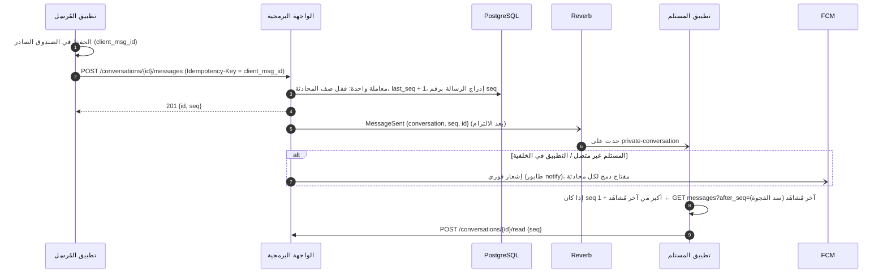

| الخاصية | الضمان |
|---|---|
| الديمومة | الرسالة موجودة بمجرد أن تُرجع الواجهة 201 (ملتزمة في Postgres) |
| التوصيل | مرة واحدة على الأقل عبر WebSocket + الإشعار الفوري؛ والعملاء يزيلون التكرار بـ `id`/`client_msg_id` ← عرض مرة واحدة فعلياً |
| الترتيب | ترتيب كامل لكل محادثة بـ `seq` (يُعيَّن تحت قفل الصف)؛ والعملاء يعرضون حسب `seq` |
| الإرسال دون إنترنت | صندوق الجوال الصادر يعيد المحاولة بنفس `client_msg_id` (بلا تكرار) |
| الاستلام دون إنترنت | عند إعادة الاتصال: `GET /conversations?updated_after=` ثم `after_seq` لكل محادثة |
| إشعارات القراءة | `last_read_seq` لكل مشارك، متزايد فقط (`GREATEST`) |
| التعديل/الحذف | صفوف بإصدارات جديدة؛ وعلامة "محذوفة" يراها الطرفان |

### 10.5 إعادة الاتصال والتوسع والتوزيع

- يعيد العملاء الاتصال بتراجع أسي (1 ثانية ← 30 ثانية، مع تذبذب) ويعيدون الاشتراك؛ وبعد إعادة الاتصال يُنفَّذ سد الفجوات دائماً. تُرفع مهلة الخمول في موازن الأحمال إلى 120 ثانية؛ وReverb يرسل نبضة كل 30 ثانية.
- **تخطيط السعة:** ذروة الاتصالات المتزامنة ≈ 10–15% من المستخدمين اليوميين **[افتراض]** ← السيناريو الأساسي عند L24 (≈ 20 ألف يومياً) ≈ 2–3 آلاف اتصال ← مهمة Reverb واحدة تكفي؛ ونشغّل اثنتين للإتاحة. هدف اختبار الحمل: 5 آلاف اتصال لكل مهمة بمعالج واحد وذاكرة 2 جيجابايت **[تحقق باختبارات k6/WebSocket]**.
- **التوزيع:** الأحداث تذهب إلى pub/sub في Valkey، وكل عقدة Reverb تدفعها لمشتركيها المحليين. البث الكبير (قنوات مجتمعية > 500 عضو، إعلانات على مستوى الجيم) يُرسل كحدث قناة واحد (بلا توزيع لكل مستخدم في PHP)؛ والإشعارات الفورية لها تُرسل على دفعات (موضوع FCM أو إرسال متعدد على دفعات من 500).
- الحضور فقط في المحادثات المباشرة (التكلفة والخصوصية).

### 10.6 التكلفة

مهام Reverb: في MVP بمعالج 0.25 وذاكرة 0.5 جيجابايت (≈ 8 دولارات شهرياً)، وفي النمو مهمتان بمعالج واحد وذاكرة 2 جيجابايت (≈ 66 دولاراً شهرياً) على Fargate ARM (القسم 15). باقة Pusher المكافئة لـ 3 آلاف اتصال متزامن ستكون بضع مئات من الدولارات شهرياً [S49]. الإشعارات عبر FCM مجانية. وعرض النطاق ضئيل (أحداث JSON صغيرة).

### 10.7 مكالمات الفيديو والبث المباشر مشكلتان مختلفتان

| الحاجة | التقنية | المرحلة | نموذج التكلفة |
|---|---|---|---|
| استشارة فردية (مدرّب ↔ عميل) | MVP: روابط Google Meet/Zoom/فيديو واتساب محفوظة في الجلسة. P4: ‏WebRTC مدمج عبر **LiveKit Cloud** (باقة Ship بـ 50 دولاراً شهرياً تشمل 150 ألف دقيقة WebRTC، ثم 0.0005 دولار للدقيقة [S50]) أو **Amazon Chime SDK** ‏(0.0017 دولار لكل دقيقة حضور [S48]) | P1 روابط، P4 مدمج | لكل دقيقة مشارك |
| تدريب جماعي مباشر صغير (≤ 25) | نفس خادم SFU ‏(LiveKit/Chime)؛ تسجيل اختياري إلى S3 | P4 | لكل دقيقة مشارك (+ التسجيل) |
| حصص مباشرة لواحد إلى كثيرين (مئات المشاهدين) | Amazon IVS (بث منخفض التأخير) أو مخرجات LiveKit إلى HLS؛ وفيديو مسجل عبر MediaConvert | P5 | لكل ساعة إدخال + لكل ساعة مشاهدة **[تحقق من أسعار IVS]** |
| فيديوهات التمارين المسجلة | S3 + تحويلات MediaConvert + CloudFront | P1 | التخزين + النقل الخارج |

مثال: 1,000 استشارة شهرياً × 30 دقيقة × مشاركَين = 60 ألف دقيقة مشارك ← Chime SDK ‏≈ 102 دولار؛ LiveKit Ship ‏50 دولاراً (ضمن الدقائق المشمولة)؛ Daily ‏≈ 200 دولار بعد الـ 10 آلاف دقيقة المجانية بسعر 0.004 دولار للدقيقة [S50]. **[توصية] LiveKit Cloud** في P4 (رخيص عند أحجامنا، وخادم مفتوح المصدر إذا استضفنا ذاتياً يوماً)، خلف واجهة `VideoRooms` بحيث يمكن لـ Chime SDK أن يحل محله. لاحظ قاعدة متجر Apple: خدمات واحد لعدد قليل/لكثيرين اللحظية المباعة داخل التطبيق تحتاج IAP [S33] — الجلسات الجماعية المباشرة تُباع على الويب (المخطط الشامل 8.5).

---

## 11. معمارية الاشتراكات والفوترة

### 11.1 تدفقان للمال، ونواة مدفوعات واحدة

| التدفق | التاجر | الوحدة | أمثلة |
|---|---|---|---|
| **فوترة المنصة** | قوّة | Billing ← Payments | Coach Pro، Gym Growth، Trainee Plus |
| **تحصيل المنشآت** | المنشأة | Commerce/Coaching ← Payments | عضوية جيم في الاستقبال، باقة مدرّب مدفوعة بإنستاباي، رابط بوابة مربوطة |
| **دفع المنصة** (P3) | تقسيم عبر بوابة مرخّصة؛ وقوّة تكسب العمولة | Marketplace ← Payments | باقة تدريب من السوق |

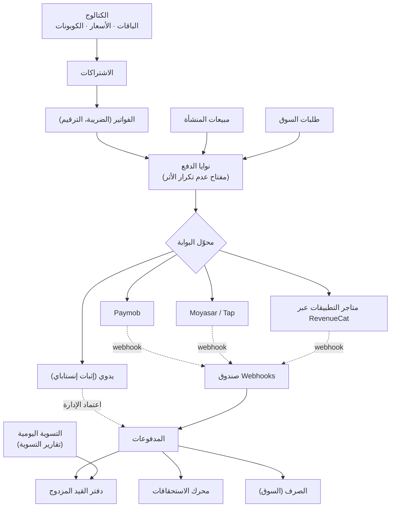

### 11.2 تجريد بوابات الدفع

```php
interface PaymentGateway
{
    public function key(): string;                                    // 'paymob', 'moyasar', 'tap', 'manual'
    public function supports(Capability $c, Currency $cur): bool;     // card, wallet, apple_pay, mada, recurring, split, payout
    public function createCheckout(PaymentIntent $intent, CheckoutOptions $o): CheckoutSession; // hosted page/iframe URL
    public function chargeSaved(PaymentIntent $intent, PaymentMethodToken $t): ChargeResult;    // merchant-initiated renewals
    public function refund(Payment $p, Money $amount, string $idempotencyKey): RefundResult;
    public function verifyWebhook(Request $r): VerifiedEvent;         // signature + parsing → provider-neutral event
    public function fetchPayment(string $providerPaymentId): ProviderPayment; // reconciliation
}
```

محوّل لكل مزوّد؛ والتوجيه حسب `(السوق، العملة، الوسيلة)`. بيانات البطاقات لا تلمس خوادمنا أبداً (صفحة دفع مستضافة/إطار مضمّن؛ نطاق PCI DSS من نوع SAQ A **[تحقق حسب نوع التكامل مع المزوّد]**). البوابات المربوطة للمنشآت تستخدم المحوّلات نفسها مع بيانات اعتماد المنشأة المشفرة (`gateway_connections`، أسرار مشفرة بـ KMS، رابط Webhook لكل اتصال).

### 11.3 دورة حياة الاشتراك

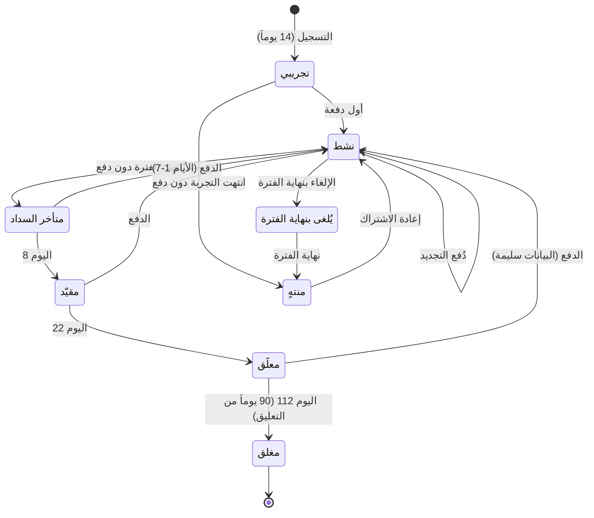

آثار كل حالة في المخطط الشامل (القسم 6.12). كل انتقال حدث (`SubscriptionPastDue`، …) تستهلكه وحدتا Entitlements وNotifications؛ والحالة تُشتق من `current_period_end` + المدفوعات، بحيث لا "ينسى" تشغيل فائت للمجدول تعليق اشتراك.

### 11.4 محرك الاستحقاقات

1. **المصادر:** اشتراكات المنصة النشطة (`trialing`، `active`، `past_due`، `cancelling`) ← استحقاقات الباقة وحدودها؛ **الرعاية** ← لكل اتفاق تدريب / عضوية جيم نشطة، تحدد باقة المنشأة الراعية ما يحصل عليه عملاؤها (المخطط الشامل 7.3)، صالحة طالما المنشأة ليست `suspended`؛ و**منح** من الإدارة (تجريبي، تعويض).
2. **الحساب:** اتحاد القيم المنطقية، والحد الأقصى للحدود الرقمية؛ يُكتب في `entitlements` (صف لكل مفتاح ومصدر) لإمكانية الاستعلام، ويُخزَّن كمصفوفة لكل جهة (`ent:{type}:{id}:v{n}`).
3. **محفزات إعادة الحساب:** أحداث الدفع، انتقالات الاشتراك، بدء/انتهاء الاتفاق/العضوية، تغييرات كتالوج الباقات (مهمة على دفعات).
4. **الفحوص:** `Entitlements::allows($subject, 'coach.automations')`، و`::limit($subject, 'coach.active_clients')` بمنطق الحد المرن (تنبيه عند 80%، +10% لمدة 14 يوماً، ثم `402 limit_reached` عند *الإضافة* فقط).
5. **إعلام العملاء بالتغييرات** عبر `EntitlementsChanged` على `private-person.{id}` / قناة مالك المنشأة؛ ويعيد التطبيق جلب `/me/entitlements`.

### 11.5 الحساب النسبي (باليوم)

`الرصيد = السعر_القديم × الأيام_غير_المستخدمة / أيام_الفترة`؛ `المطلوب = السعر_الجديد × الأيام_المتبقية / أيام_الفترة`؛ `المستحق = المطلوب − الرصيد` (السالب ← رصيد في الحساب). مثال: Coach Starter ‏(349) ← Pro ‏(799) في اليوم العاشر من شهر 30 يوماً: الرصيد = 349 × 20/30 = 232.67؛ المطلوب = 799 × 20/30 = 532.67؛ **المستحق الآن = 300.00 جنيه**، تصدر فاتورته فوراً؛ والفترة التالية تُفوتر بـ 799. التخفيض يسري في نهاية الفترة (بلا استرداد). وزيادات عدد المقاعد/الفروع تُحسب نسبياً بالطريقة نفسها.

### 11.6 التحصيل

| اليوم بالنسبة لنهاية الفترة | بطاقة محفوظة | بلا بطاقة (مدفوع مقدماً) |
|---|---|---|
| −7، −3، −1 | تذكير (داخل التطبيق، بريد) | تذكير مع رابط دفع (داخل التطبيق، بريد، واتساب خدمي) |
| 0 | محاولة خصم | إصدار فاتورة |
| 1، 3، 6 | إعادة المحاولة (غير مكررة الأثر لكل محاولة) | تذكير |
| 8 | مقيّد + إبلاغ المالك | كذلك |
| 22 | معلّق | كذلك |

لا تتجاوز إعادة المحاولة مرة يومياً لكل اشتراك؛ مع التمييز بين الرفض المؤقت والدائم (بطاقة منتهية ← إيقاف إعادة المحاولة وطلب وسيلة جديدة).

### 11.7 الفواتير والضريبة والفوترة الإلكترونية

- الفواتير غير قابلة للتعديل بعد إصدارها؛ والتصحيحات إشعارات دائنة. الترقيم: `TMR-{YYYY}-{000000}` من عدّاد مقفول داخل معاملة الإصدار.
- مصر: ضريبة القيمة المضافة 14% مشمولة في أسعار القائمة؛ والفاتورة تُظهر الصافي + الضريبة. إرسال الفاتورة الإلكترونية (للأعمال) / الإيصال الإلكتروني (للمستهلكين) لمصلحة الضرائب عبر مُكامِل معتمد أو واجهة المصلحة عندما نصبح ضمن النطاق (المخطط الشامل Q-04)؛ مع تخزين `e_invoice_status` و`e_invoice_uuid` والحمولة الموقّعة.
- السعودية: فوترة ZATCA الإلكترونية (فاتورة) للفواتير السعودية عبر مزوّد معتمد في P4؛ ومعالجة الاحتساب العكسي للأعمال **[يحتاج تحقق]**.
- إيصالات المنشآت (مبيعات الجيمات) تتبع محرك المستندات نفسه بسلاسل لكل منشأة؛ وتكامل مصلحة الضرائب/ZATCA للمنشآت في P4 ‏(GYM-26).

### 11.8 دفتر القيد المزدوج

دليل الحسابات (لكل عملة): `platform:gateway_clearing`، `platform:bank`، `platform:revenue_subscriptions`، `platform:revenue_commission`، `platform:deferred_revenue`، `platform:vat_payable`، `platform:processing_fees`، `platform:refunds`، `org:{id}:seller_payable` (السوق)، `org:{id}:payout_clearing`، `platform:chargebacks`.

**المثال (أ) — مدرّب يدفع Coach Pro بالبطاقة (799 جنيهاً شاملة الضريبة)**

| الحساب | مدين | دائن |
|---|---|---|
| platform:gateway_clearing | 799.00 | |
| platform:revenue_subscriptions | | 700.88 |
| platform:vat_payable | | 98.12 |

التسوية بعد يومين (تحتفظ البوابة بـ 2.75% + 3 = 24.97): مدين `bank` ‏774.03، مدين `processing_fees` ‏24.97، دائن `gateway_clearing` ‏799.00.

**المثال (ب) — باقة تدريب من السوق (1,800 جنيه)، عمولة 10%، والمعالجة تُمرَّر للبائع**

| الحساب | مدين | دائن |
|---|---|---|
| platform:gateway_clearing | 1,800.00 | |
| org:{coach}:seller_payable | | 1,542.30 |
| platform:revenue_commission | | 180.00 |
| platform:vat_payable (14% على العمولة) | | 25.20 |
| platform:processing_fees_recoverable | | 52.50 |

الصرف: مدين `seller_payable` ‏1,542.30، دائن `payout_clearing` ← `bank`. عندما تقسّم البوابة الأموال مباشرة للبائع (الخيار أ، المخطط الشامل 9.3)، تُحفظ القيود نفسها كـ **دفتر مذكرات** حتى تتوازن الكشوف والاستردادات والنزاعات.

القواعد: القيود إضافة فقط؛ والعكس معاملات جديدة؛ و`ledger_transactions.idempotency_key` = حدث المزوّد أو معرّف عملية الأعمال؛ والأرصدة تُحدَّث تحت قفل صف على `ledger_accounts` ويمكن التحقق منها بإعادة جمع القيود (مهمة فحص ليلية).

### 11.9 الاستردادات والنزاعات البنكية

- **الاسترداد:** صلاحية + سبب ← `PaymentGateway::refund` (غير مكرر الأثر) ← عند `RefundSucceeded`، عكس القيود، وإشعار دائن، وإعادة حساب الاستحقاقات (للمنصة) أو تعديل رصيد الجلسات (لمبيعات المنشأة).
- **النزاع البنكي (Chargeback):** حدث من المزوّد ← تجميد مبالغ الصرف المرتبطة، تسجيل النزاع، ملف أدلة (الفاتورة، أدلة التقديم: مرات الدخول، البرامج المسلَّمة، المتابعات)، والنتيجة تُرحَّل للدفتر؛ ورصيد البائع يُخصم لطلبات السوق.

### 11.10 الشراء داخل تطبيقات الجوال (Trainee Plus)

RevenueCat SDK في التطبيق؛ وWebhooks من RevenueCat ← `webhook_events` ← `subscriptions` مع `provider = apple|google`. الشخص الذي لديه اشتراك نشط من المتجر يرى على الويب "يُدار من App Store/Google Play" ولا يمكنه الشراء مرتين؛ ومشترك الويب يرى في التطبيق "أنت مشترك في Plus بالفعل" (مسموح: لا يظهر شراء أو رابط خارجي).

### 11.11 الجاهزية لتعدد العملات

الأسعار تُخزَّن لكل عملة (`plan_prices`) ولا تُحوَّل؛ وحسابات الدفتر لكل عملة؛ ولا قيود بين عملات مختلفة؛ واللوحات تحوّل بسعر مرجعي شهري للعرض فقط. إضافة الدرهم الإماراتي لاحقاً = صفوف أسعار جديدة + توجيه البوابة.

---

## 12. السوق ومعالجة العمولات

### 12.1 تدفق الطلب

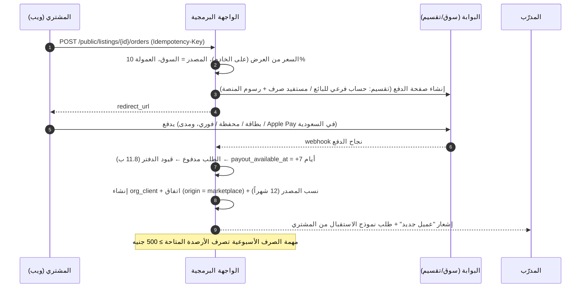

### 12.2 نسب المصدر وقواعد العمولة

- يُنشأ صف في `attributions` عندما يأتي **أول** شراء للمشتري من منشأة عبر اكتشاف السوق (بحث/صفحة/عرض مع مُحيل من السوق). ويضبط `commission_until = أول طلب + 12 شهراً`.
- أي طلب لاحق عبر دفع المنصة من ذلك المشتري مع تلك المنشأة قبل `commission_until` ← عمولة 10%؛ وبعدها ← 0% (المعالجة فقط). الطلبات من روابط دعوة المدرّب ← `origin = direct`، عمولة 0%.
- الجيمات: 5% على مدة العضوية الأولى فقط؛ باقات الحصص/الحصص المنفردة: 10% (المخطط الشامل 9.2).
- نسب العمولة بيانات (`marketplace_fee_rules` بإصدارات حسب التاريخ)، وتُحفظ نسخة منها مع كل طلب.

### 12.3 محرك الصرف

| الخطوة | القاعدة |
|---|---|
| الإتاحة | `payout_available_at = paid_at + 7 أيام` (+7 أخرى لأول 3 طلبات للبائع) |
| الدفعة | أسبوعياً (الأحد 10:00 بتوقيت القاهرة): مجموع `seller_payable` المتاح لكل منشأة ≥ 500 جنيه |
| التنفيذ | واجهة الصرف لدى البوابة (بنك/إنستاباي/محفظة) بمفتاح عدم تكرار `payout:{org}:{week}`؛ أو مع التسوية المقسّمة، "كشف" للتسوية فقط |
| الإخفاقات | إعادة المحاولة في يوم العمل التالي؛ بعد 3 إخفاقات ← تعليق + مطالبة البائع بتحديث الوجهة |
| الرصيد السالب | يُقاص من الطلبات المستقبلية؛ سالب لأكثر من 30 يوماً ← إيقاف البيع |
| الكشوف | تُولَّد لكل عملية صرف (PDF/إكسل)، وتظهر في شاشة المالية للمنشأة |

### 12.4 محرك عمولات المدرّبين (وحدة Compensation)

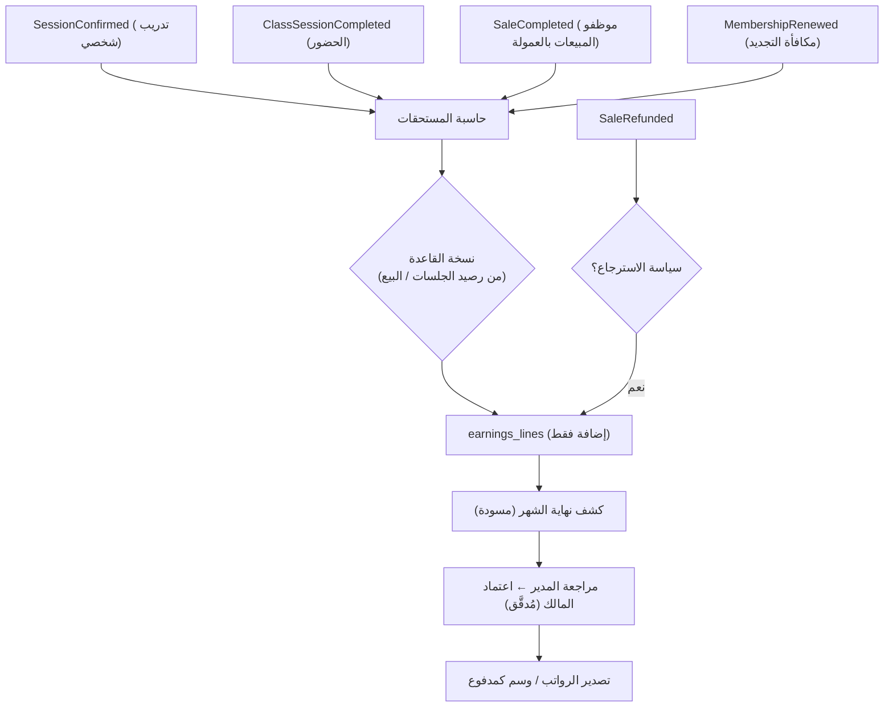

منع التلاعب: الجلسات تُحتسب فقط عند تأكيد العضو (أو التأكيد التلقائي بعد 24 ساعة دون اعتراض)؛ والجلسات داخل الجيم مرتبطة بالموقع (فرع الحجز) ويمكن اشتراط تسجيل دخول في الاستقبال في اليوم نفسه؛ والاعتراضات تجمّد البند. رسوم أرضية المدرّبين المستقلين تُولَّد كفواتير من المنشأة لنشاط تدريب المدرّب (أو كمستحق مسجل عندما لا يكون للمدرّب منشأة).

### 12.5 التقييمات والتحقق والإشراف

تُفتح التقييمات بعد 7 أيام من بدء اتفاق الطلب (أو بعد أول جلسة مؤكدة)، تقييم واحد لكل طلب؛ ويمر النص بمرشح آلي (الألفاظ النابية، أرقام الهواتف/الروابط لمنع التوجيه خارج المنصة) ثم يُنشر؛ والبلاغات تذهب لقائمة الإشراف في الإدارة. مستندات التحقق تُخزَّن في الحاوية الحساسة، ويراجعها فريق المنصة، ولها تاريخ انتهاء (الشهادات) مع تذكيرات.

---

## 13. البنية التحتية على AWS وقرارات المناطق

### 13.1 اختيار المنطقة

| المنطقة | الحالة (أكتوبر 2026) | زمن الاستجابة المتوقع من مصر **[تقدير — يُقاس]** | مستوى السعر | المخاطر / ملاحظات | الحكم |
|---|---|---|---|---|---|
| **eu-central-1 فرانكفورت** | ناضجة؛ كتالوج خدمات كامل | ≈ 50–80 مللي ثانية من مزوّدي الإنترنت في القاهرة (المسارات الدولية لمصر تمر غالباً عبر كابلات المتوسط إلى أوروبا) | خط الأساس الأوروبي | أقل مخاطرة؛ أكثر ربطاً بالشبكات | **أساسية** |
| eu-south-1 ميلانو | متاحة؛ كتالوج أضيق | ربما أقل قليلاً من فرانكفورت؛ ≈ 13 مللي ثانية من فرانكفورت [S55] | أعلى قليلاً من فرانكفورت في بعض الخدمات **[يحتاج تحقق]** | شريك جيد للتعافي | **النسخ الاحتياطية/التعافي**؛ مرشحة كأساسية فقط إذا أظهرت القياسات تفوقاً واضحاً |
| me-central-1 الإمارات | منطقة توفر واحدة ضُربت وفُقدت في مارس 2026 [S37] | لم يُقس | أعلى | تعرّض واضح للنزاعات | ليست أساسية في 2026 |
| me-south-1 البحرين | أعلنت AWS في سبتمبر 2026 أن الموارد/البيانات المستضافة فيها وحدها لا يمكن استعادتها [S37] | — | — | غير صالحة للاستخدام | لا |
| me-central-2 السعودية | مستهدفة للإطلاق بحلول ديسمبر 2026 [S36]؛ والخدمات تتوسع بعد الإطلاق | الأفضل لمستخدمي السعودية | غالباً أعلى | منطقة جديدة؛ فجوات خدمات عند الإطلاق | خلية سعودية مستقبلية (القسم 4.6) |
| il-central-1 تل أبيب | متاحة | قريبة جغرافياً | — | حساسة تجارياً وسياسياً لقاعدة عملاء مصرية/سعودية؛ تعرّض للنزاعات | لا |
| af-south-1 كيب تاون | متاحة | مرتفع (التوجيه) | أعلى | — | لا |

المحتوى الثابت والوسائط يُقدَّمان من **نقطة CloudFront في القاهرة** (منذ مايو 2024؛ شريحة أسعار الشرق الأوسط) [S38][S39]، لذا لا يعتمد على المنطقة إلا ذهاب وإياب الواجهة البرمجية؛ وتصميم التطبيق الذي يعمل دون إنترنت أولاً يخفي معظم ذلك.

**التحقق من زمن الاستجابة (P0، قبل الالتزام):** إجراء مسابير HTTP وTCP لمدة 7 أيام من 4 مزوّدي إنترنت مصريين (WE، فودافون، أورنج، e&) و3 مزوّدين سعوديين نحو نقاط اختبار في eu-central-1 وeu-south-1 (وme-central-1 كمرجع)، في ساعات الذروة. قاعدة القرار: اختيار ميلانو فقط إذا كان وسيط زمن الذهاب والإياب أقل بـ ≥ 15 مللي ثانية من ≥ 3 من 4 مزوّدين مصريين **و** كل خدمة في القسم 3.5 متاحة هناك؛ وإلا ففرانكفورت.

**الاعتماد القانوني:** استضافة البيانات الشخصية للمصريين خارج مصر تُعد نقلاً عبر الحدود وتحتاج ترخيصاً من مركز حماية البيانات [S27][S29]. إذا رُفض الترخيص أو كان غير عملي للبيانات الحساسة، فالبديل إبقاء **مخزن البيانات الحساسة** (الملفات الصحية، الصور، إجابات المتابعات) لدى مزوّد مستضاف في مصر بينما يبقى الباقي على AWS — وهي إعادة تصميم جوهرية مسجلة كأعلى خطر تقني (القسم 25).

### 13.2 خيارات الحوسبة

| الخيار | الملاءمة لـ Laravel + Reverb + العمّال | عبء التشغيل | التكلفة (MVP) | التوسع | الحكم |
|---|---|---|---|---|---|
| EC2 + Docker Compose | يعمل (أسلوب المؤسس الحالي) | الترقيع، صور AMI، SSH، نشر يدوي متدرج | الأقل (≈ 62 دولاراً لعدد 2 × t4g.medium + EBS) | يدوي/ASG | بديل احتياطي |
| **ECS على Fargate ‏(ARM64)** | الواجهة وReverb والعمّال والمجدول كخدمات منفصلة من صورة واحدة | بلا خوادم؛ نشر متدرج مُدار + قاطع دائرة | ≈ 91 دولاراً لمجموعة مهام MVP (القسم 15) | توسع تلقائي للخدمات | **من MVP إلى بدايات النمو** |
| ECS على EC2 (Graviton) | تعريفات المهام نفسها | الخوادم تُدار عبر ASG + صورة ECS المحسّنة | أرخص لكل معالج مع خطط الادخار عند الحمل الثابت | توسع العنقود | **شريحة النمو** |
| EKS | يعمل | خبرة Kubernetes، رسوم مستوى التحكم | أعلى | ممتاز | غير لازم |
| Lambda ‏(Bref) | واجهة HTTP نعم؛ Reverb لا (اتصالات طويلة)؛ Horizon لا | منخفض | منخفض عند الخمول | ممتاز | لا — يقسم الحزمة |
| Lightsail | باقات رخيصة مع نقل مشمول | تكامل محدود مع VPC/IAM، بلا ECS | منخفض جداً | يدوي | للتطوير/الاختبار فقط |
| App Runner | لا يدعم WebSockets **[يحتاج تحقق]**؛ خيارات VPC محدودة | منخفض | متوسط | تلقائي | لا |
| Elastic Beanstalk | ممكن | طابع قديم، مقيّد بالآراء | منخفض | ASG | لا |

### 13.3 خيارات قاعدة البيانات

| الخيار | المزايا | العيوب | الحكم |
|---|---|---|---|
| **RDS PostgreSQL** | نسخ احتياطي واستعادة لحظية مُدارة، Multi-AZ، الإضافات التي نحتاجها، سعر متوقع | توسع رأسي؛ تأخر نسخ القراءة | **المختار** (منطقة توفر واحدة + استعادة لحظية في MVP؛ Multi-AZ من L7 عندما تعتمد الجيمات علينا) |
| Aurora PostgreSQL | تحويل سريع، حتى 15 نسخة قراءة، توسع تخزين تلقائي | تكلفة دنيا أعلى؛ خيارات تسعير الإدخال/الإخراج | نعيد النظر عند > db.r7g.xlarge أو > نسختي قراءة |
| Aurora Serverless v2 | يتوسع مع الحمل | تكلفة أصعب في التوقع؛ تكلفة السعة الدنيا | نعيد النظر للتحليلات المتذبذبة |
| Postgres ذاتي الإدارة على EC2 | أرخص حوسبة | النسخ الاحتياطي والتحويل والترقيع والمراقبة علينا — خطر حقيقي لفريق صغير جداً | لا |

### 13.4 المُدار مقابل الذاتي — أين التوفير حقيقي

| المكوّن | الاختيار المُدار | البديل الذاتي | التوفير الشهري إن كان ذاتياً (MVP) | الخطر المأخوذ | القرار |
|---|---|---|---|---|---|
| PostgreSQL | RDS | حاوية Postgres على EC2 | ≈ 30–40 دولاراً | فقدان البيانات/تعقيد الاستعادة | **مُدار** |
| Valkey | ElastiCache Serverless (حد أدنى ≈ 6–10 دولارات) [S43] | حاوية Valkey | ≈ 10 دولارات | منخفض (ذاكرة مؤقتة/طوابير؛ والصندوق الصادر يحمي الأحداث) | مُدار (رخيص بما يكفي) |
| WebSockets | Reverb على ECS (تشغيل ذاتي) | Pusher ‏(49+ دولاراً) | — | منخفض | **تشغيل ذاتي** |
| البحث | Postgres | نطاق OpenSearch | — | — | Postgres حتى بلوغ الحدود |
| البريد | SES | Postfix | ضئيل | قابلية التوصيل | مُدار |
| المراقبة | CloudWatch + Sentry | حزمة Prometheus/Grafana | ≈ 20 دولاراً | وقت التشغيل | مُدار |
| الفيديو | LiveKit Cloud ‏(P4) | LiveKit مستضاف ذاتياً على EC2 | حسب الحجم | تشغيل TURN/التوسع | مُدار أولاً |

---

## 14. طوبولوجيا الاستضافة والنشر

### 14.1 الحسابات والبيئات

| حساب AWS (عبر AWS Organizations، ودخول موحد عبر IAM Identity Center، دون مستخدمي IAM) | المحتويات |
|---|---|
| `management` | Organizations، سياسات التحكم في الخدمات SCP (منع مغادرة المنظمة، منع تعطيل CloudTrail/GuardDuty، قائمة مناطق مسموحة: eu-central-1، eu-south-1، us-east-1 للخدمات العالمية)، إنذارات الفوترة |
| `prod` | حزمة الإنتاج |
| `nonprod` | حزمتا `dev` و`staging` (بيئة الاختبار تعكس الإنتاج بحجم صغير؛ دون بيانات شخصية حقيقية — بيانات اصطناعية فقط) |
| `security` (من P2) | مسار CloudTrail للمنظمة، Config، إدارة مفوّضة لـ GuardDuty/Security Hub، حاوية أرشيف السجلات (مع قفل الكائنات) |

### 14.2 الشبكة (الإنتاج، تخطيط MVP)

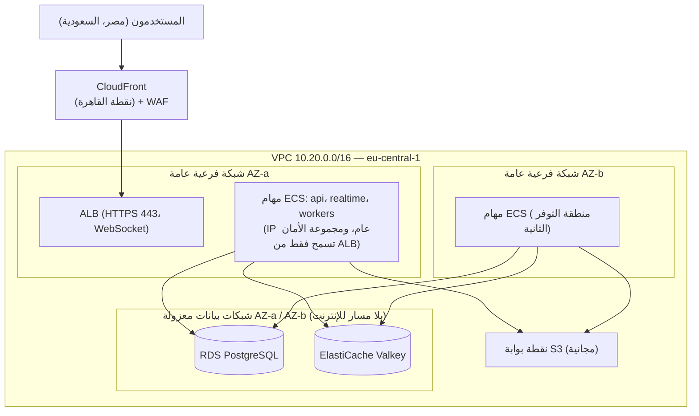

- **MVP:** المهام في شبكات فرعية عامة بعناوين IP عامة (اتصال خارجي بالبوابات وFCM وMeta دون بوابة NAT)؛ والدخول مقصور على مجموعة أمان ALB؛ بلا SSH (ECS Exec عبر SSM عند الحاجة)؛ وIMDSv2 فقط. هذا يوفّر بوابة NAT (≈ 38 دولاراً شهرياً + 0.052 دولار لكل جيجابايت معالَج **[تحقق من سعر فرانكفورت]**) ونقاط الواجهة (≈ 7–9 دولارات شهرياً لكل منها في كل منطقة توفر).
- **من بدايات النمو (≈ L9):** نقل المهام إلى شبكات فرعية خاصة مع بوابة NAT واحدة (اثنتان في شريحة النمو لاستقلال مناطق التوفر)، وإضافة نقاط واجهة فقط حيث تبررها الحركة (ECR، CloudWatch Logs، Secrets Manager).
- شبكات البيانات بلا مسار للإنترنت؛ ومجموعات أمان RDS/Valkey تسمح فقط لمجموعة أمان المهام.

### 14.3 النطاقات وسلوكيات شبكة التوزيع

| المضيف | المصدر | التخزين المؤقت |
|---|---|---|
| `app.` (تطبيق الويب)، `admin.` (لوحة الإدارة، مع قائمة IP مسموحة في WAF) | S3 ‏(OAC) | الأصول المُجزّأة سنة؛ و`index.html` بلا تخزين |
| `www.` / السوق / الصفحات العامة | خدمة ECS ‏`public-web` ‏(Nuxt SSR) | HTML لمدة 60 ثانية + stale-while-revalidate؛ مفتاح تخزين لكل لغة |
| `api.` | ALB ← خدمة `api` | بلا تخزين عدا طلبات GET لـ `/public/*` (60 ثانية) |
| `ws.` | ALB ← خدمة `realtime` | تمرير WebSocket |
| `cdn.` | S3 ‏`public-media` ‏(OAC) | سنة (مفاتيح غير قابلة للتغيير) |
| الوسائط الحساسة | **ليست على شبكة التوزيع**؛ رابط GET موقّع مسبقاً من S3 ‏(5 دقائق) بعد التفويض | بلا |

TLS عبر ACM (شهادات CloudFront في us-east-1)، مع HSTS preload، وTLS 1.2+.

### 14.4 مسار رفع الملفات

```mermaid
sequenceDiagram
    autonumber
    participant App as التطبيق
    participant API as الواجهة البرمجية
    participant S3 as S3 (حاوية خاصة)
    participant WK as عامل الوسائط
    App->>App: ضغط الصورة على الجهاز (حتى 2048 بكسل، WebP/JPEG بجودة ≈ 80)
    App->>API: POST /media/uploads {purpose: progress_photo, mime, bytes}
    API->>API: فحص السياسة والحصة، وإنشاء صف media (status=uploading, sensitivity=sensitive)
    API-->>App: رابط POST موقّع مسبقاً (المفتاح، نطاق الحجم، نوع المحتوى، 10 دقائق)
    App->>S3: الرفع مباشرة
    App->>API: POST /media/{id}/complete
    API->>S3: HEAD (الحجم، النوع)
    API-)WK: مهمة ProcessMedia
    WK->>S3: قراءة الأصل ← إزالة EXIF/الموقع ← نسخ (مصغرة، متوسطة) ← كتابة
    WK->>API: status=ready ← حدث MediaReady
```

الفيديوهات (عروض التمارين من المدرّبين، ≤ دقيقتين، ≤ 200 ميجابايت) تذهب إلى MediaConvert ‏(HLS + MP4 احتياطي، 360p/720p) وتُقدَّم من `cdn.` عندما تكون عامة، أو بروابط موقّعة عندما تكون خاصة. المستندات (إثباتات إنستاباي، الشهادات) تُفحص بحثاً عن البرمجيات الخبيثة (GuardDuty Malware Protection لـ S3 أو عامل ClamAV **[تحقق من التكلفة]**) قبل أن يفتحها الموظفون.

### 14.5 تجهيزات الإشعارات

| القناة | الخدمة | ملاحظات |
|---|---|---|
| الإشعارات الفورية | FCM HTTP v1 ‏(أندرويد + iOS عبر مفتاح APNs) | رموز لكل جهاز؛ مفاتيح دمج؛ حذف الرموز غير الصالحة |
| البريد | SES ‏(eu-central-1)، DKIM/SPF/DMARC، مجموعة إعدادات ← SNS ← قائمة منع للارتداد/الشكاوى | معاملات فقط في البداية |
| واتساب | واجهة Meta السحابية؛ قوالب معتمدة لكل لغة (خدمية: التجديد، الحجز، تذكير المتابعة؛ مصادقة: رمز التحقق) | التكلفة تُسجل لكل رسالة في `outbound_messages`؛ ورسائل المنشآت التسويقية بتمرير التكلفة |
| SMS | مجمّع محلي كبديل لرمز التحقق | تسجيل اسم المرسل **[يحتاج تحقق]** |
| داخل التطبيق | جدول `notifications` + تنبيه Reverb | مصدر الحقيقة للجرس |

### 14.6 الأسرار والإعدادات

AWS Secrets Manager لبيانات اعتماد قاعدة البيانات (مع التدوير) وأسرار المزوّدين؛ وSSM Parameter Store ‏(SecureString) للإعدادات غير الدوّارة؛ وتعريفات مهام ECS تشير للاثنين (لا أسرار في الصور أو المستودع أو سجلات التكامل المستمر). بيانات اعتماد بوابات المنشآت: مشفرة بمفتاح بيانات KMS لكل سجل (تشفير مغلّف) في Postgres. مفاتيح KMS يديرها العميل: `sensitive-media`، `db-field-encryption`، `backups`.

### 14.7 النشر والتراجع

```mermaid
flowchart TB
    PR["طلب الدمج"] --> CI["التكامل المستمر: الفحص، التحليل الثابت، الاختبارات،<br/>اختبارات المعمارية + المستأجرين،<br/>خطة Terraform، فحص الصورة"]
    CI --> M["الدمج في main"]
    M --> B["بناء صورة arm64 ← ECR (وسم ثابت = git SHA)"]
    B --> STG["النشر لبيئة الاختبار: مهمة التهجيرات ← تحديث متدرج ← اختبارات الدخان"]
    STG --> APP{"اعتماد يدوي"}
    APP --> MIG["الإنتاج: مهمة التهجيرات (توسيع فقط)"]
    MIG --> ROLL["تحديث متدرج في ECS (حد أدنى 100% / أقصى 200%)<br/>فحوص صحة + قاطع دائرة النشر"]
    ROLL --> POST["فحوص ما بعد النشر (اصطناعية، معدل الأخطاء)"]
    POST -->|"استنزاف ميزانية الأخطاء"| RB["تراجع تلقائي لتعريف المهمة السابق"]
```

التراجع آمن لأن التهجيرات توسيع فقط في الإصدار الذي يقدّمها (القسم 23.4). مفاتيح الميزات (Laravel Pennant) تفصل النشر عن الإطلاق؛ والميزات الخطرة تُنشر مخفية وتُفعَّل لكل منشأة.

---

## 15. تقديرات التكلفة وسيناريوهات التوسع

### 15.1 أسعار الوحدات المستخدمة (eu-central-1 ما لم يُذكر غير ذلك)

| البند | السعر المستخدم | المصدر / الثقة |
|---|---|---|
| EC2 ‏t4g.small / t4g.medium / t4g.large | 0.0192 / 0.0384 / 0.0768 دولار في الساعة | [S40] متتبعو أسعار مستقلون (t4g.medium بـ 0.038) — **[يحتاج تحقق]** |
| Fargate ‏Linux/ARM64 | ≈ 0.03725 دولار لكل معالج-ساعة، ≈ 0.00409 دولار لكل جيجابايت-ساعة | **[افتراض ≈ سعر us-east-1 × فرق المنطقة — يحتاج تحقق]** |
| RDS PostgreSQL ‏db.t4g.medium (منطقة توفر واحدة) | ≈ 54 دولاراً شهرياً (≈ 0.074 دولار/ساعة)؛ Multi-AZ ≈ ×2 | [S41] |
| تخزين gp3 في RDS | ≈ 0.137 دولار لكل جيجابايت شهرياً (×2 لـ Multi-AZ) | **[افتراض — يحتاج تحقق]** |
| ALB | 0.027 دولار في الساعة + 0.008 دولار لكل وحدة سعة LCU-ساعة | [S45] |
| عنوان IPv4 عام | 0.005 دولار لكل عنوان-ساعة (≈ 3.65 دولار شهرياً) | [S42] |
| بوابة NAT | ≈ 0.052 دولار في الساعة + ≈ 0.052 دولار لكل جيجابايت معالَج | **[افتراض — يحتاج تحقق]** |
| S3 Standard | 0.0245 دولار لكل جيجابايت شهرياً (أول 50 تيرابايت) | [S44] |
| CloudFront إلى الشرق الأوسط/أفريقيا (تشمل نقطة القاهرة) | 0.110 دولار لكل جيجابايت (أول 10 تيرابايت)؛ 1 تيرابايت مجاني شهرياً دائماً؛ باقات بسعر ثابت Free/15/200/1,000 دولار دون رسوم تجاوز | [S39] |
| ElastiCache Serverless Valkey | حد أدنى ≈ 6 دولارات شهرياً (100 ميجابايت كحد أدنى) | [S43] (سعر us-east-1) |
| استيعاب CloudWatch Logs | ≈ 0.63 دولار لكل جيجابايت | **[افتراض — يحتاج تحقق]** |
| SES | ≈ 0.10 دولار لكل 1,000 رسالة | **[افتراض — يحتاج تحقق]** |
| أرصدة الحسابات الجديدة | حتى 200 دولار أرصدة؛ باقة مجانية 6 أشهر | [S46] |

### 15.2 تكلفة AWS الشهرية حسب المرحلة **[تقدير]**

البنود قابلة لإعادة الإنتاج من القسم 15.1؛ بأسعار الطلب الفوري، قبل الضريبة.

**التطوير / الاختبار — ≈ 29 دولاراً شهرياً** (خادم t4g.small واحد يشغّل الحزمة كاملة عبر Docker Compose، و40 جيجابايت gp3، وIP عام واحد، وS3، وسجلات). الأشهر الأولى تغطيها أرصدة الحساب الجديد [S46].

**إنتاج MVP ‏(≤ 5 آلاف مستخدم نشط شهرياً، ≈ L1–L8) — ≈ 245 دولاراً شهرياً** (أضف ≈ 60 دولاراً شهرياً عند تحويل RDS إلى Multi-AZ قبل أول جيم دافع، ≈ L7)

| البند | دولار/شهر |
|---|---|
| Fargate ARM: الواجهة 2 × (معالج 1، 2 جيجابايت)، عامل (0.5، 1)، reverb ‏(0.25، 0.5) | 91 |
| ALB (الساعة + ≈ وحدة LCU واحدة) | 26 |
| IPv4 عامة (4 مهام + 2 لـ ALB) | 22 |
| RDS db.t4g.medium منطقة واحدة + 50 جيجابايت gp3 + استعادة لحظية | 61 |
| ElastiCache Serverless Valkey | 10 |
| S3 ‏150 جيجابايت + الطلبات | 7 |
| CloudFront (ضمن 1 تيرابايت المجاني / باقة Free الثابتة) | 0 |
| SES ‏(30 ألف رسالة)، CloudWatch ‏(10 جيجابايت سجلات + إنذارات)، الأسرار، Route 53، النسخ الاحتياطي | 27 |
| **الإجمالي** | **≈ 245** (البديل المبني على EC2 ≈ 207 دولارات) |

**بدايات النمو (≤ 30 ألف مستخدم نشط شهرياً، ≈ L9–L20) — ≈ 1,180 دولاراً شهرياً بأسعار الطلب الفوري، و≈ 1,040 دولاراً مع خطة ادخار للحوسبة لسنة + حجوزات RDS/الذاكرة المؤقتة**

| البند | دولار/شهر |
|---|---|
| Fargate ARM: الواجهة 3 × (معالجان، 4 جيجابايت)، العمّال 2 × (1، 2)، reverb ‏1 × (1، 2) | 299 |
| ALB ‏(≈ 4 وحدات LCU) | 43 |
| بوابة NAT واحدة + 150 جيجابايت | 46 |
| IPv4 عامة (ALB + NAT) | 11 |
| RDS db.t4g.large ‏**Multi-AZ** + 200 جيجابايت gp3 | 271 |
| ElastiCache Valkey ‏cache.t4g.small أساسي + نسخة | 54 |
| S3 ‏1.5 تيرابايت + الطلبات | 49 |
| باقة CloudFront Business الثابتة (أو ≈ 1 تيرابايت مدفوع بسعر 0.110 دولار/جيجابايت) | 200 |
| MediaConvert ‏(≈ 2,000 دقيقة إخراج) | 30 |
| SES، CloudWatch ‏(60 جيجابايت سجلات)، WAF، GuardDuty/Security Hub، النسخ الاحتياطي + النسخ بين المناطق، KMS/الأسرار/Route 53 | 178 |
| **الإجمالي** | **≈ 1,180** |

**النمو (≤ 100 ألف مستخدم نشط شهرياً، ≈ L21+ في السيناريو الأساسي) — ≈ 2,625 دولاراً شهرياً بأسعار الطلب الفوري، و≈ 2,280 دولاراً مع الالتزامات**

ECS على EC2 (4 × c7g.large لخوادم الواجهة 248 دولاراً، 2 × t4g.large للعمّال 112 دولاراً، 2 × t4g.medium لـ Reverb ‏56 دولاراً)، ALB ‏78 دولاراً، بوابتا NAT + 500 جيجابايت 102 دولار، RDS db.m7g.large ‏Multi-AZ + 500 جيجابايت 425 دولاراً، نسخة قراءة 177 دولاراً، زوج Valkey r7g.large ‏368 دولاراً، S3 ‏5 تيرابايت 153 دولاراً، CloudFront ‏260 دولاراً، MediaConvert ‏120 دولاراً، CloudWatch ‏186 دولاراً، WAF + GuardDuty/Security Hub/Inspector ‏130 دولاراً، النسخ الاحتياطي 90 دولاراً، SES ‏50 دولاراً، الأسرار/Route 53/KMS ‏30 دولاراً، EBS + IPv4 العامة 41 دولاراً.

**التوسع (≥ 100 ألف مستخدم نشط شهرياً، السعودية مفعّلة، خلية سعودية اختيارية) — ≈ 5,000–6,500 دولار شهرياً** **[تقدير]**: RDS أكبر (r7g.xlarge ‏Multi-AZ + نسخة قراءة)، OpenSearch (عقدتا بيانات صغيرتان)، خوادم واجهة أكثر، دقائق استشارات الفيديو (بتمرير التكلفة)، إضافة إلى ≈ 1,000–1,500 دولار شهرياً لخلية سعودية دنيا إن لزمت.

| المرحلة | المستخدمون النشطون شهرياً | AWS دولار/شهر | AWS لكل مستخدم (في أعلى الشريحة) | الحصة من صافي إيراد السيناريو الأساسي |
|---|---|---|---|---|
| MVP | ≤ 5 آلاف | ≈ 245 | ≈ 0.05 دولار | > 100% في L1 ← ≈ 12% في L8 |
| بدايات النمو | ≤ 30 ألفاً | ≈ 1,040–1,180 | ≈ 0.035–0.04 دولار | ≈ 40% في L9 ← ≈ 7% في L20 |
| النمو | ≤ 100 ألف | ≈ 2,280–2,625 | ≈ 0.023–0.026 دولار | ≈ 14% في L21 ← ≈ 10% في L24 |
| التوسع | ≥ 100 ألف | ≈ 5,000–6,500 | ≈ 0.03–0.04 دولار | ≈ 9% (السيناريو المتفائل في L24) |

يطبّق النموذج المالي التكلفة الكاملة لكل شريحة من الحد الأدنى لعدد مستخدميها، مما يبالغ في الإنفاق مباشرة بعد كل قفزة (مثل L9). عملياً تُضاف السعة تدريجياً — Multi-AZ في L7، وNAT في L9، ومهمة واجهة ثالثة عندما يبقى المعالج فوق 60% — فيكون الإنفاق الفعلي أقل من النموذج بين القفزات.

هذه الشرائح تغذي النموذج المالي في المخطط الشامل (الملحق ب).

### 15.3 تكاليف يغفل عنها الكثيرون

| التكلفة | لماذا تؤلم | كيف نتعامل معها |
|---|---|---|
| ساعات بوابة NAT + المعالجة لكل جيجابايت | كل بايت خارج من الشبكات الخاصة (استدعاءات البوابات، FCM، تنزيل الصور) | مهام في شبكات عامة في MVP؛ نقطة بوابة S3 (مجانية)؛ NAT فقط من بدايات النمو |
| رسوم IPv4 العامة | كل IP لمهمة/ALB/NAT يُحاسب منذ 2024 [S42] | عدّها؛ IPv6 مزدوج حيث يُدعم |
| نقاط VPC الواجهية | ≈ 7–9 دولارات لكل نقطة لكل منطقة توفر شهرياً | فقط حيث تبررها الحركة |
| وحدات سعة موازن الأحمال LCU | اتصالات WebSocket والاتصالات الجديدة تُحتسب | مراقبة LCU؛ ALB واحد للواجهة وWS |
| استيعاب CloudWatch Logs | السجلات الثرثارة بسعر 0.5–0.6 دولار/جيجابايت تتراكم بسرعة | مستوى INFO فقط في الإنتاج، أخذ عينات، احتفاظ 14–30 يوماً، أرشفة إلى S3 |
| نقل البيانات بين مناطق التوفر | 0.01 دولار/جيجابايت في كل اتجاه | الوعي بالأزواج كثيرة التواصل (المهمة ↔ الذاكرة المؤقتة)؛ وقبولها للإتاحة العالية |
| نقل البيانات إلى الإنترنت | الفيديو والصور | CloudFront (أرخص، باقة مجانية، باقات ثابتة)؛ نسخ مصغرة من الصور؛ عدم إرسال الأصول الخام للعملاء |
| تحويل الفيديو | لكل دقيقة إخراج لكل نسخة | نسختان كحد أقصى؛ حدود لطول الرفع |
| الاتصالات اللحظية | المزوّدون المُدارون يحاسبون لكل اتصال/رسالة | Reverb بتشغيل ذاتي |
| تخزين RDS والنسخ الاحتياطي فوق المجاني | النسخ الاحتياطية فوق 100% من حجم القاعدة مدفوعة؛ واللقطات المنسوخة بين المناطق تُحاسب في المنطقتين | سياسة احتفاظ؛ دورة حياة |
| مضاعفة Multi-AZ | تكلفة القاعدة والذاكرة المؤقتة ×2 | فقط من L7/L9 عندما تعتمد الجيمات علينا |
| Secrets Manager لكل سر | 0.40 دولار/سر/شهر **[يحتاج تحقق]** | Parameter Store للقيم غير الدوّارة |
| طلبات WAF | لكل مليون طلب + القواعد | مجموعات القواعد المُدارة فقط حيث تلزم |
| باقة الدعم | دعم Business له حد أدنى شهري | Developer/Basic حتى النمو؛ وBusiness عندما تعتمد الجيمات على 99.9% |

### 15.4 ضوابط التكلفة

AWS Budgets مع تنبيهات عند 80/100/120% لكل حساب؛ اكتشاف شذوذ التكلفة؛ وسوم (`env`، `module`، `cell`) تفرضها SCP/Config؛ مراجعة تكلفة شهرية مقابل هدف NFR-16؛ وخطط الادخار فقط بعد 3 أشهر من استخدام مستقر.

---

## 16. معمارية الأمان والخصوصية

### 16.1 نموذج التهديدات (ملخص)

| الأصل | التهديدات | الضوابط الرئيسية |
|---|---|---|
| البيانات الصحية، صور التقدم | تسرب بين المستأجرين، تصفح من الداخل، سرقة جهاز، تسرب رابط عام | الأذونات + RLS، سجل وصول يراه الشخص، حاوية منفصلة بـ KMS، روابط موقّعة قصيرة العمر، قفل التطبيق بالرمز/البصمة على الجوال |
| الحسابات | إساءة استخدام رمز التحقق، تبديل الشريحة، حشو بيانات الاعتماد، سرقة الجلسة | حدود المعدل، رمز التحقق عبر واتساب أولاً، التحقق بخطوتين للأدوار المميزة، قائمة الأجهزة + الإلغاء، ملفات ارتباط HttpOnly على الويب |
| المال (الفوترة، الصرف، أدراج النقدية) | إثباتات مزيفة، احتيال الاسترداد، تحويل وجهة الصرف، انتحال Webhooks | مسار مراجعة الإثباتات، صلاحيات الاسترداد + التدقيق، تغيير وجهة الصرف يحتاج تحققاً بخطوتين + تعليق 48 ساعة، توقيعات Webhooks + عدم تكرار الأثر |
| بيانات أعمال المنشأة | وصول موظفين سابقين، تصدير من الاستقبال | إلغاء فوري للتعيين، صلاحية التصدير، التدقيق |
| السوق | تقييمات مزيفة، مدرّبون محتالون، التوجيه خارج المنصة | تقييمات المشتريات الموثّقة، التحقق، مرشحات المحتوى |
| المنصة | حجب الخدمة، الحقن، ثغرات الاعتماديات | CloudFront + WAF، منشئ استعلامات/ORM في Laravel، CSP، فحص الاعتماديات، اختبارات الاختراق |

### 16.2 الضوابط حسب الطبقة

| الطبقة | الضوابط |
|---|---|
| الحافة | CloudFront + قواعد AWS WAF المُدارة (عامة، مدخلات سيئة معروفة، سمعة IP)، قواعد معدل على نقاط المصادقة، قواعد جغرافية للإدارة، Shield Standard |
| النقل | TLS 1.2+ في كل مكان، HSTS، وتثبيت الشهادات يُدرس لتطبيق الجوال (P3) |
| التطبيق | قائمة OWASP ASVS المستوى 2، التحقق عبر Form Requests، سياسات على كل مسار (اختبار معماري)، ترميز المخرجات، CSP صارمة (الويب/الإدارة)، CSRF على جلسات الملفات، حماية SSRF لأي جلب لرابط، فحص نوع الملفات |
| البيانات المخزنة | تشفير RDS ‏(KMS)، S3 SSE-KMS، EBS مشفر؛ **تشفير على مستوى الحقل** (تحويلات Laravel المشفرة بمفتاح مخصص) للإجابات الصحية والإصابات ورموز الفتح والأرقام القومية وبيانات اعتماد البوابات |
| الهوية والوصول (AWS) | IAM Identity Center مع دخول موحد + تحقق متعدد العوامل، أدوار مهام بأقل صلاحية لكل خدمة، لا مفاتيح طويلة العمر، SCP، مسار CloudTrail للمنظمة، قواعد Config |
| الأسرار | Secrets Manager / Parameter Store؛ التدوير؛ gitleaks في التكامل المستمر |
| الجوال | الرموز في Keychain/Keystore، قاعدة البيانات المحلية مشفرة (SQLCipher) لذاكرة البيانات الصحية/الصور، حماية لقطات الشاشة في شاشات الصور (`FLAG_SECURE` على أندرويد)، كشف كسر الحماية/الروت كإشارة فقط، قفل التطبيق (رمز/بصمة) |
| السجلات | لا قيم صحية ولا محتوى رسائل في السجلات؛ معرّفات أشخاص مُجزّأة؛ تنقية البيانات الشخصية في Sentry |

### 16.3 حدود أمان المدفوعات

لا تستلم قوّة أرقام البطاقات أبداً: صفحة دفع مستضافة/إطار مضمّن من البوابة؛ رموز فقط. نطاق PCI DSS: ‏SAQ A (إعادة توجيه/إطار) **[تحقق حسب التكامل المختار]**. Webhooks يُتحقق منها بـ HMAC ونافذة منع إعادة التشغيل؛ والمبالغ تُعاد حسابها دائماً على الخادم من سجلاتنا، ولا يُوثق بها من العميل أو من Webhook وحده.

### 16.4 الوصول الآمن للملفات

| الحاوية | المحتوى | الوصول |
|---|---|---|
| `public-media` | فيديوهات مكتبة التمارين، صور الصفحات العامة، شعارات الجيمات | CloudFront مع OAC؛ مفاتيح غير قابلة للتغيير |
| `business-files` | العقود، الإيصالات، ملفات التصدير، إثباتات إنستاباي | خاصة؛ رابط GET موقّع مسبقاً (5 دقائق) بعد فحص السياسة؛ وملفات التصدير تنتهي تلقائياً (دورة حياة 24 ساعة) |
| `sensitive-media` | صور التقدم، صور المتابعات، المستندات الصحية، هويات التحقق | خاصة؛ SSE-KMS بمفتاح مخصص لا تسمح سياسته إلا لأدوار مهام api/worker؛ رابط GET موقّع (5 دقائق) بعد فحص الإذن؛ كل وصول يُسجَّل في `data_access_log`؛ إصدارات + نسخ متماثل إلى eu-south-1 |

### 16.5 أمان الجلسات والرموز

رموز الجوال مُجزّأة في القاعدة، وتُدوَّر عند تغيير الصلاحيات، وتُلغى عند الخروج/إعادة تعيين كلمة المرور؛ وجلسات الويب HttpOnly/Secure/SameSite=Lax؛ والإدارة بحارس ونطاق منفصلين؛ ومهلة خمول لجلسات الموظفين على أجهزة الاستقبال المشتركة (قفل بعد 5 دقائق، ورمز PIN لفتحه — نمط قفل التطبيق الموجود لدى المؤسس)؛ وكشف الدخول المريب (جهاز جديد + دولة جديدة) ← تحقق إضافي.

### 16.6 ربط الامتثال وخطوات التحقق

لا تدّعي قوّة الامتثال لأي قانون قبل أن ينفّذ مستشار قانوني مؤهل خطوات التحقق أدناه.

| النظام | ينطبق لأن | الالتزامات (ملخص) | التنفيذ | خطوة التحقق |
|---|---|---|---|---|
| **قانون حماية البيانات المصري (151/2020) + لائحته التنفيذية (القرار 816/2025)** | أصحاب بيانات مصريون؛ متحكم مصري | تراخيص/تصاريح من مركز حماية البيانات (متحكم/معالج؛ **البيانات الحساسة**؛ **النقل عبر الحدود — والتخزين بالخارج يُعد نقلاً**) [S27][S29]؛ موافقة صريحة على البيانات الحساسة (الصحية، المالية، الأطفال) [S28]؛ حقوق أصحاب البيانات؛ مسؤول حماية البيانات؛ سجلات المعالجة؛ الإبلاغ عن الاختراق (72 ساعة حسب المصادر) [S27]؛ ممثل للجهات الأجنبية | سجلات موافقة لكل غرض/إصدار؛ مركز الموافقات؛ التصدير/الحذف؛ سجل الوصول للبيانات؛ تعيين مسؤول حماية بيانات (المؤسس مبدئياً + مستشار خارجي)؛ وثيقة سجل المعالجة؛ دليل حوادث بساعة 72 ساعة | رأي قانوني مكتوب في P0 حول أنواع التراخيص ورسومها ومددها؛ التقديم قبل L1؛ مراجعة أخرى عند نهاية المهلة (≈ نوفمبر 2026) [S27] |
| **نظام حماية البيانات الشخصية السعودي** | أصحاب بيانات سعوديون (P4) | أساس نظامي (موافقة للبيانات الصحية؛ المصلحة المشروعة لا تغطي البيانات الحساسة) [S30]؛ ضمانات النقل (بنود تعاقدية قياسية/تقييم مخاطر) [S30]؛ حقوق أصحاب البيانات؛ الإبلاغ عن الاختراق **[تحقق من المدة]** | محرك الموافقة نفسه؛ بنود تعاقدية قياسية مع AWS/المعالجين؛ تقييم مخاطر النقل؛ خلية سعودية اختيارية | رأي مستشار سعودي قبل L16 |
| **اللائحة الأوروبية GDPR** | فقط إذا استهدفنا مقيمين في الاتحاد الأوروبي أو كان لنا كيان فيه — الاستضافة في الاتحاد **لا تجعل** GDPR منطبقة بذاتها **[يحتاج تحقق]** | — | اتفاقية معالجة البيانات مع AWS على أي حال | تأكيد المستشار |
| **قانون حماية البيانات الإماراتي** | عند التوسع في الإمارات | مبادئ مشابهة | المحرك نفسه | قبل دخول الإمارات |
| **حماية المستهلك (مصر)** | مبيعات للمستهلكين والسوق | حقوق الإلغاء/الاسترداد للخدمات عن بُعد **[يحتاج تحقق]** | سياسات العروض، مسار الاسترداد | مراجعة المستشار للشروط |
| **سياسات متاجر التطبيقات** | تطبيقات iOS/Android | قواعد IAP (المخطط الشامل 8.5)، حدود استخدام البيانات الصحية، حذف الحساب من داخل التطبيق | حذف الحساب داخل التطبيق؛ بيانات HealthKit لا تُستخدم للإعلانات أبداً | قائمة مراجعة قبل الإرسال |
| **حدود الصحة/العافية** | نصائح التغذية والتدريب | ليس جهازاً طبياً ولا خدمة طبية؛ تجنب ادعاءات التشخيص/العلاج | إخلاء مسؤولية، استبيان جاهزية بتنبيهات "راجع طبيباً"، سياسة ادعاءات محظورة، لا نصائح طبية بالذكاء الاصطناعي | مراجعة قانونية للنصوص؛ لا ادعاءات منظَّمة في التسويق |

### 16.7 تفاصيل هندسة الخصوصية

- **تقليل البيانات:** الأسئلة الصحية اختيارية عدا استبيان جاهزية قصير؛ الصور اختيارية؛ تاريخ الميلاد مطلوب فقط لقواعد العمر.
- **موافقة مرتبطة بالغرض:** ‏`consent_records` بمفتاح الغرض (`coaching_share:{org}`، `marketing_photos`، `wearables_sync`، `guardian_consent`) وإصدار النص؛ وسحب الموافقة يلغي الإذن فوراً.
- **طلبات أصحاب البيانات:** التصدير (JSON + ملخص PDF، تولّده مهمة، والرابط صالح 24 ساعة)؛ الحذف: تُحذف بيانات المساحة الشخصية؛ وسجلات المنشآت التي تشير للشخص يُخفى فيها الاسم حيث يسمح القانون بالاحتفاظ (السجلات المالية تُحفظ مع استبدال الاسم بـ "مستخدم محذوف" وفق قواعد الاحتفاظ) — نمط إخفاء الهوية عند الحذف نفسه المستخدم في قاعدة كود المؤسس (أحداث `CustomerErased` تستهلكها كل وحدة).
- **مهام الاحتفاظ:** حذف ليلي لكل جدول احتفاظ (القسم 8.4)؛ مع تدقيق عمليات الحذف.
- **تقييم أثر حماية البيانات (DPIA)** قبل الإطلاق للبيانات الصحية والصور؛ ويُكرر قبل ميزات الذكاء الاصطناعي (P4) والأجهزة القابلة للارتداء (P3).
- **الأطفال:** موافقة وليّ الأمر، لا سوق، لا محتوى عام، رفع الصور مغلق افتراضياً.

### 16.8 منع إساءة الاستخدام

قيود رمز التحقق والدخول (القسم 9.2)؛ مرشحات رسائل السوق (أرقام الهواتف/الروابط في أولى الرسائل)، أزرار البلاغ، تقييم آلي للرسائل المزعجة للعملاء المحتملين؛ حدود حجم/نوع الرفع؛ حدود إساءة التكلفة لإرسال واتساب لكل منشأة يومياً؛ تنبيهات شذوذ للاستردادات وفروق النقدية.

---

## 17. التخزين المؤقت وتحسين الأداء

### 17.1 ماذا نخزّن مؤقتاً، وأين

| البيانات | الطبقة | المفتاح / مدة الصلاحية | الإبطال |
|---|---|---|---|
| الأصول الثابتة (حزم SPA، فيديوهات التمارين، الصور العامة) | CloudFront | غير قابلة للتغيير، سنة | أسماء ملفات جديدة مُجزّأة |
| الصفحات العامة / صفحات السوق | CloudFront ‏(60 ثانية + SWR) | لكل رابط + لغة | إبطال المسار عند نشر الصفحة (على دفعات) |
| واجهة البحث العامة | CloudFront ‏(60 ثانية) | قائمة مسموحة لمعاملات الاستعلام | انتهاء الصلاحية |
| مجموعات الصلاحيات، الاستحقاقات، كتالوج الباقات، مفاتيح الميزات | Valkey (مصفوفات، لا نماذج مسلسلة أبداً — ذاكرة Laravel 13 المؤقتة ترفض إلغاء تسلسل الكائنات) | `perm:{org}:{person}:v{n}`، `ent:{type}:{id}:v{n}`، `catalog:v{n}`؛ 10 دقائق | رفع رقم الإصدار عند التغيير |
| البحث في الأذونات لكل موظف | Valkey | `grants:{org}:{staff}:{scope}:v{n}`؛ 5 دقائق | رفع الإصدار عند تغيير الإذن |
| مكتبة التمارين، نتائج البحث في الأطعمة (بيانات المنصة) | Valkey + ETag عبر HTTP | `ex:lib:{locale}:v{n}`؛ ساعة | رفع الإصدار |
| أرقام لوحة المالك | Valkey | `dash:{org}:{branch}:{date}`؛ 30–60 ثانية | انتهاء الصلاحية (+ تنبيه "تحديث" لحظي) |
| لقطة أعضاء الاستقبال | IndexedDB في المتصفح | تُحدَّث كل 5 دقائق، بالفرق عبر `updated_after` | القسم 6.3 |
| بيانات الجوال (شاشة اليوم، البرامج، السجل) | SQLite على الجهاز | مؤشرات مزامنة يقودها الخادم | المزامنة |

القواعد: كل مفتاح يبدأ بنطاق (`org:`، `person:`، `public:`)؛ لا تخزين مؤقت للقيم الحساسة (الإجابات الصحية، الصور)؛ وحماية من تزاحم الذاكرة المؤقتة عبر `Cache::flexible`/الأقفال على المفاتيح الساخنة.

### 17.2 أداء التطبيق

- **Octane + FrankenPHP:** الإطار يُقلع مرة واحدة لكل عامل؛ مع الانتباه لتسرب الحالة (كائنات مفردة تحتفظ ببيانات طلب) — يفرض ذلك اختبار يشغّل طلبين بسياقين مختلفين في عامل واحد.
- **قاعدة البيانات:** كشف صارم لـ N+1 في التطوير/الاختبار (`Model::preventLazyLoading()`)، ومراجعة خطط التنفيذ لنقاط القوائم الجديدة، وترقيم بالمفاتيح، و`statement_timeout`، وفهارس جزئية وشاملة (القسم 8.5)؛ والعدادات (`booked_count`، `last_seq`) تُحدَّث داخل المعاملات بدلاً من `COUNT(*)` في المسارات الساخنة.
- **نسخة قراءة** من شريحة النمو للتقارير والتصدير وإعادة بناء إسقاط السوق (ما يتحمل التأخير فقط).
- **ميزانيات الحمولة:** نقاط القوائم ≤ 50 كيلوبايت مضغوطة؛ الصور عبر نسخ (مصغرة 200 بكسل، متوسطة 800 بكسل)؛ طلبات الجوال مجمّعة عبر نقاط الشاشات (`/me/today`).
- **كل ما هو بطيء في الخلفية:** إعادة حساب الأرقام القياسية، حسابات اتجاهات المتابعات، التصدير، الإشعارات، معالجة الوسائط.

### 17.3 أداء الجوال

قراءات من SQLite أولاً دون إنترنت (شاشات فورية)؛ مزامنة بالفرق عبر مؤشرات `updated_after`؛ تخزين مؤقت للصور بنسخ تراعي الحجم؛ تحميل كسول للفيديو (HLS، و360p افتراضياً على البيانات الخلوية)؛ ميزانية حجم التطبيق (< 40 ميجابايت) بتأجيل الأصول الكبيرة (فيديوهات التمارين تُبث ولا تُضمَّن).

### 17.4 ميزانيات الأداء (تُفحص في التكامل المستمر واختبارات الحمل)

| فئة نقطة النهاية | p95 لزمن الخادم | ملاحظات |
|---|---|---|
| تسجيل الدخول في الاستقبال | 250 مللي ثانية | NFR-02 |
| المصادقة / التحقق من الرمز | 300 مللي ثانية | دون زمن توصيل واتساب |
| نقاط الشاشات (`/me/today`، صندوق المدرّب) | 300 مللي ثانية | |
| حفظ برنامج (مستند) | 400 مللي ثانية | |
| دفعة مزامنة (≤ 200 مجموعة) | 500 مللي ثانية | |
| بحث السوق | 300 مللي ثانية | Postgres FTS/trigram/GIST |
| التقارير (تفاعلية) | ثانيتان | نسخة القراءة، وإلا تصدير في طابور |

### 17.5 متى نضيف بنية بحث

نبقى على Postgres (FTS + trigram + PostGIS) حتى يتحقق **أيٌّ** من: > 50 ألف عرض/صفحة منشورة؛ p95 لبحث السوق > 300 مللي ثانية بعد ضبط الفهارس؛ الحاجة لمرادفات مدركة للغة/ترتيب تقريبي يتجاوز trigram؛ أو أن تصبح أعداد الأوجه (facets) مكلفة. حينها نضيف **Amazon OpenSearch Service** (عقدتا بيانات صغيرتان، محلل عربي + مرادفات)، يغذيه مُفهرِس يستهلك أحداث الصندوق الصادر، مع بقاء Postgres مصدر الحقيقة، وإعادة بناء ليلية كاملة إلى فهرس بإصدار جديد خلف اسم مستعار (النمط نفسه الذي يشغّله المؤسس بالفعل لفهرس سوق).

---

## 18. الطوابير والأحداث ومسارات العمل غير المتزامنة

### 18.1 الآليات

| الآلية | الاستخدام | الضمان |
|---|---|---|
| **استدعاء عقد داخل المعاملة** | آثار جانبية يجب أن تنجح مع التغيير (بيع ← صرف مخزون ← دفتر ← عضوية) | ذري |
| **حدث نطاق ← مستمع (متزامن، بعد الالتزام)** | ردود فعل رخيصة داخل التطبيق | يعمل بعد الالتزام؛ والإخفاقات تُسجَّل |
| **مهمة في طابور (Horizon على Valkey)** | عمل بطيء أو خارجي (إشعارات، واتساب، بريد، وسائط، إعادة حساب الأرقام القياسية، تصدير) | مرة واحدة على الأقل؛ والمهام غير مكررة الأثر |
| **صندوق صادر معاملاتي (Postgres)** | أحداث لا يجوز فقدانها حتى لو تحوّلت Valkey (المدفوعات، الاستحقاقات، طلبات السوق، إسقاط البحث) | تُكتب في المعاملة نفسها؛ ومُرحِّل ينشرها للطابور؛ والمستهلكون يزيلون التكرار بمعرّف الحدث |
| **المجدول** | العمل الزمني | مهمة مجدول واحدة مع أقفال `onOneServer()` |

### 18.2 الطوابير والعمّال

| الطابور | أمثلة | العمّال (MVP ← النمو) | المهلة | إعادة المحاولة |
|---|---|---|---|---|
| `critical` | معالجة Webhooks، إعادة حساب الاستحقاقات، الصرف | 1 ← 2 عملية | 60 ثانية | 10 بتراجع؛ ثم تنبيه |
| `default` | آثار الاتفاقات/العضويات الجانبية، إعادة حساب الأرقام القياسية | 2 ← 4 | 120 ثانية | 5 |
| `notify` | الإشعارات الفورية، واتساب، البريد، SMS | 2 ← 6 | 30 ثانية | 5؛ قاطع دائرة للمزوّد |
| `media` | نسخ الصور، مهام الفيديو، فحص البرمجيات الخبيثة | 1 ← 2 | 300 ثانية | 3 |
| `reports` | التصدير، الكشوف، تصدير البيانات | 1 ← 2 | 900 ثانية | 2 |

المهام الفاشلة تذهب إلى `failed_jobs` مع لوحة Horizon (للإدارة فقط) وتنبيه عندما يتجاوز عدد إخفاقات `critical` الصفر.

### 18.3 أحداث النطاق (مقتطف من الكتالوج)

| الحدث | المُنتج | المستهلكون |
|---|---|---|
| `PersonClaimed` | Identity | Organizations (ربط org_clients)، Notifications |
| `GrantGiven` / `GrantRevoked` / `GrantExpired` | Access | Coaching (حالة القائمة)، الذاكرة المؤقتة، Realtime (قناة المدرّب)، Audit |
| `EngagementStarted` / `EngagementEnded` | Coaching | Billing (الاستحقاقات المرعية، عدد العملاء النشطين)، Access (دورة حياة الإذن)، Messaging (حالة المحادثة)، Marketplace (نسب المصدر) |
| `ProgramAssigned`، `MealPlanAssigned` | Training، Nutrition | Notifications |
| `WorkoutLogged`، `PersonalRecordSet` | Training | Coaching (نشاط العميل)، Notifications (تغذية المدرّب) |
| `CheckinSubmitted` / `CheckinReviewed` | Coaching | Notifications، Reporting |
| `MembershipActivated` / `Frozen` / `Expired` / `Renewed` | Gym | Billing (الاستحقاقات المرعية، الأعضاء النشطون)، Notifications، Compensation (مكافأة التجديد) |
| `VisitRecorded` | Gym | Realtime (الاستقبال/المالك)، إشارات الاحتفاظ |
| `BookingPromoted` | Gym | Notifications (إشعار فوري + واتساب خدمي) |
| `SessionConfirmed` | Scheduling | Compensation (المستحقات)، Gym (استهلاك الرصيد) |
| `SaleCompleted` / `SaleRefunded` | Commerce | Gym (العقود/الأرصدة)، Compensation، Ledger، Reporting |
| `PaymentSucceeded` / `PaymentFailed` / `RefundSucceeded` / `ChargebackOpened` | Payments | Billing، Commerce، Marketplace، Notifications |
| `SubscriptionActivated` / `PastDue` / `Suspended` | Billing | Entitlements، Notifications، Organizations (القيود) |
| `OrderPaid` | Marketplace | Coaching (الاتفاق)، Payouts |
| `PersonErased` | Identity | كل وحدة تحتفظ ببيانات الشخص (إخفاء الهوية/الحذف) |

### 18.4 المهام المجدولة

| المهمة | الجدول (بتوقيت القاهرة) | الغرض |
|---|---|---|
| `subscriptions:advance` | كل 10 دقائق | انتقالات الحالة من نهايات الفترات/المدفوعات (غير مكررة الأثر) |
| `billing:dunning` | يومياً 10:00 | التذكيرات وإعادة محاولة البطاقات |
| `payments:reconcile` | كل ساعة + استيراد التسوية اليومية 06:00 | النوايا المعلقة، مطابقة التسويات |
| `memberships:expire` / `memberships:reminders` | يومياً 02:00 / 11:00 | حالة العقود، تذكيرات التجديد |
| `classes:materialize` | يومياً 03:00 | إنشاء جلسات الحصص لأربعة أسابيع قادمة من الجداول |
| `classes:close` | كل 5 دقائق | عدم الحضور، انتهاء قوائم الانتظار |
| `checkins:schedule` / `checkins:remind` | كل ساعة | إنشاء المتابعات المستحقة، التذكيرات |
| `grants:expire` | كل 15 دقيقة | إنهاء الأذونات بعد نهاية الاتفاق + فترة الإنهاء التدريجي |
| `compensation:statements` | أول الشهر 04:00 | مسودات كشوف المدرّبين |
| `payouts:run` | أسبوعياً الأحد 10:00 | صرف مستحقات السوق |
| `privacy:retention` | يومياً 01:00 | الحذف/إخفاء الهوية وفق سياسة الاحتفاظ |
| `ledger:verify` | يومياً 05:00 | إعادة جمع القيود مقابل الأرصدة؛ تنبيه عند الانحراف |
| `health:beat` | كل دقيقة | نبضة المجدول للمراقبة |

### 18.5 مسار العمل: تذكير التجديد ← الدفع ← الاستحقاق

```mermaid
sequenceDiagram
    autonumber
    participant SCH as المجدول
    participant BIL as الفوترة
    participant NT as الإشعارات
    participant OWN as المدرّب (المالك)
    participant GW as البوابة
    participant PAY as المدفوعات
    participant ENT as الاستحقاقات
    SCH->>BIL: billing:dunning (قبل 3 أيام)
    BIL->>NT: إرسال تذكير (داخل التطبيق، بريد، واتساب خدمي برابط الدفع)
    OWN->>GW: يدفع عبر الرابط
    GW-->>PAY: webhook (موقّع)
    PAY->>PAY: صندوق الوارد ← إزالة التكرار ← دفعة + قيد دفتر (معاملة واحدة، حدث في الصندوق الصادر)
    PAY-)BIL: PaymentSucceeded (عبر مُرحِّل الصندوق الصادر)
    BIL->>BIL: الفاتورة مدفوعة ← تمديد الفترة
    BIL-)ENT: إعادة الحساب (طابور critical)
    ENT-)OWN: EntitlementsChanged (لحظياً) + إيصال
```

---

## 19. المراقبة والسجلات وقابلية الملاحظة

### 19.1 الإشارات

| الإشارة | الأداة | ملاحظات |
|---|---|---|
| الأخطاء (الواجهة، العمّال، الويب، الجوال) | Sentry (تنقية البيانات الشخصية، تتبع الإصدارات، خرائط المصدر / dSYM) | مجمّعة، وتنبيه عند ظهور مشكلات جديدة في المسارات الحرجة |
| تتبعات الأداء | أداء Sentry (عينة 5–10%)، وOpenTelemetry لاحقاً (ADOT ← X-Ray أو Grafana Cloud) | مقطع (span) لكل استعلام قاعدة بيانات/استدعاء خارجي |
| المقاييس | CloudWatch ‏(ECS، ALB، RDS، ElastiCache)، مقاييس مخصصة عبر EMF (زمن تسجيل الدخول، عمق الطوابير، تأخر Webhooks، تعارضات المزامنة) | لوحات لكل خدمة |
| السجلات | JSON منظم إلى CloudWatch Logs؛ 14 يوماً (التطبيق)، 30 يوماً (ما يتعلق بالأمان)، مع الأرشفة إلى S3 | معرّفات أشخاص مُجزّأة، بلا محتوى رسائل أو قيم صحية |
| الإتاحة / الفحوص الاصطناعية | فحوص صحة Route 53 أو مراقب إتاحة خارجي على `/up` و`/api/v1/health` ومصافحة WebSocket وصفحة الدفع | من خارج AWS أيضاً |
| مراقبة المستخدم الحقيقي | الجوال: Sentry + توقيت بدء التطبيق/الشاشات؛ الويب: إرسال Web Vitals | |
| صحة الأعمال | مهمة مقاييس يومية ← لوحة الإدارة (التسجيلات، الدافعون، الإيراد الشهري المتكرر، التسرّب، المتابعات، المدفوعات الفاشلة) | الأرقام نفسها في مؤشرات المخطط الشامل |
| التدقيق | `audit_events`، `data_access_log`، CloudTrail | منفصلة عن سجلات التطبيق |

### 19.2 أهداف مستوى الخدمة والتنبيهات

| الهدف | القيمة | التنبيه |
|---|---|---|
| إتاحة الواجهة (غير 5xx، باستثناء 4xx) | 99.9% شهرياً من L7 | معدل استنزاف بنوافذ متعددة (سريع: 14.4× خلال ساعة؛ بطيء: 6× خلال 6 ساعات) |
| p95 لتسجيل الدخول في الاستقبال | < 250 مللي ثانية على الخادم | p95 > 400 مللي ثانية لمدة 10 دقائق |
| تأخر معالجة Webhooks | 99% < 60 ثانية | أقدم غير معالج > 5 دقائق |
| تأخر الطابور (`critical`) | 99% < 30 ثانية | > دقيقتين |
| نجاح مهام الإشعارات الفورية | > 99% | معدل إخفاق > 5% لمدة 15 دقيقة |
| نبضة المجدول | كل دقيقة | غياب > 5 دقائق |
| التحقق من الدفتر | صفر انحراف | أي انحراف |

توجيه التنبيهات: Telegram/Slack للتحذيرات؛ ومكالمة هاتفية (نوبة مناوبة، من L7) للتنبيهات التي تستدعي الإيقاظ. لكل تنبيه رابط لدليل تشغيل (القسم 20.4).

### 19.3 نقطة فحص الصحة

`GET /api/v1/health` يفحص قاعدة البيانات والذاكرة المؤقتة ونبضة الطوابير ونبضة المجدول والقرص/التخزين المؤقت، ويُرجع 200/503 — وتستخدمه فحوص صحة ECS (`/up` السطحي) والمراقبون الخارجيون (`/health` العميق).

---

## 20. النسخ الاحتياطي والتعافي من الكوارث

### 20.1 الأهداف

| السيناريو | RPO | RTO | الآلية |
|---|---|---|---|
| نشر سيئ / خطأ يُفسد البيانات | ≤ 5 دقائق | ≤ ساعة | استعادة لحظية لـ RDS إلى خادم جديد، مقارنة، إصلاح |
| فشل مهمة/خادم | 0 | < دقيقتين | ECS يستبدل المهام؛ ≥ مهمتا واجهة عبر مناطق التوفر |
| فشل منطقة توفر (قبل Multi-AZ، حتى L7) | ≤ 5 دقائق | ≤ ساعة | استعادة لحظية في منطقة توفر أخرى |
| فشل منطقة توفر (Multi-AZ، من L7) | 0 | 1–2 دقيقة | تحويل RDS Multi-AZ؛ المهام في منطقتي توفر |
| فشل المنطقة (eu-central-1) | الهدف ≤ ساعة؛ المضمون ≤ 24 ساعة | ≤ 8 ساعات | نسخ النسخ الاحتياطية الآلية بين المناطق / نسخ اللقطات إلى eu-south-1 + نسخ متماثل لحاويات S3 الحساسة/التجارية + إعادة البناء بـ Terraform **[تحقق من دعم RDS للنسخ الاحتياطي الآلي بين المناطق لإصدار المحرك لدينا]** |
| حذف عرضي في S3 | 0 | دقائق | الإصدارات + دورة حياة للإصدارات غير الحالية (30 يوماً) |
| اختراق الحساب | ≤ 24 ساعة | ≤ 24 ساعة | نسخ احتياطية تُنسخ إلى حساب `security` مع AWS Backup Vault Lock (غير قابلة للتغيير) |

### 20.2 ما يُنسخ احتياطياً

| البيانات | الطريقة | الاحتفاظ |
|---|---|---|
| PostgreSQL | نسخ احتياطية آلية (استعادة لحظية) 14 يوماً؛ لقطات يومية تُنسخ بين المناطق وبين الحسابات | 14 يوماً استعادة لحظية؛ 35 يومية؛ 12 شهرية |
| حاويات S3 الحساسة/التجارية | الإصدارات + النسخ المتماثل بين المناطق إلى eu-south-1 | تعكس المصدر؛ غير الحالية 30 يوماً |
| وسائط S3 العامة | الإصدارات (محتوى يمكن إعادة إنشائه) | 30 يوماً لغير الحالية |
| Valkey | لا نسخ احتياطي (ذاكرة مؤقتة/طوابير)؛ والصندوق الصادر يجعل الأحداث قابلة للاسترداد | — |
| الإعدادات | حالة Terraform (S3 بإصدارات)، تصدير Parameter Store، المستودع | — |

### 20.3 التدريبات

تدريب استعادة ربع سنوي (استعادة لحظية إلى خادم مؤقت، تشغيل فحوص السلامة، قياس RTO)؛ ويوم تمرين نصف سنوي لتحويل المنطقة في `nonprod` (تطبيق Terraform في eu-south-1 من النسخ المتماثلة)؛ وتُسجل النتائج مع التحسينات.

### 20.4 الاستجابة للحوادث وأدلة التشغيل

| الخطورة | التعريف | الاستجابة |
|---|---|---|
| SEV-1 | تعطل الاستقبال أو الدخول لمنشآت كثيرة، اشتباه في اختراق بيانات، خصم مزدوج للمدفوعات | إيقاظ فوري؛ قائد للحادث؛ تحديث صفحة الحالة خلال 30 دقيقة؛ تحديثات كل ساعة |
| SEV-2 | ميزة متدهورة (تأخر المحادثة، إخفاق الإشعارات)، منشأة كبيرة واحدة متأثرة | خلال ساعة في ساعات العمل |
| SEV-3 | خطأ بسيط مع وجود حل مؤقت | قائمة الأعمال العادية |

اختراق البيانات الشخصية: احتواء ← تقييم ← إبلاغ مركز حماية البيانات المصري خلال نافذة الـ 72 ساعة المذكورة [S27] (والجهات السعودية وفق النظام **[يحتاج تحقق]**) ← إبلاغ الأشخاص/المنشآت المتأثرين حسب المطلوب ← مراجعة ما بعد الحادث خلال 5 أيام عمل.

أدلة التشغيل (محفوظة في المستودع، ومرتبطة بالتنبيهات): تحويل قاعدة البيانات والاستعادة اللحظية؛ إعادة بناء المنطقة؛ تدوير سر مسرّب؛ تعطل البوابة (تحويل روابط الدفع إلى وضع إنستاباي اليدوي)؛ تعطل واتساب (الرجوع إلى SMS/الإشعارات)؛ تعطل Reverb (العملاء يستطلعون)؛ تراكم الطوابير؛ إخفاق جماعي للإشعارات؛ نشاط إداري مريب؛ انحراف الدفتر.

---

## 21. مراحل التطوير ومحطات التنفيذ

أسماء المراحل وتواريخها وبوابات الأعمال تطابق المخطط الشامل (القسم 13). الجهد بالأسابيع-شخص (pw) للهندسة والتصميم؛ والتكلفة النسبية تستخدم تكاليف الفريق في المخطط الشامل.

### 21.1 نظرة عامة

| المرحلة | النافذة | الفريق (بدوام كامل) | الجهد | التكلفة النسبية | بوابة الانتقال |
|---|---|---|---|---|---|
| P0 الاكتشاف والأساسات | 6 أسابيع قبل P1 | المؤسس 1، full-stack ‏1، Flutter ‏0.5، مصمم 0.5 | ≈ 18 أسبوع-شخص | $ (≈ 0.55 مليون جنيه شاملاً جزءاً من القانوني) | اختيار المسار القانوني؛ التحقق من التسعير؛ الأساسات سليمة |
| P1 المنتج الأولي للمدرّبين | 18 أسبوعاً ← L1 | المؤسس 1، full-stack ‏1، Flutter ‏1، مصمم 0.5 | ≈ 63 أسبوع-شخص | $$ (≈ 0.97 مليون جنيه) | 50 مدرّباً دافعاً بحلول L3؛ حلقة المتابعة الأسبوعية ≥ 60% |
| P2 نواة الجيم | L2–L7 | + backend (في L8 بالنموذج؛ أبكر إن توفر التمويل)، مهندس جودة/دعم (L7)، مبيعات | ≈ 120 أسبوع-شخص | $$$ | 5 جيمات شركاء تصميم تعمل (L5)؛ تسجيل الدخول p95 < 3 ثوانٍ من طرف لطرف |
| P3 السوق والنمو | L8–L15 | 5–6 مهندسين + مصمم | ≈ 220 أسبوع-شخص | $$$$ | حدود السيولة؛ معدل الاسترداد < 3% |
| P4 الخليج والتوسع | L13–L24 | 6–7 مهندسين + مصمم | ≈ 200 أسبوع-شخص | $$$$ | السعودية مفعّلة؛ إتاحة 99.9% لثلاثة أشهر |
| P5 التوسع اللاحق | عند المحفّز | لكل مبادرة | لكل مبادرة | حسب دراسة الجدوى | لكل مبادرة |

### 21.2 P0 — الاكتشاف والأساسات

| البند | التفاصيل |
|---|---|
| الهدف التجاري | تقليل المخاطر: التسعير، المدخل، مسار الاستضافة القانوني، هيكل المدفوعات |
| داخل النطاق | المقابلات (30 مدرّباً، 15 جيماً)؛ حسابات تجريبية لدى المنافسين؛ مسابير زمن الاستجابة (القسم 13.1)؛ آراء قانونية (تراخيص حماية البيانات، النقل عبر الحدود، تدفق أموال السوق)؛ نظام التصميم (عربي/إنجليزي، RTL، رموز التصميم، فاتح/داكن)؛ المستودع الموحد؛ التكامل المستمر؛ أساس Terraform (الحسابات، VPC، ECR، عنقود ECS، RDS للتطوير)؛ هيكل المصادقة + سياق مساحة العمل؛ إطار RLS + أداة اختبار التسرب |
| خارج النطاق | شاشات الميزات بعد النماذج الأولية |
| الاعتماديات | التعاقد مع المستشار القانوني؛ حسابات AWS؛ حسابات مطوري Apple/Google؛ حساب WhatsApp Business واعتماد القوالب |
| التسلسل | الأسبوع 1: المستودع/التكامل المستمر/أساس Terraform، خطة المقابلات ← الأسابيع 2–4: المقابلات، النماذج الأولية (Figma)، الطلبات القانونية، مسابير زمن الاستجابة ← الأسابيع 5–6: هيكل الهوية/السياق/RLS، نظام التصميم، قائمة أعمال P1 بتقديراتها |
| معايير القبول | Terraform ينشئ `dev` من الصفر؛ التكامل المستمر يشغّل الفحص/الاختبارات/الاختبارات المعمارية؛ طلب بلا سياق يرى صفر صفوف (اختبار RLS)؛ 15+ التزاماً مسبقاً من المدرّبين؛ مذكرة قانونية مكتوبة |
| الاختبار | اختبارات معمارية، اختبارات RLS، اختبارات مسار التكامل المستمر |
| الإطلاق / التراجع | لا ينطبق (داخلي) |
| مؤشرات النجاح | اعتماد القرارات D-01…D-10 |

### 21.3 P1 — المنتج الأولي للمدرّبين (تسع دورات كل منها أسبوعان)

| الدورة | الـ backend | الويب | الجوال |
|---|---|---|---|
| S1 | Identity (رمز التحقق عبر واتساب/SMS، الجلسات، الأجهزة)، Organizations (نشاط التدريب)، طبقة السياق، التدقيق | المصادقة، معالج التهيئة | المصادقة، مبدّل مساحات العمل، هيكل التعريب/RTL |
| S2 | Access (الأذونات، سجلات الموافقة)، الدعوات، القائمة، الأشخاص غير المُطالَب بهم | قائمة العملاء، مسارات الدعوة | قبول الدعوة + شاشات الموافقة |
| S3 | Exercises (بذر ≈ 300، مسار الوسائط)، قوالب البرامج (JSON Schema، الإصدارات) | منشئ البرامج | تصفح مكتبة التمارين |
| S4 | الإسناد، نقطة المزامنة، عدم تكرار الأثر | إسناد البرنامج | شاشة اليوم، **المسجّل دون إنترنت** (صندوق Drift الصادر)، مؤقت الراحة |
| S5 | قياسات الجسم، حاوية الوسائط الحساسة، مهام الأرقام القياسية، السجل | ملف العميل الشامل (الرسوم) | القياسات، الصور (مضغوطة، خاصة)، السجل/الأرقام القياسية |
| S6 | المتابعات (النماذج، الجداول، التذكيرات)، الإشعارات (FCM، SES، قوالب واتساب) | قائمة المراجعة | إرسال المتابعة |
| S7 | المراسلة (Reverb، الحفظ، سد الفجوات، الإشعارات)، أساسيات التغذية (بذر الأطعمة، خطة الوجبات، PDF) | المحادثة، منشئ خطط الوجبات | المحادثة (رسائل صوتية)، عرض خطة الوجبات |
| S8 | الباقات، المدفوعات المسجلة + الإثباتات، التجديدات؛ Billing (الباقات، التجارب، Paymob، اعتماد إنستاباي، الفواتير)، الاستحقاقات v1 | الباقات، المدفوعات، صفحات الفوترة | حالة دفع العميل، الإيصالات |
| S9 | واجهة الصفحة العامة للمدرّب، لوحة الإدارة v1، تصدير البيانات، حدود المعدل، التقوية | الصفحات العامة بالتوليد على الخادم، الإدارة | الإرسال للمتاجر، تقارير الأعطال |

| البند | التفاصيل |
|---|---|
| الهدف التجاري | أول إيراد؛ إثبات حلقة التدريب |
| داخل النطاق | الضروريات في المخطط الشامل 13.2 (رموز الميزات في المخطط الشامل 13.1) |
| خارج النطاق | الجيمات، الجدولة، الأتمتة، دفع السوق، Plus/IAP، الأجهزة القابلة للارتداء، الذكاء الاصطناعي، الفيديو، يوميات الطعام |
| الأساس التقني | هيكل التطبيق المتكامل المقسّم لوحدات، RLS، الصندوق الصادر، عدم تكرار الأثر، مسار الوسائط، Reverb، الاستحقاقات v1، Terraform للإنتاج (تخطيط MVP في القسم 14.2) |
| الاعتماديات | اعتماد قوالب واتساب؛ حساب تاجر لدى Paymob؛ حسابات Apple/Google؛ إنتاج/ترخيص وسائط التمارين (المخطط الشامل Q-07)؛ بذر بيانات الأطعمة (Q-08) |
| معايير القبول | يستطيع المدرّب الانتقال من التسجيل إلى أول عميل ببرنامج ودفعة مسجلة في ≤ 30 دقيقة (اختبار قابلية استخدام مع 5 مدرّبين)؛ تسجيل تمرين مدته 60 دقيقة في وضع الطيران، وصفر تكرار بعد المزامنة (آلي)؛ توصيل المحادثة p95 < 1 ثانية في اختبار حمل بيئة الاختبار؛ مجموعة اختبارات تسرب المستأجرين ناجحة لكل مسار؛ إعادة تشغيل Webhook الدفع 5 مرات تُنشئ دفعة واحدة؛ الواجهة العربية/الإنجليزية كاملة مع اختبارات صور RTL؛ تصدير البيانات يُسلّم JSON كاملاً لشخص اختباري |
| الاختبار | مجموعات القسم 22؛ نسخة تجريبية مغلقة مع 20 مدرّباً لمدة 6 أسابيع قبل L1 |
| الإطلاق / التراجع | الويب/الواجهة: تحديث متدرج في ECS مع تراجع تلقائي؛ الجوال: TestFlight / الاختبار الداخلي في Play ← نشر تدريجي 10% ← 100% بعد 72 ساعة بنسبة جلسات خالية من الأعطال ≥ 99.5%؛ مفاتيح إيقاف على الخادم للمحادثة والفوترة |
| مؤشرات النجاح | التفعيل ≥ 50%؛ احتفاظ العملاء بعد 30 يوماً ≥ 45%؛ جلسات خالية من الأعطال ≥ 99.5% |

### 21.4 P2 — نواة الجيم (L2–L7)

| البند | التفاصيل |
|---|---|
| الهدف التجاري | خط إيراد ثانٍ بإيراد أعلى لكل عميل؛ تبنّي تطبيق الأعضاء |
| داخل النطاق | GYM-01–06، 08–10، 12–14 (أساسي)، 16–18، 21 (أساسي)، 24؛ COA-15، 17، 18، 20، 22؛ TRN-08، 09، 11–14؛ PLT-06 (خدمة ذاتية)، 11 |
| خارج النطاق | أجهزة الدخول، تصدير الرواتب، لوحة السلاسل، تحويلات المخزون، المتجر الأونلاين |
| الأساس التقني | سياق الفرع؛ نقطة البيع + ورديات النقدية + البيع ← العقود في معاملة واحدة؛ توليد جلسات الحصص؛ ترقية قائمة الانتظار بأقفال الصفوف؛ أرصدة جلسات التدريب الشخصي؛ محرك العمولات؛ تطبيق الاستقبال مع لقطة دون إنترنت؛ بيانات اعتماد البوابة المربوطة (KMS)؛ **RDS Multi-AZ** قبل أول جيم دافع |
| الاعتماديات | 5 جيمات شركاء تصميم؛ اختبار ماسحات QR/الأجهزة اللوحية؛ قوالب واتساب خدمية للتجديدات/الحجوزات |
| التسلسل | منشأة الجيم/الفروع/الأدوار ← الخطط/العقود/الأحداث ← الاستقبال + اللقطة دون إنترنت ← نقطة البيع/النقدية/المبيعات ← الحصص/الحجوزات/قوائم الانتظار ← أرصدة التدريب الشخصي/الجلسات/التأكيد ← الأجور ← العملاء المحتملون/التجارب ← التذكيرات ← التقارير ← ميزات تطبيق الأعضاء ← جدولة/فرق/أتمتة المدرّبين ← البوابة المربوطة |
| معايير القبول | قرار تسجيل الدخول p95 < 250 مللي ثانية على الخادم و< 2 ثانية من طرف لطرف عند 120 تسجيلاً/ساعة/فرع؛ الاستقبال يعمل ساعتين دون إنترنت ويتزامن دون تكرار؛ اختبارات حساب العقود (التجميد/النقل/الحساب النسبي) ناجحة لكل تركيبات السياسات؛ ترقية قائمة الانتظار لا تتسبب أبداً في حجز زائد تحت 50 إلغاءً متزامناً (اختبار تزامن)؛ كشف المدرّب يساوي الكشوف المحسوبة يدوياً لدى 3 شركاء تصميم لمدة شهر |
| الاختبار | اختبارات التزامن (الحجوزات، النقدية)، اختبارات Playwright من طرف لطرف لمسارات الاستقبال، تجربة في 5 جيمات |
| الإطلاق / التراجع | ميزات الجيم خلف مفاتيح لكل منشأة؛ تجربة ← إتاحة عامة في L7 |
| مؤشرات النجاح | 20 جيماً دافعاً بحلول L10؛ ≥ 30% من الأعضاء يستخدمون التطبيق في جيمات التجربة |

### 21.5 P3 — السوق والنمو (L8–L15)

| البند | التفاصيل |
|---|---|
| الهدف التجاري | محرك طلب؛ قمع المستهلكين |
| داخل النطاق | MKT-01–07؛ COA-03 الشارة، 16، 21؛ TRN-06 متقدم، 15–19؛ GYM-11، 14 التحويلات، 15 التجديد أونلاين، 20، 21 متقدم، 22، 23، 25 |
| الأساس التقني | البحث العام (FTS + trigram + PostGIS)، دفع المنصة عبر منتج سوق لدى البوابة، الصرف، دفتر المذكرات، النزاعات؛ RevenueCat؛ HealthKit/Health Connect على الجهاز؛ نسخة قراءة؛ تقسيم الجداول؛ NAT + شبكات خاصة |
| الاعتماديات | اعتماد قانوني لتدفق الأموال (المخطط الشامل Q-02/Q-03)؛ تحقق حدود السيولة لكل مدينة |
| معايير القبول | البحث p95 < 300 مللي ثانية عند 20 ألف صفحة؛ من الدفع إلى الاتفاق < 10 ثوانٍ بعد Webhook؛ دفعة الصرف غير مكررة الأثر (إعادة التشغيل لا تُنشئ تكرارات)؛ التقييم ممكن فقط بعد طلب مدفوع؛ مزامنة الأجهزة القابلة للارتداء لا تعطل الواجهة أبداً وتحترم الأذونات الملغاة |
| الإطلاق / التراجع | التفعيل مدينة بمدينة؛ الدفع خلف مفتاح مع الرجوع لوضع العملاء المحتملين فقط |
| مؤشرات النجاح | المخطط الشامل 9.8، 17 |

### 21.6 P4 — الخليج والتوسع (L13–L24)

| البند | التفاصيل |
|---|---|
| الهدف التجاري | إيراد السعودية؛ جاهزية المؤسسات |
| داخل النطاق | محوّلات Moyasar/Tap، أسعار بالريال، ZATCA عبر مزوّد معتمد، الشروط السعودية؛ برنامج الشركاء؛ GYM-07 أجهزة الدخول (تكامل المرحّلات/قارئات QR عبر جسر صغير في الموقع أو واجهة سحابية للمورّد)، GYM-19، GYM-26 (إيصالات مصلحة الضرائب)؛ COA-23 ‏(LiveKit)، COA-24، COA-25 تجريبي؛ TRN-20؛ MKT-09؛ خلية سعودية اختيارية |
| الأساس التقني | إعدادات مدركة للمنطقة، جاهزية الخلايا (القسم 4.6)، خدمة صياغة الذكاء الاصطناعي (أدناه)، واجهة غرف الفيديو |
| الاعتماديات | مستشار سعودي؛ توقيع الشريك؛ إتاحة منطقة AWS السعودية إذا لزمت خلية |
| معايير القبول | الفواتير السعودية يتحقق منها صندوق اختبار المزوّد؛ مدفوعات مدى/Apple Pay من طرف لطرف؛ مسودات الذكاء الاصطناعي تتطلب دائماً اعتماد المدرّب وتجتاز التحقق من المخطط؛ إتاحة 99.9% لثلاثة أشهر متتالية |
| مؤشرات النجاح | 25 جيماً سعودياً + 90 مدرّباً سعودياً بحلول L24 (أساسي) |

**تصميم صياغة الذكاء الاصطناعي (COA-25):** مجموعة عمّال منفصلة تستدعي نموذج لغة كبيراً عبر نقطة نهاية مستضافة في الاتحاد الأوروبي (Amazon Bedrock مع الاستدلال الأوروبي أو واجهة مورّد بمعالجة بيانات أوروبية — يُختار بالتقييم وقت P4)؛ المدخلات = نموذج استقبال منظّم (الأهداف، المعدات، الجدول، ملخص الإصابات دون معرّفات) + مكتبة قوالب المدرّب؛ المخرجات = **مسودة** برنامج/خطة وجبات بمخطط JSON الخاص بنا، يُتحقق منها وتُعرض كاقتراح؛ لا تُرسل للعميل أبداً دون اعتماد المدرّب؛ لا ادعاءات طبية (تعليمات النظام + مرشح لاحق)؛ تُسجل المدخلات/المخرجات دون معرّفات مباشرة؛ حصة شهرية لكل منشأة؛ تتبع التكلفة لكل مسودة؛ مجموعة تقييم دون اتصال من 200 حالة مجهولة الهوية يراجعها مدرّبون معتمدون قبل النسخة التجريبية.

### 21.7 P5 — التوسع اللاحق (عند المحفّز)

تطبيقات بعلامة بيضاء (نكهات Flutter، حسابات متاجر لكل علامة، مسار بناء آلي)، إدارة الامتياز التجاري، الظهور المميز، العافية المؤسسية (منشآت أصحاب عمل ترعى الاستحقاقات)، واجهة الشركاء + Webhooks صادرة (القسم 9.5)، OpenFGA إذا تجاوزت هرميات العلاقات سياسات التطبيق، OpenSearch (القسم 17.5).

---

## 22. استراتيجية الاختبار وضمان الجودة

### 22.1 هرم الاختبارات وملكيتها

| المستوى | النطاق | الأدوات | البوابة |
|---|---|---|---|
| الوحدة | قواعد النطاق: الحساب النسبي، حساب التجميد/النقل، قواعد العمولة، اتحاد الاستحقاقات، توازن الدفتر، التطبيع العربي، توقيع QR | Pest/PHPUnit؛ Dart `test` | كل طلب دمج |
| الميزة/الواجهة | نقاط النهاية مع PostgreSQL حقيقية (خدمة في التكامل المستمر)، السياسات، التحقق، عدم تكرار الأثر، رموز الأخطاء | Pest + اختبارات HTTP في Laravel | كل طلب دمج |
| المعمارية | حدود الوحدات (العقود/الأحداث فقط)، كل نموذج يعلن سمة مالكه، كل مسار مفوَّض، مسارات الوحدات الاختيارية تحمل طبقة الوحدة الوسيطة، لا نماذج في الذاكرة المؤقتة، فحص التهجيرات | اختبارات Pest المعمارية (كما في قاعدة كود المؤسس) | كل طلب دمج |
| **مجموعة تسرب المستأجرين** | تُولَّد من قائمة المسارات: لكل مسار مورد، منشأتان وشخصان؛ الوصول المتقاطع يجب أن يُرجع 404/403؛ والبيانات الشخصية دون إذن تُرجع 403 ‏`grant_required` | مولّد مخصص | كل طلب دمج |
| RLS | SQL خام كـ `app_rw` بسياق خاطئ/مفقود يُرجع صفر صفوف؛ واستخدام `app_system` مُدقَّق | اختبارات SQL | كل طلب دمج |
| العقود | الاستجابات تطابق OpenAPI؛ عملاء Dart وTypeScript المولَّدون من OpenAPI يُترجمون | Spectral، openapi-generator | كل طلب دمج |
| واجهة الويب | المكوّنات (Vitest)، من طرف لطرف للرحلات الحرجة (تسجيل الدخول في الاستقبال، بيع عضوية، إسناد برنامج، مراجعة متابعة)، فحوص إتاحة axe، لقطات RTL | Vitest، Playwright | طلب الدمج (دخان) + ليلياً (كامل) |
| الجوال | الوحدة، الواجهة، اختبارات الصور المرجعية (RTL/LTR، الخطوط الكبيرة)، اختبارات تكامل تشمل المزامنة في وضع الطيران، الروابط العميقة | Flutter test، integration_test، مصفوفة أجهزة Firebase Test Lab | طلب الدمج + ليلياً |
| المدفوعات | من طرف لطرف في صناديق اختبار كل بوابة؛ إعادة تشغيل Webhooks/خارج الترتيب؛ محاكاة الاسترداد/النزاع البنكي؛ مجموع الدفتر صفر | Pest + صناديق اختبار البوابات | ليلياً + قبل الإصدار |
| التزامن | حجز زائد للحصص، تسجيل دخول مزدوج، درج النقدية، تسلسل الرسائل تحت طلبات متوازية | أداة اختبار متوازي | ليلياً |
| الحمل | ذروة المساء في الاستقبال (مثلاً 30 فرعاً × تسجيلان/دقيقة)، اندفاع المزامنة بعد الحصص، 5 آلاف WebSocket، بحث السوق | k6 (+ امتداد WebSocket) على بيئة اختبار بحجم الإنتاج | قبل إطلاق P1، إتاحة P2، إتاحة P3، ثم ربع سنوياً |
| الأمان | تحليل ثابت (Larastan المستوى 8، قواعد Semgrep)، تدقيق الاعتماديات (composer/npm/pub)، فحص الحاويات (Trivy)، فحص الأسرار (gitleaks)، فحص ديناميكي أساسي (OWASP ZAP) على بيئة الاختبار، اختبار اختراق خارجي قبل L7 وسنوياً، فحوص MASVS للجوال | التكامل المستمر + موردون | طلب الدمج / ليلياً / سنوياً |
| نقل البيانات | استيراد إكسل/CSV للمدرّبين والجيمات بعينات حقيقية (مجهولة الهوية) | بيانات ثابتة | لكل أداة استيراد |
| قبول المستخدم | شركاء التصميم والمدرّبون التجريبيون بسيناريوهات مكتوبة | TestFlight، منشآت في بيئة الاختبار | لكل مرحلة |

### 22.2 بيانات الاختبار والبيئات

مولّدات بيانات اصطناعية (أسماء عربية، صيغ هواتف مصرية، سجلات تمارين واقعية)؛ **لا بيانات شخصية من الإنتاج في غير الإنتاج**؛ بيئة الاختبار تستخدم صناديق اختبار البوابات ورقم واتساب تجريبياً؛ ومنشآت العرض المبذورة للمبيعات تعيش في الإنتاج لكنها موسومة ومستبعدة من المؤشرات.

### 22.3 معايير الجودة

تغطية أسطر ≥ 70% لوحدات النطاق (Billing وPayments وGym وCompensation ≥ 85%)؛ صفر ثغرات عالية/حرجة معروفة عند الإصدار؛ جلسات خالية من الأعطال ≥ 99.5%؛ ميزانيات p95 (القسم 17.4) متحققة في اختبارات الحمل؛ الإتاحة: لا مخالفات axe "خطيرة/حرجة" في الشاشات الأساسية.

---

## 23. التكامل والنشر المستمر، والبنية التحتية ككود، وDevOps

### 23.1 تخطيط المستودع (مستودع موحد)

```
apps/api        Laravel 13 (modules in app/Modules/*, shared kernel app/Support/*)
apps/web        Nuxt 4 SPA (dashboards, front desk PWA)
apps/public     Nuxt 4 SSR (public profiles, marketplace, landing)
apps/admin      Nuxt 4 SPA (platform console)
apps/mobile     Flutter app
packages/api-client-ts   generated from OpenAPI
packages/design-tokens   shared colours/typography (web + Flutter export)
infra/terraform modules/ (network, ecs-service, rds, valkey, s3, cloudfront, ses, iam, monitoring) + envs/(dev|staging|prod)
docs/           ADRs, runbooks, OpenAPI spec
```

### 23.2 المسارات (GitHub Actions)

| المُطلِق | المهام |
|---|---|
| طلب دمج | الواجهة: Pint، Larastan، Pest (خدمتا Postgres + Valkey)، مجموعات المعمارية + المستأجرين + RLS، فحص/مقارنة OpenAPI (فحص التغييرات الكاسرة)؛ الويب: ESLint، ‏`nuxi typecheck`، Vitest، البناء؛ الجوال: `dart analyze`، الاختبارات، اختبارات الصور المرجعية؛ Terraform: fmt، validate، tflint، plan (تُنشر في طلب الدمج)؛ الأمان: gitleaks، تدقيق الاعتماديات، Trivy على الصورة المبنية |
| الدمج في `main` | بناء صور arm64 (الواجهة، public-web) ← ECR (الوسم = SHA) ← النشر إلى `staging` (مهمة التهجيرات ← تحديث متدرج) ← دخان Playwright + فحوص اصطناعية |
| الإصدار (اعتماد يدوي / وسم) | النشر إلى `prod` بتحديث متدرج في ECS + قاطع دائرة؛ فحوص اصطناعية بعد النشر؛ ملاحظات الإصدار؛ إصدار في Sentry |
| إصدار الجوال | Fastlane (أو Codemagic): البناء ← TestFlight / الاختبار الداخلي في Play ← نشر تدريجي 10% ← 50% ← 100% مشروط بنسبة الخلو من الأعطال |
| ليلياً | من طرف لطرف كامل، التزامن، مجموعة صناديق اختبار المدفوعات، الفحص الديناميكي الأساسي، طلبات دمج تحديث الاعتماديات (Renovate) |

### 23.3 البنية التحتية ككود

Terraform (متوافق مع OpenTofu)، الحالة في حاوية S3 مشفرة بإصدارات مع قفل، حالة واحدة لكل بيئة؛ الوحدات تُراجع عبر خطط طلبات الدمج؛ لا تغييرات من وحدة التحكم في الإنتاج (AWS Config يكشف الانحراف؛ وSCP يمنع الإجراءات اليدوية الخطرة)؛ `terraform apply` للإنتاج فقط من التكامل المستمر مع خطوة اعتماد؛ وقيم الأسرار لا تكون أبداً في حالة Terraform (تُنشأ خارجياً أو عبر توليد عشوائي في Secrets Manager).

### 23.4 إدارة تغييرات قاعدة البيانات

التوسيع/التقليص: الإصدار N يضيف (أعمدة قابلة للفراغ، جداول جديدة، فهارس جديدة `CONCURRENTLY`)، والكود يكتب في الشكلين؛ ومهمة في طابور تملأ البيانات؛ والإصدار N+1 يقرأ الشكل الجديد؛ والإصدار N+2 يزيل القديم. التهجيرات تعمل كمهمة ECS لمرة واحدة قبل تحديث الخدمة؛ والتهجيرات طويلة التشغيل ممنوعة في مسار النشر (ملء البيانات مهام). كل تهجير يعلن `$withinTransaction` بشكل مناسب؛ وفحص في التكامل المستمر يمنع العمليات المدمرة على الجداول الكبيرة.

### 23.5 مفاتيح الميزات والإعدادات

Laravel Pennant لمفاتيح الإطلاق (لكل منشأة/بنسبة مئوية)، و**مفاتيح ميزات المنتج** للمنشآت (يتحكم بها المالك، كما في قاعدة كود المؤسس)، ومفاتيح إيقاف على مستوى المنصة (المحادثة، الدفع، إرسال واتساب) للحوادث؛ وإعدادات عن بُعد في الجوال للمفاتيح على جهة العميل والحد الأدنى للإصدار المدعوم.

### 23.6 العمليات

نوبة مناوبة من L7 (مهندسان + المؤسس)؛ مراجعة تشغيلية أسبوعية (الأخطاء، الاستعلامات البطيئة، التكاليف، المهام الفاشلة)؛ مراجعة أمنية شهرية (نتائج IAM Access Analyzer، GuardDuty، تنبيهات الاعتماديات)؛ أدلة التشغيل في `docs/runbooks`؛ ومراجعات ما بعد الحوادث بلا لوم ومتابَعة.

### 23.7 التطوير المحلي

Docker Compose: الواجهة (FrankenPHP)، Postgres 17 + PostGIS، Valkey، Reverb، MinIO (متوافق مع S3)، Mailpit؛ بذور بمنشآت وأشخاص للعرض؛ أمر واحد `make up`؛ الجوال مقابل الواجهة المحلية عبر نفق؛ وكتالوج مكوّنات للويب بنمط Storybook.

---

## 24. سجلات القرار المعماري

الصيغة: السياق ← القرار ← البدائل ← العواقب. الحالة: **مقترح** (للجميع) حتى الاعتماد في نهاية P0.

**ADR-001 — تطبيق متكامل مقسّم إلى وحدات على Laravel.** *السياق:* 2–6 مهندسين، مسارات مال/عقود معاملاتية. *القرار:* تطبيق Laravel 13 واحد بحدود وحدات مفروضة، يُنشر كعدة خدمات ECS من صورة واحدة (api، realtime، workers، scheduler). *البدائل:* خدمات مصغّرة؛ دوال بلا خوادم. *العواقب:* تسليم سريع، معاملات ACID واحدة؛ يجب ضبط الحدود بالاختبارات؛ ومسار الفصل موثّق (القسم 7.4).

**ADR-002 — PostgreSQL ‏(RDS) كنظام السجل الوحيد.** *القرار:* RDS PostgreSQL 17 مع PostGIS/pg_trgm/pgcrypto؛ JSONB للمستندات؛ RLS. *البدائل:* Aurora، MySQL، DynamoDB. *العواقب:* مخزن واحد للنسخ الاحتياطي والفهم؛ توسع رأسي ثم نسخ قراءة؛ وAurora يُعاد النظر فيه عند حجم أكبر.

**ADR-003 — Nuxt 4 للويب: SPA + موقع عام بالتوليد على الخادم + إدارة منفصلة.** *البدائل:* Next.js، تطبيق واحد مدمج. *العواقب:* صفحات عامة صديقة لمحركات البحث ومخزنة على الحافة؛ لوحات التحكم كـ SPA ثابتة (رخيصة)؛ والإدارة معزولة بـ CSP صارمة.

**ADR-004 — تطبيق Flutter واحد بأوضاع حسب الدور.** *البدائل:* تطبيقان منفصلان للمدرّب والمتدرّب؛ React Native؛ تطبيق ويب تقدمي فقط. *العواقب:* قاعدة كود وصفحة متجر واحدة؛ يجب أن تكون تجربة تبديل الوضع واضحة؛ وموظفو الجيم يبقون على الويب.

**ADR-005 — تعدد مستأجرين بمخطط مشترك مع RLS كدفاع إضافي؛ والخلايا لاحقاً.** *البدائل:* مخطط/قاعدة بيانات لكل مستأجر. *العواقب:* الأرخص والأبسط؛ نظافة سياق RLS تحت Octane حرجة (اختبارات)؛ والتوطين يُعالج بخلايا مستقبلية.

**ADR-006 — ‏AWS eu-central-1 أساسية وeu-south-1 للنسخ الاحتياطية؛ لا منطقة خليجية أساسية في 2026.** *السياق:* لا منطقة AWS في مصر؛ ضربات 2026 دمّرت/أضعفت المناطق الخليجية [S37]؛ ومنطقة السعودية متوقعة في ديسمبر 2026 [S36]. *القرار:* فرانكفورت (رهناً بمسابير زمن الاستجابة في P0؛ وميلانو إن كانت أسرع بوضوح). *العواقب:* زمن استجابة أوروبي مقبول مع نقطة CloudFront في القاهرة والتطبيقات التي تعمل دون إنترنت أولاً؛ ويلزم ترخيص نقل البيانات المصري عبر الحدود (القسم 16.6).

**ADR-007 — ‏ECS على Fargate ‏(ARM64) أولاً، وسعة EC2 عند النمو.** *البدائل:* EC2 + Compose، EKS، Lambda/Bref، Lightsail، App Runner. *العواقب:* بلا إدارة خوادم لفريق صغير جداً مقابل علاوة ≈ 35 دولاراً شهرياً فوق EC2 في MVP؛ وتعريفات المهام نفسها تنتقل لسعة EC2 عندما تصبح أرخص.

**ADR-008 — ‏Laravel Reverb لـ WebSockets (بروتوكول Pusher).** *البدائل:* Pusher، Ably، AppSync Events، API Gateway WebSockets، SSE. *العواقب:* تكلفة منخفضة، تكامل أصيل مع Laravel، حضور؛ نحن نشغّله (مهمتان + Valkey)؛ والانتقال إلى Pusher/Ably تغيير إعداد.

**ADR-009 — تفويض هجين داخل التطبيق (RBAC + أذونات العلاقات + قواعد السمات).** *البدائل:* OpenFGA/SpiceDB، Cedar/OPA. *العواقب:* قاعدة بيانات واحدة واتساق معاملاتي؛ يجب إبقاء السياسات مختبرة؛ ونعيد النظر مع هرميات الامتياز/الشركات.

**ADR-010 — نطاق فوترة خاص بنا مع محوّلات بوابات ودفتر قيد مزدوج.** *البدائل:* خدمة فوترة جاهزة (نمط Chargebee) — دعم محدود للبوابات المحلية ولمسارات إنستاباي/اليدوية؛ أو استخدام وحدة اشتراكات البوابة وحدها. *العواقب:* تحكم كامل في الجنيه/الريال والإثباتات اليدوية والاستحقاقات وتقسيمات السوق؛ وكود أكثر للاختبار (تغطية ≥ 85%).

**ADR-011 — البرامج وخطط الوجبات كمستندات JSONB بإصدارات؛ والسجلات مُطبَّعة.** *البدائل:* جداول برامج مُطبَّعة بالكامل. *العواقب:* تحرير/إصدارات/لقطات بسيطة؛ يلزم التحقق بـ JSON Schema ومحوّلات ترقية؛ والتحليلات تقرأ السجلات لا المستندات.

**ADR-012 — الذكاء الاصطناعي كصياغة يعتمدها المدرّب فقط، من P4.** *البدائل:* تدريب آلي مستقل بالذكاء الاصطناعي. *العواقب:* مخاطر سلامة وقانون أقل؛ قيمة محدودة بتبنّي المدرّبين؛ وتكاليف مقيسة لكل منشأة.

**ADR-013 — جوال يعمل دون إنترنت أولاً مع صندوق صادر SQLite ومزامنة غير مكررة الأثر.** *البدائل:* متصل فقط. *العواقب:* تسجيل موثوق في الجيمات؛ يلزم قواعد تعارض (آخر كتابة تفوز للقياسات؛ إضافة فقط للمجموعات؛ المستندات بإصدارات مع `If-Match`).

**ADR-014 — البحث في Postgres أولاً؛ وOpenSearch عند بلوغ الحدود.** *العواقب:* بلا تكلفة عنقود مبكراً؛ ونمط الإسقاط/المفهرس جاهز (القسم 17.5).

**ADR-015 — مصادقة داخلية (Sanctum، رمز تحقق عبر واتساب/SMS، Apple/Google).** *البدائل:* Cognito، Auth0، Clerk. *العواقب:* بلا رسوم مصادقة لكل مستخدم نشط، وتحكم كامل في قنوات رمز التحقق؛ نتحمل أمان مسارات المصادقة (التحقق بخطوتين، الحدود، التدقيق)؛ ويُضاف SAML فقط لصفقات المؤسسات.

**ADR-016 — حاوية منفصلة مشفرة بـ KMS وروابط موقّعة للوسائط الحساسة.** *العواقب:* الصور لا تُخزن أبداً على شبكة التوزيع؛ تحميل أبطأ قليلاً للصور؛ احتواء قوي ووصول قابل للتدقيق.

**ADR-017 — ‏REST/JSON بعقد OpenAPI أولاً؛ لا GraphQL ولا BFF منفصلة.** *العواقب:* عملاء مولَّدون لـ TS/Dart؛ نقاط شاشات داخل التطبيق المتكامل؛ ونعيد النظر في GraphQL فقط عند طلب الشركاء.

---

## 25. المخاطر التقنية الرئيسية والافتراضات والقرارات غير المحسومة

### 25.1 المخاطر التقنية

| الرمز | الخطر | الاحتمال | الأثر | الحد من الخطر | قد يُبطل |
|---|---|---|---|---|---|
| T-01 | رفض مركز حماية البيانات أو تأخيره لترخيص النقل عبر الحدود للبيانات الحساسة المستضافة في أوروبا | متوسط | حرج | عمل قانوني مبكر (P0)؛ تقليل البيانات؛ نقطة فصل في التصميم لنقل المخزن الحساس إلى مزوّد مستضاف في مصر | ADR-006 (المنطقة)، أجزاء من القسم 14 |
| T-02 | خطأ تسرب سياق في RLS مع Octane | منخفض | حرج | ضبط/إعادة ضبط السياق لكل طلب/مهمة، اختبارات تسرب، استخدام `app_system` مُدقَّق | ADR-005 |
| T-03 | منتج السوق/التقسيم لدى البوابة غير مناسب للمدرّبين الأفراد | متوسط | مرتفع | الخيار ج كبديل (رسوم العملاء المحتملين)؛ البوابة المربوطة | القسم 12، المخطط الشامل 9.3 |
| T-04 | تعارضات المزامنة دون إنترنت تفسد البرامج | متوسط | متوسط | سجلات إضافة فقط، مستندات بإصدارات مع `If-Match`، واجهة لحل التعارض | ADR-013 |
| T-05 | رفض قوالب واتساب أو زيادة التكلفة | متوسط | متوسط | الإشعارات الفورية أولاً، SMS كبديل، تسعير بتمرير التكلفة | القسم 14.5 |
| T-06 | مشكلات تشغيلية في Reverb عند التوسع | منخفض | متوسط | الانتقال إلى Pusher/Ably بالإعداد؛ الاستطلاع كبديل | ADR-008 |
| T-07 | مشكلات ترخيص محتوى التمارين/الأطعمة | متوسط | متوسط | إنتاج ذاتي؛ بيانات USDA العامة (CC0) [S53]؛ مراجعة ترخيص أي مجموعة بيانات أخرى (مثل التزامات المشاركة بالمثل في ODbL) | خطة المحتوى |
| T-08 | تغييرات واجهات Google Fit/Fitbit تكسر الأجهزة القابلة للارتداء | معروف | منخفض | HealthKit + Health Connect على الجهاز فقط [S52] | نطاق P3 |
| T-09 | الاعتماد على المؤسس وحده في البنية التحتية | مرتفع | مرتفع | Terraform، أدلة التشغيل، تدريب مهندس ثانٍ على العمليات بحلول L7 | — |
| T-10 | تجاوز التكلفة بسبب نقل الفيديو/الصور | متوسط | متوسط | الضغط، النسخ المصغرة، باقات CloudFront الثابتة، حدود الرفع | القسم 15 |
| T-11 | فجوات خدمات في المنطقة السعودية إذا أصبح التوطين إلزامياً | متوسط | متوسط | تصميم الخلايا؛ خيار استضافة لدى شريك | القسم 4.6 |
| T-12 | رفض من متاجر التطبيقات (IAP، البيانات الصحية، حذف الحساب) | متوسط | متوسط | قائمة مراجعة السياسات، الدفع عبر الويب للتدريب | المخطط الشامل 8.5 |

### 25.2 الافتراضات

| الرمز | الافتراض | إن كان خاطئاً |
|---|---|---|
| TA-01 | وسيط زمن الذهاب والإياب من القاهرة إلى فرانكفورت ≤ 80 مللي ثانية لدى المزوّدين الرئيسيين | إعادة تقييم ميلانو؛ نقل المزيد إلى الحافة/العمل دون إنترنت |
| TA-02 | ذروة اتصالات WebSocket المتزامنة ≈ 10–15% من المستخدمين اليوميين | إضافة مهام Reverb (رخيصة) |
| TA-03 | في المتوسط 3 تمارين أسبوعياً × 20 مجموعة لكل مسجّل نشط | التقسيم مبكراً |
| TA-04 | أسعار Fargate ARM وRDS في القسم 15.1 ضمن ±15% من الفعلي | إعادة تشغيل نموذج التكلفة |
| TA-05 | البوابات توفر صفحات دفع مستضافة وWebhooks موقّعة لكل الوسائل المطلوبة | تعديل نطاق PCI والمحوّلات |
| TA-06 | الاستضافة في الاتحاد الأوروبي لا تفرض بذاتها التزامات GDPR على المستخدمين من خارجه | إضافة ضوابط GDPR (معظمها موجود بالفعل) |

### 25.3 القرارات غير المحسومة (المسؤول، الموعد)

| الرمز | القرار | الخيارات | المسؤول | بحلول |
|---|---|---|---|---|
| U-01 | المنطقة الأساسية النهائية | فرانكفورت مقابل ميلانو (نتائج المسابير) | المدير التقني/المؤسس | نهاية P0 |
| U-02 | استضافة البيانات الحساسة إذا قيّدها الترخيص | AWS أوروبا مقابل مخزن مستضاف في مصر | المؤسس + المستشار القانوني | نهاية P0 |
| U-03 | تدفق أموال السوق | تقسيم عبر البوابة (أ) مقابل رسوم العملاء المحتملين (ج) | المؤسس + المستشار القانوني | قبل P3 |
| U-04 | مزوّد SMS لرمز التحقق | مجمّعات محلية (عروض أسعار) | الهندسة | P1 الدورة S1 |
| U-05 | مزوّد الفيديو في P4 | LiveKit Cloud مقابل Chime SDK | الهندسة | بداية P4 |
| U-06 | مسار تكامل الفوترة الإلكترونية (مصلحة الضرائب/ZATCA) | واجهة مباشرة مقابل مزوّد معتمد | المؤسس + المستشار الضريبي | قبل L1 (نطاق مصلحة الضرائب) / قبل L16 (ZATCA) |
| U-07 | مزوّد التكامل المستمر للجوال | GitHub Actions + Fastlane مقابل Codemagic | قائد الجوال | P1 الدورة S1 |
| U-08 | موردو أجهزة التحكم في الدخول الأولى بالدعم | مسح سوق الجيمات المصرية | المنتج | بداية P4 |

---

## الملحق (أ) — المصادر

تم الوصول إليها في 22 أكتوبر 2026 عبر البحث على الويب ما لم يُذكر غير ذلك. المعرّفات S1–S37 وS52 وS54 مشتركة مع المخطط الشامل (القائمة الكاملة هناك). المصادر الخاصة بالمستند التقني (العناوين بلغتها الأصلية):

| الرمز | المصدر | النوع / التاريخ |
|---|---|---|
| S23 | أسعار Paymob / الاشتراكات / وثائق التقسيم والسوق — https://www.paymob.com/en/pricing ؛ https://developers.paymob.com/paymob-docs/payments-and-features | مورّد |
| S26 | Moyasar (دفع متكرر يشمل مدى، Apple Pay) — https://moyasar.com/en/products/accept-payments/ | مورّد |
| S27 | اللائحة التنفيذية لقانون حماية البيانات المصري (القرار 816/2025) — https://www.tamimi.com/law_update_articles/from-policy-to-practice-egypt-issues-executive-regulations-of-the-personal-data-protection-law/ | مكتب محاماة |
| S28 | البيانات الحساسة في القانون 151/2020 — https://eg.andersen.com/wp-content/uploads/2025/06/Law-No.-151-OF-2020.pdf | ترجمة |
| S29 | ترخيص النقل عبر الحدود في مصر — https://consortiolawfirm.com/cross-border-data-transfer-egypt-pdpl/ | مكتب محاماة |
| S30 | قواعد النقل في النظام السعودي — https://www.clydeco.com/en/insights/2025/03/update-on-saudi-arabia-risk-assessment-guidelines | مكتب محاماة، مارس 2025 |
| S33 | نقاشات إرشاد Apple ‏3.1.3(d) — https://developer.apple.com/forums/thread/730033 | منتديات Apple |
| S36 | منطقة AWS في السعودية بحلول ديسمبر 2026 — https://www.aboutamazon.com/news/aws/aws-cloud-region-saudi-arabia | مورّد |
| S37 | ضربات مراكز AWS في الشرق الأوسط وفقدان البيانات — https://www.datacenterknowledge.com/outages/aws-middle-east-outage-after-data-center-hit-by-unidentified-objects ؛ https://www.helpnetsecurity.com/2026/09/17/aws-middle-east-outage-permanent-data-loss-bahrain-uae/ | أخبار، مارس–سبتمبر 2026 |
| S38 | نقطة CloudFront في مصر — https://aws.amazon.com/about-aws/whats-new/2024/05/new-edge-location-egypt/ | AWS، ‏22 مايو 2024 |
| S39 | أسعار CloudFront للشرق الأوسط — https://spendark.com/blog/cloudfront-pricing-guide/ ؛ الباقات الثابتة — https://docs.aws.amazon.com/AmazonCloudFront/latest/DeveloperGuide/flat-rate-pricing-plan.html ؛ https://aws.amazon.com/blogs/networking-and-content-delivery/amazon-cloudfront-flat-rate-pricing-plans-new-features-and-expanded-capabilities | طرف ثالث سبتمبر 2026؛ وثائق AWS |
| S40 | أسعار EC2 t4g ‏(eu-central-1) — https://www.devzero.io/instances/aws/t4g.medium ؛ https://aws-pricing.com/t4g.small.html | طرف ثالث |
| S41 | أسعار RDS db.t4g (فرانكفورت) — https://www.bytebase.com/dbcost/rds/instance/db.t4g.medium/ ؛ https://www.bytebase.com/dbcost/rds/instance/db.t4g.small/ | طرف ثالث |
| S42 | رسوم IPv4 العامة — https://aws.amazon.com/ko/blogs/tech/identify-and-optimize-public-ipv4-address-usage-on-aws ؛ https://www.techradar.com/pro/aws-will-start-charging-customers-for-public-ipv4-addresses | مدونة AWS؛ أخبار |
| S43 | الحد الأدنى لـ ElastiCache Serverless Valkey — https://upstash.com/blog/aws-elasticache-pricing-explained-2026-full-cost-breakdown | طرف ثالث، يونيو 2026 |
| S44 | أسعار S3 في فرانكفورت — https://www.enterprisestorageforum.com/cloud/aws-s3-pricing/ ؛ https://upstash.com/blog/aws-s3-pricing-explained-2026 | طرف ثالث، 2026 |
| S45 | سعر ALB بالساعة في فرانكفورت — https://www.cloudzero.com/blog/aws-alb-pricing/ ؛ https://cloudburn.io/blog/aws-elastic-load-balancing-pricing | طرف ثالث |
| S46 | تحديث الباقة المجانية في AWS (يوليو 2025) — https://aws.amazon.com/about-aws/whats-new/2025/07/aws-free-tier-credits-month-free-plan/ | AWS |
| S47 | أسعار AWS AppSync (Events) — https://aws.amazon.com/appsync/pricing/ | AWS |
| S48 | أسعار Amazon Chime SDK — https://aws.amazon.com/chime/chime-sdk/pricing/ | AWS |
| S49 | أسعار Pusher وAbly — https://www.budgetforge.dev/tools/pusher-pricing-2026 ؛ https://ably.com/compare/ably-vs-pusher/pricing | طرف ثالث / مورّد، 2026 |
| S50 | باقات LiveKit Cloud — https://livekit.com/pricing.md ؛ أسعار فيديو Daily — https://www.daily.co/pricing/video-sdk/ | موردون |
| S51 | إصدار Laravel 13، حد PHP 8.3 الأدنى، محرك قاعدة البيانات في Reverb — https://laravel-news.com/laravel-13 ؛ https://www.cloudways.com/blog/laravel-13/ | أخبار، مارس 2026 |
| S52 | الأسئلة الشائعة لنقل Google Fit — https://developer.android.com/health-and-fitness/guides/health-connect/migrate/migration-faq ؛ تغيير واجهة Fitbit Web — https://www.thryve.health/blog/fitbit-shutdown-september-2026-migration-options | Google؛ طرف ثالث |
| S53 | USDA FoodData Central (CC0/ملكية عامة) — https://catalog.data.gov/dataset/fooddata-central | حكومة أمريكية |
| S55 | زمن الاستجابة بين مناطق AWS (eu-central-1 ↔ eu-south-1 ≈ 13 مللي ثانية، ↔ me-central-1 ≈ 112 مللي ثانية) — https://www.economize.cloud/resources/aws/latency/eu-central-1-vs-me-central-1/ | طرف ثالث |

## الملحق (ب) — ربط المصطلحات بالمخطط البرمجي

| المصطلح (المخطط الشامل، القسم 0) | الجداول / المكوّنات |
|---|---|
| الشخص | `persons`، `person_devices`، `guardianships` |
| المساحة الشخصية | الجداول المملوكة للشخص: `workout_sessions`، `workout_sets`، `personal_records`، `body_metrics`، `progress_photos`، `health_profiles`، `assigned_programs`، `meal_plans`، `food_logs`، `habits` |
| المنشأة / الفرع | `organizations`، `branches` |
| تعيين الموظف | `staff_assignments`، `staff_branches`، `roles` |
| علاقة العميل | `org_clients` + `gym_memberships` أو `coaching_engagements`؛ `client_assignments` |
| إذن الوصول إلى البيانات | `data_access_grants`، `consent_records`، `data_access_log` |
| اشتراك المنصة | `plans`، `plan_prices`، `subscriptions`، `invoices` |
| الاستحقاق / الاستحقاق برعاية المنشأة | `entitlements` (المصدر `subscription` / `sponsorship`) |
| العرض | `membership_plans`، `coaching_packages`، `products`/`product_variants`، باقات التدريب الشخصي، باقات الحصص، `listings` |
| تحصيل المنشأة | `sales`، `sale_payments`، `gateway_connections`، `payment_intents` |
| دفع المنصة | `marketplace_orders`، `payment_intents`، `payouts`، حسابات الدفتر `seller_payable` |
| قالب البرنامج / البرنامج المسند | `program_templates` / `assigned_programs` |
| المتابعة الدورية / زيارة الجيم | `progress_checkins` / `gym_visits` |
| الجلسة (تدريب شخصي/استشارة/حصة) | `sessions` / `class_sessions`، `class_bookings` |
| قاعدة العمولة / مستحقات المدرّب / الصرف | `commission_rules`، `earnings_lines`، `trainer_statements` / `payouts` |
