# Tamreen — Technical System Architecture

**Architecture, data, security, infrastructure and delivery plan for the unified fitness & coaching ecosystem**

| | |
|---|---|
| Document | `TECHNICAL_SYSTEM_ARCHITECTURE.md` (companion: [`PRODUCT_BUSINESS_BLUEPRINT.md`](./PRODUCT_BUSINESS_BLUEPRINT.md)) |
| Version / date | v1.0 — 22 October 2026 |
| Status | Design baseline before implementation. ADRs in §24 are *Proposed* until accepted. |
| Vocabulary | Terms (Person, Personal Space, Organization, Branch, Staff Assignment, Data Access Grant, Entitlement, Merchant Collection, Platform Checkout, Progress Check-in, Gym Visit, Launch month L1 …) are defined in Blueprint §0 and used identically here. Appendix B maps each term to tables. |
| Labels | **[FACT]** (cited `[Sxx]`, Appendix A), **[ASSUMPTION]**, **[ESTIMATE]**, **[RECOMMENDATION]**, **[DECISION]**, **[VERIFY]** — same meaning as in the Blueprint. |

AWS prices below were gathered on 22 Oct 2026 from third-party price trackers and AWS pages reachable through search (the AWS pricing pages themselves could not be opened from the research environment). Every price is marked with its source; **re-check in the AWS Pricing Calculator for eu-central-1 before committing a budget**.

---

## Table of contents

1. [Architectural principles and requirements](#1-architectural-principles-and-requirements)
2. [Functional and non-functional requirements](#2-functional-and-non-functional-requirements)
3. [Technology stack evaluation and final recommendations](#3-technology-stack-evaluation-and-final-recommendations)
4. [Multi-tenant architecture](#4-multi-tenant-architecture)
5. [Identity and authorization model](#5-identity-and-authorization-model)
6. [Complete system architecture](#6-complete-system-architecture)
7. [Domain and module boundaries](#7-domain-and-module-boundaries)
8. [Database architecture and ER diagrams](#8-database-architecture-and-er-diagrams)
9. [API design and representative endpoints](#9-api-design-and-representative-endpoints)
10. [Real-time architecture](#10-real-time-architecture)
11. [Subscription and billing architecture](#11-subscription-and-billing-architecture)
12. [Marketplace and commission handling](#12-marketplace-and-commission-handling)
13. [AWS infrastructure and regional deployment decisions](#13-aws-infrastructure-and-regional-deployment-decisions)
14. [Hosting and deployment topology](#14-hosting-and-deployment-topology)
15. [Cost estimates and scaling scenarios](#15-cost-estimates-and-scaling-scenarios)
16. [Security and privacy architecture](#16-security-and-privacy-architecture)
17. [Caching and performance optimization](#17-caching-and-performance-optimization)
18. [Queues, events and asynchronous workflows](#18-queues-events-and-asynchronous-workflows)
19. [Monitoring, logging and observability](#19-monitoring-logging-and-observability)
20. [Backup and disaster recovery](#20-backup-and-disaster-recovery)
21. [Development phases and implementation milestones](#21-development-phases-and-implementation-milestones)
22. [Testing and quality assurance strategy](#22-testing-and-quality-assurance-strategy)
23. [CI/CD, infrastructure as code and DevOps](#23-cicd-infrastructure-as-code-and-devops)
24. [Architecture Decision Records](#24-architecture-decision-records)
25. [Key technical risks, assumptions and unresolved decisions](#25-key-technical-risks-assumptions-and-unresolved-decisions)
- [Appendix A — Sources](#appendix-a--sources)
- [Appendix B — Vocabulary to schema map](#appendix-b--vocabulary-to-schema-map)

---

## 1. Architectural principles and requirements

### 1.1 Constraints that drive everything

| Constraint | Consequence |
|---|---|
| Solo founder + 2–3 engineers until \~L8 (Blueprint §12) | One deployable backend, one web codebase, one mobile codebase. No microservices, no Kubernetes, no self-built infrastructure we don't need. |
| Budget: AWS ≈ $250/month at launch, ≤ 10% of revenue later | Graviton (ARM) everywhere, no NAT gateway until needed, managed services only where they replace real ops work. |
| Sensitive data (health, financial, minors) under Egypt's PDPL and Saudi PDPL [S27][S28][S30] | Personal Space ownership model, consent records, encryption, access logging, data minimisation, licences before launch. |
| Egypt-first, KSA later, possible data residency asks | Region-agnostic IDs and a `home_region` on persons/orgs so a regional "cell" can be added later (§4.6). |
| Unreliable gym connectivity, mid-range Android phones | Offline-first mobile logging, small payloads, image compression on device. |
| Arabic-first, RTL | Every UI string translatable, RTL layouts, Arabic search normalisation. |

### 1.2 Principles

1. **Modular monolith first.** Clear module boundaries enforced by tests; extract a service only when a module has a different scaling or failure profile *and* an owner (§7.4).
2. **The trainee owns their Personal Space.** Business access is always a Data Access Grant + staff assignment + role permission (§5). No shortcut "admin sees all".
3. **Every row has an owner.** Org-owned rows carry `organization_id`; person-owned rows carry `person_id`; shared rows carry both and declare which side owns them (§8.4).
4. **Money is append-only.** Integer minor units, double-entry ledger, idempotent payment handling, no updates to posted entries (§11).
5. **Idempotency everywhere the network is unreliable.** Client-generated IDs for logs, messages, sales and payments.
6. **Boring, managed infrastructure.** RDS, ElastiCache, S3, CloudFront, SES, ECS — no clusters to babysit.
7. **Security and privacy are defaults, not settings.** Least privilege, encryption, audit, private-by-default media.
8. **Design for reversibility.** Prefer choices that can be swapped behind an interface (gateway adapters, Pusher-protocol WebSockets, S3-compatible storage, OpenAPI contracts).
9. **Measure before optimising.** Latency budgets and SLOs (§19) decide when to add caches, replicas or search clusters — not popularity.

### 1.3 Quality attribute priorities

| Rank | Attribute | Why |
|---|---|---|
| 1 | Data protection and tenant isolation | Health and financial data; one leak ends the company |
| 2 | Correctness of money and contracts | Gyms and coaches judge the product on whether the numbers are right |
| 3 | Availability of front desk and logging | A gym cannot stop members at the door because of us; trainees log mid-workout |
| 4 | Developer productivity | Small team; speed to market |
| 5 | Cost efficiency | Egyptian price points |
| 6 | Scalability | Needed, but 100× the base case still fits a well-built monolith (§15) |

---

## 2. Functional and non-functional requirements

### 2.1 Functional requirements (summary)

The complete feature inventory with IDs is Blueprint §4. Grouped by capability:

| FR group | Requirement | Feature IDs | Module(s) (§7) |
|---|---|---|---|
| FR-ID | One identity per person, OTP/password/social login, 2FA, workspace switching | PLT-01, 02 | Identity, Organizations |
| FR-CON | Consented, scoped, revocable access to Personal Space data; access transparency log; export/delete | PLT-05, 06 | Access |
| FR-TRN | Programs, templates, assignment, offline logging, PRs, body metrics, photos | COA-06–08, TRN-01–07 | Exercises, Training, Body |
| FR-NUT | Food database, meal plans, diary, macros | COA-09, TRN-08 | Nutrition |
| FR-COA | Engagements, packages, intake, check-ins, leads, team coaching | COA-01–05, 10–22 | Coaching |
| FR-GYM | Plans, contracts, freezes, visits, classes, bookings, waitlists, PT credits | GYM-01–10, 24 | Gym, Scheduling |
| FR-PAY-TRN | Trainer agreements, commission rules, earnings, statements | GYM-10, 12 | Compensation |
| FR-COM | POS, inventory, cash shifts, merchant collections | GYM-13–16 | Commerce, Payments |
| FR-MSG | Real-time chat, notifications (push, email, WhatsApp, SMS) | COA-12, PLT-04 | Messaging, Notifications |
| FR-BIL | Platform plans, subscriptions, invoices, dunning, entitlements, IAP | PLT-07, TRN-18 | Billing, Payments |
| FR-MKT | Profiles, search, listings, reviews, checkout, payouts, disputes | MKT-01–07 | Marketplace, Payments |
| FR-RPT | Operational and financial reports, exports | GYM-21, COA-19 | Reporting |
| FR-ADM | Platform console, verification, moderation, support access | PLT-10 | Admin |

### 2.2 Non-functional requirements

| ID | Requirement | Target | Measured by |
|---|---|---|---|
| NFR-01 | API availability (monthly) | 99.5% at L1, **99.9% from L7** (gyms) | Synthetic checks + ALB 5xx |
| NFR-02 | Front-desk check-in decision (server time) | p95 < 250 ms; end-to-end scan→decision p95 < 2 s on 4G | APM span, RUM |
| NFR-03 | Read API latency (server time, Frankfurt) | p95 < 300 ms, p99 < 800 ms | APM |
| NFR-04 | Write API latency | p95 < 500 ms (excl. uploads) | APM |
| NFR-05 | Chat delivery to an online recipient | p95 < 1 s | client-reported timing |
| NFR-06 | Push notification after event | p95 < 30 s | job timing |
| NFR-07 | Offline logging | Full workout logging with no network; sync within 60 s after reconnect; zero duplicates | sync tests |
| NFR-08 | Data durability | RPO ≤ 5 min (AZ/instance failure), ≤ 1 h target / ≤ 24 h guaranteed (region loss) | restore drills |
| NFR-09 | Recovery time | RTO ≤ 1 h (single-AZ phase), ≤ 15 min (Multi-AZ phase), ≤ 8 h region loss | drills |
| NFR-10 | Scalability (design point) | 150k MAU, 20k DAU, 5k concurrent WebSockets, 300 req/s peak without architectural change | load tests (§22.1) |
| NFR-11 | Security | OWASP ASVS L2 for web/API; MASVS-L1 mobile; annual pen test from L12 | audits |
| NFR-12 | Privacy | Data-subject requests ≤ 7 days; access log for every staff read of sensitive data | Consent centre |
| NFR-13 | Localisation | AR/EN complete, RTL/LTR, Latin digits default | UI tests |
| NFR-14 | Accessibility | WCAG 2.2 AA for web; platform accessibility APIs on mobile | audits |
| NFR-15 | Mobile performance | Cold start < 2.5 s on a mid-range Android (e.g. 4 GB RAM); app download < 40 MB | device lab |
| NFR-16 | Cost | AWS ≤ $0.04 per MAU per month at ≥ 30k MAU; ≤ 15% of net revenue from L15 and ≤ 10% from L24 | monthly review |
| NFR-17 | Maintainability | Architecture tests enforce module boundaries; ≥ 70% line coverage on domain modules | CI |

---

## 3. Technology stack evaluation and final recommendations

### 3.1 Context that matters for the choice

- The founder already runs a production **Laravel 13 / PHP 8.4 + PostgreSQL + Nuxt 4** modular monolith (the Muhasebi codebase this document sits in) with multi-tenancy (`BelongsToTenant`), module manifests, permission resolution, Reverb real-time, an offline PWA outbox, InstaPay billing approval flows and WhatsApp templates. That is real, transferable productivity — patterns, not shared code: the fitness platform should be a **separate repository and deployment** (different customers, different data protection profile).
- Egypt's developer market has deep PHP/Laravel, JavaScript/Vue/React and Flutter talent pools **[ASSUMPTION — based on job-market familiarity; validate with hiring tests in P0]**.
- Laravel 13 shipped in March 2026 (PHP ≥ 8.3), with bug fixes to Q3 2027 and security fixes to Q1 2028; Reverb gained a database scaling driver [S51] **[FACT]**.

### 3.2 Backend — weighted decision matrix

Weights sum to 100; scores 1–5; total = Σ(weight × score)/100.

| Criterion (weight) | Laravel 13 / PHP 8.4 (Octane + FrankenPHP) | NestJS / Node (TypeScript) | ASP.NET Core / C# | Django / Python | Rails 8 | Go | Elixir / Phoenix |
|---|---|---|---|---|---|---|---|
| Performance (10) | 3 | 4 | 5 | 3 | 3 | 5 | 5 |
| Developer productivity (20) | 5 | 4 | 3 | 4 | 5 | 2 | 3 |
| Maintainability (10) | 4 | 4 | 5 | 4 | 4 | 4 | 4 |
| Developer availability in Egypt/MENA (15) | 5 | 4 | 3 | 3 | 1 | 2 | 1 |
| Long-term scalability (10) | 4 | 4 | 5 | 4 | 4 | 5 | 5 |
| Real-time (8) | 4 (Reverb) | 5 | 4 | 3 | 4 | 4 | 5 |
| AWS compatibility (5) | 4 | 5 | 4 | 4 | 4 | 5 | 3 |
| Deployment simplicity (7) | 4 | 4 | 3 | 4 | 4 | 5 | 3 |
| Security ecosystem (5) | 4 | 4 | 5 | 5 | 4 | 4 | 4 |
| Total cost of ownership (10) | 5 | 4 | 3 | 4 | 4 | 3 | 3 |
| **Weighted total** | **4.35** | **4.13** | 3.83 | 3.72 | 3.65 | 3.52 | 3.41 |

**[RECOMMENDATION] Laravel 13 on PHP 8.4, running under Octane with FrankenPHP** (persistent workers; no PHP-FPM cold boot per request). It wins on productivity (queues, scheduler, policies, validation, notifications, broadcasting, Horizon, Pennant feature flags, Sanctum in the box), on hiring and on the founder's proven patterns.

**When another stack wins:** if the team is TypeScript-first and wants one language across web, API and (React Native) mobile, **NestJS + Next.js + React Native** is the credible alternative (score 4.13). If a future service needs very high concurrency with low memory (e.g. a dedicated real-time gateway beyond \~50k concurrent sockets), **Go or Elixir** for that one service.

### 3.3 Web frontend

| Criterion (weight) | Nuxt 4 (Vue 3) + Nuxt UI | Next.js (React) | SvelteKit | Angular |
|---|---|---|---|---|
| Performance (10) | 4 | 4 | 5 | 4 |
| Productivity (20) | 5 | 4 | 4 | 3 |
| Maintainability (10) | 4 | 4 | 4 | 5 |
| Talent availability (15) | 4 | 5 | 2 | 4 |
| SSR/SEO for public pages (15) | 5 | 5 | 5 | 3 |
| i18n + RTL maturity (10) | 5 | 4 | 3 | 4 |
| Ecosystem/components (10) | 4 | 5 | 3 | 4 |
| TCO (10) | 5 | 4 | 4 | 3 |
| **Weighted total** | **4.55** | 4.40 | 3.75 | 3.65 |

**[RECOMMENDATION] Nuxt 4**, three apps in one monorepo:
- `apps/web` — authenticated dashboards for coaches, gyms and trainees on desktop (SPA, `ssr: false`, installable PWA for the front-desk tablet).
- `apps/public` — public coach/gym pages, marketplace, landing, blog (SSR with CDN caching; `routeRules` for ISR-style caching; JSON-LD).
- `apps/admin` — platform console on its own domain with IP allowlist and strict CSP.

### 3.4 Mobile

| Criterion (weight) | Flutter | React Native (Expo) | PWA only | Native Swift + Kotlin | Kotlin/Compose Multiplatform |
|---|---|---|---|---|---|
| UX quality (15) | 5 | 4 | 3 | 5 | 4 |
| Offline/local DB (10) | 5 | 4 | 3 | 5 | 5 |
| Health integrations (HealthKit/Health Connect) (15) | 4 | 4 | 1 | 5 | 4 |
| Productivity (15) | 5 | 4 | 5 | 2 | 3 |
| Talent in Egypt (15) | 5 | 4 | 5 | 3 | 2 |
| Code sharing with web (10) | 3 | 4 | 5 | 1 | 3 |
| Performance (10) | 5 | 4 | 3 | 5 | 5 |
| TCO (10) | 5 | 4 | 5 | 2 | 3 |
| **Weighted total** | **4.65** | 4.00 | 3.70 | 3.55 | 3.55 |

**[RECOMMENDATION] One Flutter app ("Tamreen") with modes:** Trainee mode (everyone) and Coach mode (Persons with a coaching Staff Assignment), switched through the workspace switcher. Gym staff use the web app (desktop and front-desk tablet PWA); gym members use the Trainee mode, which unlocks gym features when a Gym Membership exists. One app = one store listing, one review pipeline, one codebase.

Mobile building blocks: Riverpod (state), Drift/SQLite (offline store + outbox), Dio (HTTP with auth/idempotency interceptors), a Pusher-protocol client for Reverb, Firebase Cloud Messaging, `health` plugin (HealthKit + Health Connect, P3), RevenueCat SDK (Plus IAP, P3), Sentry, `intl` ARB localisation with RTL, image compression before upload, background sync via WorkManager/BGTaskScheduler.

### 3.5 Other building blocks

| Concern | Options considered | Choice | Why / when to revisit |
|---|---|---|---|
| Primary database | RDS PostgreSQL, Aurora PostgreSQL, Aurora Serverless v2, MySQL, DynamoDB, MongoDB | **RDS PostgreSQL 17** (+ PostGIS, pg_trgm, pgcrypto) | Relational integrity for money/contracts, JSONB for program documents, RLS, FTS, geo. Aurora when we need > 1 read replica with fast failover or storage > 2 TB. |
| Cache, queues, locks, rate limits, WebSocket fan-out | Valkey/Redis (ElastiCache), SQS, DB queue | **ElastiCache for Valkey** + Laravel Horizon | One component serves five needs; Valkey Serverless starts around $6/month [S43]. SQS considered for queues — rejected to keep Horizon's tooling; critical events go through a Postgres outbox anyway (§18). |
| Auth | In-app (Sanctum + OTP + Apple/Google), Cognito, Auth0, Clerk, Keycloak | **In-app** | Phone-OTP via WhatsApp is central; per-MAU pricing of hosted identity adds up for a B2C base; the founder has done it before. Revisit if enterprise SSO (SAML) becomes a deal requirement (P5) — add it then. |
| Authorization | RBAC only, ABAC engine (Cedar/OPA), ReBAC (OpenFGA/SpiceDB), hybrid in-app | **Hybrid in-app** (RBAC + relationship grants + attribute conditions) | §5; OpenFGA when franchise/corporate hierarchies arrive (P5). |
| Real-time | Reverb (self-hosted), Pusher, Ably, AppSync Events, API Gateway WebSockets, Centrifugo | **Laravel Reverb** on ECS | §10; Pusher protocol keeps a managed fallback one config change away. |
| Search | Postgres FTS + pg_trgm + PostGIS, OpenSearch, Elasticsearch self-managed, Algolia | **Postgres** until thresholds (§17.5), then **Amazon OpenSearch Service** | Avoid a cluster before there is data to search. |
| Object storage / CDN | S3 + CloudFront, Cloudflare R2, Bunny | **S3 + CloudFront** (Cairo edge since May 2024 [S38]) | AWS-first; free tier 1 TB/month egress; flat-rate plans available [S39]. |
| Images / video | libvips in workers; MediaConvert; Cloudflare Stream; Mux | **libvips** (images) + **AWS Elemental MediaConvert** (coach video uploads) | Pay-per-minute, no servers. |
| Email | SES, Postmark, Mailgun | **Amazon SES** | Cheap, in-region. |
| Push | FCM, Amazon SNS mobile push, OneSignal | **FCM** (APNs via FCM) | Free, single API. |
| WhatsApp | Meta Cloud API direct, BSP (Twilio/360dialog/Infobip) | **Meta Cloud API direct** | No BSP mark-up; we already need template management. |
| SMS | AWS End User Messaging, local Egyptian aggregators | **Local aggregator** for OTP fallback **[VERIFY quotes]** | Egyptian delivery rates and sender-ID rules. |
| Observability | CloudWatch, Sentry, Grafana Cloud, Datadog, New Relic | **CloudWatch + Sentry** (+ OpenTelemetry later) | Low cost; Datadog-class tools are priced for bigger teams. |
| CI/CD | GitHub Actions, CodePipeline, GitLab | **GitHub Actions** (+ Codemagic or Actions/Fastlane for mobile) | Already used. |
| IaC | Terraform/OpenTofu, AWS CDK, CloudFormation, Pulumi | **Terraform (OpenTofu-compatible)** | Language-neutral, large module ecosystem, plan/apply review in PRs. |
| Compute | EC2, ECS Fargate, ECS on EC2, EKS, Lambda (Bref), Lightsail, App Runner, Beanstalk | **ECS on Fargate (ARM64)** → ECS on EC2 capacity at growth | §13.2. |

### 3.6 Final stack

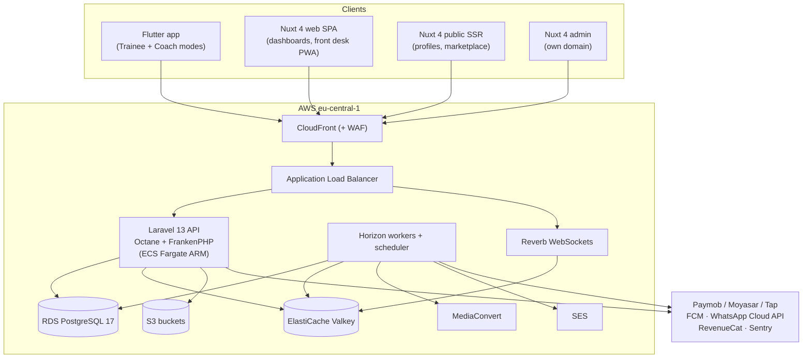

---

## 4. Multi-tenant architecture

### 4.1 What "tenant" means here

There are **two kinds of data owners**, not one:

| Owner | Examples | Isolation key |
|---|---|---|
| **Organization** (gym or coaching business) | Staff, plans, contracts, sales, cash shifts, program templates, leads, coach notes, invoices issued by the Org | `organization_id` |
| **Person** (Personal Space) | Workout logs, body metrics, photos, health profile, food diary, assigned program copies, consent records | `person_id` |

Shared objects (a Coaching Engagement, a conversation, a class booking) reference both and declare an owning side (§8.4). Cross-tenant collaboration happens only through **Data Access Grants** (Person → Org) and **Client Relationships**; Orgs never share data with each other directly.

### 4.2 Isolation strategies compared

| Strategy | Isolation | Cost | Ops complexity | Cross-tenant features (marketplace, a person in many orgs) | Fit |
|---|---|---|---|---|---|
| **Shared DB, shared schema, tenant columns + app scoping + Postgres RLS** | Logical (strong with RLS) | Lowest | Low | Natural | **Chosen** |
| Schema per Org | Stronger logical | Low–medium | Migrations × N schemas; connection/search_path handling | Awkward: a Person's data spans Orgs; Personal Space has no Org schema | No |
| Database per Org | Strong | High (thousands of Orgs) | High | Very awkward | Only for a future enterprise/residency cell |
| **Cell** (full stack per region/segment, shared nothing) | Strong, regional | Medium per cell | Medium | Directory service routes users | **Later** for KSA residency or very large chains (§4.6) |

**[DECISION] ADR-005:** shared database and schema; every query scoped in the application; **PostgreSQL Row-Level Security as a second line of defence** on tenant and sensitive tables; cells only when residency or an enterprise contract requires them.

### 4.3 Request context

Every authenticated request carries:

- the bearer token → **Person**;
- `X-Workspace: personal` or `X-Workspace: org:{organizationId}` → **acting context**;
- optional `X-Branch-Id` for branch-scoped endpoints (front desk, POS, classes).

Middleware resolves and validates the context (the Person must hold an active Staff Assignment in that Org, with that branch in scope), then:

1. binds `CurrentContext` (person, org, branch, staff assignment, roles, permissions, active grants cache key);
2. sets Postgres session settings for RLS: `app.person_id`, `app.org_id`, `app.staff_id`, `app.context` (`personal` / `org` / `system`);
3. tags logs, traces, Sentry and queued jobs with the context (hashed person ID in logs).

### 4.4 Row-Level Security design

- Application connects as role `app_rw` (no `BYPASSRLS`). Migrations run as `app_owner`. A narrow `app_system` role with `BYPASSRLS` is used only by named system jobs (billing runs, retention purge, reindexing), and every use is audited.
- **Org tables** (`organization_id` NOT NULL): policy `organization_id = current_setting('app.org_id')::uuid`.
- **Personal tables** (`person_id` NOT NULL): policy allows the owner, or an Org context that holds an active grant for the needed scope:

```sql
CREATE POLICY personal_rw ON body_metrics
USING (
  person_id = nullif(current_setting('app.person_id', true), '')::uuid
  OR app_has_grant(person_id, 'body.read')
)
WITH CHECK (
  person_id = nullif(current_setting('app.person_id', true), '')::uuid
  OR app_has_grant(person_id, 'body.write')
);

-- STABLE, SECURITY DEFINER, indexed lookup on (person_id, organization_id, status)
CREATE FUNCTION app_has_grant(p_person uuid, p_scope text) RETURNS boolean
LANGUAGE sql STABLE SECURITY DEFINER AS $$
  SELECT EXISTS (
    SELECT 1
    FROM data_access_grants g
    JOIN client_assignments ca ON ca.org_client_id = g.org_client_id
    WHERE g.person_id = p_person
      AND g.organization_id = nullif(current_setting('app.org_id', true), '')::uuid
      AND g.status = 'active'
      AND now() <@ g.valid_during
      AND p_scope = ANY (g.scopes)
      AND (current_setting('app.staff_role_all_clients', true) = 'on'
           OR ca.staff_assignment_id = nullif(current_setting('app.staff_id', true), '')::uuid)
  );
$$;
```

- RLS is **defence in depth**: the application still scopes queries (global scopes, policies) so that a missing policy is caught by tests, and RLS catches a missing scope in code.
- Context hygiene with Octane (persistent workers, persistent connections): context is **set at the start of every request and job** with `set_config(..., false)` and **reset in the terminate hook**; a test asserts that a request without context sees zero rows. No PgBouncer in transaction-pooling mode (it would break session settings); if RDS Proxy is added later, use `SET LOCAL` inside explicit transactions to limit pinning.

### 4.5 Leakage prevention beyond the database

| Layer | Risk | Control |
|---|---|---|
| API | IDOR (guessing another Org's IDs) | Policies on every route (an architecture test fails a route without authorization, as in the founder's existing codebase); UUIDv7 IDs (not secret, but no enumeration); 404 instead of 403 for out-of-tenant objects |
| Background jobs | Job runs without context, or with the wrong one | Jobs implementing `TenantAware` serialise `{person, org, staff}` and restore context in middleware; jobs without it run as `system` only if listed |
| Cache | Key collision across tenants | Key builder requires a scope: `org:{id}:…`, `person:{id}:…`, `public:…`; arrays only (never serialised models) |
| Search | Org-private data in a public index | Public index contains only published profile/listing fields; private search stays in Postgres under RLS |
| Real-time | Subscribing to another tenant's channel | Channel authorisation callbacks (§10.3); channel names include IDs but authorisation is checked server-side |
| Files | Guessable S3 keys, public buckets | Private buckets with Block Public Access; keys include random media IDs; access only via short-lived signed URLs after policy checks; sensitive bucket separate (§16.4) |
| Reports/exports | Cross-tenant joins in SQL | Reports run in org context on the read replica with RLS; exports are generated by jobs with context and stored privately for 24 h |
| Logs/analytics | PII in logs; product analytics leaking data | Structured logs with hashed IDs; scrubbing rules in Sentry; analytics events exclude health values |
| Admin/support | Staff browsing customer data | Support access requires an Org-granted, time-boxed support session; Personal Space data never visible to support without the person's consent; all audited |

### 4.6 Regional cells (future)

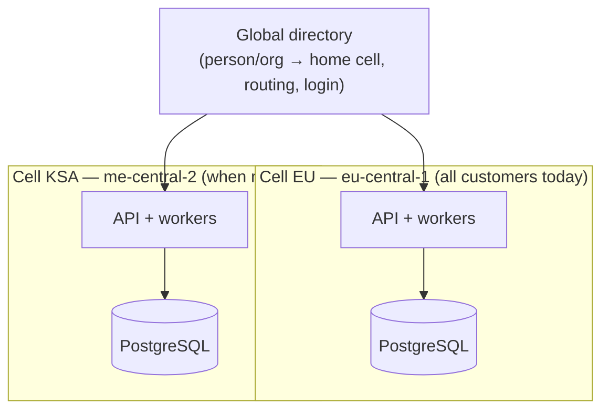

Prepared now (cheap): UUIDv7 IDs (no sequence collisions), `home_region` on `persons` and `organizations`, no cross-module joins that assume one database for Marketplace (it reads a projection), media keys prefixed by region. Deferred (expensive): the directory service, cross-cell engagements (a Saudi coach with an Egyptian client → the engagement lives in the client's cell; the coach's app talks to two cells). Trigger: a signed Saudi customer or regulator requirement for in-Kingdom hosting, and the Saudi AWS region being generally available with the services we use [S36].

---

## 5. Identity and authorization model

### 5.1 Identity

| Element | Design |
|---|---|
| Person | One row per human in `persons`; phone (E.164) is the primary identifier (unique when verified); e-mail optional and unique when verified; `birth_date` (age rules), `locale`, `home_region`. |
| Login methods | Phone OTP (WhatsApp authentication template first, SMS fallback), e-mail + password (Argon2id), Sign in with Apple (required on iOS when other social logins are offered **[VERIFY current guideline 4.8]**), Google. Passkeys in P3. |
| Unclaimed persons | Front desks and coaches can create a member/client by phone before that person installs the app. The row is `claimed_at = null` and holds only what the Org entered. When the person verifies the same phone by OTP, they **claim** it; Org-created business records stay Org-owned, and the Personal Space starts empty. A claim never merges two verified accounts silently — duplicates go to a support-assisted merge. |
| Sessions — mobile | Opaque Sanctum tokens per device (hashed at rest), stored in Keychain/Keystore, 60-day sliding expiry, listed under "devices" with revoke. |
| Sessions — web | Sanctum **cookie sessions** (HttpOnly, Secure, SameSite=Lax, CSRF token) on first-party subdomains — health data should not sit in `localStorage` tokens readable by injected scripts. |
| Sessions — admin | Separate guard, separate domain, 12-hour tokens, mandatory TOTP, IP allowlist. |
| 2FA | TOTP for owners/managers (required by policy for Orgs on Growth/Pro and for anyone with `payments.*` or `clients.view_all`), recovery codes hashed. |
| Abuse controls | OTP: 5 sends per phone per 15 min, 20 per IP per hour, exponential cool-down; login lock after 5 failures (15 min); risk signals (new device + new country) → step-up. |
| Minors | Age < 18 → guardian required (`guardianships`), consent given by the guardian, no marketplace purchases, no public reviews, photos off by default (children's data is sensitive under Law 151 [S28]). |

### 5.2 Why a hybrid authorization model

| Model | Handles well | Fails at | Verdict |
|---|---|---|---|
| RBAC (roles → permissions) | "Receptionists may sell memberships" | "…only at branch X", "only for clients assigned to me", "only if the client granted it" | Necessary, not sufficient |
| ABAC (attribute rules, e.g. Cedar/OPA) | Time windows, branch, contract state, sensitivity | Relationship graphs become attribute soup; another engine to run | Use attributes inside policies, no separate engine yet |
| ReBAC (Zanzibar-style: OpenFGA, SpiceDB) | "Coach X of client Y in org Z", hierarchies | Operational cost; dual-write consistency with Postgres; overkill at our scale | Defer (franchises/corporate wellness in P5) |
| **Hybrid in-app (chosen)** | RBAC for actions + relationship tables (assignments, grants) + attribute conditions, all in Laravel policies backed by Postgres + RLS | Needs discipline and tests | **ADR-009** |

### 5.3 Decision layers

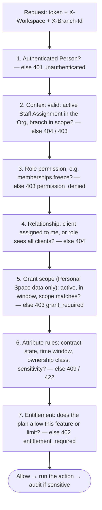

Layers 1–6 answer "may this person do this?"; layer 7 answers "has this business paid for it?" — kept separate so that a lapsed subscription never turns into a privacy decision.

### 5.4 Permissions, roles and grant scopes

**Permission keys** are declared by each module's manifest (`module.php`), e.g.:

| Module | Example permissions |
|---|---|
| Organizations | `org.settings`, `staff.manage`, `branches.manage` |
| Coaching | `clients.view_assigned`, `clients.view_all`, `clients.assign`, `programs.manage_templates`, `checkins.review`, `packages.manage`, `leads.manage` |
| Gym | `members.register`, `memberships.sell`, `memberships.freeze`, `memberships.cancel`, `memberships.transfer`, `frontdesk.checkin`, `classes.manage`, `classes.book_for_member`, `pt.sell`, `pt.confirm` |
| Commerce | `pos.sell`, `pos.refund`, `inventory.manage`, `cash.close_shift`, `cash.view_expected` |
| Compensation | `commissions.manage_rules`, `earnings.view_own`, `earnings.view_all`, `statements.approve` |
| Payments | `payments.record`, `payments.refund`, `gateway.connect`, `payouts.view` |
| Reporting | `reports.view`, `reports.financial`, `reports.export` |
| Audit | `audit.view` |

**Default roles** (Orgs can copy and edit; Owner always has every permission of the modules the Org is entitled to):

| Role | Gym default permissions | Coaching default permissions |
|---|---|---|
| Owner | all | all |
| Manager / Branch manager | all except billing, `staff.manage` (branch manager: own branches) | all except billing |
| Receptionist | `members.register`, `memberships.sell`, `memberships.freeze`, `frontdesk.checkin`, `classes.book_for_member`, `pos.sell`, `payments.record` | — |
| Trainer (in-house) | `clients.view_assigned`, `programs.manage_templates`, `checkins.review`, `pt.confirm`, `earnings.view_own` | — |
| Coach (team) | — | `clients.view_assigned`, `programs.manage_templates`, `checkins.review`, `earnings.view_own` |
| Nutritionist | `clients.view_assigned` (nutrition scopes only) | same |

**Grant scopes** (what a Person shares with an Org):

| Scope | Covers | Default in a coaching engagement | Default in a gym membership |
|---|---|---|---|
| `training.read` / `training.write` | Workout logs, PRs, assigned programs | ✓ / ✓ | — (only with PT purchase) |
| `body.read` / `body.write` | Weight, measurements | ✓ / ✓ | — |
| `photos.read` | Progress photos | Ask separately (opt-in) | — |
| `nutrition.read` / `nutrition.write` | Diary, meal plans | ✓ / ✓ | — |
| `health.read` | Readiness answers, injuries, conditions | ✓ (needed for safe programming) | — |
| `checkins.read` / `checkins.write` | Check-in submissions/feedback | ✓ / ✓ | — |
| `wearables.read` | Synced device data | Opt-in | — |
| History window | How far back the Org can read | Last 90 days + future | — |

Gyms see **business data** they own (contracts, visits, bookings, payments) without any grant; training/health data needs a grant like anyone else.

### 5.5 Evaluation and caching

```php
// Pseudocode — Coaching module policy
public function viewBodyMetrics(Context $ctx, Person $client): bool
{
    return $ctx->inOrg()
        && $ctx->can('clients.view_assigned')                        // RBAC
        && ($ctx->can('clients.view_all') || $ctx->isAssignedTo($client)) // relationship
        && $ctx->grants()->allows($client->id, 'body.read');           // consent scope + window
}
```

- Permission sets per `(person, org)` are cached as arrays (`perm:{org}:{person}:v{n}`), bumped when roles/assignments change.
- Granted-person sets per `(org, staff, scope)` are cached (`grants:{org}:{staff}:{scope}:v{n}`), bumped on grant create/revoke/expire — used to filter lists ("my clients with photos shared").
- Every read of `health.*`, `photos.*` or `body.*` data by staff writes a row to `data_access_log` (batched), which the trainee can see in the Consent centre ("Coach Nour viewed your check-in photos on 12 Oct").

### 5.6 Support and break-glass access

Platform support never has standing access to Org or Personal Space data. An Org owner can open a **support session** (scope: Org business data, 24 h max) from settings; Personal Space data additionally needs the person's consent link. A break-glass path for legal/security incidents requires two platform admins, records a reason and notifies the affected Org owner afterwards.

---

## 6. Complete system architecture

### 6.1 System context

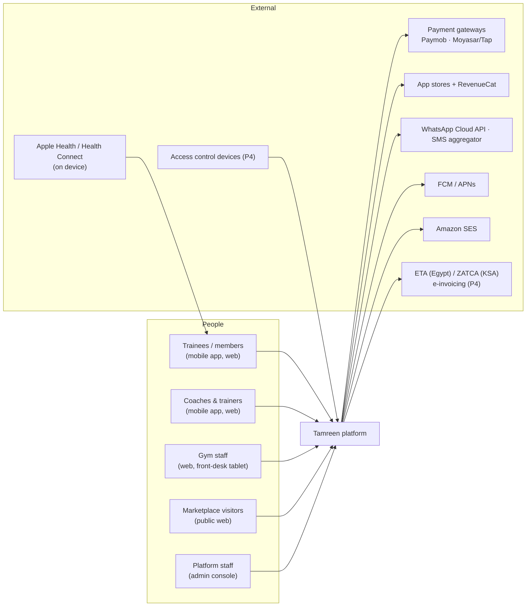

### 6.2 Containers

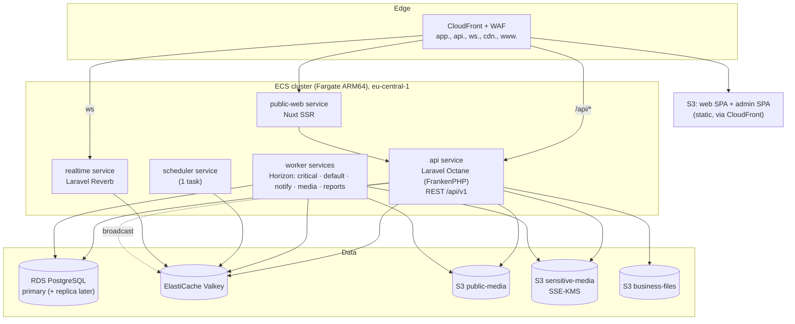

Notes:
- **No separate API gateway product.** CloudFront → ALB → ECS gives TLS, WAF, routing and WebSocket support. API Gateway would add per-request cost and a 29-second integration timeout for no benefit here.
- **No separate BFF service.** The monolith exposes a few screen-shaped endpoints for mobile (`/me/today`, `/coach/inbox`) — a BFF *inside* the API. Revisit only if a third client type with very different needs appears.
- Static SPAs are served from S3 through CloudFront (cheap, cached); only the public SSR site runs as a container.

### 6.3 Key runtime flows

**Offline workout sync**

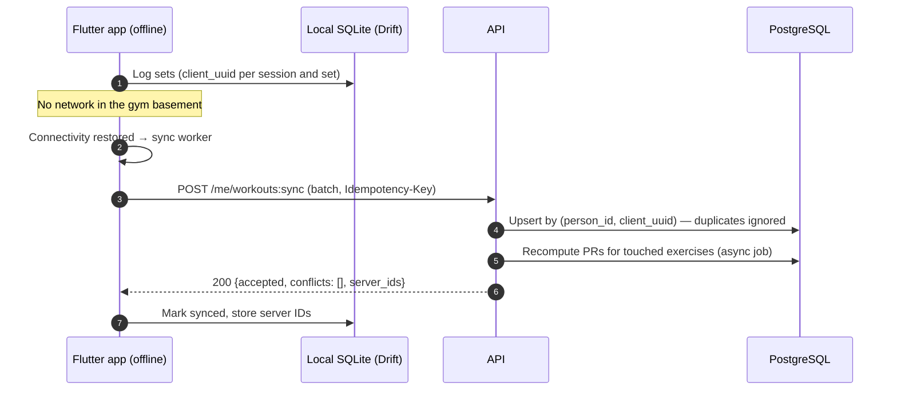

**Front-desk check-in (online, with offline fallback)**

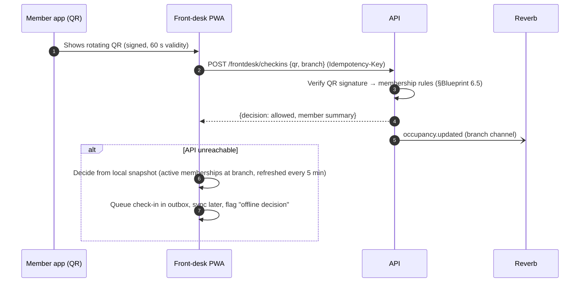

The front desk never blocks members because of an outage. The local snapshot holds only what a decision needs (member ID, name, status, end date, small photo), lives behind the app's PIN lock and is wiped after 24 h without a refresh.

### 6.4 Failure isolation and resilience

| Concern | Design |
|---|---|
| Slow external calls (gateways, WhatsApp, FCM) | Never in the request path except checkout redirects; queued jobs with timeouts (5–10 s), retries with jittered back-off, circuit breaker per provider (open after N failures, half-open probe) |
| Queue isolation | Separate Horizon queues and worker processes: `critical` (payment webhooks, entitlements), `default`, `notify` (push/WhatsApp/e-mail), `media` (image/video), `reports` (exports). A flood of media jobs cannot delay payments. |
| Real-time failure | Messages are persisted first; if Reverb is down, clients fall back to polling `GET /conversations/{id}/messages?after_seq=` every 15 s |
| Database pressure | Statement timeout 5 s for API role, 60 s for report role; read replica for reports (from Growth tier) |
| Deploy failures | ECS deployment circuit breaker with automatic rollback; migrations expand/contract (§23.4) |
| Mobile | Offline-first logging; all writes go through an outbox with idempotent IDs |
| Front desk | Local snapshot fallback (§6.3) |

---

## 7. Domain and module boundaries

### 7.1 Modules

Code lives in `app/Modules/{Name}` with `module.php` manifests (permissions, routes, menu entries, features, events) — the same convention the founder already uses. A module may reference only another module's `Contracts\` (interfaces) and `Events\`; architecture tests enforce it.

| Module | Responsibility | Owns (main tables) | Exposes (Contracts) | Publishes (Events) |
|---|---|---|---|---|
| **Identity** | Persons, credentials, OTP, devices/tokens, 2FA, guardianships | persons, person_devices, otp_challenges, guardianships | `PersonDirectory`, `AccountSecurity` | `PersonRegistered`, `PersonClaimed`, `PersonErased` |
| **Organizations** | Orgs, branches, staff assignments, roles, invitations | organizations, branches, staff_assignments, roles, role_permissions, org_clients, client_assignments | `OrgDirectory`, `StaffDirectory`, `ClientRegistry` | `OrgCreated`, `StaffAssigned`, `ClientAdded` |
| **Access** | Grants, consent records, access log, support sessions | data_access_grants, consent_records, data_access_log, support_sessions | `Grants`, `ConsentLedger` | `GrantGiven`, `GrantRevoked`, `GrantExpired` |
| **Exercises** | Exercise library (platform + org custom) | exercises, exercise_media | `ExerciseCatalog` | — |
| **Training** | Program templates, assigned programs, workout logs, PRs | program_templates, assigned_programs, workout_sessions, workout_sets, personal_records | `ProgramDelivery`, `TrainingStats` | `ProgramAssigned`, `WorkoutLogged`, `PersonalRecordSet` |
| **Body** | Body metrics, measurements, progress photos, health profile | body_metrics, progress_photos, health_profiles | `BodyStats` | `BodyMetricRecorded` |
| **Nutrition** | Foods, meal plans, food diary, habits | foods, meal_plans, food_logs, habits, habit_logs | `NutritionPlans` | `MealPlanAssigned` |
| **Coaching** | Packages, engagements, intake forms, check-ins, notes, leads | coaching_packages, coaching_engagements, forms, form_responses, progress_checkins, coach_notes, leads | `Engagements` | `EngagementStarted`, `EngagementEnded`, `CheckinSubmitted`, `CheckinReviewed` |
| **Gym** | Membership plans, contracts, freezes, visits, classes, bookings, PT credits, facilities | membership_plans, gym_memberships, membership_events, gym_visits, class_*, class_bookings, pt_credit_lots, equipment | `Memberships`, `ClassBooking` | `MembershipActivated`, `MembershipFrozen`, `MembershipExpired`, `VisitRecorded`, `BookingPromoted` |
| **Scheduling** | Availability, bookable sessions (PT, consults) | availability_rules, sessions | `Calendar` | `SessionBooked`, `SessionConfirmed`, `SessionCancelled` |
| **Compensation** | Trainer agreements, commission rules, earnings, statements | trainer_agreements, commission_rules, earnings_lines, trainer_statements | `Earnings` | `StatementApproved` |
| **Commerce** | Products, POS sales, stock, cash shifts, merchant collections | products, product_variants, sales, sale_lines, sale_payments, stock_levels, stock_movements, cash_shifts, cash_movements | `Sales`, `CashDrawer`, `StockLedger` | `SaleCompleted`, `SaleRefunded` |
| **Payments** | Gateway adapters, payment intents, webhooks inbox, manual proofs, payouts, ledger | payment_intents, payments, payment_methods, webhook_events, manual_payment_proofs, payouts, ledger_* | `PaymentGateway`, `Ledger`, `Payouts` | `PaymentSucceeded`, `PaymentFailed`, `RefundSucceeded`, `ChargebackOpened` |
| **Billing** | Platform plans, subscriptions, invoices, coupons, credits, IAP, entitlements | plans, plan_prices, subscriptions, subscription_items, usage_records, invoices, invoice_lines, coupons, credits, entitlements | `Entitlements`, `Subscriptions` | `SubscriptionActivated`, `SubscriptionPastDue`, `EntitlementsChanged` |
| **Marketplace** | Public profiles, listings, verification, reviews, orders, attribution, disputes, search projection | public_profiles, listings, verifications, reviews, marketplace_orders, attributions, disputes | `PublicProfiles`, `Attribution` | `OrderPaid`, `ReviewPublished` |
| **Messaging** | Conversations, messages, attachments, read state | conversations, conversation_participants, messages | `Conversations` | `MessageSent` |
| **Notifications** | In-app, push, e-mail, WhatsApp, SMS; templates, preferences | notifications, push_tokens, notification_preferences, message_templates, outbound_messages | `Notifier` | — |
| **Media** | Uploads, processing, signed access | media | `MediaStore` | `MediaReady` |
| **Reporting** | Read-only report definitions over other modules' tables (SQL, never models) | report_runs, exports | — | — |
| **Audit** | Org audit log | audit_events | `Auditor` | — |
| **Admin** | Platform console, moderation, verification queue | admin_users, admin_actions | — | — |

Shared kernel (`app/Support`): tenancy context, money (`Money` value object, minor units), IDs, Arabic text normalisation (`SearchText`), document numbering, outbox, idempotency, HTTP problem responses, feature flags.

### 7.2 Dependency map (allowed directions)

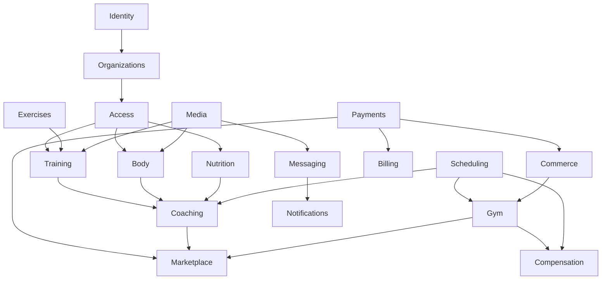

Arrows mean "is used by" (via Contracts). Billing's `Entitlements` contract is used by every module (not drawn). Reporting and Audit read/write across modules by design and are excluded from the graph.

### 7.3 Modular monolith vs microservices

| Factor | Modular monolith | Microservices |
|---|---|---|
| Team of 2–6 engineers | One repo, one deploy, one debugger | Coordination cost exceeds the team |
| Transactions across contracts/payments/stock | Single ACID transaction (e.g. sale → stock issue → ledger → membership) | Sagas, outbox per service, eventual consistency bugs |
| Infrastructure cost | 3–5 ECS services | 15+ services, service mesh/observability tooling |
| Independent scaling | Workers and real-time already separate ECS services from the same image | Finer-grained |
| Fault isolation | Queues and services separated by role (§6.4) | Stronger |
| **Verdict** | **Chosen (ADR-001)** | Only by extraction when triggered |

### 7.4 Extraction candidates and triggers

| Candidate | Trigger to extract | Shape |
|---|---|---|
| Real-time gateway | > 50k concurrent sockets or Reverb CPU-bound | Already a separate service; could move to a Go/Elixir gateway speaking the Pusher protocol |
| Media processing | > 20% of worker CPU or video-heavy features | Lambda/MediaConvert pipeline triggered by S3 events |
| Search projection | OpenSearch introduced | Indexer consuming outbox events |
| Payments/ledger | Licensing requirement for segregated systems, or audit demand | Separate service with its own database and strict API |
| AI services | P4/P5 | Separate worker pool calling LLM APIs, isolated keys and quotas |

---

## 8. Database architecture and ER diagrams

### 8.1 Conventions

| Topic | Rule |
|---|---|
| Engine | PostgreSQL 17 on RDS; extensions `pg_trgm`, `postgis`, `pgcrypto`, `btree_gist`, `unaccent` (not used for Arabic; Arabic normalisation is done in code) |
| IDs | UUIDv7 (`HasUuids`) for everything except pure join tables; time-ordered so B-tree inserts stay local |
| Money | `bigint` minor units (`*_minor`) + `currency char(3)`; never floats. EGP and SAR both have 100 minor units |
| Weights / measures | Integers in base units: grams (`weight_g`), millimetres, seconds, metres; RPE as `numeric(3,1)` |
| Time | `timestamptz` (UTC) for instants; `date` for business days in the Org's timezone (`Africa/Cairo`, `Asia/Riyadh`); recurrence rules as RFC 5545 strings |
| Documents | Program and meal-plan structures as versioned `jsonb` validated against JSON Schema (ADR-011); everything that is queried or aggregated is a normal column |
| Append-only | `membership_events`, `stock_movements`, `cash_movements`, `ledger_entries`, `consent_records`, `data_access_log`, `audit_events`, `messages` (edits are new versions) — no UPDATE/DELETE grants for `app_rw` on these tables |
| Ordering | Ledgers and event streams order by a `seq bigint GENERATED ALWAYS AS IDENTITY`, never by timestamps |
| Soft delete | Only where users expect "undo" (programs, templates, products). Personal data deletion is real deletion or anonymisation (§16.7) |
| Search columns | `search_name text` normalised (أإآ→ا، ة→ه، ى→ي, diacritics/tatweel removed) with `gin_trgm_ops` index |

### 8.2 ER diagrams

#### 8.2.1 Identity, organizations and access

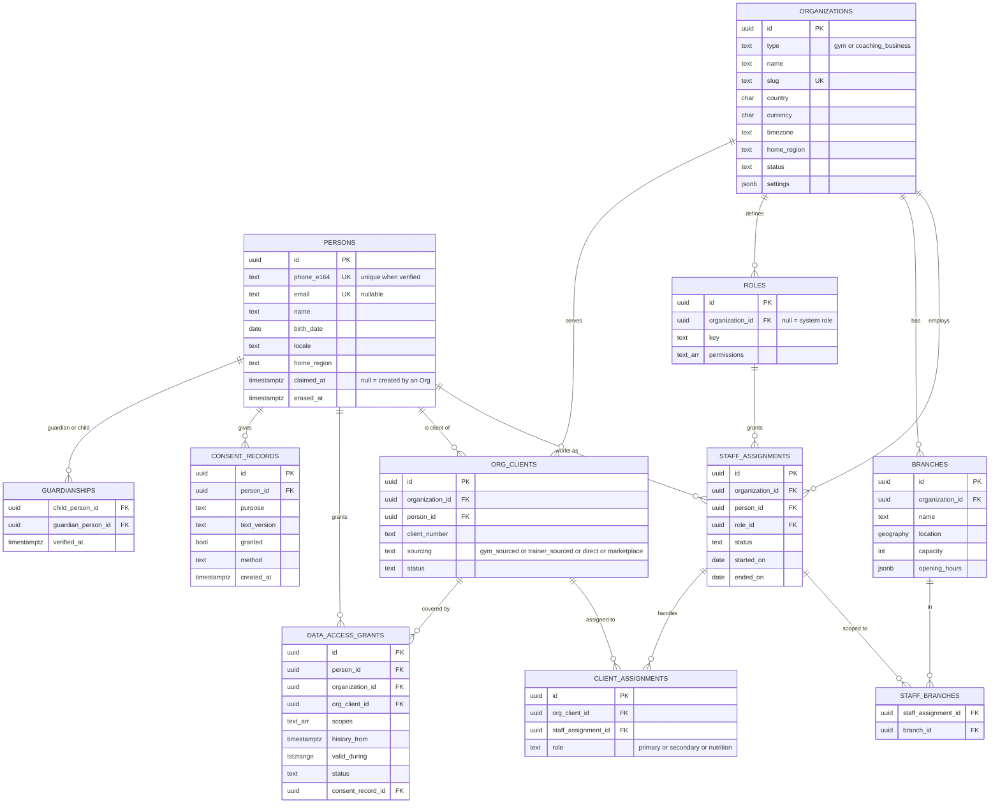

#### 8.2.2 Personal Space — training, body, nutrition

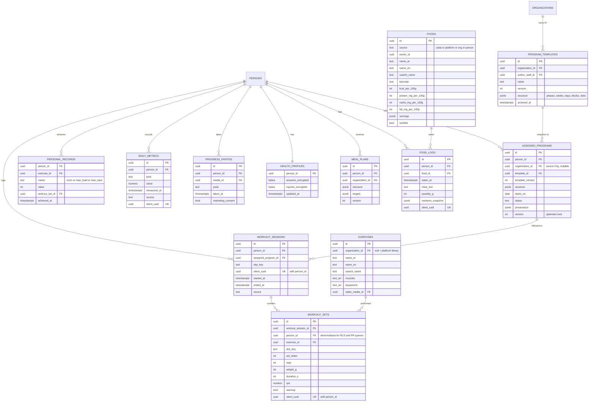

#### 8.2.3 Coaching and scheduling

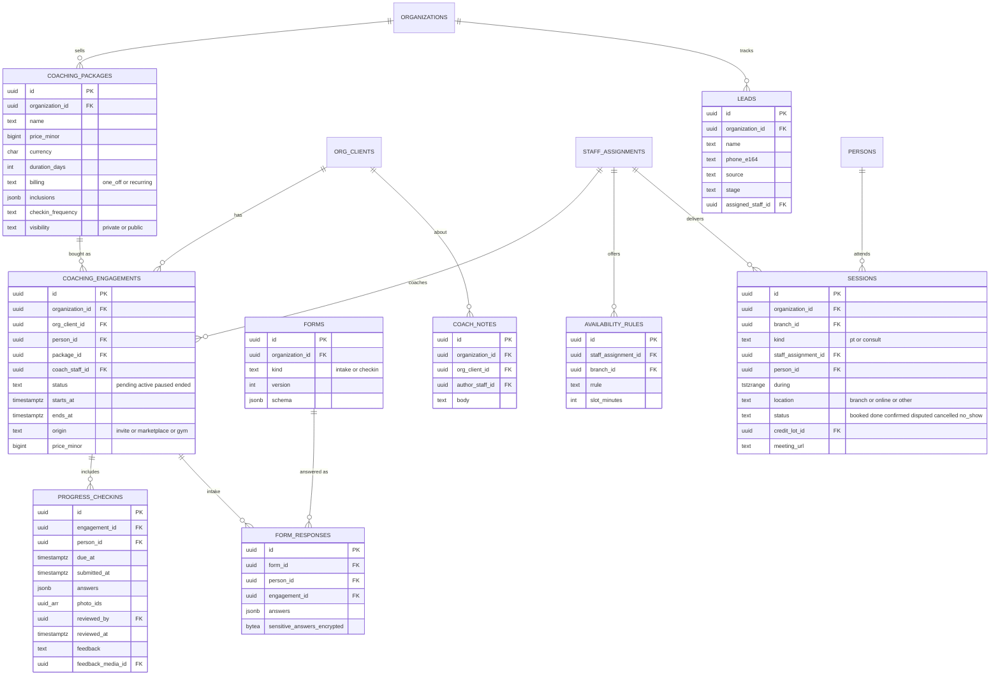

#### 8.2.4 Gym operations and compensation

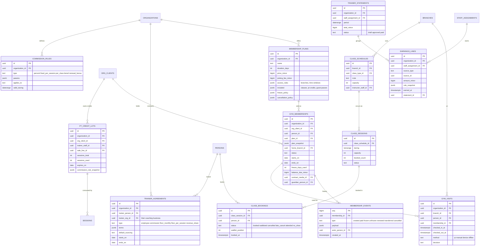

#### 8.2.5 Commerce, payments, ledger and billing

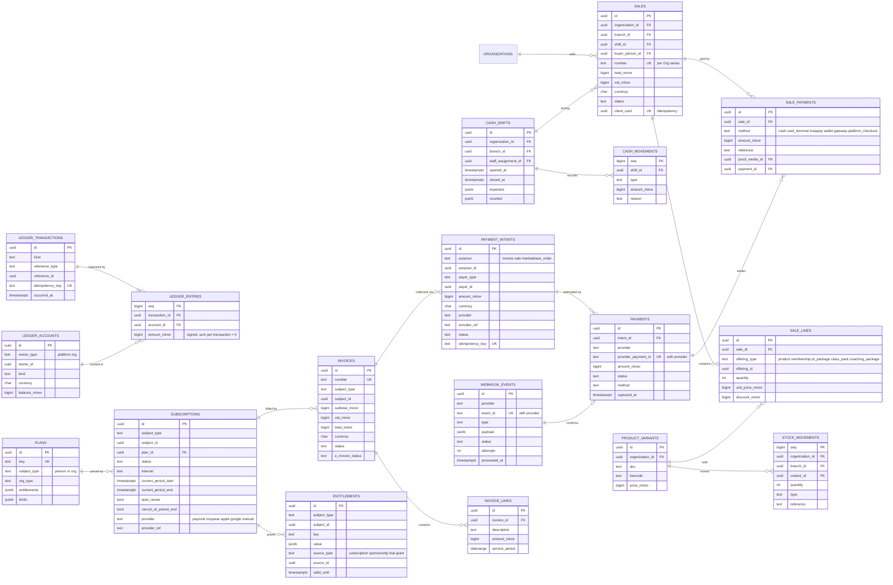

#### 8.2.6 Marketplace, messaging, notifications, media and audit

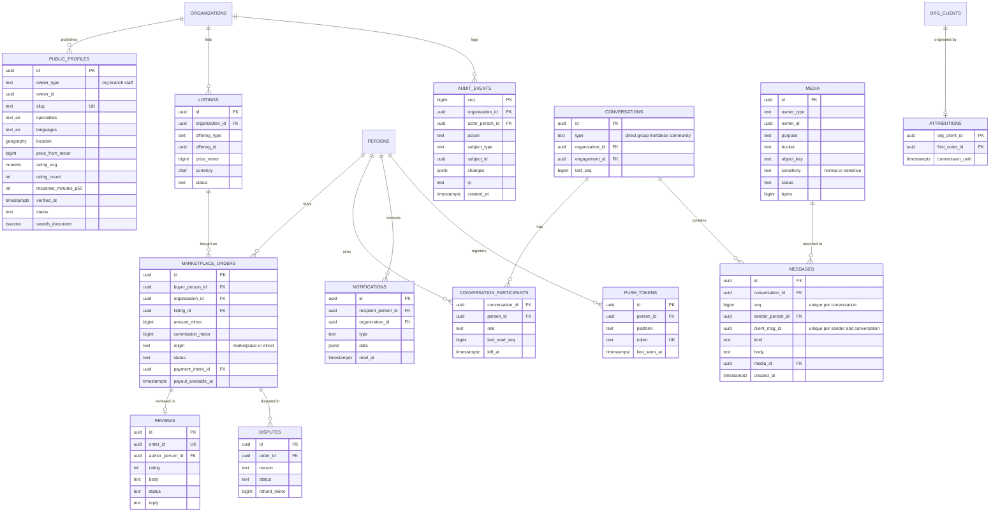

### 8.3 Critical uniqueness and integrity constraints

| Table | Constraint | Prevents |
|---|---|---|
| `persons` | `UNIQUE (phone_e164) WHERE phone_verified_at IS NOT NULL` | Two verified accounts on one phone |
| `staff_assignments` | `UNIQUE (organization_id, person_id) WHERE status = 'active'` | Duplicate roles |
| `org_clients` | `UNIQUE (organization_id, person_id)` | Duplicate client records per Org |
| `data_access_grants` | `EXCLUDE USING gist (org_client_id WITH =, valid_during WITH &&) WHERE (status = 'active')` | Overlapping active grants for one relationship |
| `coaching_engagements` | `EXCLUDE USING gist (org_client_id WITH =, coach_staff_id WITH =, tstzrange(starts_at, ends_at) WITH &&) WHERE (status IN ('active','paused'))` | Double engagements with the same coach |
| `gym_memberships` | `EXCLUDE USING gist (org_client_id WITH =, daterange(starts_on, ends_on) WITH &&) WHERE (status IN ('active','frozen'))` (per plan family) | Two overlapping active contracts |
| `class_bookings` | `UNIQUE (class_session_id, person_id) WHERE status IN ('booked','waitlisted')`; `booked_count ≤ capacity` enforced under `SELECT … FOR UPDATE` on the class session | Overbooking, double booking |
| `sessions` | `EXCLUDE USING gist (staff_assignment_id WITH =, during WITH &&) WHERE (status IN ('booked','done','confirmed'))` | Trainer double-booked |
| `workout_sessions`, `workout_sets`, `body_metrics`, `food_logs` | `UNIQUE (person_id, client_uuid)` | Duplicate offline syncs |
| `messages` | `UNIQUE (conversation_id, seq)`, `UNIQUE (conversation_id, sender_person_id, client_msg_id)` | Ordering gaps and duplicate sends |
| `payments` | `UNIQUE (provider, provider_payment_id)` | Double-crediting a payment |
| `webhook_events` | `UNIQUE (provider, event_id)` | Reprocessing webhooks |
| `payment_intents`, `ledger_transactions` | `UNIQUE (idempotency_key)` | Duplicate charges/postings |
| `ledger_entries` | Deferred constraint trigger: Σ `amount_minor` per transaction = 0 | Unbalanced books |
| `invoices`, `sales` | `UNIQUE (number)` per series (from a locked per-Org counter inside the transaction) | Gaps/duplicates in tax documents |
| `reviews` | `UNIQUE (order_id)` | Review stuffing |
| `public_profiles` | `UNIQUE (slug)` | URL clashes |

### 8.4 Ownership rules

| Entity | Owner | Who else can read/write | On relationship end | Retention |
|---|---|---|---|---|
| Workout sessions/sets, PRs | Person | Orgs with `training.*` grant | Org access ends; data stays | Until the person deletes |
| Body metrics, photos, health profile | Person | Grant holders (`body.*`, `photos.read`, `health.read`) | Same | Until deleted; photos purge 30 days after deletion from backups' live set |
| Assigned programs, meal plans | Person (copy) with provenance | Source Org edits while grant has `*.write` | Read-only copy remains (Blueprint §6.10) | With Personal Space |
| Program templates, exercise videos, coach notes | Org | Org staff by permission | Stay with Org | Org lifetime + 90 days after closure |
| Coaching engagements, packages, payments, invoices | Org | Client sees own engagement and receipts | Kept | Financial retention (**[VERIFY]**, typically 5–7 years) |
| Gym memberships, visits, bookings | Org | Member sees own | Kept; member sees history in "My memberships" | Contract + financial retention; visits 3 years then aggregated |
| Conversations/messages | Shared (participants) | Participants | Read-only after engagement end | 3 years after last message unless deleted by participant (own messages) **[VERIFY]** |
| Marketplace orders, reviews | Shared (buyer + Org) | Public: reviews only | Kept | Financial retention |
| Consent records, data access log | Person (subject) | Person; platform for compliance | Kept | Legal minimum after the relationship **[VERIFY]** |
| Audit events | Org (platform for platform actions) | Owners/managers | Kept | 2 years online, then archive |

### 8.5 Indexing strategy (representative)

| Query | Index |
|---|---|
| Coach roster with last activity | `client_assignments (staff_assignment_id)`; `org_clients (organization_id, status)` |
| Client's recent workouts | `workout_sessions (person_id, started_at DESC)` |
| PR / history per exercise | `workout_sets (person_id, exercise_id, created_at DESC)` |
| Weight trend | `body_metrics (person_id, kind, measured_at DESC)` |
| Check-in review queue | `progress_checkins (organization_id, reviewed_at NULLS FIRST, due_at)` partial `WHERE submitted_at IS NOT NULL AND reviewed_at IS NULL` |
| Front-desk lookup by phone/name | `persons (phone_e164)`; `org_clients` + trigram on normalised name |
| Membership expiry jobs | `gym_memberships (organization_id, ends_on) WHERE status IN ('active','frozen')` |
| Occupancy now | `gym_visits (branch_id, checked_in_at DESC) WHERE checked_out_at IS NULL` |
| Class timetable | `class_sessions USING gist (during)` + `(class_schedule_id)` |
| Messages in a conversation | `messages (conversation_id, seq DESC)` |
| Unread notifications | `notifications (recipient_person_id, read_at, created_at DESC)` |
| Marketplace search | GIN on `search_document`; GIN trigram on names; GIST on `location`; partial `WHERE status = 'published'` |
| Grants lookup (RLS function) | `data_access_grants (person_id, organization_id) WHERE status = 'active'` |
| Ledger balance rebuild | `ledger_entries (account_id, seq)` |
| Exercise/food search | GIN trigram on `search_name`; `foods (barcode)` |

### 8.6 Volume, partitioning and archiving

| Table | Base-case volume at L24 **[ESTIMATE]** | Plan |
|---|---|---|
| `workout_sets` | \~20k active loggers × 3 workouts/week × 20 sets ≈ 5M rows/month | Monthly range partitions on `created_at` from P3; BRIN on time |
| `gym_visits` | 183 gyms × 400 members × 12 visits/month ≈ 0.9M/month | Monthly partitions from P3 |
| `messages` | \~3M/month | Monthly partitions from P3 |
| `audit_events`, `data_access_log` | \~1–2M/month | Monthly partitions; > 24 months exported to S3 (Parquet) |
| `ledger_entries` | \~100k/month | No partitioning needed before \~50M rows |

### 8.7 Migrations

Laravel migrations per module (`Database/migrations`), forward-only in production, expand → migrate data (queued, batched) → contract across separate releases; `CREATE INDEX CONCURRENTLY` for large tables; JSON Schema versions for document columns with upcasters in code; a migration lint in CI (no column drops or type changes on hot tables in the same release that stops using them).

---

## 9. API design and representative endpoints

### 9.1 REST or GraphQL?

| Factor | REST + OpenAPI | GraphQL |
|---|---|---|
| Fit with Laravel ecosystem (policies, resources, rate limiting, caching) | Native | Lighthouse works, but authorization per field and N+1 control need care |
| Offline mobile sync with idempotent batches | Simple dedicated endpoints | Mutations work but add little |
| HTTP caching / CDN for public pages | Straightforward | Needs persisted queries |
| Security surface (query depth, cost) | Small | Requires cost analysis and limits |
| Client flexibility | Screen-shaped endpoints where needed | Strong |
| **Verdict** | **REST/JSON, OpenAPI 3.1 contract-first (ADR-017)** | Revisit for a public partner API (P5) only if partners ask |

### 9.2 Conventions

| Topic | Convention |
|---|---|
| Base URL | `https://api.tamreen.app/api/v1` (domain is a placeholder) |
| Versioning | Major version in the path; additive changes are non-breaking; removals announced with `Deprecation` and `Sunset` headers ≥ 6 months ahead; mobile clients send `X-App-Version` and the API can return `426 upgrade_required` below a floor |
| Context | `Authorization: Bearer …` (mobile) or session cookie (web); `X-Workspace: personal` \| `org:{uuid}`; `X-Branch-Id` where branch-scoped |
| Naming | Plural nouns, snake_case JSON, ISO-8601 UTC timestamps (`2026-10-22T09:30:00Z`), `date` fields as `YYYY-MM-DD` in the Org's timezone |
| Money | `{"amount_minor": 34900, "currency": "EGP"}` |
| IDs | UUIDv7 strings |
| Pagination | Cursor-based for feeds and large lists (`?limit=50&cursor=…`, response `meta.next_cursor`); page-based only for admin tables |
| Filtering / sorting | `filter[status]=active&filter[branch_id]=…&sort=-created_at`; whitelisted per endpoint |
| Sparse responses | `include=` for related resources (whitelisted) |
| Concurrency | Documents (programs, meal plans) carry `version`; updates require `If-Match: "<version>"` → `412` on conflict |
| Idempotency | `Idempotency-Key` header **required** on POSTs that create money, bookings, check-ins, sales, messages, grants; key + request hash stored 24 h; same key + same body → same response; same key + different body → `422 idempotency_key_reused` |
| Errors | `application/problem+json` (RFC 9457 shape) with a stable machine `code` |
| Rate limits | Per person and per IP; `429` + `Retry-After`; headers `RateLimit-Limit/Remaining/Reset` |
| Localisation | `Accept-Language: ar` \| `en`; error `title`/`detail` localised, `code` stable |

**Error example**

```json
{
  "type": "https://docs.tamreen.app/errors/membership_frozen",
  "title": "العضوية متجمدة",
  "status": 409,
  "code": "membership_frozen",
  "detail": "Membership is frozen until 2026-11-03.",
  "meta": { "membership_id": "01929f4e-7c2a-7b1e-9f3c-2a1b0c9d8e7f", "frozen_until": "2026-11-03" },
  "trace_id": "4bf92f3577b34da6a3ce929d0e0e4736"
}
```

| HTTP | Typical `code`s |
|---|---|
| 400 | `malformed_request` |
| 401 | `unauthenticated`, `token_expired`, `two_factor_required` |
| 402 | `entitlement_required`, `limit_reached` (with `meta.limit`, `meta.upgrade_to`) |
| 403 | `permission_denied`, `grant_required`, `context_invalid`, `subscription_suspended` |
| 404 | `not_found` (also for out-of-tenant objects) |
| 409 | `membership_frozen`, `class_full`, `slot_taken`, `already_checked_in`, `state_conflict` |
| 412 | `version_mismatch` |
| 422 | `validation_failed` (with `errors{field: [..]}`), `idempotency_key_reused`, business rules (`freeze_limit_exceeded`, `refund_exceeds_paid`) |
| 426 | `upgrade_required` |
| 429 | `rate_limited` |

**Rate limits (initial)**

| Bucket | Limit |
|---|---|
| OTP send | 5 / phone / 15 min; 20 / IP / hour |
| Login attempts | 5 failures → 15 min lock per account; 50 / IP / hour |
| Authenticated API | 300 / min / person (burst 60 / 5 s) |
| Sync endpoints | 30 / min / device |
| Public marketplace API | 60 / min / IP; cached at CloudFront |
| Uploads | 60 presigned URLs / hour / person |
| Webhooks inbound | Not limited; verified by signature and provider IP lists where published |

### 9.3 Public vs internal APIs

| API | Consumers | Auth | Stability |
|---|---|---|---|
| App API `/api/v1/*` | Our mobile/web apps | Person token/cookie + context | Versioned; may change with app releases (with floors) |
| Public read API `/api/v1/public/*` | Public site, marketplace, SEO | None (rate-limited) | Stable |
| Webhooks inbound `/webhooks/{provider}` | Paymob, Moyasar/Tap, RevenueCat, Meta | Provider signatures (HMAC), replay window | Stable |
| Admin API `/admin/v1/*` | Admin console only | Admin guard, TOTP, IP allowlist | Internal |
| Partner API + outbound webhooks (P5) | Chains, integrators | OAuth2 client credentials, scoped per Org | Versioned, documented, SLA |

### 9.4 Representative endpoints

#### 9.4.1 Request an OTP and sign in

```http
POST /api/v1/auth/otp
Content-Type: application/json

{ "phone": "+201001234567", "channel": "whatsapp", "purpose": "login" }
```
```json
202 Accepted
{ "challenge_id": "01929f50-1d2e-7a3b-8c4d-5e6f7a8b9c0d", "expires_in": 300, "resend_after": 60, "channel": "whatsapp" }
```
```http
POST /api/v1/auth/otp/verify
{ "challenge_id": "01929f50-…", "code": "482913", "device_name": "Samsung A54", "platform": "android" }
```
```json
200 OK
{
  "token": "3|9f0c…",
  "person": { "id": "01929f…", "name": "Dina", "locale": "ar", "claimed": true },
  "workspaces": [
    { "type": "personal" },
    { "type": "org", "id": "0192a0…", "name": "Nour Fitness", "org_type": "coaching_business", "roles": ["owner"] }
  ],
  "two_factor_required": false
}
```

#### 9.4.2 Invite a client (coach)

```http
POST /api/v1/coaching/clients
X-Workspace: org:0192a0…
Idempotency-Key: 5d6a2c4e-…

{ "phone": "+966501234567", "name": "Reem", "package_id": "0192a1…", "starts_on": "2026-11-01",
  "requested_scopes": ["training.read","training.write","body.read","body.write","nutrition.read","nutrition.write","health.read","checkins.read","checkins.write"],
  "send_via": "whatsapp" }
```
```json
201 Created
{
  "org_client": { "id": "0192a2…", "status": "invited", "sourcing": "direct" },
  "engagement": { "id": "0192a3…", "status": "pending", "starts_at": "2026-10-31T21:00:00Z" },
  "invite": { "url": "https://tamreen.app/i/Q7XK2M", "expires_at": "2026-11-07T21:00:00Z" }
}
```

#### 9.4.3 Accept an invite and grant access (trainee)

```http
POST /api/v1/me/grants
X-Workspace: personal
Idempotency-Key: 8b1f…

{ "invite_code": "Q7XK2M",
  "scopes": ["training.read","training.write","body.read","body.write","nutrition.read","nutrition.write","health.read","checkins.read","checkins.write"],
  "photos": false, "history_days": 90, "consent_text_version": "grant-v3-ar" }
```
```json
201 Created
{ "grant": { "id": "0192a4…", "organization": { "id": "0192a0…", "name": "Nour Fitness" },
  "scopes": ["training.read", "…"], "valid_from": "2026-11-01T00:00:00Z", "valid_until": null, "status": "active" } }
```

`DELETE /api/v1/me/grants/{id}` revokes immediately (coach sees a "client revoked access" state; the engagement stays for billing).

#### 9.4.4 Assign a program

```http
POST /api/v1/coaching/clients/0192a2…/programs
X-Workspace: org:0192a0…
Idempotency-Key: c41e…

{ "template_id": "0192b0…", "template_version": 7, "starts_on": "2026-11-02", "notify": true }
```
```json
201 Created
{ "assigned_program": { "id": "0192b1…", "person_id": "0192…", "version": 1, "starts_on": "2026-11-02",
  "provenance": { "organization_id": "0192a0…", "author": "Coach Nour", "template_id": "0192b0…", "template_version": 7 } } }
```
Requires permission `programs.manage_templates`, assignment to the client and grant scope `training.write`.

#### 9.4.5 Sync workouts from the mobile outbox

```http
POST /api/v1/me/workouts:sync
X-Workspace: personal
Idempotency-Key: 2f7d…

{
  "device_id": "a3c9…",
  "sessions": [{
    "client_uuid": "6c1f…", "assigned_program_id": "0192b1…", "day_key": "w1d2",
    "started_at": "2026-11-03T16:05:12Z", "ended_at": "2026-11-03T17:01:40Z",
    "sets": [
      { "client_uuid": "e01a…", "exercise_id": "0191…", "slot_key": "a1", "set_index": 1, "reps": 8, "weight_g": 60000, "rpe": 7.5 },
      { "client_uuid": "e01b…", "exercise_id": "0191…", "slot_key": "a1", "set_index": 2, "reps": 8, "weight_g": 62500, "rpe": 8.0 }
    ]
  }]
}
```
```json
200 OK
{ "accepted": { "sessions": 1, "sets": 2 }, "duplicates": { "sessions": 0, "sets": 0 },
  "id_map": { "6c1f…": "0192c0…", "e01a…": "0192c1…", "e01b…": "0192c2…" },
  "server_time": "2026-11-03T17:02:05Z" }
```

#### 9.4.6 Submit a Progress Check-in

```http
POST /api/v1/me/checkins/0192d0…:submit
Idempotency-Key: 77aa…

{ "answers": { "adherence_training": 4, "adherence_nutrition": 3, "sleep_hours": 6.5, "stress": 3, "notes": "ركبتي بتوجعني في السكوات" },
  "metrics": [ { "kind": "weight", "value": 72.4 }, { "kind": "waist_cm", "value": 81.0 } ],
  "photo_media_ids": ["0192d1…", "0192d2…"] }
```
```json
200 OK
{ "checkin": { "id": "0192d0…", "status": "submitted", "submitted_at": "2026-11-07T08:12:00Z" } }
```

#### 9.4.7 Front-desk check-in

```http
POST /api/v1/frontdesk/checkins
X-Workspace: org:0192e0…
X-Branch-Id: 0192e1…
Idempotency-Key: 0c3d…

{ "qr": "v1.0192f0….1730622000.MEUCIQ…", "client_time": "2026-11-03T15:00:01Z" }
```
```json
200 OK
{ "decision": "allowed",
  "member": { "name": "Dina A.", "photo_url": "https://cdn…/t/…?sig=…", "plan": "Gold 3 months", "ends_on": "2026-12-01", "days_left": 28 },
  "warnings": [ { "code": "renewal_due_soon" } ],
  "visit_id": "0192f1…", "occupancy": 87 }
```
Denials return `200` with `"decision": "denied"` and a reason (`expired`, `frozen`, `outside_time_window`, `balance_due`) — a business answer, not an HTTP error — so the desk UI never treats it as a failure.

#### 9.4.8 Book a class (with waitlist)

```http
POST /api/v1/gym/class-sessions/0192g0…/bookings
X-Workspace: personal
Idempotency-Key: 91be…
```
```json
201 Created
{ "booking": { "id": "0192g1…", "status": "waitlisted", "waitlist_position": 3 },
  "policy": { "cancel_before_minutes": 120, "late_cancel_penalty": "1 credit" } }
```

#### 9.4.9 Sell a membership at the desk

```http
POST /api/v1/sales
X-Workspace: org:0192e0…
X-Branch-Id: 0192e1…
Idempotency-Key: 4e5f…

{ "client_uuid": "4e5f…", "buyer_person_id": "0192f0…",
  "lines": [ { "offering_type": "membership", "offering_id": "0192h0…", "quantity": 1, "starts_on": "2026-11-03" } ],
  "payments": [ { "method": "instapay", "amount_minor": 450000, "reference": "IPN-77812", "proof_media_id": "0192h1…" } ] }
```
```json
201 Created
{ "sale": { "id": "0192h2…", "number": "R-001245", "total": { "amount_minor": 450000, "currency": "EGP" }, "vat": { "amount_minor": 55263, "currency": "EGP" } },
  "created": { "membership_id": "0192h3…", "ends_on": "2027-02-02" },
  "receipt_url": "https://tamreen.app/r/kT9…" }
```
One transaction: sale → membership contract → membership event → cash-drawer movement → ledger posting → audit entry.

#### 9.4.10 Confirm a PT session (member)

```http
POST /api/v1/me/sessions/0192j0…:confirm
Idempotency-Key: aa01…

{ "confirm": true }
```
```json
200 OK
{ "session": { "id": "0192j0…", "status": "confirmed" }, "credits_left": 7 }
```
Emits `SessionConfirmed` → Compensation writes the earnings line using the lot's commission snapshot.

#### 9.4.11 Platform checkout for a subscription

```http
POST /api/v1/billing/checkout
X-Workspace: org:0192a0…
Idempotency-Key: 3b9c…

{ "plan_key": "coach_pro", "interval": "month", "method": "card", "coupon": "FOUNDERS40", "return_url": "https://app.tamreen.app/billing/return" }
```
```json
201 Created
{ "invoice": { "id": "0192k0…", "number": "TMR-2026-000812", "total": { "amount_minor": 47940, "currency": "EGP" } },
  "payment": { "intent_id": "0192k1…", "provider": "paymob", "redirect_url": "https://accept.paymob.com/…", "expires_at": "2026-11-03T15:30:00Z" } }
```
For `method: "instapay"` the response returns the platform's InstaPay address and a reference; the owner uploads the proof via `POST /billing/invoices/{id}/manual-proofs`.

#### 9.4.12 Payment webhook (inbound)

```http
POST /webhooks/paymob
X-Signature: <HMAC per provider spec>

{ "type": "TRANSACTION", "obj": { "id": 912773, "success": true, "amount_cents": 47940, "order": { "merchant_order_id": "0192k1…" } } }
```
Processing: verify signature → insert into `webhook_events` (unique on provider + event id; duplicates return 200 immediately) → `200` within 1 s → `critical` queue job: lock the intent, create/confirm `payments` row, post ledger transaction, mark invoice paid, extend subscription, recompute entitlements, emit `PaymentSucceeded`. A reconciliation job re-queries the provider for intents pending > 15 min (missed webhooks).

#### 9.4.13 Marketplace search (public)

```http
GET /api/v1/public/coaches?q=تخسيس&filter[mode]=online&filter[gender]=female&filter[lang]=ar&near=30.0444,31.2357&sort=relevance&limit=20
```
```json
200 OK
{ "data": [ { "slug": "coach-nour", "name": "Nour", "headline": "خسارة دهون للسيدات", "verified": true,
  "rating": { "avg": 4.8, "count": 63 }, "price_from": { "amount_minor": 150000, "currency": "EGP" },
  "response_minutes_p50": 95, "modes": ["online"], "distance_km": null } ],
  "meta": { "next_cursor": "eyJ…", "facets": { "specialties": { "weight_loss": 142, "muscle_gain": 98 } } } }
```

#### 9.4.14 Send a chat message

```http
POST /api/v1/conversations/0192m0…/messages
Idempotency-Key: 6c2d…

{ "client_msg_id": "6c2d…", "kind": "voice", "media_id": "0192m1…", "reply_to_id": null }
```
```json
201 Created
{ "message": { "id": "0192m2…", "seq": 418, "kind": "voice", "created_at": "2026-11-03T18:22:10Z", "client_msg_id": "6c2d…" } }
```

### 9.5 Outbound webhooks (P5 partner API)

Events (`membership.activated`, `visit.recorded`, `sale.completed`, …) delivered as `POST` with `Tamreen-Signature: t=…,v1=HMAC-SHA256(secret, t + "." + body)`, at-least-once, retried with exponential back-off for 24 h, each carrying `event_id` for de-duplication; a delivery log and replay button per endpoint.

---

## 10. Real-time architecture

### 10.1 What must be real-time (and what need not be)

| Use case | Real-time need | Mechanism |
|---|---|---|
| Coach ↔ client chat, group chat | Seconds; typing indicators nice-to-have | WebSocket + push when offline |
| Notifications (bell) | Seconds | WebSocket ping → fetch; push |
| Workout/session status ("client finished workout", PT session confirmed) | Seconds–minutes | WebSocket event to coach |
| Front-desk live check-ins, occupancy | Seconds | WebSocket on branch channel |
| Booking/waitlist updates | Seconds | WebSocket to the person + push |
| Membership/payment status (checkout return, entitlement change) | Seconds | WebSocket to the person/Org |
| Admin and owner dashboards | 10–60 s | "refresh" pings, polling fallback |
| Presence/typing | Best effort | Presence channels (direct chats only) |
| Video consults, live classes | Media streaming | **Separate** WebRTC/streaming infrastructure (§10.7) |

### 10.2 Options compared

| Option | Ops | Cost at 3k concurrent / 30M messages per month **[ESTIMATE]** | Presence | Laravel/Flutter fit | Notes |
|---|---|---|---|---|---|
| **Laravel Reverb (self-hosted on ECS)** | Low–medium | 1–2 small tasks: **\~$10–35/month** | Yes | Native (Pusher protocol, Echo; Flutter Pusher clients) | Horizontal scaling via Valkey pub/sub (or the Laravel 13 database driver [S51]) |
| Pusher Channels | None | Tiers by connections and daily messages: $49 (500 conn, 1M msg/day) up to $1,199 (30k conn) [S49] | Yes | Native | Plan limits hard-block over-quota |
| Ably | None | Free → $29 → $399 + usage [S49] | Yes | Pusher-compat adapter | Billing by messages/connection-minutes |
| AWS AppSync Events | None | \~$1 per million operations + $0.08 per million connection-minutes [S47] → roughly **$10–40/month** | No built-in presence | Custom auth (Lambda), AWS-specific client | Cheapest managed; more custom code |
| API Gateway WebSockets | None | Per message + per connection-minute **[VERIFY rates]** | No | Custom | Connection state in DynamoDB; more plumbing |
| Server-Sent Events | Low | Part of API | No | Simple one-way | Good for dashboards; no client→server; PHP workers held open |
| Long-polling | Low | Part of API | No | Simple | Fallback only |

**[DECISION] ADR-008: Laravel Reverb** on its own ECS service behind the ALB (`ws.` host), Valkey for horizontal fan-out, Pusher protocol so that **Pusher or Ably is a configuration change** if operations become a burden. SSE/polling remain fallbacks.

### 10.3 Channels and authorization

| Channel | Members | Authorised when |
|---|---|---|
| `private-person.{personId}` | The person (all devices) | token's person = `personId` |
| `private-conversation.{id}` | Participants | active row in `conversation_participants` |
| `presence-conversation.{id}` | Participants of direct/small conversations (≤ 50) | as above; exposes `{id, name, avatar}` only |
| `private-org.{orgId}.desk.{branchId}` | Front-desk staff | Staff Assignment with branch in scope + `frontdesk.checkin` |
| `private-org.{orgId}.coach.{staffId}` | One coach's devices | assignment = `staffId` |
| `private-org.{orgId}.owner` | Owners/managers | `reports.view` |
| `private-org.{orgId}.schedule.{branchId}` | Members of that branch (class capacity changes) | active membership with access to branch |

Authorisation goes through `/broadcasting/auth` (Sanctum), which runs the same policy code as the REST API; events carry IDs and minimal fields, never sensitive values (clients fetch details through the API, which applies grants). Tokens for WebSocket auth expire with the session.

### 10.4 Message persistence, ordering and delivery

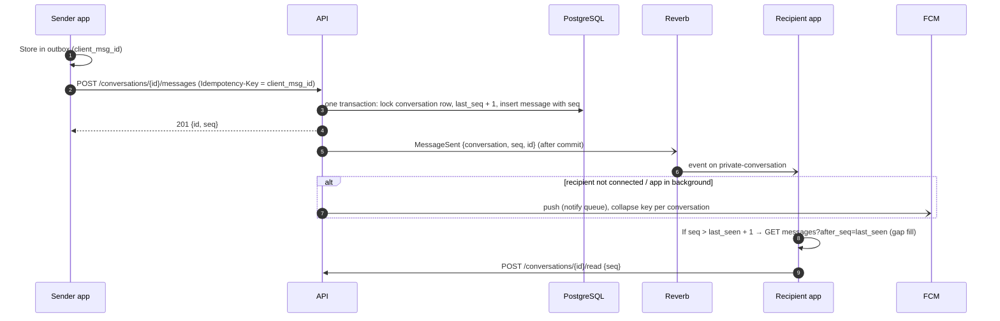

| Property | Guarantee |
|---|---|
| Durability | A message exists once the API returns 201 (committed in Postgres) |
| Delivery | At-least-once over WebSocket + push; clients de-duplicate by `id`/`client_msg_id` → effectively exactly-once display |
| Ordering | Total order per conversation by `seq` (assigned under row lock); clients render by `seq` |
| Offline send | Mobile outbox retries with the same `client_msg_id` (no duplicates) |
| Offline receive | On reconnect: `GET /conversations?updated_after=` then per-conversation `after_seq` |
| Read receipts | `last_read_seq` per participant, monotonic (`GREATEST`) |
| Edits/deletes | New version rows; "deleted" tombstone visible to both |

### 10.5 Reconnects, scaling and fan-out

- Clients reconnect with exponential back-off (1 s → 30 s, jitter) and resubscribe; after reconnect they always run gap-fill. ALB idle timeout raised to 120 s; Reverb ping every 30 s.
- **Capacity planning:** peak concurrent sockets ≈ 10–15% of DAU **[ASSUMPTION]** → base case L24 (≈ 20k DAU) ≈ 2–3k sockets → one Reverb task suffices; run 2 for availability. Load-test target: 5k sockets per 1 vCPU/2 GB task **[VERIFY with k6/WebSocket tests]**.
- **Fan-out:** events go to Valkey pub/sub and each Reverb node pushes to its local subscribers. Large broadcasts (community channels > 500 members, gym-wide announcements) are sent as a single channel event (no per-user fan-out in PHP); push notifications for them are batched (FCM topic or multicast in chunks of 500).
- Presence only on direct conversations (cost and privacy).

### 10.6 Cost

Reverb tasks: MVP 0.25 vCPU/0.5 GB (\~$8/month), growth 2 tasks of 1 vCPU/2 GB (\~$66/month) on Fargate ARM (§15). Equivalent Pusher plan for 3k concurrent connections would be a few hundred dollars per month [S49]. Push via FCM: free. Bandwidth is negligible (small JSON events).

### 10.7 Video calls and live streaming are different problems

| Need | Technology | Phase | Cost model |
|---|---|---|---|
| 1:1 consult (coach ↔ client) | MVP: links to Google Meet/Zoom/WhatsApp video stored on the session. P4: embedded WebRTC via **LiveKit Cloud** (Ship plan $50/month incl. 150k WebRTC minutes, then $0.0005/min [S50]) or **Amazon Chime SDK** ($0.0017 per attendee-minute [S48]) | P1 links, P4 embedded | Per participant-minute |
| Small-group live coaching (≤ 25) | Same SFU (LiveKit/Chime); recording to S3 optional | P4 | Per participant-minute (+ recording) |
| One-to-many live classes (hundreds of viewers) | Amazon IVS (low-latency streaming) or LiveKit egress to HLS; recorded VOD via MediaConvert | P5 | Per input hour + per viewer hour **[VERIFY IVS rates]** |
| Recorded exercise videos | S3 + MediaConvert renditions + CloudFront | P1 | Storage + egress |

Example: 1,000 consults/month × 30 min × 2 participants = 60k participant-minutes → Chime SDK ≈ $102; LiveKit Ship $50 (inside the included minutes); Daily ≈ $200 after its 10k free minutes at $0.004/min [S50]. **[RECOMMENDATION] LiveKit Cloud** for P4 (cheap at our volumes, open-source server if we ever self-host), behind a `VideoRooms` interface so Chime SDK can replace it. Note the App Store rule: one-to-few/one-to-many real-time services sold in the app need IAP [S33] — group live sessions are sold on the web (Blueprint §8.5).

---

## 11. Subscription and billing architecture

### 11.1 Two money flows, one payments core

| Flow | Merchant | Module | Examples |
|---|---|---|---|
| **Platform Billing** | Tamreen | Billing → Payments | Coach Pro, Gym Growth, Trainee Plus |
| **Merchant Collections** | The Org | Commerce/Coaching → Payments | Gym membership at the desk, coach package paid by InstaPay, Connected Gateway link |
| **Platform Checkout** (P3) | Licensed gateway split; Tamreen earns commission | Marketplace → Payments | Marketplace coaching package |

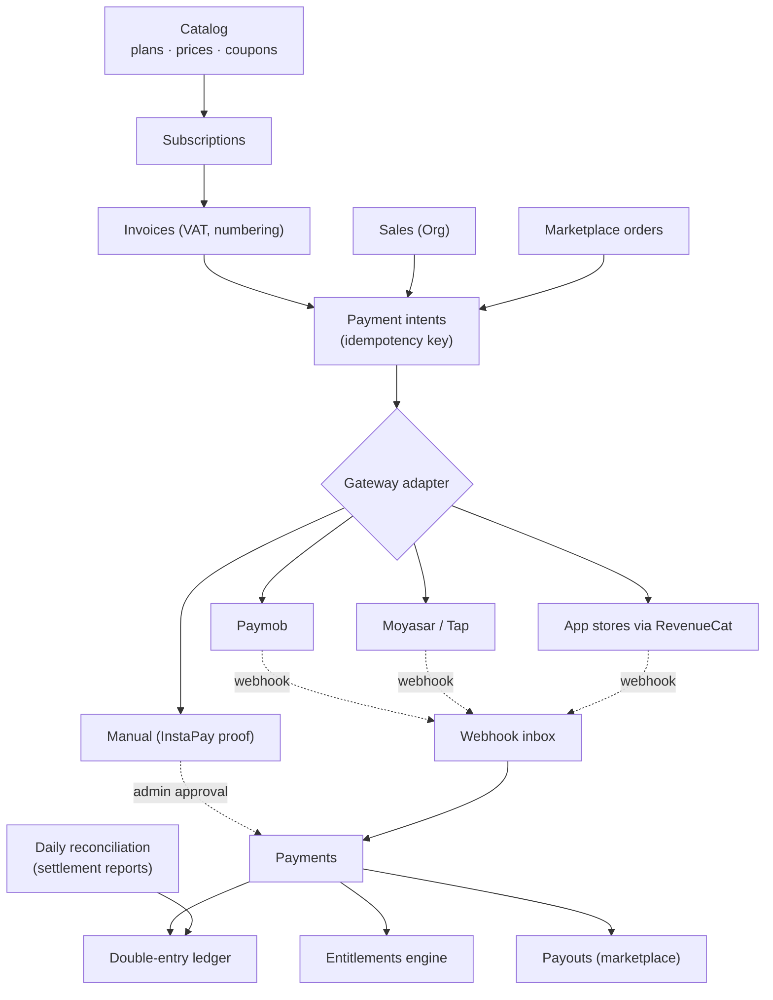

### 11.2 Gateway abstraction

```php
interface PaymentGateway
{
    public function key(): string;                                    // 'paymob', 'moyasar', 'tap', 'manual'
    public function supports(Capability $c, Currency $cur): bool;     // card, wallet, apple_pay, mada, recurring, split, payout
    public function createCheckout(PaymentIntent $intent, CheckoutOptions $o): CheckoutSession; // hosted page/iframe URL
    public function chargeSaved(PaymentIntent $intent, PaymentMethodToken $t): ChargeResult;    // merchant-initiated renewals
    public function refund(Payment $p, Money $amount, string $idempotencyKey): RefundResult;
    public function verifyWebhook(Request $r): VerifiedEvent;         // signature + parsing → provider-neutral event
    public function fetchPayment(string $providerPaymentId): ProviderPayment; // reconciliation
}
```

Adapters per provider; routing by `(market, currency, method)`. Card data never touches our servers (hosted checkout/iframe; PCI DSS SAQ A scope **[VERIFY with provider integration type]**). Org Connected Gateways use the same adapters with the Org's own encrypted credentials (`gateway_connections`, KMS-encrypted secrets, per-connection webhook URL).

### 11.3 Subscription lifecycle

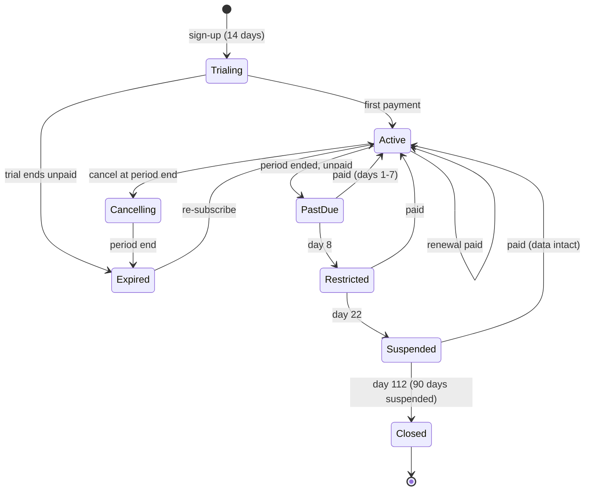

Effects per state are in Blueprint §6.12. Each transition is an event (`SubscriptionPastDue`, …) consumed by Entitlements and Notifications; state is derived from `current_period_end` + payments so that a missed scheduler run cannot "forget" to suspend.

### 11.4 Entitlements engine

1. **Sources:** active platform subscriptions (`trialing`, `active`, `past_due`, `cancelling`) → plan entitlements and limits; **sponsorships** → for every active Coaching Engagement / Gym Membership, the sponsoring Org's plan defines what its clients receive (Blueprint §7.3), valid while the Org is not `suspended`; **grants** by admins (beta, compensation).
2. **Computation:** union of booleans, max of numeric limits; written to `entitlements` (one row per key and source) for queryability and cached as an array per subject (`ent:{type}:{id}:v{n}`).
3. **Recompute triggers:** payment events, subscription transitions, engagement/membership start/end, plan catalogue changes (batched job).
4. **Checks:** `Entitlements::allows($subject, 'coach.automations')`, `::limit($subject, 'coach.active_clients')` with soft-limit logic (80% warn, +10% for 14 days, then `402 limit_reached` on *adding* only).
5. **Clients learn about changes** via `EntitlementsChanged` on `private-person.{id}` / the Org owner channel; the app re-fetches `/me/entitlements`.

### 11.5 Proration (day-based)

`credit = old_price × unused_days / period_days`; `charge = new_price × remaining_days / period_days`; `due = charge − credit` (negative → account credit). Example: Coach Starter (349) → Pro (799) on day 10 of a 30-day month: credit = 349 × 20/30 = 232.67; charge = 799 × 20/30 = 532.67; **due now = 300.00 EGP**, invoiced immediately; the next period bills 799. Downgrades take effect at period end (no refund). Seat/branch quantity increases prorate the same way.

### 11.6 Dunning

| Day after period end | Card on file | No card (prepaid) |
|---|---|---|
| −7, −3, −1 | Reminder (in-app, e-mail) | Reminder with pay link (in-app, e-mail, WhatsApp utility) |
| 0 | Charge attempt | Invoice issued |
| 1, 3, 6 | Retry (idempotent per attempt) | Reminder |
| 8 | Restricted + owner notified | Same |
| 22 | Suspended | Same |

Retries never run more than once per day per subscription; soft declines vs hard declines (expired card → stop retrying, ask for a new method).

### 11.7 Invoices, VAT and e-invoicing

- Invoices are immutable once issued; corrections are credit notes. Numbering: `TMR-{YYYY}-{000000}` from a locked counter in the issuing transaction.
- Egypt: VAT 14% included in list prices; invoice shows net + VAT. ETA e-invoice (B2B) / e-receipt (B2C) submission via an accredited integrator or the ETA API once in scope (Blueprint Q-04); store `e_invoice_status`, `e_invoice_uuid`, signed payload.
- KSA: ZATCA e-invoicing (Fatoora) for Saudi invoices via an accredited provider in P4; B2B reverse-charge treatment **[VERIFY]**.
- Org-issued receipts (gyms' sales) follow the same document engine with per-Org series; ETA/ZATCA for Orgs in P4 (GYM-26).

### 11.8 Double-entry ledger

Chart of accounts (per currency): `platform:gateway_clearing`, `platform:bank`, `platform:revenue_subscriptions`, `platform:revenue_commission`, `platform:deferred_revenue`, `platform:vat_payable`, `platform:processing_fees`, `platform:refunds`, `org:{id}:seller_payable` (marketplace), `org:{id}:payout_clearing`, `platform:chargebacks`.

**Example A — coach pays Coach Pro by card (799 EGP incl. VAT)**

| Account | Debit | Credit |
|---|---|---|
| platform:gateway_clearing | 799.00 | |
| platform:revenue_subscriptions | | 700.88 |
| platform:vat_payable | | 98.12 |

Settlement two days later (gateway keeps 2.75% + 3 = 24.97): Dr `bank` 774.03, Dr `processing_fees` 24.97, Cr `gateway_clearing` 799.00.

**Example B — marketplace coaching package (1,800 EGP), 10% commission, processing passed through**

| Account | Debit | Credit |
|---|---|---|
| platform:gateway_clearing | 1,800.00 | |
| org:{coach}:seller_payable | | 1,542.30 |
| platform:revenue_commission | | 180.00 |
| platform:vat_payable (14% on commission) | | 25.20 |
| platform:processing_fees_recoverable | | 52.50 |

Payout: Dr `seller_payable` 1,542.30, Cr `payout_clearing` → `bank`. When the gateway splits funds directly to the seller (Option A, Blueprint §9.3), the same postings are kept as a **memo ledger** so statements, refunds and disputes still balance.

Rules: entries are append-only; reversals are new transactions; `ledger_transactions.idempotency_key` = provider event or business operation ID; balances maintained under row lock on `ledger_accounts` and verifiable by re-summing entries (nightly check job).

### 11.9 Refunds and chargebacks

- **Refund:** permission + reason → `PaymentGateway::refund` (idempotent) → on `RefundSucceeded`, reverse postings, credit note, entitlement recompute (platform) or session-credit adjustment (Org sale).
- **Chargeback:** provider event → freeze related payout amounts, record dispute, evidence pack (invoice, delivery evidence: logins, delivered programs, check-ins), outcome posts to ledger; seller balance debited for marketplace orders.

### 11.10 Mobile in-app purchases (Trainee Plus)

RevenueCat SDK in the app; RevenueCat webhooks → `webhook_events` → `subscriptions` with `provider = apple|google`. A Person with an active store subscription sees "managed in the App Store/Google Play" on the web and cannot double-buy; a web subscriber sees "you're already Plus" in the app (allowed: no purchase or external link shown).

### 11.11 Multi-currency readiness

Prices are stored per currency (`plan_prices`), not converted; ledger accounts are per currency; no cross-currency postings; dashboards convert at a monthly reference rate for display only. Adding AED later = new price rows + gateway routing.

---

## 12. Marketplace and commission handling

### 12.1 Order flow

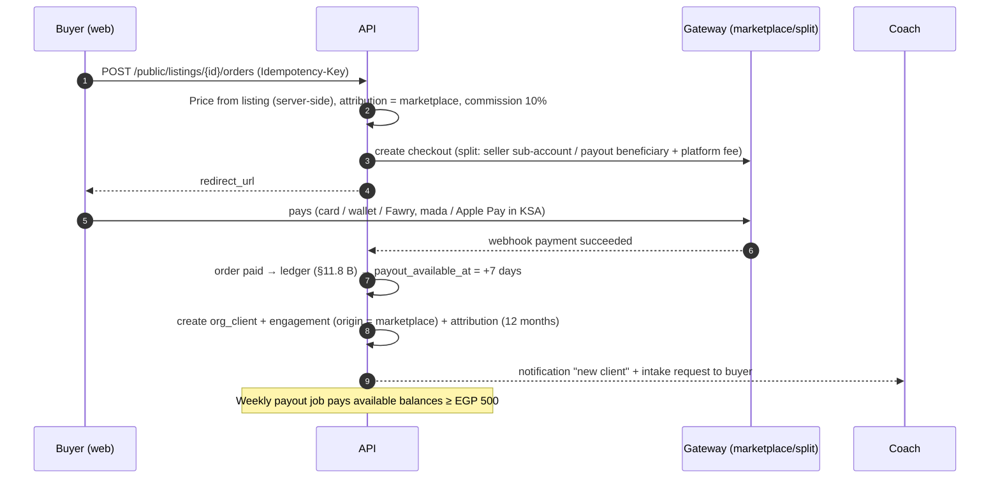

### 12.2 Attribution and commission rules

- An `attributions` row is created when a buyer's **first** purchase with an Org comes through marketplace discovery (search/profile/listing page with marketplace referrer). It sets `commission_until = first_order + 12 months`.
- Any later Platform Checkout order by that buyer with that Org before `commission_until` → commission 10%; after → 0% (processing only). Orders from the coach's own invite links → `origin = direct`, 0% commission.
- Gyms: 5% on the first membership term only; class packs/drop-ins: 10% (Blueprint §9.2).
- Commission rates are data (`marketplace_fee_rules` versioned by date), snapshotted on each order.

### 12.3 Payout engine

| Step | Rule |
|---|---|
| Availability | `payout_available_at = paid_at + 7 days` (+7 more for a seller's first 3 orders) |
| Batch | Weekly (Sunday 10:00 Cairo): sum available `seller_payable` per Org ≥ EGP 500 |
| Execute | Gateway payout API (bank/InstaPay/wallet) with idempotency key `payout:{org}:{week}`; or, with split settlement, a reconciliation-only "statement" |
| Failures | Retry next business day; after 3 failures → hold + ask seller to update destination |
| Negative balance | Offset against future orders; > 30 days negative → selling paused |
| Statements | Generated per payout (PDF/Excel), visible in the Org's finance screen |

### 12.4 Trainer commission engine (Compensation module)

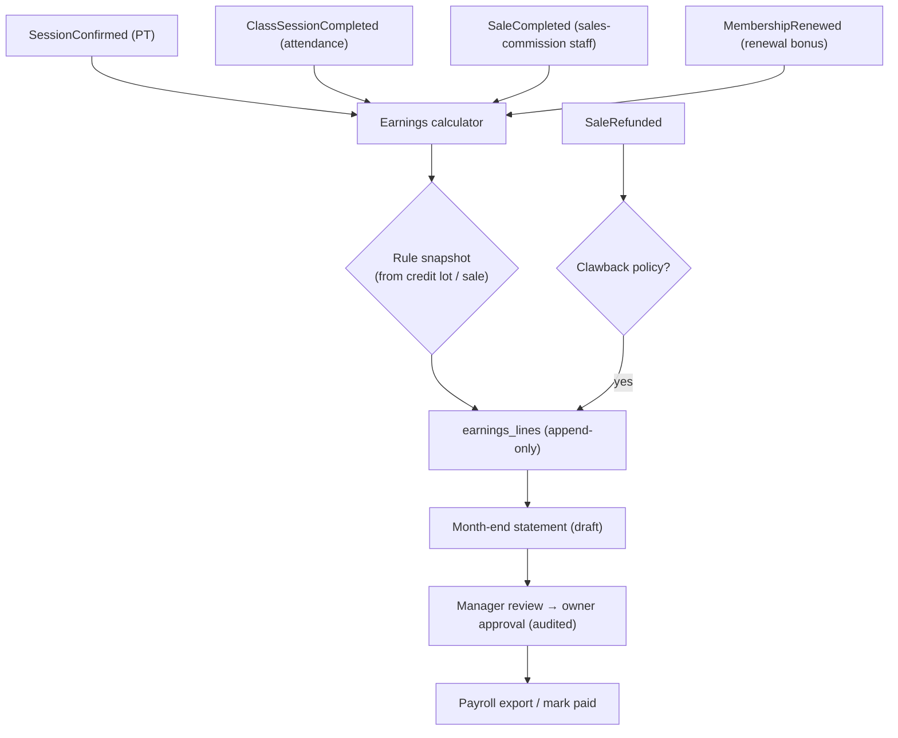

Anti-gaming: sessions count only when confirmed by the member (or auto-confirmed after 24 h without dispute); sessions held at a gym are location-tagged (booking branch) and optionally require a desk check-in the same day; disputes freeze the line. Freelance floor fees are generated as Org invoices to the trainer's coaching business (or a recorded receivable when the trainer has no Org).

### 12.5 Reviews, verification and moderation

Reviews unlock 7 days after an order's engagement starts (or after the first confirmed session), one per order; text passes an automated filter (profanity, phone numbers/URLs to prevent off-platform steering) then publishes; reports go to the admin moderation queue. Verification documents are stored in the sensitive bucket, reviewed by platform staff, and expire (certificates) with reminders.

---

## 13. AWS infrastructure and regional deployment decisions

### 13.1 Region choice

| Region | Status (Oct 2026) | Expected latency from Egypt **[ESTIMATE — measure]** | Price level | Risk / notes | Verdict |
|---|---|---|---|---|---|
| **eu-central-1 Frankfurt** | Mature; full service catalogue | \~50–80 ms from Cairo ISPs (Egypt's international routes run mostly via Mediterranean cables into Europe) | EU baseline | Lowest risk; most peering | **Primary** |
| eu-south-1 Milan | GA; narrower catalogue | Possibly a little lower than Frankfurt; \~13 ms from Frankfurt [S55] | Slightly higher than Frankfurt on some services **[VERIFY]** | Good DR partner | **Backups/DR**; primary candidate only if measurements show a clear win |
| me-central-1 UAE | One AZ struck and lost in March 2026 [S37] | Not measured | Higher | Conflict exposure demonstrated | Not for primary in 2026 |
| me-south-1 Bahrain | AWS stated in Sep 2026 that resources/data hosted only there cannot be restored [S37] | — | — | Unusable | No |
| me-central-2 Saudi Arabia | Targeted to launch by Dec 2026 [S36]; services expand after launch | Best for KSA users | Likely higher | New region; service gaps at launch | Future KSA cell (§4.6) |
| il-central-1 Tel Aviv | GA | Geographically close | — | Commercially/politically sensitive for an Egyptian/Saudi customer base; conflict exposure | No |
| af-south-1 Cape Town | GA | High (routing) | Higher | — | No |

Static content and media are served from **CloudFront's Cairo edge** (since May 2024; Middle East pricing tier) [S38][S39], so only API round-trips depend on the region; the mobile app's offline-first design hides most of that latency.

**Latency validation (P0, before committing):** run HTTP and TCP RTT probes for 7 days from 4 Egyptian ISPs (WE, Vodafone, Orange, e&) and 3 Saudi ISPs to test endpoints in eu-central-1 and eu-south-1 (and me-central-1 for reference), at peak hours. Decision rule: pick Milan only if its median RTT is ≥ 15 ms lower from ≥ 3 of 4 Egyptian ISPs **and** every service in §3.5 is available there; otherwise Frankfurt.

**Legal dependency:** hosting Egyptians' personal data outside Egypt counts as cross-border transfer and needs a licence from the PDPC [S27][S29]. If the licence is refused or impractical for sensitive data, the fallback is to keep the **sensitive data store** (health profiles, photos, check-in answers) with an Egypt-hosted provider while the rest stays on AWS — a material redesign that is flagged as the top technical risk (§25).

### 13.2 Compute options

| Option | Fit for Laravel + Reverb + workers | Ops burden | Cost (MVP) | Scaling | Verdict |
|---|---|---|---|---|---|
| EC2 + Docker Compose | Works (the founder's current style) | Patching, AMIs, SSH, manual rolling deploys | Lowest (\~$62 for 2 × t4g.medium + EBS) | Manual/ASG | Fallback |
| **ECS on Fargate (ARM64)** | API, Reverb, workers, scheduler as separate services from one image | No hosts; managed rolling deploys + circuit breaker | \~$91 for the MVP task set (§15) | Service autoscaling | **MVP → early traction** |
| ECS on EC2 (Graviton) capacity provider | Same task definitions | Hosts managed via ASG + ECS-optimised AMI | Cheaper per vCPU with Savings Plans at steady load | Cluster autoscaling | **Growth tier** |
| EKS | Works | Kubernetes expertise, control-plane fee | Higher | Excellent | Not needed |
| Lambda (Bref) | HTTP API yes; Reverb no (long-lived sockets); Horizon no | Low | Low at idle | Excellent | No — splits the stack |
| Lightsail | Cheap bundles with included transfer | Limited VPC/IAM integration, no ECS | Very low | Manual | Dev/staging only |
| App Runner | No WebSockets support **[VERIFY]**; limited VPC options | Low | Medium | Auto | No |
| Elastic Beanstalk | Possible | Legacy feel, opinionated | Low | ASG | No |

### 13.3 Database options

| Option | Pros | Cons | Verdict |
|---|---|---|---|
| **RDS PostgreSQL** | Managed backups/PITR, Multi-AZ, extensions we need, predictable price | Vertical scaling; read replicas lag | **Chosen** (Single-AZ + PITR at MVP; Multi-AZ from L7 when gyms depend on us) |
| Aurora PostgreSQL | Fast failover, up to 15 replicas, storage autoscaling | Higher minimum cost; I/O pricing choices | Revisit at > db.r7g.xlarge or > 2 replicas |
| Aurora Serverless v2 | Scales with load | Cost harder to predict; minimum capacity cost | Revisit for spiky analytics |
| Self-managed Postgres on EC2 | Cheapest compute | Backups, failover, patching, monitoring on us — real risk for a tiny team | No |

### 13.4 Managed vs self-managed — where the savings are real

| Component | Managed choice | Self-managed alternative | Monthly saving if self-managed (MVP) | Risk taken | Decision |
|---|---|---|---|---|---|
| PostgreSQL | RDS | Postgres container on EC2 | \~$30–40 | Data loss/restore complexity | **Managed** |
| Valkey | ElastiCache Serverless (\~$6–10 floor) [S43] | Valkey container | \~$10 | Low (cache/queue; outbox protects events) | Managed (cheap enough) |
| WebSockets | Reverb on ECS (self-run) | Pusher ($49+) | — | Low | **Self-run** |
| Search | Postgres | OpenSearch domain | — | — | Postgres until thresholds |
| Email | SES | Postfix | negligible | Deliverability | Managed |
| Monitoring | CloudWatch + Sentry | Prometheus/Grafana stack | \~$20 | Ops time | Managed |
| Video | LiveKit Cloud (P4) | Self-hosted LiveKit on EC2 | depends on volume | TURN/scaling ops | Managed first |

---

## 14. Hosting and deployment topology

### 14.1 Accounts and environments

| AWS account (AWS Organizations, IAM Identity Center SSO, no IAM users) | Contents |
|---|---|
| `management` | Organizations, SCPs (deny leaving org, deny disabling CloudTrail/GuardDuty, region allowlist: eu-central-1, eu-south-1, us-east-1 for global services), billing alarms |
| `prod` | Production stack |
| `nonprod` | `dev` and `staging` stacks (staging mirrors prod at small size; no real personal data — synthetic seed data only) |
| `security` (from P2) | CloudTrail org trail, Config, GuardDuty/Security Hub delegated admin, log archive bucket (object lock) |

### 14.2 Network (production, MVP layout)

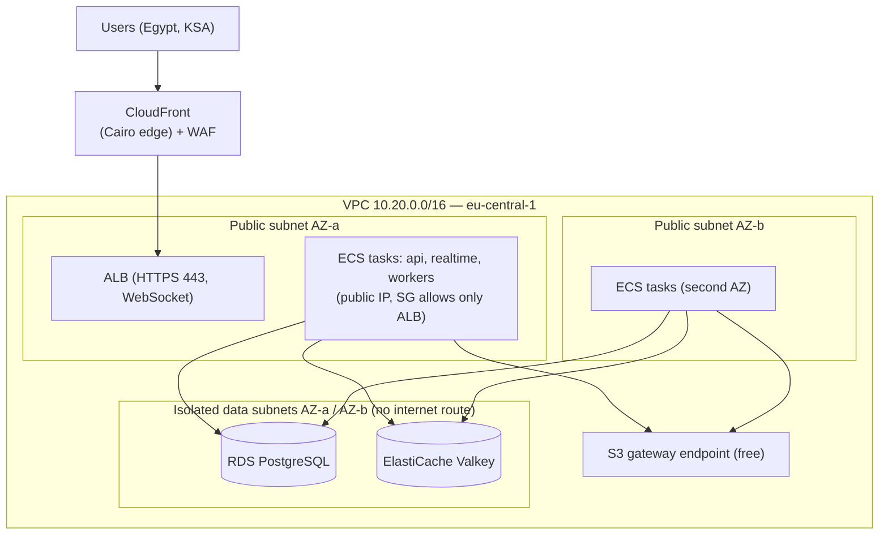

- **MVP:** tasks in public subnets with public IPs (outbound to gateways, FCM, Meta without a NAT gateway); inbound locked to the ALB security group; no SSH (ECS Exec via SSM when needed); IMDSv2 only. This saves a NAT gateway (\~$38/month + $0.052/GB processed **[VERIFY Frankfurt rate]**) and interface endpoints (\~$7–9/month each per AZ).
- **From early traction (≈ L9):** move tasks to private subnets with one NAT gateway (two at growth tier for AZ independence), add interface endpoints only where traffic justifies them (ECR, CloudWatch Logs, Secrets Manager).
- Data subnets have no internet route; RDS/Valkey security groups allow only the task security group.

### 14.3 Domains and CDN behaviours

| Host | Origin | Caching |
|---|---|---|
| `app.` (web SPA), `admin.` (admin SPA, WAF IP allowlist) | S3 (OAC) | Hashed assets 1 year; `index.html` no-cache |
| `www.` / marketplace / public profiles | `public-web` ECS service (Nuxt SSR) | HTML 60 s + stale-while-revalidate; per-language cache key |
| `api.` | ALB → `api` service | No caching except `/public/*` GETs (60 s) |
| `ws.` | ALB → `realtime` service | WebSocket pass-through |
| `cdn.` | S3 `public-media` (OAC) | 1 year (immutable keys) |
| Sensitive media | **Not on the CDN**; S3 presigned GET (5 min) after authorization | None |

TLS via ACM (CloudFront certs in us-east-1), HSTS preload, TLS 1.2+.

### 14.4 File upload workflow

```mermaid
sequenceDiagram
    autonumber
    participant App as App
    participant API as API
    participant S3 as S3 (private bucket)
    participant WK as Media worker
    App->>App: Compress image on device (max 2048 px, WebP/JPEG q≈80)
    App->>API: POST /media/uploads {purpose: progress_photo, mime, bytes}
    API->>API: Policy + quota check, create media row (status=uploading, sensitivity=sensitive)
    API-->>App: presigned POST (key, content-length-range, content-type, 10 min)
    App->>S3: Upload directly
    App->>API: POST /media/{id}/complete
    API->>S3: HEAD (size, type)
    API-)WK: ProcessMedia job
    WK->>S3: Read original → strip EXIF/GPS → variants (thumb, medium) → write
    WK->>API: status=ready → MediaReady event
```

Videos (coach exercise demos, ≤ 2 min, ≤ 200 MB) go to MediaConvert (HLS + MP4 fallback, 360p/720p) and are served from `cdn.` when public, or via signed URLs when private. Documents (InstaPay proofs, certificates) are scanned for malware (GuardDuty Malware Protection for S3 or a ClamAV worker **[VERIFY cost]**) before staff can open them.

### 14.5 Notifications plumbing

| Channel | Service | Notes |
|---|---|---|
| Push | FCM HTTP v1 (Android + iOS through APNs key) | Tokens per device; collapse keys; invalid tokens pruned |
| E-mail | SES (eu-central-1), DKIM/SPF/DMARC, configuration set → SNS → bounce/complaint suppression | Transactional only at first |
| WhatsApp | Meta Cloud API; approved templates per language (utility: renewal, booking, check-in reminder; authentication: OTP) | Cost logged per message in `outbound_messages`; Orgs' marketing messages pass-through |
| SMS | Local aggregator for OTP fallback | Sender ID registration **[VERIFY]** |
| In-app | `notifications` table + Reverb ping | Source of truth for the bell |

### 14.6 Secrets and configuration

AWS Secrets Manager for database credentials (rotation) and provider secrets; SSM Parameter Store (SecureString) for non-rotating config; ECS task definitions reference both (no secrets in images, repo or CI logs). Org gateway credentials: encrypted with a KMS data key per record (envelope encryption) in Postgres. KMS customer-managed keys: `sensitive-media`, `db-field-encryption`, `backups`.

### 14.7 Deployment and rollback

```mermaid
flowchart TB
    PR["Pull request"] --> CI["CI: lint, static analysis, tests,<br/>architecture + tenancy tests,<br/>Terraform plan, image scan"]
    CI --> M["Merge to main"]
    M --> B["Build arm64 image → ECR (immutable tag = git SHA)"]
    B --> STG["Deploy staging: run migrations task → rolling update → smoke tests"]
    STG --> APP{"Manual approval"}
    APP --> MIG["Prod: migrations task (expand-only)"]
    MIG --> ROLL["ECS rolling update (min 100% / max 200%)<br/>health checks + deployment circuit breaker"]
    ROLL --> POST["Post-deploy checks (synthetics, error rate)"]
    POST -->|"error budget burn"| RB["Automatic rollback to previous task definition"]
```

Rollback is safe because migrations are expand-only in the release that introduces them (§23.4). Feature flags (Laravel Pennant) decouple deploy from release; risky features ship dark and roll out by Org.

---

## 15. Cost estimates and scaling scenarios

### 15.1 Unit prices used (eu-central-1 unless stated)

| Item | Price used | Source / confidence |
|---|---|---|
| EC2 t4g.small / t4g.medium / t4g.large | $0.0192 / $0.0384 / $0.0768 per hour | [S40] third-party trackers (t4g.medium $0.038) — **[VERIFY]** |
| Fargate Linux/ARM64 | \~$0.03725 per vCPU-hour, \~$0.00409 per GB-hour | **[ASSUMPTION ≈ us-east-1 × regional uplift — VERIFY]** |
| RDS PostgreSQL db.t4g.medium (Single-AZ) | \~$54/month (\~$0.074/h); Multi-AZ ≈ ×2 | [S41] |
| RDS gp3 storage | \~$0.137 per GB-month (×2 for Multi-AZ) | **[ASSUMPTION — VERIFY]** |
| ALB | $0.027 per hour + $0.008 per LCU-hour | [S45] |
| Public IPv4 | $0.005 per address-hour (\~$3.65/month) | [S42] |
| NAT gateway | \~$0.052 per hour + \~$0.052 per GB processed | **[ASSUMPTION — VERIFY]** |
| S3 Standard | $0.0245 per GB-month (first 50 TB) | [S44] |
| CloudFront to Middle East/Africa (incl. Cairo edge) | $0.110 per GB (first 10 TB); always-free 1 TB/month; flat-rate plans Free/$15/$200/$1,000 with no overage | [S39] |
| ElastiCache Serverless Valkey | \~$6/month floor (100 MB minimum) | [S43] (us-east-1 rate) |
| CloudWatch Logs ingestion | \~$0.63 per GB | **[ASSUMPTION — VERIFY]** |
| SES | \~$0.10 per 1,000 e-mails | **[ASSUMPTION — VERIFY]** |
| New-account credits | Up to $200 credits; free plan 6 months | [S46] |

### 15.2 Monthly AWS cost by stage **[ESTIMATE]**

Line items are reproducible from §15.1; on-demand prices, before tax.

**Development / staging — \~$29/month** (one t4g.small running the whole stack in Docker Compose, 40 GB gp3, one public IP, S3, logs). First months are covered by new-account credits [S46].

**MVP production (≤ 5k MAU, \~L1–L8) — \~$245/month** (add \~$60/month when RDS goes Multi-AZ before the first paying gym, \~L7)

| Line | $/month |
|---|---|
| Fargate ARM: api 2 × (1 vCPU, 2 GB), worker (0.5, 1), reverb (0.25, 0.5) | 91 |
| ALB (hour + \~1 LCU) | 26 |
| Public IPv4 (4 tasks + 2 ALB) | 22 |
| RDS db.t4g.medium Single-AZ + 50 GB gp3 + PITR | 61 |
| ElastiCache Serverless Valkey | 10 |
| S3 150 GB + requests | 7 |
| CloudFront (inside 1 TB free / Free flat-rate plan) | 0 |
| SES (30k), CloudWatch (10 GB logs + alarms), Secrets, Route 53, backups | 27 |
| **Total** | **≈ 245** (EC2-based alternative ≈ $207) |

**Early traction (≤ 30k MAU, \~L9–L20) — \~$1,180/month on demand, \~$1,040 with 1-year Compute Savings Plan + reserved RDS/cache**

| Line | $/month |
|---|---|
| Fargate ARM: api 3 × (2 vCPU, 4 GB), workers 2 × (1, 2), reverb 1 × (1, 2) | 299 |
| ALB (\~4 LCU) | 43 |
| NAT gateway (1) + 150 GB | 46 |
| Public IPv4 (ALB + NAT) | 11 |
| RDS db.t4g.large **Multi-AZ** + 200 GB gp3 | 271 |
| ElastiCache Valkey cache.t4g.small primary + replica | 54 |
| S3 1.5 TB + requests | 49 |
| CloudFront Business flat-rate plan (or \~1 TB billable at $0.110/GB) | 200 |
| MediaConvert (\~2k output minutes) | 30 |
| SES, CloudWatch (60 GB logs), WAF, GuardDuty/Security Hub, backups + cross-region copies, KMS/Secrets/Route 53 | 178 |
| **Total** | **≈ 1,180** |

**Growth (≤ 100k MAU, \~L21+ in base case) — \~$2,625/month on demand, \~$2,280 with commitments**

ECS on EC2 (4 × c7g.large API hosts $248, 2 × t4g.large workers $112, 2 × t4g.medium Reverb $56), ALB $78, 2 NAT gateways + 500 GB $102, RDS db.m7g.large Multi-AZ + 500 GB $425, read replica $177, Valkey r7g.large pair $368, S3 5 TB $153, CloudFront $260, MediaConvert $120, CloudWatch $186, WAF + GuardDuty/Security Hub/Inspector $130, backups $90, SES $50, Secrets/Route 53/KMS $30, EBS + public IPv4 $41.

**Scale (≥ 100k MAU, KSA live, optional Saudi cell) — \~$5,000–6,500/month** **[ESTIMATE]**: larger RDS (r7g.xlarge Multi-AZ + replica), OpenSearch (2 small data nodes), more API hosts, video consult minutes (pass-through), plus \~$1,000–1,500/month for a minimal Saudi cell if required.

| Stage | MAU | AWS $/month | AWS per MAU (at the top of the tier) | Share of base-case net revenue |
|---|---|---|---|---|
| MVP | ≤ 5k | \~245 | \~$0.05 | > 100% at L1 → \~12% at L8 |
| Early traction | ≤ 30k | \~1,040–1,180 | \~$0.035–0.04 | \~40% at L9 → \~7% at L20 |
| Growth | ≤ 100k | \~2,280–2,625 | \~$0.023–0.026 | \~14% at L21 → \~10% at L24 |
| Scale | ≥ 100k | \~5,000–6,500 | \~$0.03–0.04 | \~9% (aggressive scenario at L24) |

The financial model applies each tier's full cost from the tier's lower MAU bound, which overstates spend right after each step (e.g. L9). In practice capacity is added gradually — Multi-AZ at L7, NAT at L9, a third API task when CPU stays above 60% — so real spend should sit below the model between steps.

These tiers feed the Blueprint's financial model (Blueprint Appendix B).

### 15.3 Commonly overlooked costs

| Cost | Why it bites | Our handling |
|---|---|---|
| NAT gateway hours + per-GB processing | Every outbound byte from private subnets (gateway calls, FCM, image downloads) | Public-subnet tasks at MVP; S3 gateway endpoint (free); NAT only from early traction |
| Public IPv4 charges | Every task/ALB/NAT IP is billed since 2024 [S42] | Count them; IPv6 dual-stack where supported |
| Interface VPC endpoints | \~$7–9 per endpoint per AZ per month | Only where traffic justifies |
| Load balancer LCUs | WebSocket connections and new connections count | Monitor LCU; one ALB for API + WS |
| CloudWatch Logs ingestion | Chatty logs at $0.5–0.6/GB add up fast | INFO-level only in prod, sampling, 14–30-day retention, archive to S3 |
| Cross-AZ data transfer | $0.01/GB each way between AZs | Keep chatty pairs (task ↔ cache) aware; accept for HA |
| Data transfer to the internet | Video and photos | CloudFront (cheaper, free tier, flat-rate plans); image variants; no raw originals to clients |
| Video transcoding | Per output minute per rendition | Two renditions max; length limits on uploads |
| Real-time connections | Managed providers bill per connection/message | Self-run Reverb |
| RDS storage and backup beyond free | Backups above 100% of DB size are billed; snapshots copied cross-region billed in both regions | Retention policy; lifecycle |
| Multi-AZ doubling | DB and cache cost ×2 | Only from L7/L9 when gyms depend on us |
| Secrets Manager per secret | $0.40/secret/month **[VERIFY]** | Parameter Store for non-rotating values |
| WAF requests | Per million requests + rules | Managed rule groups only where needed |
| Support plan | Business support starts at a monthly minimum | Developer/Basic until Growth; Business when gyms depend on 99.9% |

### 15.4 Cost guardrails

AWS Budgets with alerts at 80/100/120% per account; Cost Anomaly Detection; tagging (`env`, `module`, `cell`) enforced by SCP/Config; monthly cost review against the NFR-16 target; Savings Plans only after 3 months of stable usage.

---

## 16. Security and privacy architecture

### 16.1 Threat model (summary)

| Asset | Threats | Key controls |
|---|---|---|
| Health data, progress photos | Cross-tenant leak, insider browsing, stolen device, public link leakage | Grants + RLS, access log visible to the person, separate KMS bucket, short-lived signed URLs, app lock/biometric on mobile |
| Accounts | OTP abuse, SIM swap, credential stuffing, session theft | Rate limits, WhatsApp-first OTP, 2FA for privileged roles, device list + revoke, HttpOnly cookies on web |
| Money (billing, payouts, cash drawers) | Fake proofs, refund fraud, payout redirection, webhook spoofing | Proof review workflow, refund permissions + audit, payout destination changes need 2FA + 48 h hold, webhook signatures + idempotency |
| Org business data | Ex-staff access, receptionist exports | Immediate assignment revocation, export permission, audit |
| Marketplace | Fake reviews, scam coaches, steering off-platform | Verified-purchase reviews, verification, content filters |
| Platform | DDoS, injection, dependency vulnerabilities | CloudFront + WAF, Laravel query builder/ORM, CSP, dependency scanning, pen tests |

### 16.2 Controls by layer

| Layer | Controls |
|---|---|
| Edge | CloudFront + AWS WAF managed rules (common, known bad inputs, IP reputation), rate-based rules on auth endpoints, geo rules for admin, Shield Standard |
| Transport | TLS 1.2+ everywhere, HSTS, certificate pinning considered for the mobile app (P3) |
| Application | OWASP ASVS L2 checklist, Form Request validation, policies on every route (architecture test), output encoding, strict CSP (web/admin), CSRF on cookie sessions, SSRF protection on any URL fetch, file type sniffing |
| Data at rest | RDS encryption (KMS), S3 SSE-KMS, encrypted EBS; **field-level encryption** (Laravel encrypted casts with a dedicated key) for health answers, injuries, unlock codes, national IDs, gateway credentials |
| Identity & access (AWS) | IAM Identity Center SSO + MFA, least-privilege task roles per service, no long-lived keys, SCPs, CloudTrail org trail, Config rules |
| Secrets | Secrets Manager / Parameter Store; rotation; gitleaks in CI |
| Mobile | Tokens in Keychain/Keystore, local DB encrypted (SQLCipher) for health/photo caches, screenshot protection on photo screens (Android `FLAG_SECURE`), jailbreak/root detection as a signal only, app lock (PIN/biometric) |
| Logging | No health values or message bodies in logs; hashed person IDs; PII scrubbing in Sentry |

### 16.3 Payment security boundary

Tamreen never receives card numbers: hosted checkout/iframe from the gateway; tokens only. PCI DSS scope: SAQ A (redirect/iframe) **[VERIFY with chosen integration]**. Webhooks verified by HMAC and replay window; amounts always recomputed server-side from our records, never trusted from the client or the webhook alone.

### 16.4 Secure file access

| Bucket | Content | Access |
|---|---|---|
| `public-media` | Exercise library videos, public profile images, gym logos | CloudFront OAC; immutable keys |
| `business-files` | Contracts, receipts, exports, InstaPay proofs | Private; presigned GET (5 min) after policy check; exports auto-expire (24 h lifecycle) |
| `sensitive-media` | Progress photos, check-in photos, health documents, verification IDs | Private; SSE-KMS with a dedicated CMK whose key policy allows only the api/worker task roles; presigned GET (5 min) after grant check; every access logged in `data_access_log`; versioning + replication to eu-south-1 |

### 16.5 Session and token security

Mobile tokens hashed in DB, rotated on privilege change, revoked on logout/password reset; web sessions HttpOnly/Secure/SameSite=Lax; admin separate guard and domain; idle timeout for staff sessions on shared front-desk tablets (lock after 5 min, PIN to unlock — the founder's existing app-lock pattern); suspicious-login detection (new device + new country) → step-up.

### 16.6 Compliance mapping and verification steps

Tamreen does **not** claim compliance with any law until the verification steps below are done by qualified counsel.

| Regime | Applies because | Obligations (summary) | Implementation | Verification step |
|---|---|---|---|---|
| **Egypt PDPL (Law 151/2020) + Executive Regulations (Decree 816/2025)** | Egyptian data subjects; Egyptian controller | Licences/permits from the PDPC (controller/processor; **sensitive data**; **cross-border transfer — storing abroad counts**) [S27][S29]; explicit consent for sensitive data (health, financial, children) [S28]; data subject rights; DPO; records of processing; breach notification (72 h reported) [S27]; representative for foreign entities | Consent records per purpose/version; Consent centre; export/delete; data access log; DPO appointed (founder initially + external counsel); RoPA document; incident runbook with 72 h clock | Written legal opinion in P0 on licence types, fees and timelines; application filed before L1; review again at the end of the grace period (\~Nov 2026) [S27] |
| **Saudi PDPL** | Saudi data subjects (P4) | Lawful basis (consent for health data; legitimate interest does not cover sensitive data) [S30]; transfer safeguards (SCCs/risk assessment) [S30]; data subject rights; breach notification **[VERIFY timeline]** | Same consent engine; SCCs with AWS/processors; transfer risk assessment; optional Saudi cell | Saudi counsel opinion before L16 |
| **GDPR** | Only if we target EU residents or have an EU establishment — hosting in the EU **does not by itself** make GDPR apply **[VERIFY]** | — | AWS DPA in place regardless | Counsel confirmation |
| **UAE PDPL** | If UAE expansion | Similar principles | Same engine | Before entering UAE |
| **Consumer protection (Egypt)** | B2C sales and marketplace | Cancellation/refund rights for distance services **[VERIFY]** | Listing policies, refund workflow | Counsel review of terms |
| **App store policies** | iOS/Android apps | IAP rules (Blueprint §8.5), health data use limits, account deletion in-app | In-app account deletion; HealthKit data never used for ads | Pre-submission review checklist |
| **Health/wellness boundary** | Nutrition and training advice | Not a medical device or medical service; avoid diagnosis/treatment claims | Disclaimers, readiness questionnaire with "consult a doctor" flags, prohibited-claims policy, no AI medical advice | Legal review of copy; no regulated claims in marketing |

### 16.7 Privacy engineering details

- **Data minimisation:** health questions optional except a short readiness questionnaire; photos opt-in; birth date required only for age rules.
- **Purpose-bound consent:** `consent_records` keyed by purpose (`coaching_share:{org}`, `marketing_photos`, `wearables_sync`, `guardian_consent`) and text version; withdrawing consent revokes the grant immediately.
- **Data subject requests:** export (JSON + PDF summary, generated by a job, link valid 24 h); deletion: Personal Space data deleted; Org-owned records referencing the person are anonymised where the law allows retention (financial records kept with name replaced by "deleted user" per retention rules) — the same anonymise-on-erase pattern already used in the founder's codebase (`CustomerErased` events consumed per module).
- **Retention jobs:** nightly purge per retention table (§8.4); audit of purges.
- **DPIA** before launch for health data and photos; repeated before AI features (P4) and wearables (P3).
- **Children:** guardian consent, no marketplace, no public content, photo uploads off by default.

### 16.8 Abuse prevention

OTP and login throttles (§9.2); marketplace message filters (phone numbers/links in first messages), report buttons, automated spam scoring for leads; upload size/type limits; cost-abuse limits on WhatsApp sends per Org per day; anomaly alerts on refunds and cash differences.

---

## 17. Caching and performance optimization

### 17.1 What we cache, where

| Data | Layer | Key / TTL | Invalidation |
|---|---|---|---|
| Static assets (SPA bundles, exercise videos, public images) | CloudFront | Immutable, 1 year | New hashed filenames |
| Public profile / marketplace pages | CloudFront (60 s + SWR) | Per URL + language | Purge on profile publish (path invalidation, batched) |
| Public search API | CloudFront (60 s) | Query string whitelist | TTL |
| Permission sets, entitlements, plan catalogue, feature switches | Valkey (arrays, never serialised models — Laravel 13 cache refuses to unserialise objects) | `perm:{org}:{person}:v{n}`, `ent:{type}:{id}:v{n}`, `catalog:v{n}`; 10 min | Version bump on change |
| Grant lookups per staff | Valkey | `grants:{org}:{staff}:{scope}:v{n}`; 5 min | Bump on grant change |
| Exercise library, food search results (platform data) | Valkey + HTTP ETag | `ex:lib:{locale}:v{n}`; 1 h | Version bump |
| Owner dashboard figures | Valkey | `dash:{org}:{branch}:{date}`; 30–60 s | TTL (+ realtime "refresh" ping) |
| Front-desk member snapshot | Browser IndexedDB | Refreshed every 5 min, delta by `updated_after` | §6.3 |
| Mobile data (today view, programs, history) | Device SQLite | Server-driven sync cursors | Sync |

Rules: every key starts with a scope (`org:`, `person:`, `public:`); no cache for sensitive values (health answers, photos); cache stampede protection with `Cache::flexible`/locks on hot keys.

### 17.2 Application performance

- **Octane + FrankenPHP:** framework booted once per worker; watch for state leaks (singletons holding request data) — enforced by a test that runs two requests with different contexts in one worker.
- **Database:** strict N+1 detection in dev/test (`Model::preventLazyLoading()`), explain-plan review for new list endpoints, keyset pagination, `statement_timeout`, partial and covering indexes (§8.5); counters (`booked_count`, `last_seq`) maintained transactionally instead of `COUNT(*)` on hot paths.
- **Read replica** from the growth tier for reports, exports and marketplace projection rebuilds (lag-tolerant only).
- **Payload budgets:** list endpoints ≤ 50 KB gzip; images through variants (thumb 200 px, medium 800 px); mobile requests batched via screen endpoints (`/me/today`).
- **Background everything slow:** PR recomputation, check-in trend calculations, exports, notifications, media processing.

### 17.3 Mobile performance

Offline-first reads from SQLite (instant screens); delta sync with `updated_after` cursors; image caching with size-aware variants; lazy video loading (HLS, 360p default on cellular); app size budget (< 40 MB) by deferring large assets (exercise videos streamed, not bundled).

### 17.4 Performance budgets (checked in CI and load tests)

| Endpoint class | p95 server time | Notes |
|---|---|---|
| Front-desk check-in | 250 ms | NFR-02 |
| Auth / OTP verify | 300 ms | excluding WhatsApp delivery |
| Screen endpoints (`/me/today`, coach inbox) | 300 ms | |
| Program save (document) | 400 ms | |
| Sync batch (≤ 200 sets) | 500 ms | |
| Marketplace search | 300 ms | Postgres FTS/trigram/GIST |
| Reports (interactive) | 2 s | replica, else queued export |

### 17.5 When to add search infrastructure

Stay on Postgres (FTS + trigram + PostGIS) until **any** of: > 50k published listings/profiles; marketplace search p95 > 300 ms after index tuning; need for language-aware synonyms/fuzzy ranking beyond trigram; faceted counts become expensive. Then add **Amazon OpenSearch Service** (2 small data nodes, Arabic analyzer + synonyms), fed by an indexer consuming outbox events, with Postgres as the source of truth and a nightly full rebuild into a new versioned index behind an alias (the same pattern the founder already runs for a marketplace index).

---

## 18. Queues, events and asynchronous workflows

### 18.1 Mechanisms

| Mechanism | Use | Guarantee |
|---|---|---|
| **In-transaction contract call** | Side effects that must succeed with the change (sale → stock issue → ledger → membership) | Atomic |
| **Domain event → listener (sync, after commit)** | Cheap reactions inside the monolith | Runs after commit; failures logged |
| **Queued job (Horizon on Valkey)** | Slow or external work (push, WhatsApp, e-mail, media, PR recompute, exports) | At-least-once; jobs idempotent |
| **Transactional outbox (Postgres)** | Events that must not be lost even if Valkey fails over (payments, entitlements, marketplace orders, search projection) | Written in the same transaction; relay publishes to the queue; consumers de-duplicate by event ID |
| **Scheduler** | Time-based work | Single scheduler task with `onOneServer()` locks |

### 18.2 Queues and workers

| Queue | Examples | Workers (MVP → growth) | Timeout | Retries |
|---|---|---|---|---|
| `critical` | Webhook processing, entitlement recompute, payouts | 1 → 2 processes | 60 s | 10 with back-off; then alert |
| `default` | Engagement/membership side effects, PR recompute | 2 → 4 | 120 s | 5 |
| `notify` | Push, WhatsApp, e-mail, SMS | 2 → 6 | 30 s | 5; provider circuit breaker |
| `media` | Image variants, video jobs, malware scan | 1 → 2 | 300 s | 3 |
| `reports` | Exports, statements, data exports | 1 → 2 | 900 s | 2 |

Failed jobs land in `failed_jobs` with a Horizon dashboard (admin-only) and an alert when the `critical` failure count > 0.

### 18.3 Domain events (catalogue excerpt)

| Event | Producer | Consumers |
|---|---|---|
| `PersonClaimed` | Identity | Organizations (link org_clients), Notifications |
| `GrantGiven` / `GrantRevoked` / `GrantExpired` | Access | Coaching (roster state), caches, Realtime (coach channel), Audit |
| `EngagementStarted` / `EngagementEnded` | Coaching | Billing (sponsored entitlements, active-client counts), Access (grant lifecycle), Messaging (conversation state), Marketplace (attribution) |
| `ProgramAssigned`, `MealPlanAssigned` | Training, Nutrition | Notifications |
| `WorkoutLogged`, `PersonalRecordSet` | Training | Coaching (client activity), Notifications (coach feed) |
| `CheckinSubmitted` / `CheckinReviewed` | Coaching | Notifications, Reporting |
| `MembershipActivated` / `Frozen` / `Expired` / `Renewed` | Gym | Billing (sponsored entitlements, active members), Notifications, Compensation (renewal bonus) |
| `VisitRecorded` | Gym | Realtime (desk/owner), Retention signals |
| `BookingPromoted` | Gym | Notifications (push + WhatsApp utility) |
| `SessionConfirmed` | Scheduling | Compensation (earnings), Gym (credit consumption) |
| `SaleCompleted` / `SaleRefunded` | Commerce | Gym (contracts/credits), Compensation, Ledger, Reporting |
| `PaymentSucceeded` / `PaymentFailed` / `RefundSucceeded` / `ChargebackOpened` | Payments | Billing, Commerce, Marketplace, Notifications |
| `SubscriptionActivated` / `PastDue` / `Suspended` | Billing | Entitlements, Notifications, Organizations (restrictions) |
| `OrderPaid` | Marketplace | Coaching (engagement), Payouts |
| `PersonErased` | Identity | Every module holding the person's data (anonymise/delete) |

### 18.4 Scheduled jobs

| Job | Schedule (Cairo time) | Purpose |
|---|---|---|
| `subscriptions:advance` | every 10 min | State transitions from period ends/payments (idempotent) |
| `billing:dunning` | daily 10:00 | Reminders and card retries |
| `payments:reconcile` | hourly + daily settlement import 06:00 | Pending intents, settlement matching |
| `memberships:expire` / `memberships:reminders` | daily 02:00 / 11:00 | Contract state, renewal reminders |
| `classes:materialize` | daily 03:00 | Create class sessions 4 weeks ahead from schedules |
| `classes:close` | every 5 min | No-shows, waitlist expiry |
| `checkins:schedule` / `checkins:remind` | hourly | Create due check-ins, reminders |
| `grants:expire` | every 15 min | End grants after engagement end + wind-down |
| `compensation:statements` | 1st of month 04:00 | Draft trainer statements |
| `payouts:run` | weekly Sunday 10:00 | Marketplace payouts |
| `privacy:retention` | daily 01:00 | Purges/anonymisation per retention policy |
| `ledger:verify` | daily 05:00 | Re-sum entries vs balances; alert on drift |
| `health:beat` | every minute | Scheduler heartbeat for monitoring |

### 18.5 Workflow: renewal reminder → payment → entitlement

```mermaid
sequenceDiagram
    autonumber
    participant SCH as Scheduler
    participant BIL as Billing
    participant NT as Notifications
    participant OWN as Coach (owner)
    participant GW as Gateway
    participant PAY as Payments
    participant ENT as Entitlements
    SCH->>BIL: billing:dunning (T−3 days)
    BIL->>NT: send reminder (in-app, e-mail, WhatsApp utility with pay link)
    OWN->>GW: pays via link
    GW-->>PAY: webhook (signed)
    PAY->>PAY: inbox → dedupe → payment + ledger (one transaction, outbox event)
    PAY-)BIL: PaymentSucceeded (outbox relay)
    BIL->>BIL: invoice paid → period extended
    BIL-)ENT: recompute (critical queue)
    ENT-)OWN: EntitlementsChanged (realtime) + receipt
```

---

## 19. Monitoring, logging and observability

### 19.1 Signals

| Signal | Tool | Notes |
|---|---|---|
| Errors (API, workers, web, mobile) | Sentry (PII scrubbing, release tracking, source maps / dSYM) | Grouped, alert on new issues in `critical` paths |
| Performance traces | Sentry performance (sampling 5–10%), OpenTelemetry later (ADOT → X-Ray or Grafana Cloud) | Span per DB query/external call |
| Metrics | CloudWatch (ECS, ALB, RDS, ElastiCache), custom metrics via EMF (check-in latency, queue depth, webhook lag, sync conflicts) | Dashboards per service |
| Logs | Structured JSON to CloudWatch Logs; 14 days (app), 30 days (security-relevant), archived to S3 | Hashed person IDs, no bodies of messages or health values |
| Uptime / synthetics | Route 53 health checks or an external uptime monitor on `/up`, `/api/v1/health`, WebSocket handshake, checkout page | From outside AWS too |
| Real-user monitoring | Mobile: Sentry + app start/screen timing; web: Web Vitals beacon | |
| Business health | Daily metrics job → admin dashboard (sign-ups, paying, MRR, churn, check-ins, failed payments) | Same numbers as the Blueprint KPIs |
| Audit | `audit_events`, `data_access_log`, CloudTrail | Separate from app logs |

### 19.2 SLOs and alerts

| SLO | Target | Alert |
|---|---|---|
| API availability (non-5xx, excluding 4xx) | 99.9% monthly from L7 | Multi-window burn rate (fast: 14.4× over 1 h; slow: 6× over 6 h) |
| Front-desk check-in p95 | < 250 ms server | p95 > 400 ms for 10 min |
| Webhook processing lag | 99% < 60 s | Oldest unprocessed > 5 min |
| Queue latency (`critical`) | 99% < 30 s | > 2 min |
| Push delivery job success | > 99% | Failure rate > 5% for 15 min |
| Scheduler heartbeat | every minute | Missing > 5 min |
| Ledger verification | 0 drift | Any drift |

Alert routing: Telegram/Slack for warnings; phone call (on-call rotation, from L7) for page-worthy alerts. Every page has a runbook link (§20.4).

### 19.3 Health endpoint

`GET /api/v1/health` checks database, cache, queue heartbeat, scheduler heartbeat and disk/ephemeral storage, returning 200/503 — used by ECS health checks (shallow `/up`) and external monitors (deep `/health`).

---

## 20. Backup and disaster recovery

### 20.1 Objectives

| Scenario | RPO | RTO | Mechanism |
|---|---|---|---|
| Bad deploy / bug corrupting data | ≤ 5 min | ≤ 1 h | RDS point-in-time restore to a new instance, compare, repair |
| Task/instance failure | 0 | < 2 min | ECS replaces tasks; ≥ 2 API tasks across AZs |
| AZ failure (before Multi-AZ, until L7) | ≤ 5 min | ≤ 1 h | PITR restore in another AZ |
| AZ failure (Multi-AZ, from L7) | 0 | 1–2 min | RDS Multi-AZ failover; tasks in two AZs |
| Region failure (eu-central-1) | target ≤ 1 h; guaranteed ≤ 24 h | ≤ 8 h | Cross-region automated backup replication / snapshot copies to eu-south-1 + S3 replication of sensitive/business buckets + Terraform rebuild **[VERIFY RDS cross-region automated backup support for our engine version]** |
| Accidental S3 deletion | 0 | minutes | Versioning + lifecycle on noncurrent versions (30 days) |
| Account compromise | ≤ 24 h | ≤ 24 h | Backups copied to the `security` account with AWS Backup Vault Lock (immutable) |

### 20.2 What is backed up

| Data | How | Retention |
|---|---|---|
| PostgreSQL | Automated backups (PITR) 14 days; daily snapshots copied cross-region and cross-account | 14 days PITR; 35 daily; 12 monthly |
| S3 sensitive/business buckets | Versioning + Cross-Region Replication to eu-south-1 | Mirrors source; noncurrent 30 days |
| S3 public media | Versioning (re-creatable content) | 30 days noncurrent |
| Valkey | Not backed up (cache/queues); outbox makes events recoverable | — |
| Configuration | Terraform state (versioned S3), Parameter Store export, repository | — |

### 20.3 Drills

Quarterly restore drill (PITR to a scratch instance, run integrity checks, measure RTO); twice-yearly region-failover game day in `nonprod` (Terraform apply into eu-south-1 from replicated backups); results logged with improvements.

### 20.4 Incident response and runbooks

| Severity | Definition | Response |
|---|---|---|
| SEV-1 | Front desk or logins down for many Orgs, data breach suspected, payments double-charging | Page immediately; incident lead; status page update within 30 min; hourly updates |
| SEV-2 | Feature degraded (chat delays, push failures), single large Org affected | Within 1 h in working hours |
| SEV-3 | Minor bug, workaround exists | Normal backlog |

Personal data breach: contain → assess → notify the Egyptian PDPC within the reported 72-hour window [S27] (and Saudi authorities per PDPL **[VERIFY]**) → notify affected persons/Orgs as required → post-incident review within 5 working days.

Runbooks (kept in the repo, linked from alerts): database failover and PITR restore; region rebuild; rotating a leaked secret; gateway outage (switch payment links to manual InstaPay mode); WhatsApp outage (fallback to SMS/push); Reverb down (clients poll); queue backlog; mass push failure; suspicious admin activity; ledger drift.

---

## 21. Development phases and implementation milestones

Phase names, dates and business gates match Blueprint §13. Effort is in person-weeks (pw) of engineering + design; relative cost uses the Blueprint's team costs.

### 21.1 Overview

| Phase | Window | Team (FTE) | Effort | Relative cost | Gate to next phase |
|---|---|---|---|---|---|
| P0 Discovery & foundation | 6 weeks before P1 | Founder 1, full-stack 1, Flutter 0.5, designer 0.5 | \~18 pw | $ (≈ 0.55M EGP incl. part of legal) | Legal path chosen; pricing validated; foundations green |
| P1 Coach MVP | 18 weeks → L1 | Founder 1, full-stack 1, Flutter 1, designer 0.5 | \~63 pw | $$ (≈ 0.97M EGP) | 50 paying coaches by L3; weekly check-in loop ≥ 60% |
| P2 Gym Core | L2–L7 | + backend (L8 in model; earlier if funded), QA/support engineer (L7), sales | \~120 pw | $$$ | 5 design-partner gyms live (L5); check-in p95 < 3 s end-to-end |
| P3 Marketplace & Growth | L8–L15 | 5–6 engineers + designer | \~220 pw | $$$$ | Liquidity thresholds; refund rate < 3% |
| P4 GCC & Scale | L13–L24 | 6–7 engineers + designer | \~200 pw | $$$$ | KSA live; 99.9% availability held 3 months |
| P5 Expansion | On trigger | Per initiative | Per initiative | Per business case | Per initiative |

### 21.2 P0 — Discovery and foundation

| Item | Detail |
|---|---|
| Business objective | De-risk: pricing, wedge, legal hosting path, payment structure |
| In scope | Interviews (30 coaches, 15 gyms); competitor demo accounts; latency probes (§13.1); legal opinions (PDPL licences, cross-border, marketplace money flow); design system (AR/EN, RTL, tokens, light/dark); monorepo; CI; Terraform base (accounts, VPC, ECR, ECS cluster, RDS dev); auth + workspace context skeleton; RLS framework + leak-test harness |
| Excluded | Feature screens beyond prototypes |
| Dependencies | Counsel engaged; AWS accounts; Apple/Google developer accounts; WhatsApp Business account and template approvals |
| Sequence | Week 1: repo/CI/Terraform base, interview plan → Weeks 2–4: interviews, prototypes (Figma), legal requests, latency probes → Weeks 5–6: identity/context/RLS skeleton, design system, P1 backlog with estimates |
| Acceptance criteria | Terraform creates `dev` from scratch; CI runs lint/tests/architecture tests; a request without context sees zero rows (RLS test); 15+ coach pre-commitments; written legal memo |
| Testing | Architecture tests, RLS tests, CI pipeline tests |
| Release / rollback | n/a (internal) |
| Success metrics | Decisions D-01…D-10 signed off |

### 21.3 P1 — Coach MVP (nine 2-week sprints)

| Sprint | Backend | Web | Mobile |
|---|---|---|---|
| S1 | Identity (OTP via WhatsApp/SMS, sessions, devices), Organizations (coaching business), context middleware, audit | Auth, onboarding wizard | Auth, workspace switcher, i18n/RTL shell |
| S2 | Access (grants, consent records), invites, roster, unclaimed persons | Client list, invite flows | Invite acceptance + consent screens |
| S3 | Exercises (seed \~300, media pipeline), program templates (JSON Schema, versioning) | Program builder | Exercise library browsing |
| S4 | Assignment, sync endpoint, idempotency | Assign program | Today view, **offline logger** (Drift outbox), rest timer |
| S5 | Body metrics, sensitive media bucket, PR jobs, history | Client 360° (charts) | Metrics, photos (compressed, private), history/PRs |
| S6 | Check-ins (forms, schedules, reminders), notifications (FCM, SES, WhatsApp templates) | Review queue | Check-in submission |
| S7 | Messaging (Reverb, persistence, gap fill, push), nutrition basics (food DB seed, meal plan, PDF) | Chat, meal plan builder | Chat (voice notes), meal plan view |
| S8 | Packages, Recorded payments + proofs, renewals; Billing (plans, trials, Paymob, InstaPay approval, invoices), Entitlements v1 | Packages, payments, billing pages | Client payment status, receipts |
| S9 | Public coach page API, admin console v1, data export, rate limits, hardening | Public SSR pages, admin | Store submission, crash reporting |

| Item | Detail |
|---|---|
| Business objective | First revenue; prove the coaching loop |
| In scope | Blueprint §13.2 must-haves (feature IDs in Blueprint §13.1) |
| Excluded | Gyms, scheduling, automations, marketplace checkout, Plus/IAP, wearables, AI, video, food diary |
| Technical foundation | Modular monolith skeleton, RLS, outbox, idempotency, media pipeline, Reverb, Entitlements v1, Terraform prod (MVP layout §14.2) |
| Dependencies | WhatsApp templates approved; Paymob merchant account; Apple/Google accounts; exercise media produced/licensed (Blueprint Q-07); food data seed (Q-08) |
| Acceptance criteria | A coach can go from sign-up to first client with a program and recorded payment in ≤ 30 min (usability test, 5 coaches); offline logging of a 60-minute workout with airplane mode, zero duplicates after sync (automated); chat delivery p95 < 1 s on staging load test; tenancy leak suite green for every route; payment webhook replayed 5× creates one payment; Arabic/English UI complete with RTL golden tests; data export delivers a complete JSON for a test person |
| Testing | §22 suites; closed beta with 20 coaches for 6 weeks before L1 |
| Release / rollback | Web/API: ECS rolling with auto-rollback; Mobile: TestFlight / Play internal → 10% staged rollout → 100% after 72 h crash-free ≥ 99.5%; server-side kill switches for chat and billing |
| Success metrics | Activation ≥ 50%; D30 client retention ≥ 45%; crash-free sessions ≥ 99.5% |

### 21.4 P2 — Gym Core (L2–L7)

| Item | Detail |
|---|---|
| Business objective | Second revenue line with higher ARPA; member app adoption |
| In scope | GYM-01–06, 08–10, 12–14 (basic), 16–18, 21 (core), 24; COA-15, 17, 18, 20, 22; TRN-08, 09, 11–14; PLT-06 (self-serve), 11 |
| Excluded | Access hardware, payroll export, chain console, inventory transfers, online shop |
| Technical foundation | Branch context; POS + cash shifts + sales → contracts in one transaction; class session materialisation; waitlist promotion with row locks; PT credit lots; commission engine; front-desk PWA with offline snapshot; Connected Gateway credentials (KMS); **RDS Multi-AZ** before first paying gym |
| Dependencies | 5 design-partner gyms; QR scanners/tablets tested; WhatsApp utility templates for renewals/bookings |
| Sequence | Gym org/branches/roles → plans/contracts/events → front desk + offline snapshot → POS/cash/sales → classes/bookings/waitlists → PT credits/sessions/confirmation → compensation → CRM/trials → reminders → reports → member app features → coach scheduling/teams/automations → Connected Gateway |
| Acceptance criteria | Check-in decision p95 < 250 ms server and < 2 s end-to-end at 120 check-ins/hour/branch; desk works for 2 h offline and syncs without duplicates; contract math tests (freeze/transfer/proration) pass for all policy combinations; waitlist promotion never overbooks under 50 concurrent cancellations (concurrency test); trainer statement equals hand-calculated statements for 3 design partners for one month |
| Testing | Concurrency tests (bookings, cash), E2E Playwright for desk flows, pilot at 5 gyms |
| Release / rollback | Gym features behind per-Org flags; pilot → GA at L7 |
| Success metrics | 20 paying gyms by L10; ≥ 30% of members with the app at pilot gyms |

### 21.5 P3 — Marketplace & Growth (L8–L15)

| Item | Detail |
|---|---|
| Business objective | Demand engine; B2C funnel |
| In scope | MKT-01–07; COA-03 badge, 16, 21; TRN-06 advanced, 15–19; GYM-11, 14 transfers, 15 renewals online, 20, 21 advanced, 22, 23, 25 |
| Technical foundation | Public search (FTS + trigram + PostGIS), Platform Checkout via gateway marketplace product, payouts, memo ledger, disputes; RevenueCat; HealthKit/Health Connect on device; read replica; table partitioning; NAT + private subnets |
| Dependencies | Legal sign-off on money flow (Blueprint Q-02/Q-03); liquidity thresholds met per city |
| Acceptance criteria | Search p95 < 300 ms at 20k profiles; checkout→engagement < 10 s after webhook; payout batch idempotent (re-run creates no duplicates); review only possible after a paid order; wearables sync never blocks the UI and respects revoked permissions |
| Release / rollback | City-by-city enablement; checkout behind flag with fallback to lead-only mode |
| Success metrics | Blueprint §9.8, §17 |

### 21.6 P4 — GCC & Scale (L13–L24)

| Item | Detail |
|---|---|
| Business objective | Saudi revenue; enterprise readiness |
| In scope | Moyasar/Tap adapters, SAR prices, ZATCA via accredited provider, Saudi terms; partner program; GYM-07 access hardware (relay/QR reader integration through a small on-site bridge or vendor cloud API), GYM-19, GYM-26 (ETA e-receipts); COA-23 (LiveKit), COA-24, COA-25 beta; TRN-20; MKT-09; optional Saudi cell |
| Technical foundation | Region-aware config, cell readiness (§4.6), AI drafting service (below), video rooms interface |
| Dependencies | Saudi counsel; partner signed; AWS Saudi region GA if a cell is required |
| Acceptance criteria | Saudi invoices validated by the provider's sandbox; mada/Apple Pay payments end-to-end; AI drafts always require coach approval and pass schema validation; 99.9% availability for 3 consecutive months |
| Success metrics | 25 Saudi gyms + 90 Saudi coaches by L24 (base) |

**AI drafting design (COA-25):** a separate worker pool calls a large language model through an EU-hosted endpoint (Amazon Bedrock EU inference or a vendor API with EU data processing — chosen by evaluation at P4 time); input = structured intake (goals, equipment, schedule, injuries summarised without identifiers) + the coach's template library; output = a program/meal-plan **draft** in our JSON Schema, validated and shown as a suggestion; never sent to the client without coach approval; no medical claims (system prompt + post-filter); prompts/outputs logged without direct identifiers; per-Org monthly quota; cost tracked per draft; offline evaluation set of 200 anonymised cases reviewed by certified coaches before beta.

### 21.7 P5 — Expansion (on trigger)

White-label apps (Flutter flavours, per-brand store accounts, automated build pipeline), franchise management, featured listings, corporate wellness (employer Orgs sponsoring entitlements), partner API + outbound webhooks (§9.5), OpenFGA if relationship hierarchies outgrow in-app policies, OpenSearch (§17.5).

---

## 22. Testing and quality assurance strategy

### 22.1 Test pyramid and ownership

| Level | Scope | Tools | Gate |
|---|---|---|---|
| Unit | Domain rules: proration, freeze/transfer math, commission rules, entitlement union, ledger balancing, Arabic normalisation, QR signing | Pest/PHPUnit; Dart `test` | Every PR |
| Feature/API | Endpoints with a real PostgreSQL (CI service), policies, validation, idempotency, error codes | Pest + Laravel HTTP tests | Every PR |
| Architecture | Module boundaries (only Contracts/Events), every model declares an owner trait, every route authorised, optional-module routes carry module middleware, no cached models, migrations lint | Pest arch tests (as in the founder's codebase) | Every PR |
| **Tenancy leak suite** | Generated from the route list: for each resource route, two Orgs + two Persons; cross-access must return 404/403; personal data without grant returns 403 `grant_required` | Custom generator | Every PR |
| RLS | Raw SQL as `app_rw` with wrong/missing context returns zero rows; `app_system` use is audited | SQL tests | Every PR |
| Contract | API responses validate against OpenAPI; Dart and TypeScript clients generated from OpenAPI compile | Spectral, openapi-generator | Every PR |
| Web UI | Components (Vitest), E2E for critical journeys (desk check-in, sell membership, assign program, review check-in), axe accessibility checks, RTL screenshots | Vitest, Playwright | PR (smoke) + nightly (full) |
| Mobile | Unit, widget, golden tests (RTL/LTR, large fonts), integration tests incl. airplane-mode sync, deep links | Flutter test, integration_test, Firebase Test Lab device matrix | PR + nightly |
| Payments | Sandbox E2E per gateway; webhook replay/out-of-order; refund/chargeback simulation; ledger zero-sum | Pest + gateway sandboxes | Nightly + before release |
| Concurrency | Class overbooking, double check-in, cash drawer, message sequencing under parallel requests | Parallel test harness | Nightly |
| Load | Front-desk evening peak (e.g. 30 branches × 2 check-ins/min), sync bursts after classes, 5k WebSockets, marketplace search | k6 (+ WebSocket extension) on staging sized like prod | Before P1 launch, P2 GA, P3 GA, then quarterly |
| Security | SAST (Larastan level 8, Semgrep rules), dependency audit (composer/npm/pub), container scan (Trivy), secrets scan (gitleaks), DAST baseline (OWASP ZAP) on staging, external pen test before L7 and yearly, mobile MASVS checks | CI + vendors | PR / nightly / yearly |
| Data migration | Excel/CSV imports for coaches and gyms with real (anonymised) samples | Fixtures | Per importer |
| UAT | Design partners and beta coaches with scripted scenarios | TestFlight, staging Orgs | Per phase |

### 22.2 Test data and environments

Synthetic data generators (Arabic names, Egyptian phone formats, realistic workout histories); **no production personal data in non-production**; staging uses gateway sandboxes and a WhatsApp test number; seeded demo Orgs for sales demos live in production but are flagged and excluded from metrics.

### 22.3 Quality bars

Line coverage ≥ 70% on domain modules (Billing, Payments, Gym, Compensation ≥ 85%); zero known high/critical vulnerabilities at release; crash-free sessions ≥ 99.5%; p95 budgets (§17.4) met in load tests; accessibility: no axe "serious/critical" violations on core screens.

---

## 23. CI/CD, infrastructure as code and DevOps

### 23.1 Repository layout (monorepo)

```
apps/api        Laravel 13 (modules in app/Modules/*, shared kernel app/Support/*)
apps/web        Nuxt 4 SPA (dashboards, front desk PWA)
apps/public     Nuxt 4 SSR (public profiles, marketplace, landing)
apps/admin      Nuxt 4 SPA (platform console)
apps/mobile     Flutter app
packages/api-client-ts   generated from OpenAPI
packages/design-tokens   shared colours/typography (web + Flutter export)
infra/terraform modules/ (network, ecs-service, rds, valkey, s3, cloudfront, ses, iam, monitoring) + envs/(dev|staging|prod)
docs/           ADRs, runbooks, OpenAPI spec
```

### 23.2 Pipelines (GitHub Actions)

| Trigger | Jobs |
|---|---|
| Pull request | API: Pint, Larastan, Pest (Postgres + Valkey services), architecture + tenancy + RLS suites, OpenAPI lint/diff (breaking-change check); Web: ESLint, `nuxi typecheck`, Vitest, build; Mobile: `dart analyze`, tests, golden tests; Terraform: fmt, validate, tflint, plan (posted to PR); Security: gitleaks, dependency audit, Trivy on built image |
| Merge to `main` | Build arm64 images (API, public-web) → ECR (tag = SHA) → deploy `staging` (migrations task → rolling update) → Playwright smoke + synthetic checks |
| Release (manual approval / tag) | Deploy `prod` with ECS rolling + circuit breaker; post-deploy synthetics; release notes; Sentry release |
| Mobile release | Fastlane (or Codemagic): build → TestFlight / Play internal → staged rollout 10% → 50% → 100% gated on crash-free rate |
| Nightly | Full E2E, concurrency, payments sandbox suite, DAST baseline, dependency update PRs (Renovate) |

### 23.3 Infrastructure as code

Terraform (OpenTofu-compatible), state in a versioned, encrypted S3 bucket with locking, one state per environment; modules reviewed via PR plans; no console changes in prod (AWS Config detects drift; SCP blocks risky manual actions); `terraform apply` for prod only from CI with an approval step; secrets values never in Terraform state (created out-of-band or via Secrets Manager random generation).

### 23.4 Database change management

Expand/contract: release N adds (nullable columns, new tables, new indexes `CONCURRENTLY`), code writes both; a queued backfill fills data; release N+1 reads the new shape; release N+2 removes the old. Migrations run as a one-off ECS task before the service update; long-running migrations are forbidden in the deploy path (backfills are jobs). Each migration declares `$withinTransaction` appropriately; a CI check blocks destructive operations on large tables.

### 23.5 Feature flags and configuration

Laravel Pennant for release flags (per Org/percentage), product **feature switches** for Orgs (owner-controlled, as the founder's codebase does), platform kill switches (chat, checkout, WhatsApp sending) for incidents; mobile remote config for client-side flags and minimum supported version.

### 23.6 Operations

On-call rotation from L7 (two engineers + founder); weekly ops review (errors, slow queries, costs, failed jobs); monthly security review (IAM Access Analyzer findings, GuardDuty, dependency alerts); runbooks in `docs/runbooks`; post-incident reviews blameless and tracked.

### 23.7 Local development

Docker Compose: API (FrankenPHP), Postgres 17 + PostGIS, Valkey, Reverb, MinIO (S3-compatible), Mailpit; seeders with demo Orgs and Persons; `make up` one command; mobile against local API via tunnelling; Storybook-like component catalogue for web.

---

## 24. Architecture Decision Records

Format: Context → Decision → Alternatives → Consequences. Status: **Proposed** (all) until accepted at the end of P0.

**ADR-001 — Modular monolith on Laravel.** *Context:* 2–6 engineers, transactional money/contract flows. *Decision:* one Laravel 13 application with enforced module boundaries, deployed as several ECS services from one image (api, realtime, workers, scheduler). *Alternatives:* microservices; serverless functions. *Consequences:* fast delivery, single ACID transactions; must police boundaries with tests; extraction path documented (§7.4).

**ADR-002 — PostgreSQL (RDS) as the single system of record.** *Decision:* RDS PostgreSQL 17 with PostGIS/pg_trgm/pgcrypto; JSONB for documents; RLS. *Alternatives:* Aurora, MySQL, DynamoDB. *Consequences:* one store to back up and reason about; vertical scaling then read replicas; Aurora reconsidered at higher scale.

**ADR-003 — Nuxt 4 for web: SPA + SSR public site + separate admin.** *Alternatives:* Next.js, one combined app. *Consequences:* SEO-friendly public pages cached at the edge; dashboards as static SPA (cheap); admin isolated with strict CSP.

**ADR-004 — One Flutter app with role modes.** *Alternatives:* separate coach and trainee apps; React Native; PWA only. *Consequences:* one codebase/store listing; mode switching UX must be clear; gym staff stay on web.

**ADR-005 — Shared-schema multi-tenancy with RLS defence in depth; cells later.** *Alternatives:* schema/DB per tenant. *Consequences:* cheapest and simplest; RLS context hygiene under Octane is critical (tests); residency handled by future cells.

**ADR-006 — AWS eu-central-1 primary, eu-south-1 for backups; no Gulf primary in 2026.** *Context:* Egypt has no AWS region; 2026 strikes destroyed/impaired Gulf regions [S37]; Saudi region expected Dec 2026 [S36]. *Decision:* Frankfurt (subject to P0 latency probes; Milan if clearly faster). *Consequences:* EU latency acceptable with CloudFront Cairo edge and offline-first apps; Egyptian cross-border transfer licence required (§16.6).

**ADR-007 — ECS on Fargate (ARM64) first, EC2 capacity providers at growth.** *Alternatives:* EC2 + Compose, EKS, Lambda/Bref, Lightsail, App Runner. *Consequences:* no host management for a tiny team at \~$35/month premium over EC2 at MVP; same task definitions move to EC2 capacity when cheaper.

**ADR-008 — Laravel Reverb for WebSockets (Pusher protocol).** *Alternatives:* Pusher, Ably, AppSync Events, API Gateway WebSockets, SSE. *Consequences:* low cost, native Laravel integration, presence; we operate it (2 tasks + Valkey); switching to Pusher/Ably is configuration.

**ADR-009 — Hybrid authorization in-app (RBAC + relationship grants + attribute rules).** *Alternatives:* OpenFGA/SpiceDB, Cedar/OPA. *Consequences:* one database, transactional consistency; must keep policies tested; revisit with franchises/corporate hierarchies.

**ADR-010 — Own billing domain with gateway adapters and a double-entry ledger.** *Alternatives:* a billing SaaS (Chargebee-like) — limited local gateway support and InstaPay/manual flows; using the gateway's subscription module alone. *Consequences:* full control over EGP/SAR, manual proofs, entitlements and marketplace splits; more code to test (≥ 85% coverage).

**ADR-011 — Programs and meal plans as versioned JSONB documents; logs normalised.** *Alternatives:* fully normalised program tables. *Consequences:* simple editing/versioning/snapshotting; JSON Schema validation and upcasters required; analytics read logs, not documents.

**ADR-012 — AI as coach-approved drafting only, from P4.** *Alternatives:* autonomous AI coaching. *Consequences:* lower safety and legal risk; value bounded by coach adoption; costs metered per Org.

**ADR-013 — Offline-first mobile with SQLite outbox and idempotent sync.** *Alternatives:* online-only. *Consequences:* reliable logging in gyms; conflict rules needed (last-write-wins for metrics; append-only for sets; documents versioned with `If-Match`).

**ADR-014 — Postgres search first; OpenSearch on thresholds.** *Consequences:* no cluster cost early; projection/indexer pattern ready (§17.5).

**ADR-015 — In-house authentication (Sanctum, OTP via WhatsApp/SMS, Apple/Google).** *Alternatives:* Cognito, Auth0, Clerk. *Consequences:* no per-MAU auth fees, full control of OTP channels; we own security of auth flows (2FA, throttling, audits); SAML SSO added only for enterprise deals.

**ADR-016 — Separate KMS-encrypted bucket and signed URLs for sensitive media.** *Consequences:* photos never cached on CDN; slightly slower photo loads; strong containment and auditable access.

**ADR-017 — REST/JSON with OpenAPI contract-first; no GraphQL, no separate BFF.** *Consequences:* generated clients for TS/Dart; screen endpoints inside the monolith; revisit GraphQL only for partner API demand.

---

## 25. Key technical risks, assumptions and unresolved decisions

### 25.1 Technical risks

| ID | Risk | Likelihood | Impact | Mitigation | Could invalidate |
|---|---|---|---|---|---|
| T-01 | PDPC refuses or delays cross-border licence for sensitive data hosted in the EU | Medium | Critical | Early legal work (P0); data minimisation; design seam to move the sensitive store to an Egypt-hosted provider | ADR-006 (region), parts of §14 |
| T-02 | RLS + Octane context leakage bug | Low | Critical | Context set/reset per request/job, leak tests, `app_system` audited | ADR-005 |
| T-03 | Gateway marketplace/split product unsuitable for individual coaches | Medium | High | Option C fallback (lead fees); Connected Gateway | §12, Blueprint §9.3 |
| T-04 | Offline sync conflicts corrupt programs | Medium | Medium | Append-only logs, versioned documents with `If-Match`, conflict UI | ADR-013 |
| T-05 | WhatsApp template rejection or cost increases | Medium | Medium | Push-first, SMS fallback, pass-through pricing | §14.5 |
| T-06 | Reverb operational issues at scale | Low | Medium | Pusher/Ably switch by config; polling fallback | ADR-008 |
| T-07 | Exercise/food content licensing problems | Medium | Medium | Own production; public-domain USDA data (CC0) [S53]; licence review for any other dataset (e.g. ODbL share-alike obligations) | Content plan |
| T-08 | Google Fit/Fitbit API changes break wearables | Known | Low | Only HealthKit + Health Connect on device [S52] | P3 scope |
| T-09 | Single-founder bus factor on infrastructure | High | High | Terraform, runbooks, second engineer trained on ops by L7 | — |
| T-10 | Cost overrun from video/photos egress | Medium | Medium | Compression, variants, CloudFront flat-rate plans, upload limits | §15 |
| T-11 | Saudi region service gaps if residency becomes mandatory | Medium | Medium | Cell design; partner hosting option | §4.6 |
| T-12 | App store rejection (IAP, health data, account deletion) | Medium | Medium | Policy checklist, web checkout for coaching | Blueprint §8.5 |

### 25.2 Assumptions

| ID | Assumption | If wrong |
|---|---|---|
| TA-01 | Median Cairo → Frankfurt RTT ≤ 80 ms on major ISPs | Re-evaluate Milan; push more to edge/offline |
| TA-02 | Peak concurrent WebSockets ≈ 10–15% of DAU | Add Reverb tasks (cheap) |
| TA-03 | Average 3 workouts/week × 20 sets per active logger | Partition earlier |
| TA-04 | Fargate ARM and RDS prices in §15.1 within ±15% of actual | Re-run the cost model |
| TA-05 | Gateways offer hosted checkout and webhooks with signatures for all needed methods | Adjust PCI scope and adapters |
| TA-06 | Hosting in the EU does not by itself trigger GDPR obligations for non-EU users | Add GDPR controls (mostly already present) |

### 25.3 Unresolved decisions (owner, deadline)

| ID | Decision | Options | Owner | By |
|---|---|---|---|---|
| U-01 | Final primary region | Frankfurt vs Milan (probe results) | CTO/founder | End of P0 |
| U-02 | Sensitive data hosting if licence constraints | AWS EU vs Egypt-hosted store | Founder + counsel | End of P0 |
| U-03 | Marketplace money flow | Gateway split (A) vs lead fees (C) | Founder + counsel | Before P3 |
| U-04 | OTP SMS provider | Local aggregators (quotes) | Engineering | P1 S1 |
| U-05 | Video provider for P4 | LiveKit Cloud vs Chime SDK | Engineering | Start of P4 |
| U-06 | E-invoicing integration route (ETA/ZATCA) | Direct API vs accredited provider | Founder + tax advisor | Before L1 (ETA scope) / before L16 (ZATCA) |
| U-07 | Mobile CI provider | GitHub Actions + Fastlane vs Codemagic | Mobile lead | P1 S1 |
| U-08 | Access-control hardware vendors to support first | Market survey of Egyptian gyms | Product | P4 start |

---

## Appendix A — Sources

Accessed 22 October 2026 via web search unless noted. IDs S1–S37, S52 and S54 are shared with the Blueprint (full list there). Technical-specific sources:

| ID | Source | Type / date |
|---|---|---|
| S23 | Paymob pricing / subscriptions / split & marketplace docs — https://www.paymob.com/en/pricing ; https://developers.paymob.com/paymob-docs/payments-and-features | Vendor |
| S26 | Moyasar (recurring incl. mada, Apple Pay) — https://moyasar.com/en/products/accept-payments/ | Vendor |
| S27 | Egypt PDPL Executive Regulations (Decree 816/2025) — https://www.tamimi.com/law_update_articles/from-policy-to-practice-egypt-issues-executive-regulations-of-the-personal-data-protection-law/ | Law firm |
| S28 | Law 151/2020 sensitive data — https://eg.andersen.com/wp-content/uploads/2025/06/Law-No.-151-OF-2020.pdf | Translation |
| S29 | Egypt cross-border transfer licence — https://consortiolawfirm.com/cross-border-data-transfer-egypt-pdpl/ | Law firm |
| S30 | Saudi PDPL transfer rules — https://www.clydeco.com/en/insights/2025/03/update-on-saudi-arabia-risk-assessment-guidelines | Law firm, Mar 2025 |
| S33 | Apple guideline 3.1.3(d) discussions — https://developer.apple.com/forums/thread/730033 | Apple forums |
| S36 | AWS Saudi Arabia region by Dec 2026 — https://www.aboutamazon.com/news/aws/aws-cloud-region-saudi-arabia | Vendor |
| S37 | AWS Middle East strikes/data loss — https://www.datacenterknowledge.com/outages/aws-middle-east-outage-after-data-center-hit-by-unidentified-objects ; https://www.helpnetsecurity.com/2026/09/17/aws-middle-east-outage-permanent-data-loss-bahrain-uae/ | News, Mar–Sep 2026 |
| S38 | CloudFront edge location in Egypt — https://aws.amazon.com/about-aws/whats-new/2024/05/new-edge-location-egypt/ | AWS, 22 May 2024 |
| S39 | CloudFront Middle East pricing — https://spendark.com/blog/cloudfront-pricing-guide/ ; flat-rate plans — https://docs.aws.amazon.com/AmazonCloudFront/latest/DeveloperGuide/flat-rate-pricing-plan.html ; https://aws.amazon.com/blogs/networking-and-content-delivery/amazon-cloudfront-flat-rate-pricing-plans-new-features-and-expanded-capabilities | Third party Sep 2026; AWS docs |
| S40 | EC2 t4g prices (eu-central-1) — https://www.devzero.io/instances/aws/t4g.medium ; https://aws-pricing.com/t4g.small.html | Third party |
| S41 | RDS db.t4g prices (Frankfurt) — https://www.bytebase.com/dbcost/rds/instance/db.t4g.medium/ ; https://www.bytebase.com/dbcost/rds/instance/db.t4g.small/ | Third party |
| S42 | Public IPv4 charge — https://aws.amazon.com/ko/blogs/tech/identify-and-optimize-public-ipv4-address-usage-on-aws ; https://www.techradar.com/pro/aws-will-start-charging-customers-for-public-ipv4-addresses | AWS blog; news |
| S43 | ElastiCache Serverless Valkey minimum — https://upstash.com/blog/aws-elasticache-pricing-explained-2026-full-cost-breakdown | Third party, Jun 2026 |
| S44 | S3 Frankfurt pricing — https://www.enterprisestorageforum.com/cloud/aws-s3-pricing/ ; https://upstash.com/blog/aws-s3-pricing-explained-2026 | Third party, 2026 |
| S45 | ALB Frankfurt hourly rate — https://www.cloudzero.com/blog/aws-alb-pricing/ ; https://cloudburn.io/blog/aws-elastic-load-balancing-pricing | Third party |
| S46 | AWS Free Tier update (July 2025) — https://aws.amazon.com/about-aws/whats-new/2025/07/aws-free-tier-credits-month-free-plan/ | AWS |
| S47 | AWS AppSync pricing (Events) — https://aws.amazon.com/appsync/pricing/ | AWS |
| S48 | Amazon Chime SDK pricing — https://aws.amazon.com/chime/chime-sdk/pricing/ | AWS |
| S49 | Pusher and Ably pricing — https://www.budgetforge.dev/tools/pusher-pricing-2026 ; https://ably.com/compare/ably-vs-pusher/pricing | Third party / vendor, 2026 |
| S50 | LiveKit Cloud plans — https://livekit.com/pricing.md ; Daily video pricing — https://www.daily.co/pricing/video-sdk/ | Vendors |
| S51 | Laravel 13 release, PHP 8.3 minimum, Reverb database driver — https://laravel-news.com/laravel-13 ; https://www.cloudways.com/blog/laravel-13/ | News, Mar 2026 |
| S52 | Google Fit migration FAQ — https://developer.android.com/health-and-fitness/guides/health-connect/migrate/migration-faq ; Fitbit Web API change — https://www.thryve.health/blog/fitbit-shutdown-september-2026-migration-options | Google; third party |
| S53 | USDA FoodData Central (CC0/public domain) — https://catalog.data.gov/dataset/fooddata-central | US government |
| S55 | AWS inter-region latency (eu-central-1 ↔ eu-south-1 \~13 ms, ↔ me-central-1 \~112 ms) — https://www.economize.cloud/resources/aws/latency/eu-central-1-vs-me-central-1/ | Third party |

## Appendix B — Vocabulary to schema map

| Term (Blueprint §0) | Tables / components |
|---|---|
| Person | `persons`, `person_devices`, `guardianships` |
| Personal Space | Person-owned tables: `workout_sessions`, `workout_sets`, `personal_records`, `body_metrics`, `progress_photos`, `health_profiles`, `assigned_programs`, `meal_plans`, `food_logs`, `habits` |
| Organization / Branch | `organizations`, `branches` |
| Staff Assignment | `staff_assignments`, `staff_branches`, `roles` |
| Client Relationship | `org_clients` + `gym_memberships` or `coaching_engagements`; `client_assignments` |
| Data Access Grant | `data_access_grants`, `consent_records`, `data_access_log` |
| Platform Subscription | `plans`, `plan_prices`, `subscriptions`, `invoices` |
| Entitlement / Sponsored Entitlement | `entitlements` (source_type `subscription` / `sponsorship`) |
| Offering | `membership_plans`, `coaching_packages`, `products`/`product_variants`, PT packages, class packs, `listings` |
| Merchant Collection | `sales`, `sale_payments`, `gateway_connections`, `payment_intents` |
| Platform Checkout | `marketplace_orders`, `payment_intents`, `payouts`, ledger accounts `seller_payable` |
| Program Template / Assigned Program | `program_templates` / `assigned_programs` |
| Progress Check-in / Gym Visit | `progress_checkins` / `gym_visits` |
| Session (PT/Consult/Class) | `sessions` / `class_sessions`, `class_bookings` |
| Commission Rule / Trainer Earnings / Payout | `commission_rules`, `earnings_lines`, `trainer_statements` / `payouts` |
